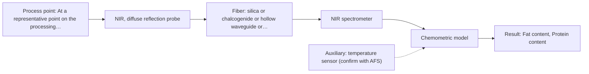
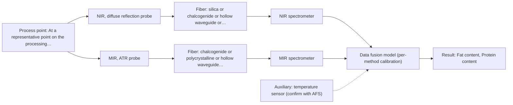

# First technical assessment: Fat and protein monitoring in opaque dairy product

## Answer

**Customer request (our summary):** Customer wants an initial spectroscopy concept and a practical comparison experiment for earlier information about composition changes in an opaque, concentrated milk product on a processing line, while retaining laboratory checks.

### Brief answer

Test NIR diffuse reflection first on representative samples, with MIR ATR as the single-method comparison. Retain laboratory fat and protein checks as the reference. The open points are target ranges, required accuracy and response time, product texture/temperature range, and installation/cleaning constraints; these decide whether NIR alone is enough or a fused NIR+MIR model is worth testing.

### Proposal

- **Best current option:** O2 (recommended)
- **Basis:** supplied AFS sources
- **What would change it:** If the required composition changes are below NIR sensitivity, or if texture/temperature variation dominates the spectra, the MIR ATR comparison or the fused NIR+MIR option would move ahead. A different installation or cleaning constraint could also rule out a contact ATR probe.
- **Next step:** Run a paired comparison of NIR diffuse reflection against the retained laboratory fat and protein reference on representative samples across the stated variation.

**Secondary evidence (external, not AFS material):** G1: E01 ¶12, E02 ¶19; G2: E03 ¶82, E03 ¶36; G3: E02 ¶8; G4: no usable external source found. See Expert detail.

**Decision status:** Provisional feasibility assessment

### Solution options

| ID | Tier | Methods | Confidence | Cost class, S01 Table 1 (p.6) | Ease of use | Maintenance | Performance fit | Sources |
|---|---|---|---|---|---|---|---|---|
| O1 | Simple | M2 MIR, ATR probe | Low: open question: Q1 (starts at Medium); uncited auxiliary sensor | high cost (row 2) | single contact probe, moderate handling | ATR crystal cleaning and fouling checks | adds molecular specificity NIR may miss | [1: S01 p.10] [2: S01 p.18] [3: S01 p.13] |
| O2 | Recommended | M1 NIR, diffuse reflection probe | Low: open question: Q1 (starts at Medium); uncited auxiliary sensor | average cost (row 8) | fiber probe, remote measurement | probe window cleaning, calibration updates | suited to opaque concentrated dairy streams | [4: S01 p.17] [5: S01 p.17] [6: S01 p.10] |
| O3 | Extended (multi-method) | M3 NIR, diffuse reflection probe + MIR (combination) | Low: open question: Q1 (starts at Medium); uncited auxiliary sensor; multi-method, fusion benefit not yet shown | high cost (rows 2, 8) | two instruments, more setup | two probes, synchronised calibration | tests whether fused data beats NIR alone | [7: S01 p.7] [8: S01 p.8] [9: S01 p.8] |

*Confidence rates the basis of the advice (how much is known and cited), not a predicted accuracy or probability of success. It starts at High, or at Medium when a key question on the method or the option is open, and drops one level per weakness listed (floor Low).*

*Cost class is the relative rating in S01 Table 1 (p.6) for the in-line method+technique rows named (the highest one for a multi-method option); it is not a price.*

### Setup sketch

*Recommended option O2; drawn by code from the option, a schematic, not a configuration.*

### Key questions

1. What are the target ranges and required accuracy, precision, detection limit and response time for fat and protein, and what smallest composition change must be detected?
2. Is the product always liquid, or can it be paste-like or variable in texture, and what are the temperature range and variation during production?
3. Where on the line can a probe be installed, and what are the pressure, flow, cleaning and fouling conditions?

## Expert detail

**Customer enquiry**

> We produce an opaque, concentrated milk product that flows through a processing line. We currently sample it for fat and protein analysis and would like earlier information about composition changes. Product temperature and texture vary during production. We want an initial spectroscopy concept and a practical comparison experiment, while retaining our laboratory checks.

**Decision status:** Provisional feasibility assessment. A method shortlist can be justified from the dairy example, but the customer's target ranges, accuracy, response time and installation constraints are missing, so the assessment is provisional.

### Parameters

| ID | Parameter | Kind | Need | Measured by | Why | Sources |
|---|---|---|---|---|---|---|
| P1 | Fat content | quantitative | required | Spectroscopy: NIR | Fat is one of the two composition targets and a main milk component. | [5: S01 p.17] |
| P2 | Protein content | quantitative | required | Spectroscopy: NIR | Protein is the other stated composition target. | [5: S01 p.17] |
| P3 | Product temperature | quantitative | required | Auxiliary sensor: temperature sensor (engineering judgement: confirm availability with AFS) | Product temperature varies during production and affects spectra and physical state. | *(no verified source: engineering judgement)* |
| P4 | Texture or viscosity | quantitative | optional | Reference lab method: laboratory viscosity or texture measurement | Texture varies during production and changes light scattering, so it should be available to separate physical from chemical variation. | [10: S01 p.17] |

### Solution option details

- **O1 cost drivers:** MIR ATR probe, MIR fiber, spectrometer, calibration samples, reference analysis
- **O2 cost drivers:** NIR probe and spectrometer, calibration samples, reference laboratory analysis
- **O3 cost drivers:** two probes or spectrometers, synchronisation, per-method calibration, reference analysis
- **O3 combining methods:** Low-level fusion of NIR diffuse reflection and MIR ATR is the later hypothesis, not the first test. Both probes must view the same product volume, data must be synchronised to a common time step, and each method needs its own calibration. The fused model must beat the best single method on held-out batches, otherwise the extra MIR channel is dropped.

*Extended (multi-method) option O3; drawn by code from the option, a schematic, not a configuration.*

### Premise check

- **Supported:** Spectroscopy can provide earlier information about composition changes than the current sampling and laboratory checks. The supplied concept page states that online fiber-probe analysis allows in-process measurement without sampling and without the associated delays. [11: S01 p.3]
- **Supported:** An initial spectroscopy concept can be defined before the deciding facts are known. The supplied guidance explicitly allows a conditional shortlist with stated assumptions when facts are incomplete. [12: REF §3]
- **Not covered:** A practical comparison experiment can be designed without specifying target ranges, accuracy, detection limits or response time. No supplied page states that a comparison experiment can omit these criteria; the guidance asks for a go/no-go basis, which needs customer-defined numbers. *(no verified source: engineering judgement)*

### Requirements

**Stated by the customer**

- fat and protein composition analysis
- earlier information about composition changes
- retain laboratory checks
- opaque, concentrated milk product flowing through a processing line
- product temperature and texture vary during production

**Key unknowns**

- Target concentration ranges and required accuracy, precision, detection limit and response time for fat and protein.
- The smallest composition change and the time scale that must be detected.
- Whether the product is always liquid or sometimes paste-like, and the temperature range and variation.
- The installation point, pressure/flow and cleaning/fouling constraints on the line.
- The reference laboratory method, sampling frequency and ability to take paired samples at the probe location.
- Whether in-line, at-line or online measurement is required.

### Clarification questions (most decision-relevant first)

Q1. What are the target ranges and required accuracy, precision, detection limit and response time for fat and protein, and what smallest composition change must be detected? *Why it matters:* These values set the go/no-go criteria and decide whether NIR sensitivity is sufficient. *(affects: method)*
Q2. Is the product always liquid, or can it be paste-like or variable in texture, and what are the temperature range and variation during production? *Why it matters:* Texture and temperature affect the choice of NIR geometry, ATR contact and spectral compensation. *(affects: technique)*
Q3. Where on the line can a probe be installed, and what are the pressure, flow, cleaning and fouling conditions? *Why it matters:* These determine whether an in-line probe is practical and what maintenance is needed. *(affects: installation)*
Q4. What is the reference laboratory method and sampling frequency for fat and protein, and can paired samples be taken at the proposed probe location? *Why it matters:* The comparison needs independent reference values matched to the spectral samples. *(affects: status)*
Q5. Is in-line, at-line or online measurement required, and what response time counts as earlier information? *Why it matters:* This decides the measurement configuration and whether continuous tracking is needed. *(affects: technique)*

### Recommendation

- **M1 · Primary candidate: NIR, diffuse reflection probe.** NIR diffuse reflection is the primary test because the supplied dairy example uses it for opaque or highly concentrated products and quantifies fat and protein with PLS. NIR bands overlap, so a matrix-specific chemometric calibration is part of the test. *Conditions:* Applies if the product is truly opaque/highly scattering and the target changes are within NIR sensitivity; confirm on representative samples. [4: S01 p.17] [5: S01 p.17] [6: S01 p.10]
- **M2 · Comparison candidate: MIR, ATR probe.** MIR ATR is a single-method comparison because it can measure liquids and soft solids by contact and adds molecular information NIR may miss. It is not the first choice for an opaque flowing dairy stream because it samples only a thin surface layer. *Conditions:* Applies if the product is liquid or paste-like and can contact the ATR crystal without rapid fouling. [1: S01 p.10] [2: S01 p.18] [3: S01 p.13]
- **M3 · Conditional candidate: NIR, diffuse reflection probe + MIR (combination).** A fused NIR + MIR ATR model is a later hypothesis: NIR is suited to opaque dairy, while MIR ATR can add molecular specificity NIR may miss. It should be tested only after the single-method runs and must beat the best single method on held-out batches. *Conditions:* Applies only if NIR alone does not meet the agreed targets and both probes can sample the same product volume with synchronised data. [7: S01 p.7] [8: S01 p.8] [9: S01 p.8]

### Measurement concept

- **Probe and geometry:** Start with a fiber-optic NIR diffuse-reflection probe viewing the flowing product; compare with a contact MIR ATR probe on the same samples; consider a combined NIR + MIR ATR probe only after single-method tests.
- **Location:** At a representative point on the processing line where the product is well mixed and accessible for a probe and paired reference sampling.
- **Fiber link:** NIR uses silica Vis-NIR fibers; MIR needs CIR or PIR fibers or hollow waveguides. Exact fiber length and installation are not defined in the supplied material. [13: S02 p.6] [14: S02 p.6]

### Spectral range

- **NIR:** Nominal NIR range 780-2500 nm; the usable range depends on the instrument, fiber and probe actually selected. [15: S01 p.10] [16: REF §5]
- **MIR:** Nominal MIR range 4000-400 cm-1; the usable range depends on the fiber, crystal and probe actually selected. [17: S01 p.9]

### Risks and uncertainty

- NIR reflection is sensitive to surface characteristics and fat globule size, so texture variation could be mistaken for composition change. *(rules: R-GEO-6)* [10: S01 p.17]
- NIR may lack sensitivity for small or trace composition changes, so the required detection limit may not be met. *(rules: R-NIR-4)* [18: S01 p.16]
- MIR ATR samples only a thin surface layer and is prone to contact and fouling problems with concentrated milk. *(rules: R-MIR-3)* [3: S01 p.13] [19: REF §5]
- Calibrations are matrix-specific, so a change in product composition or texture may require revalidation. *(rules: R-CAL-1)* [20: REF §5]

### First feasibility experiment

1. **Collect representative samples or process states across the expected fat/protein levels, temperature/texture variation and batches; record the process conditions.** Cover the expected chemical and physical variation. [21: REF §3]
2. **Measure each sample first by NIR diffuse reflection; run MIR ATR as a separate single-method comparison on the same samples.** Test the single methods before any combination. *(no verified source: engineering judgement)*
3. **Obtain independent laboratory reference values for fat, protein, temperature and texture/viscosity from the retained checks.** Provide an independent reference for calibration and validation. [22: REF §3]
4. **Build one calibration per method and validate on held-out runs or batches; compare each single method with the current laboratory sampling.** Check performance on independent material, not only calibration data. [23: S01 p.10]
5. **Set the go/no-go basis with the customer's numerical criteria for accuracy, precision and the smallest composition change to detect; only then test a fused NIR+MIR model against the best single method.** Define the decision basis and avoid adding the second method without evidence. [24: REF §3]

**Reference measurements:** Retain the existing laboratory fat and protein checks and use them as the independent reference for the comparison.

**Decision basis:** The go/no-go criteria must be provided by the customer; the supplied sources do not define accuracy or detection limits for this product.

### Assumptions

- The product is sufficiently opaque and scattering for NIR diffuse reflection to carry composition information.
- The product can be accessed at a representative line point without excessive fouling or pressure problems.
- The existing laboratory checks can provide paired reference values for the spectral samples.
- Temperature and texture variation can be recorded and included in the calibration or compensated separately.

### Not covered by the supplied sources

- A product-specific calibration for this opaque concentrated milk product.
- Accuracy, precision, detection limits or response time for fat and protein in this product.
- A specific probe installation, cleaning/fouling procedure or fiber length for this line.
- A customer-defined go/no-go criterion for the comparison experiment.

### Further notes

- **Chemometrics:** NIR and MIR data need matrix-specific calibration models; use independent reference values and validate on held-out batches. NIR broad overlapping bands make chemometrics necessary.
- **Real-time tracking:** Fiber probes can support in-line or online measurement with near real-time results, but the required response time and installation point are not yet defined.
- **Future direction:** After single-method tests, a fused NIR + MIR ATR model is the later extension to test if NIR alone misses target changes.

### Secondary evidence (external, not AFS material)

*Found by a literature search for gaps the supplied AFS sources leave open. Not AFS material and not proof for this case; every quote below was verified verbatim against the fetched text.*

*Live search unavailable (library only: cache miss (europepmc); cache miss (openalex)); curated library only.*

**G1 · auxiliary sensor:** In-line measurement of Product temperature with temperature sensor

- **E01 ¶12** The source notes that temperature sensitivity of OH bands is a severe drawback for aqueous solutions in NIR and MIR, making tempered sample holders necessary. *How it applies:* For an opaque concentrated milk product with high water content, this suggests temperature should be measured and controlled during in-line NIR measurement, and temperature variation should be included in testing. *Limits and transfer risks:* This is a review statement from biopharmaceutical downstream processing, not a milk or in-line dairy study; tempered sample holders are a laboratory measure and may not transfer directly to a process line. *(supports O2)*
  > "Additionally, the temperature sensitivity of the OH bands is a severe drawback for measuring aqueous solution in NIR and MIR, which makes tempered sample holders necessary [29]."
  > A critical review of recent trends, and a future perspective of optical spectroscopy as PAT in biopharmaceutical downstream processing. (2020) · Analytical and bioanalytical chemistry · doi:10.1007/s00216-020-02407-z · https://europepmc.org/article/PMC/PMC7072065 · retrieved 2026-10-17, full text, licence: cc by, via curated library
- **E02 ¶19** The source varied temperature together with concentrations and ionic strength to obtain a robust model. *How it applies:* This supports treating product temperature as a measured variable during calibration and robustness testing for the in-line NIR concept. *Limits and transfer risks:* The work concerns reactive liquid-liquid extraction in lithium recycling, not milk or dairy processing; the temperature variation was part of model building rather than an in-line temperature-sensor study. *(supports O2)*
  > "The concentrations of nitric acid and hydrochloric acid as well as the ionic strength and temperature were varied to obtain a robust model."
  > Process Analytical Technology-Integrated FT-IR and Raman Spectroscopies for Efficient Reactive Liquid-Liquid Extraction Processing in Lithium Recycling. (2025) · ACS omega · doi:10.1021/acsomega.5c05705 · https://europepmc.org/article/PMC/PMC12573149 · retrieved 2026-10-17, full text, licence: cc by, via curated library

**G2 · multi-method:** Combining several spectroscopy methods (data fusion) (Low-level fusion of NIR diffuse reflection and MIR ATR is the later hypothesis, not the first test. Both probes must view the same product volume, data must be synchronised to a common time step, and each method needs its own calibration. The fused model must beat the best single method on held-out batches, otherwise the extra MIR channel is dropped.)

- **E03 ¶82** Before fusing data from multiple sources, the source says it is essential to evaluate each dataset's contribution to the model and its complementarity. *How it applies:* For a later NIR plus MIR low-level fusion hypothesis, this suggests first checking whether the MIR data adds useful information beyond NIR before keeping the extra channel. *Limits and transfer risks:* This is a review statement on data fusion in process analytical technology, not a milk-specific NIR/MIR study; it does not address same-volume viewing or time synchronisation. *(supports O3)*
  > "Before fusing data from multiple sources, it is essential to evaluate the contribution of each dataset to the model and its complementarity."
  > Challenges and Opportunities of Implementing Data Fusion in Process Analytical Technology-A Review. (2022) · Molecules (Basel, Switzerland) · doi:10.3390/molecules27154846 · https://europepmc.org/article/PMC/PMC9369811 · retrieved 2026-10-17, full text, licence: cc by, via curated library
- **E03 ¶36** The source reports situations where instrument complementarity alone was not sufficient to improve prediction of several CQAs in a Raman and FT-IR food analytical study. *How it applies:* This cautions that adding MIR to NIR should be tested against the best single method on held-out batches rather than assumed to improve performance. *Limits and transfer risks:* The cited example used Raman and FT-IR on food samples, not NIR diffuse reflection and MIR ATR on concentrated milk; laboratory results may not transfer to an in-line dairy process. *(supports O3)*
  > "In some situations, instrument complementarity (not data complementarity) was not sufficient to improve the performance of predictive several CQAs, as shown by a Raman and FT-IR data based food analytical study [73]."
  > Challenges and Opportunities of Implementing Data Fusion in Process Analytical Technology-A Review. (2022) · Molecules (Basel, Switzerland) · doi:10.3390/molecules27154846 · https://europepmc.org/article/PMC/PMC9369811 · retrieved 2026-10-17, full text, licence: cc by, via curated library

**G3 · not in the supplied sources:** A product-specific calibration for this opaque concentrated milk product.

- **E02 ¶8** For a continuous process at a fixed probe location operating in a steady-state window, the source says calibrations can be narrower and centered on the operational envelope, with validation using independent steady-state runs. *How it applies:* This could inform a product-specific calibration strategy by defining the product and process operational envelope, using independent batches or runs for validation, and monitoring drift and out-of-specification conditions. *Limits and transfer risks:* The source concerns reactive liquid-liquid extraction in lithium recycling, not an opaque concentrated milk product; the steady-state assumption and process behaviour may differ on a dairy line.
  > "In contrast, a continuous process at a fixed probe location is intended to operate in a steady-state window, which simplifies the model design: calibrations can be narrower and centered on the operational envelope, validation can rely on independent steady-state runs, and online monitoring focuses on drift and out-of-specification detection rather than resolving the rapidly changing composition."
  > Process Analytical Technology-Integrated FT-IR and Raman Spectroscopies for Efficient Reactive Liquid-Liquid Extraction Processing in Lithium Recycling. (2025) · ACS omega · doi:10.1021/acsomega.5c05705 · https://europepmc.org/article/PMC/PMC12573149 · retrieved 2026-10-17, full text, licence: cc by, via curated library

**G4 · not in the supplied sources:** Accuracy, precision, detection limits or response time for fat and protein in this product.

- No usable external source found.

### Evidence (verified quotes)

1. ✓ **S01 p.10** (general): "ATR fiber probes (Fig.1) enable the analysis of liquids and solid elastic samples"
2. ✓ **S01 p.18** (application precedent): "advanced labs often incorporate Fluorescence, Raman, and Mid-Infrared (MIR) ATR fiber optic techniques to capture specific chemical or structural information that NIR might miss."
3. ✓ **S01 p.13** (general): "typically at a depth of few microns"
4. ✓ **S01 p.17** (application precedent): "NIR Reflection is primarily used for opaque or highly concentrated dairy products, such as yogurt, butter, or whole milk concentrates."
5. ✓ **S01 p.17** (application precedent): "using Partial Least Squares (PLS) regression to quantify fat and protein."
6. ✓ **S01 p.10** (general): "The broad absorption bands observed in this region overlap, suggesting the use of chemometrics for quantitative and qualitative analysis of spectral data."
7. ✓ (precedent only) **S01 p.7** (method gain): "The analysis of such systems may require a combination of two or even more spectral methods."
8. ✓ **S01 p.8** (general): "It is crucial that the spectral information obtained by different methods-Mid-IR, NIR, Raman, and fluorescence spectra-is collected from the same small, even pinpoint, area of the sample."
9. ✓ **S01 p.8** (general): "Ultimately, the measurement data must be normalized to a common time step."
10. ✓ **S01 p.17** (general): "the method is sensitive to the surface characteristics and fat globule size."
11. ✓ **S01 p.3** (general): "It allows for in-process analysis, i.e., directly in the process flow or reactor without sampling, eliminating delays and the risk of sample contamination."
12. ✓ **REF §3** (general): "A conditional shortlist with explicit assumptions is also fine."
13. ✓ **S02 p.6** (general): "350 nm Standard VIS-NIR Silica Fibers Al/Cu-coated VIS-NIR Silica Fibers 2400 nm"
14. ✓ **S02 p.6** (general): "1100 nm Chalcogenide As-S IR Fibers 6500 nm"
15. ✓ **S01 p.10** (general): "NIR spectra (780-2500 nm) contain predominantly overtones and component bands of fundamental vibrations"
16. ✓ **REF §5** (general): "It is not a product specification: actual spectral coverage, fiber length, component ratings, detection limits and accuracy depend on the configuration and the sample."
17. ✓ **S01 p.9** (general): "Vibrational spectroscopy in the mid-IR range (4000-400 cm-1) is one of the most informative methods of chemical analysis."
18. ✓ **S01 p.16** (general): "may lack the sensitivity to detect trace compounds below 0.1 percent."
19. ✓ **REF §5** (general): "Usable range limited by fiber and crystal; contact, fouling, compatibility."
20. ✓ **REF §5** (general): "calibration specific to the matrix."
21. ✓ **REF §3** (general): "Representative samples or process states"
22. ✓ **REF §3** (general): "independent reference measurements"
23. ✓ **S01 p.10** (general): "suggesting the use of chemometrics for quantitative and qualitative analysis of spectral data."
24. ✓ **REF §3** (general): "the basis for the go / no-go decision."

### Verification

- Citations verified: 36 of 36 (exact or whitespace/hyphen-tolerant match on the cited page, scope checked).
- Hard check failures before deterministic corrections: 0; still open: 0; soft warnings: 4; repair rounds: 0.
- Corrected deterministically after verification (1):
  - ⚠ recommendations[2].combined_with: combined_with normalised to ['MIR'] (duplicates and the entry's own method removed)
- Removed 1 intake item(s) not quoted verbatim from the enquiry:
  - intake.targets[0]: enquiry_quote not found verbatim in the enquiry
- External evidence (cache): 5 quote(s) verified verbatim (exact or whitespace/hyphen-tolerant, at most 400 characters and 2 sentences, against the cited paragraph); 0 item(s) dropped.
- External search: 6 query(ies), 0 hit(s), 3 source(s) (3 from the curated library); ⚠ library only: cache miss (europepmc); cache miss (openalex).
- External step: 2 model call(s), 31.5 s extra (cost in the run JSON).

*Run D02-20261018T075900Z-01ab · models deepseek/deepseek-v4.1-flash-1017*
