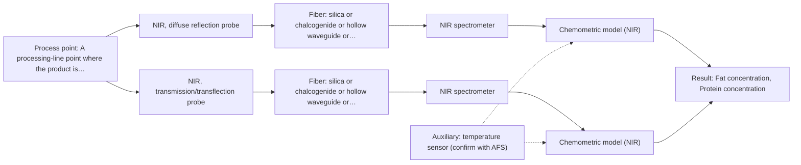
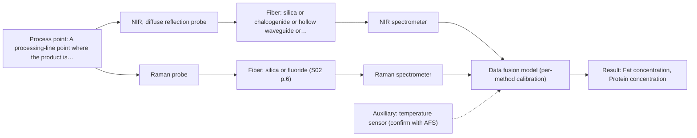

# First technical assessment: Fat and protein monitoring in opaque dairy product

## Answer

**Customer request (our summary):** The customer wants an in-line spectroscopy concept to monitor fat and protein changes in a flowing, opaque milk product.

### Brief answer

Start with an in-line NIR diffuse-reflection probe flush-mounted in the line, calibrated against your existing laboratory fat and protein analyses across the full temperature and texture range; test a transflection insert at the same port as a fallback. Raman is a second method worth measuring on the same samples, with a combined NIR+Raman option only if single methods fall short. Open points: concentration ranges, temperature/texture window, installation point, and required accuracy and response time.

### Proposal

- **Best current option:** O2 (recommended)
- **Basis:** supplied AFS sources
- **What would change it:** If the transflection insert shows no adequate signal in the concentrated product, the concept reduces to O1 with reflection only; if reflection cannot separate composition from texture effects, the extended NIR+Raman option O3 becomes relevant.
- **Next step:** Run the multi-method feasibility trial on representative product samples with laboratory reference analysis and customer-defined go/no-go criteria.

**Secondary evidence (external, not AFS material):** G1: E03 ¶12; G2: E02 ¶8; G3: no usable external source found; G4: no usable external source found. See Expert detail.

**Decision status:** Provisional feasibility assessment

### Solution options

| ID | Tier | Methods | Confidence | Cost class, S01 Table 1 (p.6) | Ease of use | Maintenance | Performance fit | Sources |
|---|---|---|---|---|---|---|---|---|
| O1 | Simple | M1 NIR, diffuse reflection probe | Low: open question: Q1 (starts at Medium); uncited auxiliary sensor | average cost (row 8) | Single probe, straightforward installation | Low; one probe and window cleaning | Directly targets opaque dairy composition monitoring | [1: S01 p.17] [2: S01 p.17] [3: S01 p.5] |
| O2 | Recommended | M1 NIR, diffuse reflection probe; M3 NIR, transmission/transflection probe | Low: open question: Q1 (starts at Medium); suitability for this sample not confirmed; uncited auxiliary sensor | average cost (rows 7, 8) | Two probe variants, one spectrometer | Moderate; two optical interfaces to keep clean | Covers texture variation via reflection plus transflection fallback | [1: S01 p.17] [2: S01 p.17] [3: S01 p.5] [4: S01 p.18] [5: S01 p.18] |
| O3 | Extended (multi-method) | M4 NIR, diffuse reflection probe + Raman (combination) | Low: open question: Q1 (starts at Medium); uncited auxiliary sensor; multi-method, fusion benefit not yet shown | high cost (rows 8, 12) | Two instruments, more complex operation | Higher; two calibrations and diagnostics to maintain | Adds molecular specificity where NIR scatter ambiguity remains | [6: S01 p.15] [7: S01 p.8] [8: S01 p.15] [9: S01 p.8] |

*Confidence rates the basis of the advice (how much is known and cited), not a predicted accuracy or probability of success. It starts at High, or at Medium when a key question on the method or the option is open, and drops one level per weakness listed (floor Low).*

*Cost class is the relative rating in S01 Table 1 (p.6) for the in-line method+technique rows named (the highest one for a multi-method option); it is not a price.*

### Setup sketch

*Recommended option O2; drawn by code from the option, a schematic, not a configuration.*

### Key questions

1. What are the expected fat and protein concentration ranges, and how large are the composition changes you need to detect?
2. Over what temperature and texture (e.g. viscosity, fat globule size) range does the product vary during production?
3. Where on the line could a probe be mounted, and is flush contact with the flowing product possible?

## Expert detail

**Customer enquiry**

> We produce an opaque, concentrated milk product that flows through a processing line. We currently sample it for fat and protein analysis and would like earlier information about composition changes. Product temperature and texture vary during production. We want an initial spectroscopy concept and a practical comparison experiment, while retaining our laboratory checks.

**Decision status:** Provisional feasibility assessment. In-line NIR reflection for opaque dairy is a documented application pattern, but the customer's concentration ranges, temperature window and installation point are unknown, so the concept stays provisional until the feasibility trial.

### Parameters

| ID | Parameter | Kind | Need | Measured by | Why | Sources |
|---|---|---|---|---|---|---|
| P1 | Fat concentration | quantitative | required | Spectroscopy: NIR | Fat is one of the two target variables the in-line model must predict. | [10: S01 p.17] |
| P2 | Protein concentration | quantitative | required | Spectroscopy: NIR | Protein is the second target variable the in-line model must predict. | [10: S01 p.17] |
| P3 | Product temperature | quantitative | required | Auxiliary sensor: temperature sensor (engineering judgement: confirm availability with AFS) | Temperature varies during production and shifts the spectra, so it must be recorded for the calibration. | *(no verified source: engineering judgement)* |
| P4 | Texture / fat globule size state | qualitative | optional | Reference lab method: laboratory rheology / microscopy characterisation | Texture variation drives scatter effects in reflection spectra and should be characterised to design the calibration; it should be available from process knowledge or lab rheology. | [2: S01 p.17] |

### Solution option details

- **O1 cost drivers:** One NIR spectrometer, reflection probe, silica cable, calibration samples and lab reference analyses
- **O2 cost drivers:** NIR spectrometer, reflection and transflection probes, calibration across temperature and texture range, lab references
- **O3 cost drivers:** Second spectrometer (Raman), probe or combined probe, synchronised data handling, larger calibration set
- **O3 combining methods:** Low-level fusion: synchronised NIR reflection and Raman spectra merged into one augmented matrix, as in the published feed-frame example. Both probes must sample the same product volume at the same port, with data normalised to a common time step. Each method keeps its own calibration block, and the fused model must beat the best single method on held-out runs before the second instrument is kept.

*Extended (multi-method) option O3; drawn by code from the option, a schematic, not a configuration.*

### Premise check

- **Precedent only:** In-line spectroscopy can give earlier information on fat and protein changes in a dairy process. Inline NIR monitoring of milk fat and protein is described as established dairy PAT practice; this is a reason to test, not proof for this specific concentrated product. [11: S01 p.17]
- **Precedent only:** An opaque, concentrated milk product can be measured in-line despite its opacity. NIR reflection is described for opaque, concentrated dairy products flush-mounted in a pipe or vat; whether it covers this product's texture and temperature variation must be tested. [1: S01 p.17]

### Requirements

**Stated by the customer**

- Earlier information about fat and protein composition changes than current sampling
- Retention of existing laboratory checks
- An initial spectroscopy concept
- A practical comparison experiment

**Key unknowns**

- Fat and protein concentration ranges to be covered
- Temperature and texture (e.g. fat globule size) variation range
- Installation point and probe/flow-cell access on the line
- Required accuracy and response time
- Degree of product heterogeneity at the measurement point

### Clarification questions (most decision-relevant first)

Q1. What are the expected fat and protein concentration ranges, and how large are the composition changes you need to detect? *Why it matters:* The ranges set the calibration span and determine whether NIR reflection sensitivity is sufficient. *(affects: method, status)*
Q2. Over what temperature and texture (e.g. viscosity, fat globule size) range does the product vary during production? *Why it matters:* Reflection signals are sensitive to surface characteristics and globule size, so this variation defines the calibration design and scatter correction. *(affects: technique, installation)*
Q3. Where on the line could a probe be mounted, and is flush contact with the flowing product possible? *Why it matters:* Reflection probes are flush-mounted into the pipe or vat; the available port decides the installation concept. *(affects: installation)*
Q4. What accuracy and response time do you need compared with your current laboratory checks? *Why it matters:* This sets the go/no-go criteria for the feasibility trial and whether chemometric calibration effort is justified. *(affects: status)*
Q5. How homogeneous is the product at the proposed measurement point, and does texture vary independently of composition? *Why it matters:* Inhomogeneity and turbulence influence technique choice and whether a single measurement point is representative. *(affects: technique, installation)*

### Recommendation

- **M1 · Primary candidate: NIR, diffuse reflection probe.** NIR reflection is the documented in-line technique for opaque, concentrated dairy products, flush-mounted into the pipe or vat, and NIR suits remote fiber-probe measurement. Its reflection signal responds to both composition and scattering morphology, which must be handled by calibration. *Conditions:* Calibration must cover the full temperature and texture variation and apply scatter correction. [1: S01 p.17] [2: S01 p.17] [3: S01 p.5]
- **M2 · Comparison candidate: Raman probe.** Raman tolerates water well and adds molecular specificity that NIR may miss in dairy, so it is worth measuring on the same samples as a second opinion. Its weak signal and possible fluorescence background must be checked on the real product. [12: S01 p.16] [13: S01 p.18]
- **M3 · Conditional candidate: NIR, transmission/transflection probe.** A transflection probe can in some cases serve both low-fat and high-fat dairy products with one spectrometer, which would simplify the installation if it proves robust for this concentrated product. Transmission alone fails for opaque, fat-rich samples, so only the transflection variant should be tested. *Conditions:* Only if the feasibility trial shows adequate signal penetration in the concentrated product. [4: S01 p.18] [5: S01 p.18]
- **M4 · Conditional candidate: NIR, diffuse reflection probe + Raman (combination).** If NIR reflection alone cannot separate composition change from texture-driven scatter effects, a combined NIR and Raman measurement is a published pattern for capturing complementary chemical information. Any fusion gain is a hypothesis that must beat the best single method. *Conditions:* Only after the single-method tests, and only if M1 alone misses part of the target variation. [8: S01 p.15] [9: S01 p.8]

### Measurement concept

- **Probe and geometry:** NIR diffuse-reflection fiber probe, flush-mounted into the pipe or vat wall in contact with the flowing product; transflection insert tested as an alternative at the same port.
- **Location:** A processing-line point where the product is well mixed and temperature is representative; exact port to be chosen with the customer.
- **Fiber link:** Vis-NIR silica fiber cable from the probe to the spectrometer placed away from vibration and dust; usable NIR range depends on the selected fiber and instrument. [14: S01 p.17] [15: S01 p.15]

### Spectral range

- **NIR:** Nominal NIR range 780-2500 nm; the usable range depends on the spectrometer, Vis-NIR silica fiber and reflection probe actually selected. [16: S01 p.10]
- **Raman:** Raman shift in cm-1 with the laser excitation wavelength (e.g. 785 nm in the published feed-frame example) stated separately; exact range depends on the selected spectrometer and probe. [17: S01 p.11] [18: S01 p.15]

### Risks and uncertainty

- Reflection signals respond to surface characteristics and fat globule size, so texture variation can mimic composition change unless the calibration covers it. *(rules: R-GEO-6)* [2: S01 p.17]
- NIR bands are broad and overlapping, so quantitative fat and protein values require a chemometric calibration specific to this product matrix. *(rules: R-NIR-2, R-CAL-1)* [19: S01 p.10]
- Raman signals are weak and can be swamped by fluorescence background in a biological product such as concentrated milk. *(rules: R-RAM-1)* [20: S01 p.11]
- Sample inhomogeneity and process turbulence at the probe position could make a single measurement point unrepresentative. *(rules: R-GEN-5)* [21: S01 p.7]

### First feasibility experiment

1. **Collect representative product samples across the expected fat, protein, temperature and texture variation, including start-up and changeover states.** Cover the calibration space the in-line model must handle. *(no verified source: engineering judgement)*
2. **Measure all samples with the NIR reflection probe (and, in parallel, the transflection insert and Raman probe) under controlled geometry, recording product temperature with a sensor.** Compare the candidate techniques on identical samples before any installation decision. *(no verified source: engineering judgement)*
3. **Send split portions to the existing laboratory for reference fat and protein analysis as the independent reference method.** Anchor the spectral models to the customer's retained laboratory checks. *(no verified source: engineering judgement)*
4. **Build per-method chemometric calibration models with scatter correction, validate on held-out production runs or batches, and only then test any NIR+Raman fusion against the best single method.** Single methods first; a fusion gain must be demonstrated, not assumed. [22: S01 p.17]
5. **Define the go/no-go basis with the customer: agreed prediction error limits for fat and protein on held-out runs, and required response time.** Make the decision criterion numerical and owned by the customer. *(no verified source: engineering judgement)*

**Reference measurements:** Existing laboratory fat and protein analysis on split samples

**Decision basis:** Customer-defined prediction error limits for fat and protein on held-out runs, plus required response time

### Assumptions

- The product remains a flowable liquid at the measurement point despite texture variation.
- A probe port with product contact can be made available on the line.
- Laboratory fat and protein analysis can serve as the reference method during calibration.

### Not covered by the supplied sources

- Achievable in-line accuracy for fat and protein in this specific concentrated product
- Suitable installation point and probe design for the customer's line

### Further notes

- **Chemometrics:** A PLS calibration for fat and protein will need reference values from the retained laboratory checks across the full temperature and texture range; scatter correction (MSC or SNV) is the published starting point for scattering dairy products, and the model must be validated on held-out runs.
- **Real-time tracking:** The goal is continuous in-line tracking of composition changes; once calibrated, the probe gives near-real-time trends that trigger laboratory sampling when a change is detected.
- **Future direction:** If the feasibility trial succeeds, a compact LED-based NIR sensor at selected wavelengths could later replace the full spectrometer for routine monitoring, following the published wavelength-selection approach.

### Secondary evidence (external, not AFS material)

*Found by a literature search for gaps the supplied AFS sources leave open. Not AFS material and not proof for this case; every quote below was verified verbatim against the fetched text.*

*Live search unavailable (library only: cache miss (europepmc); cache miss (openalex)); curated library only.*

**G1 · auxiliary sensor:** In-line measurement of Product temperature with temperature sensor

- **E03 ¶12** The study notes that the temperature sensitivity of the OH bands is a severe drawback for measuring aqueous solutions in NIR and MIR, requiring tempered sample holders. *How it applies:* This highlights that product temperature fluctuations could impact NIR measurements in aqueous dairy products, suggesting that testing temperature compensation or sample conditioning might be necessary. *Limits and transfer risks:* The source discusses biopharmaceutical downstream processing and general aqueous solutions rather than an in-line flowing opaque milk product, so thermal dynamics may differ. *(supports O2)*
  > "Additionally, the temperature sensitivity of the OH bands is a severe drawback for measuring aqueous solution in NIR and MIR, which makes tempered sample holders necessary [29]."
  > A critical review of recent trends, and a future perspective of optical spectroscopy as PAT in biopharmaceutical downstream processing. (2020) · Analytical and bioanalytical chemistry · doi:10.1007/s00216-020-02407-z · https://europepmc.org/article/PMC/PMC7072065 · retrieved 2026-10-17, full text, licence: cc by, via curated library

**G2 · multi-method:** Combining several spectroscopy methods (data fusion) (Low-level fusion: synchronised NIR reflection and Raman spectra merged into one augmented matrix, as in the published feed-frame example. Both probes must sample the same product volume at the same port, with data normalised to a common time step. Each method keeps its own calibration block, and the fused model must beat the best single method on held-out runs before the second instrument is kept.)

- **E02 ¶8** Continuous processes at a fixed probe location can operate in a steady-state window, simplifying model design by allowing narrower calibrations centered on the operational envelope. *How it applies:* This suggests that if data fusion methods are implemented, establishing a steady-state operating window could simplify the calibration and validation of the combined models. *Limits and transfer risks:* The source refers to liquid-liquid extraction in lithium recycling rather than milk processing, and does not specifically address multi-method sensor fusion. *(supports O3)*
  > "In contrast, a continuous process at a fixed probe location is intended to operate in a steady-state window, which simplifies the model design: calibrations can be narrower and centered on the operational envelope, validation can rely on independent steady-state runs, and online monitoring focuses on drift and out-of-specification detection rather than resolving the rapidly changing composition."
  > Process Analytical Technology-Integrated FT-IR and Raman Spectroscopies for Efficient Reactive Liquid-Liquid Extraction Processing in Lithium Recycling. (2025) · ACS omega · doi:10.1021/acsomega.5c05705 · https://europepmc.org/article/PMC/PMC12573149 · retrieved 2026-10-17, full text, licence: cc by, via curated library

**G3 · not in the supplied sources:** Achievable in-line accuracy for fat and protein in this specific concentrated product

- No usable external source found.

**G4 · not in the supplied sources:** Suitable installation point and probe design for the customer's line

- No usable external source found.

### Evidence (verified quotes)

1. ✓ **S01 p.17** (application precedent): "NIR Reflection is primarily used for opaque or highly concentrated dairy products, such as yogurt, butter, or whole milk concentrates."
2. ✓ **S01 p.17** (general): "the method is sensitive to the surface characteristics and fat globule size."
3. ✓ **S01 p.5** (general): "making it ideal for online applications, including remote measurements via fiber optic probes."
4. ✓ **S01 p.18** (application precedent): "In some cases, a Transflection probe can already be a combined solution working well for low-fat and high-fat containing milk products."
5. ✓ **S01 p.18** (general): "it fails when the milk becomes too "thick" or fat-rich, as the light cannot penetrate the sample."
6. ✓ **S01 p.15** (application precedent): "the synchronized NIR and Raman spectra are merged into a single augmented matrix"
7. ✓ **S01 p.8** (general): "Ultimately, the measurement data must be normalized to a common time step."
8. ✓ (precedent only) **S01 p.15** (method gain): "By combining Raman and NIR, these models can predict API potency or coating thickness with higher accuracy and robustness than single-method models."
9. ✓ **S01 p.8** (general): "It is crucial that the spectral information obtained by different methods-Mid-IR, NIR, Raman, and fluorescence spectra-is collected from the same small, even pinpoint, area of the sample."
10. ✓ **S01 p.17** (application precedent): "(PLS) regression to quantify fat and protein."
11. ✓ **S01 p.17** (application precedent): "The use of Near-Infrared (NIR) spectroscopy for the inline monitoring of milk is a cornerstone of modern dairy "Process Analytical Technology" (PAT)."
12. ✓ **S01 p.16** (general): "Raman is particularly well-suited for aqueous environments, as it exhibits low absorbance for water molecules compared to infrared methods."
13. ✓ **S01 p.18** (application precedent): "advanced labs often incorporate Fluorescence, Raman, and Mid-Infrared (MIR) ATR fiber optic techniques to capture specific chemical or structural information that NIR might miss."
14. ✓ **S01 p.17** (application precedent): "Experimentally, the probe is flush-mounted into a pipe or vat to interact directly with the flowing medium."
15. ✓ **S01 p.15** (general): "located safely away from the vibration and dust of the manufacturing floor."
16. ✓ **S01 p.10** (general): "NIR spectra (780-2500 nm) contain predominantly overtones and component bands of fundamental vibrations"
17. ✓ **S01 p.11** (general): "The Raman shift is used as the horizontal (spectral) axis in Raman spectroscopy"
18. ✓ **S01 p.15** (application precedent): "Raman spectrometer and Raman fiber probe for contact measurements with 785 nm excitation wavelength"
19. ✓ **S01 p.10** (general): "The broad absorption bands observed in this region overlap, suggesting the use of chemometrics for quantitative and qualitative analysis of spectral data."
20. ✓ **S01 p.11** (general): "superposition of luminescence (fluorescence), which has a significantly higher intensity."
21. ✓ **S01 p.7** (general): "Morphological factors, such as sample inhomogeneity (e.g., biological tissue) or process turbulence, must also be considered when selecting a measurement technique."
22. ✓ **S01 p.17** (application precedent): "applying Multiplicative Scatter Correction (MSC) or Standard Normal Variate (SNV) transformations to remove physical interference caused by the scattering nature of the milk particles before using Partial Least Squares (PLS) regression to quantify fat and protein."

### Verification

- Citations verified: 26 of 26 (exact or whitespace/hyphen-tolerant match on the cited page, scope checked).
- Hard check failures before deterministic corrections: 0; still open: 0; soft warnings: 2; repair rounds: 1.
- External evidence (cache): 2 quote(s) verified verbatim (exact or whitespace/hyphen-tolerant, at most 400 characters and 2 sentences, against the cited paragraph); 0 item(s) dropped.
- External search: 3 query(ies), 0 hit(s), 3 source(s) (3 from the curated library); ⚠ library only: cache miss (europepmc); cache miss (openalex).
- External step: 2 model call(s), 2.4 s extra (cost in the run JSON).

*Run D02-20261018T075900Z-1365 · models google/gemini-3.5-flash-lite, google/gemini-3.8-flash, z-ai/glm-5.3-flash*
