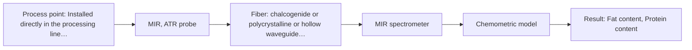
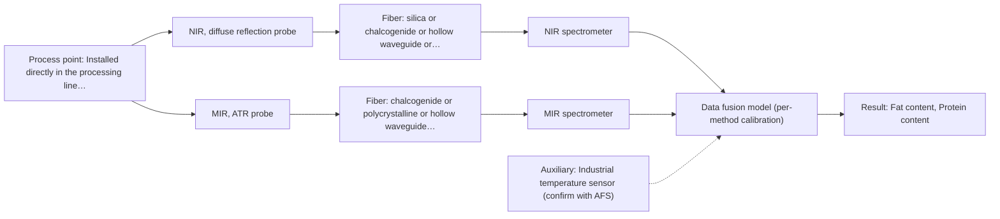

# First technical assessment: Fat and protein monitoring in opaque dairy product

## Answer

**Customer request (our summary):** The customer wants an in-line spectroscopy concept and a comparison experiment to monitor fat and protein in a flowing, opaque milk product with variable temperature and texture.

### Brief answer

For monitoring fat and protein in an opaque, concentrated milk stream, NIR diffuse reflection is the recommended primary method. Because product temperature and texture vary, the feasibility plan should test NIR reflection with scatter-corrected chemometric models against laboratory reference data. Clarifying target accuracy and pipe dimensions will finalize the installation concept.

### Proposal

- **Best current option:** O2 (recommended)
- **Basis:** supplied AFS sources
- **What would change it:** If texture variations cause uncorrectable scattering interference, comparative testing with MIR ATR (M2) would be evaluated.
- **Next step:** Perform laboratory trials using representative milk sample batches across temperature and texture ranges with NIR reflection and reference measurements.

**Secondary evidence (external, not AFS material):** G1: no usable external source found; G2: E01 ¶31; G3: no usable external source found; G4: no usable external source found. See Expert detail.

**Decision status:** Provisional feasibility assessment

### Solution options

| ID | Tier | Methods | Confidence | Cost class, S01 Table 1 (p.6) | Ease of use | Maintenance | Performance fit | Sources |
|---|---|---|---|---|---|---|---|---|
| O1 | Simple | M1 NIR, diffuse reflection probe | Medium: open question: Q1 (starts at Medium) | average cost (row 8) | Simple online reflection probe setup | Periodic optical window cleaning | Standard dairy reflection monitoring | [1: S01 p.17] [2: S01 p.5] |
| O2 | Recommended | M2 MIR, ATR probe | Medium: open question: Q1 (starts at Medium) | high cost (row 2) | Direct ATR contact probe monitoring | Routine crystal cleaning and check | High chemical specificity for fundamental bands | [3: S01 p.9] [4: S01 p.10] |
| O3 | Extended (multi-method) | M3 NIR, diffuse reflection probe + MIR (combination) | Low: open question: Q1 (starts at Medium); precedent only; multi-method, fusion benefit not yet shown | high cost (rows 2, 8) | Dual instrument setup with synchronized sampling | Independent calibration and upkeep for both blocks | Multispectral fusion handling complex matrix variations | [5: S01 p.7] |

*Confidence rates the basis of the advice (how much is known and cited), not a predicted accuracy or probability of success. It starts at High, or at Medium when a key question on the method or the option is open, and drops one level per weakness listed (floor Low).*

*Cost class is the relative rating in S01 Table 1 (p.6) for the in-line method+technique rows named (the highest one for a multi-method option); it is not a price.*

### Setup sketch

*Recommended option O2; drawn by code from the option, a schematic, not a configuration.*

### Key questions

1. What are the required accuracy and detection limits for fat and protein measurements?
2. What are the process pipe dimensions, mounting port specifications, and operating pressure/temperature ranges?
3. What is the maximum allowable response time for tracking composition changes in real time?

## Expert detail

**Customer enquiry**

> We produce an opaque, concentrated milk product that flows through a processing line. We currently sample it for fat and protein analysis and would like earlier information about composition changes. Product temperature and texture vary during production. We want an initial spectroscopy concept and a practical comparison experiment, while retaining our laboratory checks.

**Decision status:** Provisional feasibility assessment. The customer's opaque, concentrated milk product with variable temperature and texture is well-suited for NIR diffuse reflection and MIR ATR spectroscopy based on dairy precedents, but key operational parameters such as pipe dimensions and required accuracy must be confirmed.

### Parameters

| ID | Parameter | Kind | Need | Measured by | Why | Sources |
|---|---|---|---|---|---|---|
| P1 | Fat content | quantitative | required | Spectroscopy: NIR | Primary target component for composition monitoring. | *(no verified source: engineering judgement)* |
| P2 | Protein content | quantitative | required | Spectroscopy: NIR | Primary target component for composition monitoring alongside fat. | *(no verified source: engineering judgement)* |
| P3 | Product temperature | quantitative | optional | Auxiliary sensor: Industrial temperature sensor (engineering judgement: confirm availability with AFS) | Helps compensate for temperature-induced spectral shifts in calibration models. | *(no verified source: engineering judgement)* |

### Solution option details

- **O1 cost drivers:** Single NIR spectrometer and reflection probe
- **O2 cost drivers:** Single FTIR spectrometer and MIR ATR probe
- **O3 cost drivers:** NIR and MIR spectrometers, combined probes, and data fusion software
- **O3 combining methods:** Combines NIR reflection and MIR ATR data matrices after normalization to a common time step, requiring individual calibration blocks per instrument to beat single-method performance.

*Extended (multi-method) option O3; drawn by code from the option, a schematic, not a configuration.*

### Premise check

- **Supported:** An initial spectroscopy concept and practical comparison experiment can be provided directly to address the monitoring of fat and protein in flowing opaque milk. The supplied sources describe established NIR reflection and multispectral methods for dairy and concentrated milk products, supporting an initial concept and comparison plan. [1: S01 p.17]

### Requirements

**Stated by the customer**

- Monitor fat and protein composition changes in an opaque, concentrated milk product
- Provide earlier information for flowing product in a processing line
- Accommodate varying product temperature and texture
- Retain existing laboratory checks

**Key unknowns**

- Required accuracy and detection limits for fat and protein
- Process pipe dimensions, material, and pressure rating
- Exact acceptable response time for process control
- Aqueous and hydrodynamic characteristics of the concentrated milk stream

### Clarification questions (most decision-relevant first)

Q1. What are the required accuracy and detection limits for fat and protein measurements? *Why it matters:* Determines whether a simpler single-method sensor or a more complex chemometric calibration model is required. *(affects: method, M1)*
Q2. What are the process pipe dimensions, mounting port specifications, and operating pressure/temperature ranges? *Why it matters:* Dictates the mechanical probe design and insertion method into the processing line. *(affects: installation)*
Q3. What is the maximum allowable response time for tracking composition changes in real time? *Why it matters:* Influences spectrometer selection and data acquisition rates. *(affects: technique)*
Q4. What is the expected range of temperature and texture variations during production? *Why it matters:* Determines the extent of physical interference compensation required in the chemometric model. *(affects: method, technique)*

### Recommendation

- **M1 · Primary candidate: NIR, diffuse reflection probe.** NIR reflection is the standard approach for opaque and concentrated dairy products, penetrating up to several millimeters and accommodating scattering media effectively. *Conditions:* Must include scatter correction (such as SNV or MSC) to handle variable texture and fat globule size. [1: S01 p.17] [2: S01 p.5]
- **M2 · Comparison candidate: MIR, ATR probe.** MIR ATR provides high chemical specificity for fundamental molecular vibrations and can serve as a comparative method if NIR diffuse reflection is overly sensitive to physical texture changes. *Conditions:* Requires direct contact with the flowing fluid and a robust window material (e.g., diamond or ZrO2) resistant to fouling. [3: S01 p.9] [4: S01 p.10]
- **M3 · Conditional candidate: NIR, diffuse reflection probe + MIR (combination).** Combining NIR and MIR spectral data can provide complementary chemical information for complex matrix variations. *Conditions:* Applies if single-method NIR diffuse reflection is insufficient for target accuracy. [5: S01 p.7] Later hypothesis, after single-method tests.

### Measurement concept

- **Probe and geometry:** Flush-mounted NIR diffuse reflectance probe with side windows interacting with the flowing milk stream.
- **Location:** Installed directly in the processing line pipe wall to monitor flow without sampling delays.
- **Fiber link:** Vis-NIR silica fiber optic cables connecting the probe to the spectrometer located safely away from process vibration. [6: S01 p.17] [7: S01 p.15]

### Spectral range

- **NIR:** Nominal method range is 780-2500 nm; usable range depends on the specific spectrometer, fiber, and probe configuration selected. [8: S01 p.10]
- **MIR:** Nominal method range is 4000-400 cm-1 (2.5-25 µm); usable range depends on the specific FTIR instrument, crystal, and fiber configuration. [3: S01 p.9]

### Risks and uncertainty

- Variable texture and fat globule size alter light scattering, which can mimic chemical composition changes in reflection measurements. *(rules: R-GEO-6)* [9: S01 p.17]
- Product temperature fluctuations shift spectral bands and baselines, potentially reducing quantitative model accuracy without proper pre-processing or temperature compensation. *(rules: R-CAL-1)* [10: S01 p.10]
- Fouling or film buildup on the probe tip in concentrated, flowing milk can attenuate optical signals over time. *(rules: R-MIR-3)* [11: S01 p.13]

### First feasibility experiment

1. **Collect representative sample batches covering the full expected range of temperature, texture, and fat/protein variations.** Ensures the experimental dataset captures real-world physical and chemical heterogeneity. *(no verified source: engineering judgement)*
2. **Perform independent reference laboratory measurements for fat and protein on all sample batches.** Provides ground-truth reference data for calibration and validation. *(no verified source: engineering judgement)*
3. **Test NIR diffuse reflection probe across the sample variations and record spectra.** Evaluates raw spectral response and assesses scattering effects. *(no verified source: engineering judgement)*
4. **Develop and cross-validate PLS regression models incorporating scatter correction (e.g., SNV or MSC).** Separates physical scattering variations from chemical concentration changes. *(no verified source: engineering judgement)*
5. **Validate model performance on held-out test batches against customer-defined accuracy criteria.** Establishes a go/no-go basis for in-line implementation. *(no verified source: engineering judgement)*

**Reference measurements:** Standard laboratory reference methods for fat and protein analysis.

**Decision basis:** Go/no-go based on achieving customer-specified prediction accuracy for fat and protein under varying temperature and texture conditions.

### Assumptions

- The concentrated milk product is pumpable and compatible with in-line probe insertion.
- Temperature and texture variations can be modeled and compensated using chemometric pre-processing.

### Not covered by the supplied sources

- Specific pipe diameter and material of the customer's processing line
- Numerical accuracy targets for fat and protein measurement

### Further notes

- **Chemometrics:** Partial Least Squares (PLS) regression combined with scatter correction preprocessing (such as SNV or MSC) is essential to eliminate physical scattering interference caused by variable fat globule size and texture.
- **Real-time tracking:** In-line fiber probes enable continuous real-time monitoring directly in the processing line without sampling delays.
- **Future direction:** Expansion to multi-wavelength LED sensors or optical multisensor systems (OMS) once key spectral wavelengths are optimized.

### Secondary evidence (external, not AFS material)

*Found by a literature search for gaps the supplied AFS sources leave open. Not AFS material and not proof for this case; every quote below was verified verbatim against the fetched text.*

*Live search unavailable (library only: cache miss (europepmc); cache miss (openalex)); curated library only.*

**G1 · auxiliary sensor:** In-line measurement of Product temperature with Industrial temperature sensor

- No usable external source found.

**G2 · multi-method:** Combining several spectroscopy methods (data fusion) (Combines NIR reflection and MIR ATR data matrices after normalization to a common time step, requiring individual calibration blocks per instrument to beat single-method performance.)

- **E01 ¶31** Low-level data fusion is described as the simplest method to achieve a combination of inputs by rearranging data into a new matrix where variables from different sources are placed sequentially. *How it applies:* This approach could be tested to combine different spectral data streams, provided the contribution and complementarity of each dataset are carefully evaluated first. *Limits and transfer risks:* The cited review focuses on general process analytical technology applications rather than milk processing, so matrix effects and data structures may differ significantly. *(supports O3)*
  > "Low-level data fusion (LLDF) is considered the simplest method to achieve a combination of inputs. In this case, the data is rearranged into a new data matrix, where the variables coming from different sources are placed one after the other."
  > Challenges and Opportunities of Implementing Data Fusion in Process Analytical Technology-A Review. (2022) · Molecules (Basel, Switzerland) · doi:10.3390/molecules27154846 · https://europepmc.org/article/PMC/PMC9369811 · retrieved 2026-10-17, full text, licence: cc by, via curated library

**G3 · not in the supplied sources:** Specific pipe diameter and material of the customer's processing line

- No usable external source found.

**G4 · not in the supplied sources:** Numerical accuracy targets for fat and protein measurement

- No usable external source found.

### Evidence (verified quotes)

1. ✓ **S01 p.17** (application precedent): "NIR Reflection is primarily used for opaque or highly concentrated dairy products, such as yogurt, butter, or whole milk concentrates."
2. ✓ **S01 p.5** (general): "NIR spectroscopy, with its relatively large penetration depth (up to several millimetres) even into dense solid samples due to low absorption and strong scattering, allows the use of ordinary glass for optics"
3. ✓ **S01 p.9** (general): "Vibrational spectroscopy in the mid-IR range (4000-400 cm-1) is one of the most informative methods of chemical analysis."
4. ✓ **S01 p.10** (general): "ATR fiber probes (Fig.1) enable the analysis of liquids and solid elastic samples, such as biological tissue, using specialized probes utilizing high-transmission fiber optics in the Mid-IR region."
5. ✓ **S01 p.7** (application precedent): "The analysis of such systems may require a combination of two or even more spectral methods."
6. ✓ **S01 p.17** (general): "the probe is flush-mounted into a pipe or vat to interact directly with the flowing medium."
7. ✓ **S01 p.15** (general): "The use of fiber optics is critical here, as it allows the sensitive spectrometers to be located safely away from the vibration and dust of the manufacturing floor."
8. ✓ **S01 p.10** (general): "NIR spectra (780-2500 nm) contain predominantly overtones and component bands of fundamental vibrations of molecules and atomic groups"
9. ✓ **S01 p.17** (general): "the method is sensitive to the surface characteristics and fat globule size."
10. ✓ **S01 p.10** (general): "The broad absorption bands observed in this region overlap, suggesting the use of chemometrics for quantitative and qualitative analysis of spectral data."
11. ✓ **S01 p.13** (general): "typically at a depth of few microns"

### Verification

- Citations verified: 13 of 13 (exact or whitespace/hyphen-tolerant match on the cited page, scope checked).
- Hard check failures before deterministic corrections: 0; still open: 0; soft warnings: 0; repair rounds: 1.
- External evidence (cache): 1 quote(s) verified verbatim (exact or whitespace/hyphen-tolerant, at most 400 characters and 2 sentences, against the cited paragraph); 0 item(s) dropped.
- External search: 2 query(ies), 0 hit(s), 3 source(s) (3 from the curated library); ⚠ library only: cache miss (europepmc); cache miss (openalex).
- External step: 2 model call(s), 1.9 s extra (cost in the run JSON).

*Run D02-20261018T075900Z-6616 · models google/gemini-3.5-flash-lite*
