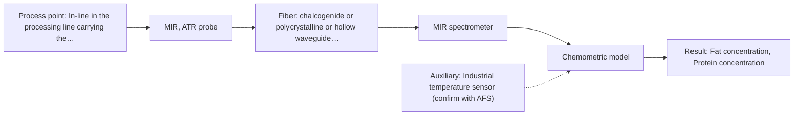

# First technical assessment: Fat and protein monitoring in opaque dairy product

## Answer

**Customer request (our summary):** The customer wants an initial spectroscopy concept and comparison experiment for in-line measurement of fat and protein in an opaque milk product.

### Brief answer

For in-line analysis of fat and protein in your concentrated milk product, we recommend starting with NIR diffuse reflection spectroscopy as the primary method, with MIR ATR as a comparison option. A practical feasibility experiment using representative samples across your temperature and texture variation ranges will establish the optimal calibration. Please provide target accuracy criteria and operating temperature ranges to refine the setup.

### Proposal

- **Best current option:** O2 (recommended)
- **Basis:** supplied AFS sources
- **What would change it:** If laboratory trials show that NIR diffuse reflection provides superior scatter stability and robustness over MIR ATR for this specific concentrated milk product.
- **Next step:** Perform multi-method laboratory trials on representative concentrated milk samples using both NIR diffuse reflection and MIR ATR setups.

**Secondary evidence (external, not AFS material):** G1: E01 ¶4; G2: no usable external source found. See Expert detail.

**Decision status:** Provisional feasibility assessment

### Solution options

| ID | Tier | Methods | Confidence | Cost class, S01 Table 1 (p.6) | Ease of use | Maintenance | Performance fit | Sources |
|---|---|---|---|---|---|---|---|---|
| O1 | Simple | M1 NIR, diffuse reflection probe | Low: open question: Q1 (starts at Medium); precedent only | average cost (row 8) | Straightforward probe installation | Periodic optical cleaning | Well-established for dairy composition tracking in concentrated products | [1: S01 p.17] |
| O2 | Recommended | M2 MIR, ATR probe | Medium: open question: Q1 (starts at Medium) | high cost (row 2) | Robust industrial ATR probe | Regular crystal cleaning and calibration checks | Provides high chemical specificity via fundamental bands for challenging matrices | [2: S01 p.9] |

*Confidence rates the basis of the advice (how much is known and cited), not a predicted accuracy or probability of success. It starts at High, or at Medium when a key question on the method or the option is open, and drops one level per weakness listed (floor Low).*

*Cost class is the relative rating in S01 Table 1 (p.6) for the in-line method+technique rows named (the highest one for a multi-method option); it is not a price.*

### Setup sketch

*Recommended option O2; drawn by code from the option, a schematic, not a configuration.*

### Key questions

1. What are the expected numerical concentration ranges and target accuracies for fat and protein?
2. What are the exact process temperature and pressure ranges, and how frequently does texture vary?
3. What are the inner diameter and material of the process pipe where the probe will be installed?

## Expert detail

**Customer enquiry**

> We produce an opaque, concentrated milk product that flows through a processing line. We currently sample it for fat and protein analysis and would like earlier information about composition changes. Product temperature and texture vary during production. We want an initial spectroscopy concept and a practical comparison experiment, while retaining our laboratory checks.

**Decision status:** Provisional feasibility assessment. The customer's request to measure fat and protein in an opaque, concentrated milk product inline with variable temperature and texture is well-supported by established dairy spectroscopic precedents, but deciding the optimal single method or combination requires preliminary trials on representative samples.

### Parameters

| ID | Parameter | Kind | Need | Measured by | Why | Sources |
|---|---|---|---|---|---|---|
| P1 | Fat concentration | quantitative | required | Spectroscopy: NIR | Primary compositional target specified by the customer. | [3: S01 p.17] |
| P2 | Protein concentration | quantitative | required | Spectroscopy: NIR | Secondary compositional target specified by the customer. | [3: S01 p.17] |
| P3 | Product temperature | quantitative | optional | Auxiliary sensor: Industrial temperature sensor (engineering judgement: confirm availability with AFS) | Compensates for temperature-induced spectral shifts during production. | *(no verified source: engineering judgement)* |

### Solution option details

- **O1 cost drivers:** Single NIR spectrometer and diffuse reflection fiber probe
- **O2 cost drivers:** MIR spectrometer, specialized ATR probe, and chemometric modeling

### Premise check

- **Supported:** Opaque, concentrated dairy products can be monitored in-line for fat and protein using NIR diffuse reflection or MIR ATR spectroscopy. NIR reflection is established for opaque dairy products like milk concentrates, and MIR ATR is used for liquids and pastes. [1: S01 p.17]
- **Supported:** Product temperature and texture variations during production can affect spectral signals and require robust calibration or scatter correction. Physical variations such as scattering and particle size changes require scatter correction like SNV or MSC. [4: S01 p.17]

### Requirements

**Stated by the customer**

- In-line measurement of fat and protein in an opaque, concentrated milk product
- Earlier information about composition changes during processing
- Initial spectroscopy concept and practical comparison experiment
- Retaining existing laboratory checks

**Key unknowns**

- Exact concentration ranges for fat and protein
- Operating temperature and pressure ranges
- Pipe dimensions and installation fitting requirements
- Required measurement response time
- CIP/SIP cleaning and fouling protocols

### Clarification questions (most decision-relevant first)

Q1. What are the expected numerical concentration ranges and target accuracies for fat and protein? *Why it matters:* Defines the required analytical sensitivity and calibration range. *(affects: method, status)*
Q2. What are the exact process temperature and pressure ranges, and how frequently does texture vary? *Why it matters:* Determines hardware temperature rating, probe material compatibility, and scatter correction needs. *(affects: installation, technique)*
Q3. What are the inner diameter and material of the process pipe where the probe will be installed? *Why it matters:* Ensures proper mechanical and hygienic seating of the optical probe. *(affects: installation)*
Q4. What is the required response time or data update rate for process control? *Why it matters:* Informs spectrometer selection between high-speed diode array systems and scanning instruments. *(affects: technique)*

### Recommendation

- **M1 · Primary candidate: NIR, diffuse reflection probe.** NIR diffuse reflection is the industry workhorse for measuring major components like fat and protein in concentrated, opaque dairy streams. [1: S01 p.17]
- **M2 · Comparison candidate: MIR, ATR probe.** MIR ATR offers high chemical selectivity via fundamental vibrational fingerprint bands for organic molecules. *Conditions:* Applies if NIR diffuse reflection is overly sensitive to physical texture variations. [2: S01 p.9]
- **M3 · Conditional candidate: Raman probe.** Raman scattering exhibits low water absorbance and provides sharp molecular backbones, serving as an alternative if aqueous matrix interference is significant. *Conditions:* Applies if water or scattering interference limits vibrational infrared methods. [5: S01 p.16]

### Measurement concept

- **Probe and geometry:** NIR diffuse reflection probe flush-mounted in the process pipe, utilizing separate delivery and collection fiber bundles.
- **Location:** In-line in the processing line carrying the concentrated milk product.
- **Fiber link:** Vis-NIR silica fiber cable (low-OH content) allowing the spectrometer to be located safely away from process vibration. [6: S01 p.17] [7: S02 p.7]

### Spectral range

- **NIR:** Nominal range 780-2500 nm; usable range depends on the selected instrument, fibers, and probe configuration. [8: S01 p.10]
- **MIR:** Nominal range 4000-400 cm-1; usable range depends on the selected instrument, crystal, and probe configuration. [2: S01 p.9]

### Risks and uncertainty

- Physical texture and temperature variations can alter light scattering and mimic chemical concentration changes in NIR diffuse reflection. *(rules: R-GEO-6, R-CAL-1)* [9: S01 p.17]
- Fouling or film buildup on the probe tip in concentrated dairy streams can degrade optical signal transmission over time. *(rules: R-MIR-3)* [10: S01 p.10]

### First feasibility experiment

1. **Collect representative process samples** Gather representative concentrated milk product samples covering the expected chemical and physical variation (temperature and texture). *(no verified source: engineering judgement)*
2. **Reference laboratory analysis** Determine independent reference values for fat and protein for all collected samples. *(no verified source: engineering judgement)*
3. **Laboratory spectral trials** Test NIR diffuse reflection and MIR ATR setups on the samples to record spectral features and evaluate sensitivity. *(no verified source: engineering judgement)*
4. **Develop chemometric calibration models** Build and cross-validate PLS calibration models linking spectra to reference fat and protein values with appropriate scatter correction. *(no verified source: engineering judgement)*
5. **Validation on held-out data** Verify model predictive performance on independent test batches against customer-defined accuracy criteria. *(no verified source: engineering judgement)*

**Reference measurements:** Standard laboratory reference methods for fat and protein analysis.

**Decision basis:** Go/no-go based on achieving customer-specified prediction accuracy for fat and protein under varying sample conditions.

### Assumptions

- The concentrated milk product is pumpable and compatible with probe immersion or flush-mounted window interfaces.
- Laboratory reference methods are available to calibrate the optical models.

### Not covered by the supplied sources

- Exact customer process temperature, pressure, and pipe dimensions.

### Further notes

- **Chemometrics:** Requires multivariate calibration (PLS regression) combined with scatter correction (such as SNV) to handle physical texture and temperature variations.
- **Real-time tracking:** Enables continuous in-line monitoring of fat and protein concentrations directly in the process stream.
- **Future direction:** Integration of temperature compensation sensors and automated cleaning cycles for unattended operation.

### Secondary evidence (external, not AFS material)

*Found by a literature search for gaps the supplied AFS sources leave open. Not AFS material and not proof for this case; every quote below was verified verbatim against the fetched text.*

*Live search unavailable (library only: cache miss (europepmc); cache miss (openalex)); curated library only.*

**G1 · auxiliary sensor:** In-line measurement of Product temperature with Industrial temperature sensor

- **E01 ¶4** Attenuated total reflection probes can be used for in-line measurements in demanding environments. *How it applies:* This supports evaluating ATR configurations, though temperature effects on aqueous systems should be tested. *Limits and transfer risks:* The source discusses chemical reaction monitoring rather than dairy products, so transfer to milk processing requires validation. *(supports O2)*
  > "Attenuated total reflection probes (ATR) allow in-line measurements even in demanding measurement environments and reaction mixtures with highly oxidative and corrosive substances, such as chlorosilanes or strong acids and bases."
  > A Process Analytical Concept for In-Line FTIR Monitoring of Polysiloxane Formation. (2020) · Polymers · doi:10.3390/polym12112473 · https://europepmc.org/article/PMC/PMC7693933 · retrieved 2026-10-17, full text, licence: cc by, via curated library

**G2 · not in the supplied sources:** Exact customer process temperature, pressure, and pipe dimensions.

- No usable external source found.

### Evidence (verified quotes)

1. ✓ **S01 p.17** (application precedent): "NIR Reflection is primarily used for opaque or highly concentrated dairy products, such as yogurt, butter, or whole milk concentrates."
2. ✓ **S01 p.9** (general): "Vibrational spectroscopy in the mid-IR range (4000-400 cm-1) is one of the most informative methods of chemical analysis."
3. ✓ **S01 p.17** (application precedent): "quantify fat and protein"
4. ✓ **S01 p.17** (general): "Standard Normal Variate (SNV) transformations to remove physical interference caused by the scattering nature of the milk particles"
5. ✓ **S01 p.16** (general): "Raman is particularly well-suited for aqueous environments, as it exhibits low absorbance for water molecules compared to infrared methods."
6. ✓ **S01 p.17** (application precedent): "the probe is flush-mounted into a pipe or vat to interact directly with the flowing medium."
7. ✓ **S02 p.7** (general): "Robust 100-300m cables made with Silica fibers of low OH-content (<0.1ppm OH) enable remote industrial process-control"
8. ✓ **S01 p.10** (general): "NIR spectra (780-2500 nm) contain predominantly overtones and component bands of fundamental vibrations"
9. ✓ **S01 p.17** (general): "the method is sensitive to the surface characteristics and fat globule size."
10. ✓ **S01 p.10** (general): "ATR fiber probes (Fig.1) enable the analysis of liquids and solid elastic samples"

### Verification

- Citations verified: 15 of 15 (exact or whitespace/hyphen-tolerant match on the cited page, scope checked).
- Hard check failures before deterministic corrections: 0; still open: 0; soft warnings: 2; repair rounds: 1.
- External evidence (cache): 1 quote(s) verified verbatim (exact or whitespace/hyphen-tolerant, at most 400 characters and 2 sentences, against the cited paragraph); 0 item(s) dropped.
- External search: 1 query(ies), 0 hit(s), 3 source(s) (3 from the curated library); ⚠ library only: cache miss (europepmc); cache miss (openalex).
- External step: 2 model call(s), 2.0 s extra (cost in the run JSON).

*Run D02-20261018T075900Z-920e · models google/gemini-3.5-flash-lite, google/gemini-3.8-flash*
