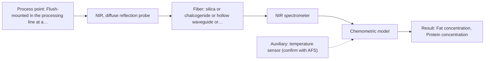
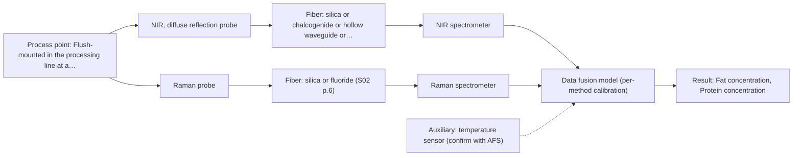

# First technical assessment: Fat and protein monitoring in opaque dairy product

## Answer

**Customer request (our summary):** Producer of an opaque, concentrated milk product flowing through a processing line wants earlier information about fat and protein composition changes, requesting an initial spectroscopy concept and a practical comparison experiment while retaining laboratory checks. Temperature and texture vary during production.

### Brief answer

Test in-line NIR diffuse reflection first: it is the documented technique for opaque, concentrated dairy products and can track fat and protein with a chemometric calibration against your laboratory checks. Also test a transflection probe as an alternative geometry, since plain transmission is unsuitable for an opaque product. Open points that decide the design: fat/protein target ranges and required accuracy, temperature range, installation point and distance, and cleaning conditions.

### Proposal

- **Best current option:** O2 (recommended)
- **Basis:** supplied AFS sources
- **What would change it:** A very wide temperature range, severe fouling, or extreme texture variation could shift the choice toward a different probe design or a second method; concentration ranges outside typical dairy levels could require Raman as an addition.
- **Next step:** Run the lab comparison of NIR reflection and transflection probes on representative production samples against your laboratory fat and protein results, then mount the better probe in-line for a validation period.

**Secondary evidence (external, not AFS material):** G1: E01 ¶12, E03 ¶19, E03 ¶72; G2: E02 ¶31, E02 ¶36, E02 ¶82; G3: no usable external source found; G4: no usable external source found. See Expert detail.

**Decision status:** Provisional feasibility assessment

### Solution options

| ID | Tier | Methods | Confidence | Cost class, S01 Table 1 (p.6) | Ease of use | Maintenance | Performance fit | Sources |
|---|---|---|---|---|---|---|---|---|
| O1 | Simple | M1 NIR, diffuse reflection probe; M2 NIR, transmission/transflection probe | Low: open question: Q1 (starts at Medium); suitability for this sample not confirmed; uncited auxiliary sensor | average cost (rows 7, 8) | straightforward lab bench trial | minimal, no line modification | answers method choice before any line work | [1: S01 p.17] [2: S01 p.5] [3: S01 p.18] |
| O2 | Recommended | M1 NIR, diffuse reflection probe | Low: open question: Q1 (starts at Medium); uncited auxiliary sensor | average cost (row 8) | continuous in-line operation after calibration | probe window cleaning between runs | matches opaque product and early-warning goal | [4: S01 p.17] [5: S01 p.15] [1: S01 p.17] [2: S01 p.5] |
| O3 | Extended (multi-method) | M1 NIR, diffuse reflection probe; M3 Raman probe | Low: open question: Q1 (starts at Medium); uncited auxiliary sensor; multi-method, fusion benefit not yet shown | high cost (rows 8, 12) | two instruments to run and maintain | two instruments, per-block calibration | hypothesis if NIR alone misses accuracy | [6: S01 p.7] [1: S01 p.17] [2: S01 p.5] [7: S01 p.16] |

*Confidence rates the basis of the advice (how much is known and cited), not a predicted accuracy or probability of success. It starts at High, or at Medium when a key question on the method or the option is open, and drops one level per weakness listed (floor Low).*

*Cost class is the relative rating in S01 Table 1 (p.6) for the in-line method+technique rows named (the highest one for a multi-method option); it is not a price.*

### Setup sketch

*Recommended option O2; drawn by code from the option, a schematic, not a configuration.*

### Key questions

1. What are the fat and protein concentration ranges, and what accuracy do you need in-line compared with your laboratory method?
2. Where on the line would the measurement sit, what is the product temperature range there, and how far is it to a safe place for the spectrometer?
3. What are the cleaning-in-place and fouling conditions at the proposed measurement point?

## Expert detail

**Customer enquiry**

> We produce an opaque, concentrated milk product that flows through a processing line. We currently sample it for fat and protein analysis and would like earlier information about composition changes. Product temperature and texture vary during production. We want an initial spectroscopy concept and a practical comparison experiment, while retaining our laboratory checks.

**Decision status:** Provisional feasibility assessment. A method shortlist can be justified from the documented dairy NIR reflection application, but the concentration ranges, temperature range, installation point and cleaning conditions are unknown, so the assessment is provisional and the deciding questions are asked first.

### Parameters

| ID | Parameter | Kind | Need | Measured by | Why | Sources |
|---|---|---|---|---|---|---|
| P1 | Fat concentration | quantitative | required | Spectroscopy: NIR | Fat is a stated monitoring target and the main analyte the in-line model must predict. | [8: S01 p.17] |
| P2 | Protein concentration | quantitative | required | Spectroscopy: NIR | Protein is a stated monitoring target and the second analyte the in-line model must predict. | [8: S01 p.17] |
| P3 | Product temperature | quantitative | required | Auxiliary sensor: temperature sensor (engineering judgement: confirm availability with AFS) | Temperature varies during production and shifts the spectra, so it must be recorded to include or correct its effect in the calibration. | *(no verified source: engineering judgement)* |
| P4 | Texture state (viscosity / globule structure regime) | qualitative | optional | Not measurable in-line by spectroscopy; alternative: laboratory texture/viscosity characterisation of samples taken at known process states | Texture variation can mimic composition change in reflection spectra, so knowing the texture regime per sample helps separate physical from chemical effects; it should be available from process knowledge. | [9: S01 p.17] |

### Solution option details

- **O1 cost drivers:** one reflection probe, one NIR spectrometer, lab trial samples, reference analyses
- **O2 cost drivers:** in-line probe and flush fitting, fiber cable, calibration samples across process variation, ongoing reference analyses
- **O3 cost drivers:** second spectrometer and Raman probe, synchronisation software, doubled calibration and maintenance effort
- **O3 combining methods:** Low-level fusion: NIR reflection and Raman spectra from the same line location are synchronised to a common time step and merged into one augmented matrix for PLS regression. Each method keeps its own calibration and diagnostics, and the fused model must beat the best single-method model on held-out runs before the extra instrument is justified.

*Extended (multi-method) option O3; drawn by code from the option, a schematic, not a configuration.*

### Premise check

- **Precedent only:** In-line spectroscopy can track fat and protein in an opaque, concentrated milk product. The enquiry assumes spectroscopy can give earlier fat/protein information on an opaque, concentrated dairy stream. The sources show this as a documented dairy application pattern (NIR reflection with PLS), which is a reason to test, not proof for this specific product. [1: S01 p.17]
- **Precedent only:** A single probe geometry can cover the product across its texture and composition variation. The sources say a transflection probe can in some cases serve both low-fat and high-fat milk products; whether it works for this opaque, concentrated product is untested and must be checked in the comparison experiment. [3: S01 p.18]

### Requirements

**Stated by the customer**

- Earlier information about fat and protein composition changes than current sampling provides
- An initial spectroscopy concept and a practical comparison experiment
- Laboratory checks retained as reference

**Key unknowns**

- Fat and protein concentration ranges and required in-line accuracy
- Product temperature range at the measurement point
- Installation point and fiber distance on the line
- Cleaning and fouling conditions at the probe location
- Nature and timescale of the texture variation
- Reference laboratory method and its accuracy

### Clarification questions (most decision-relevant first)

Q1. What are the fat and protein concentration ranges, and what accuracy do you need in-line compared with your laboratory method? *Why it matters:* The concentration range and required accuracy decide whether NIR reflection alone suffices or a second method is needed. *(affects: method, technique)*
Q2. Where on the line would the measurement sit, what is the product temperature range there, and how far is it to a safe place for the spectrometer? *Why it matters:* Temperature affects the spectra and the installation point and distance determine the probe and fiber cable design. *(affects: installation)*
Q3. What are the cleaning-in-place and fouling conditions at the proposed measurement point? *Why it matters:* A contact probe window fouls in concentrated dairy, so cleaning access and window material drive the probe choice. *(affects: installation, technique)*
Q4. What exactly varies in texture (e.g. viscosity, fat globule size, phase separation) and over what timescale? *Why it matters:* Reflection signals are sensitive to surface characteristics and globule size, so texture variation must be separated from composition change in the calibration. *(affects: technique, status)*
Q5. Which laboratory method do you use for fat and protein, and what is its own accuracy? *Why it matters:* The laboratory method is the reference for calibration and for the go/no-go criteria, so its accuracy bounds what in-line can be validated against. *(affects: status, method)*

### Recommendation

- **M1 · Primary candidate: NIR, diffuse reflection probe.** NIR diffuse reflection is the documented technique for opaque, concentrated dairy products and is well suited to remote fiber-probe measurement. Quantification of fat and protein then relies on a PLS calibration against the laboratory reference. [1: S01 p.17] [2: S01 p.5]
- **M2 · Comparison candidate: NIR, transmission/transflection probe.** A transflection probe can in some cases serve both low-fat and high-fat dairy products with one probe, which would simplify the installation. Plain transmission is not worth testing first because it fails when the sample is too thick or fat-rich, but the transflection geometry on this opaque, concentrated product is untested and must be compared against reflection. *Conditions:* Test it in the comparison experiment; it applies only if the transflection geometry gives acceptable signal and accuracy on this opaque, concentrated product. [3: S01 p.18]
- **M3 · Comparison candidate: Raman probe.** Raman tolerates water well and offers molecular specificity that can complement NIR in dairy matrices. Its weak signal and possible fluorescence background must be checked on real samples before relying on it. *Conditions:* Test only if the NIR reflection calibration cannot meet the required accuracy across the texture and temperature variation. [7: S01 p.16]

### Measurement concept

- **Probe and geometry:** NIR diffuse reflection fiber optic probe, flush-mounted into the pipe or vat; a transflection probe is tested as an alternative geometry in the comparison experiment.
- **Location:** Flush-mounted in the processing line at a point representative of the product stream, with the spectrometer located away from the line via fiber optics.
- **Fiber link:** Vis-NIR silica fiber cable from the flush-mounted reflection probe to the spectrometer; the achievable cable length depends on the selected fiber and is not stated for this configuration. [1: S01 p.17]

### Spectral range

- **NIR:** Nominal NIR range 780-2500 nm; the usable range depends on the spectrometer, fiber and probe actually selected. [10: S01 p.10]
- **Raman:** Raman is reported as Raman shift in cm-1 with the laser excitation wavelength stated separately; the usable range depends on the selected instrument and probe. [11: S01 p.11]

### Risks and uncertainty

- Texture and globule-size variation can mimic composition change in reflection spectra, so the calibration must separate physical from chemical effects. *(rules: R-GEO-6)* [9: S01 p.17]
- Product temperature variation shifts the spectra and must be covered by representative calibration samples or an auxiliary temperature input. *(no verified source: engineering judgement)*
- A contact probe window in a concentrated dairy line can foul, degrading the signal between cleanings. *(rules: R-MIR-3)* [12: REF §5]
- The calibration is specific to this product matrix; recipe or process changes require re-validation of the model. *(rules: R-CAL-1)* [13: REF §5]

### First feasibility experiment

1. **Collect representative samples across the expected chemical and physical variation** Collect representative samples spanning the expected variation in fat, protein, temperature and texture across production runs. *(no verified source: engineering judgement)*
2. **Measure all samples with the NIR reflection probe and, in parallel, with the transflection probe** Measure all samples with the NIR reflection probe in the lab and, in parallel, with the transflection probe, to compare both geometries on the same material. *(no verified source: engineering judgement)*
3. **Run the customer's laboratory fat and protein analysis on every sample as the independent reference** Run the customer's laboratory fat and protein analysis on every sample as the independent reference. *(no verified source: engineering judgement)*
4. **Build PLS calibration models per analyte with scatter correction and validate on held-out runs** Build PLS calibration models per analyte with scatter correction, and validate them on held-out samples or runs not used in calibration. *(no verified source: engineering judgement)*
5. **Mount the best probe in-line and track composition changes against the laboratory checks over several runs** Mount the best probe in-line and track composition changes in real time against the laboratory checks over several production runs. *(no verified source: engineering judgement)*

**Reference measurements:** Each sample point is analysed in parallel by the customer's existing laboratory fat and protein method (Q5), which remains the retained check.

**Decision basis:** Go/no-go against the customer's own criteria: the in-line PLS predictions on held-out runs must meet the accuracy the customer states in answer to Q1, with stable performance across the temperature and texture range; otherwise the geometry or method is revisited.

### Assumptions

- The product is a water-based dairy matrix whose fat and protein lie in ranges typical of concentrated dairy products; the actual ranges are unknown and asked in Q1.
- The laboratory fat/protein analysis currently used can serve as the independent reference method in a comparison trial; its method and accuracy are asked in Q5.
- A probe can be mounted flush at a suitable line location with reasonable access for cleaning; the installation point and distance are asked in Q2.

### Not covered by the supplied sources

- Achievable fiber cable length for this specific probe and spectrometer configuration
- In-line accuracy achievable for fat and protein in this specific concentrated product

### Further notes

- **Chemometrics:** A PLS regression model per analyte (fat, protein) is expected, built on spectra from representative production states with scatter correction (e.g. MSC or SNV) to handle the texture-driven scattering variation; the model must be validated on held-out production runs and re-checked whenever the recipe or texture regime changes.
- **Real-time tracking:** The goal is earlier information on composition changes than manual sampling allows; an in-line probe with continuous spectral acquisition and a running PLS prediction gives composition trends in near real time, with the laboratory checks retained as reference and for calibration updates.
- **Future direction:** If the single-method calibration proves sensitive to texture variation, a later extension could add Raman in the same reactor as a molecular-specific second view of fat and protein, tested only after the NIR reflection baseline is established.

### Secondary evidence (external, not AFS material)

*Found by a literature search for gaps the supplied AFS sources leave open. Not AFS material and not proof for this case; every quote below was verified verbatim against the fetched text.*

*Live search unavailable (library only: cache miss (europepmc); cache miss (openalex)); curated library only.*

**G1 · auxiliary sensor:** In-line measurement of Product temperature with temperature sensor

- **E01 ¶12** The review states that the temperature sensitivity of the OH bands is a severe drawback for NIR and MIR measurements of aqueous solutions, making tempered sample holders necessary. *How it applies:* Since the product is aqueous and temperature varies during production, temperature should be recorded alongside the NIR spectra and included as a calibration variable or used to select/segment calibration data. A temperature sensor at the probe location is a reasonable auxiliary measurement to test whether it improves model robustness. *Limits and transfer risks:* The quote concerns aqueous solutions in laboratory NIR/MIR with tempered sample holders, not an opaque concentrated dairy product measured in-line; the magnitude of the temperature effect on this matrix is unknown. *(supports O2)*
  > "Additionally, the temperature sensitivity of the OH bands is a severe drawback for measuring aqueous solution in NIR and MIR, which makes tempered sample holders necessary [29]."
  > A critical review of recent trends, and a future perspective of optical spectroscopy as PAT in biopharmaceutical downstream processing. (2020) · Analytical and bioanalytical chemistry · doi:10.1007/s00216-020-02407-z · https://europepmc.org/article/PMC/PMC7072065 · retrieved 2026-10-17, full text, licence: cc by, via curated library
- **E03 ¶19** In the FT-IR and Raman study, concentrations as well as ionic strength and temperature were deliberately varied to obtain a robust model. *How it applies:* This suggests a practical design choice for the calibration experiment: deliberately vary product temperature (and composition) across expected production conditions so the model becomes robust to the temperature and texture variations mentioned in the enquiry. *Limits and transfer risks:* The study concerns acids and ionic strength in a lithium recycling extraction, a very different matrix from concentrated milk, so the transferable point is the design principle, not the results. *(supports O2)*
  > "The concentrations of nitric acid and hydrochloric acid as well as the ionic strength and temperature were varied to obtain a robust model."
  > Process Analytical Technology-Integrated FT-IR and Raman Spectroscopies for Efficient Reactive Liquid-Liquid Extraction Processing in Lithium Recycling. (2025) · ACS omega · doi:10.1021/acsomega.5c05705 · https://europepmc.org/article/PMC/PMC12573149 · retrieved 2026-10-17, full text, licence: cc by, via curated library
- **E03 ¶72** The study notes that in-line methods require maintenance such as calibration and handling of sensor drift and aging, which can be addressed by checking the baseline in each cycle and monitoring drift. *How it applies:* This supports retaining laboratory checks and adding routine baseline/drift monitoring in the concept, since in-line spectroscopy performance can degrade over time. The assessment should plan periodic lab reference sampling to verify the in-line calibration. *Limits and transfer risks:* The recommendation comes from a fixed-probe liquid-liquid extraction process with pure-component phases available for baseline checks; a continuous dairy line may not offer comparable reference phases. *(supports O2)*
  > "Potential typical drawbacks of any in-line method are maintenance efforts like calibration, and actions to sensor drift and aging could be easily overcome by checking the baseline in each cycle of pure component phases of process operation and monitoring any drift in order to be able to react."
  > Process Analytical Technology-Integrated FT-IR and Raman Spectroscopies for Efficient Reactive Liquid-Liquid Extraction Processing in Lithium Recycling. (2025) · ACS omega · doi:10.1021/acsomega.5c05705 · https://europepmc.org/article/PMC/PMC12573149 · retrieved 2026-10-17, full text, licence: cc by, via curated library

**G2 · multi-method:** Combining several spectroscopy methods (data fusion) (Low-level fusion: NIR reflection and Raman spectra from the same line location are synchronised to a common time step and merged into one augmented matrix for PLS regression. Each method keeps its own calibration and diagnostics, and the fused model must beat the best single-method model on held-out runs before the extra instrument is justified.)

- **E02 ¶31** Low-level data fusion is described as the simplest combination approach, where variables from different sources are concatenated one after the other into a new data matrix. *How it applies:* This supports the planned low-level fusion of synchronised NIR and Raman spectra into one augmented matrix for PLS regression as an established, simple fusion scheme. The comparison experiment can implement exactly this concatenation and benchmark it against single-method models. *Limits and transfer risks:* The review describes the method generically; it does not state performance gains for NIR+Raman fusion of a concentrated dairy product, and synchronisation quality in-line is not addressed. *(supports O3)*
  > "Low-level data fusion (LLDF) is considered the simplest method to achieve a combination of inputs. In this case, the data is rearranged into a new data matrix, where the variables coming from different sources are placed one after the other."
  > Challenges and Opportunities of Implementing Data Fusion in Process Analytical Technology-A Review. (2022) · Molecules (Basel, Switzerland) · doi:10.3390/molecules27154846 · https://europepmc.org/article/PMC/PMC9369811 · retrieved 2026-10-17, full text, licence: cc by, via curated library
- **E02 ¶36** A Raman and FT-IR food analytical study cited in the review showed that in some situations instrument complementarity alone was not sufficient to improve the prediction of several CQAs. *How it applies:* This is a reason to keep the planned acceptance criterion: the fused model must beat the best single-method model on held-out runs before the extra Raman instrument is justified. The experiment should explicitly test whether the second method adds predictive value for fat and protein. *Limits and transfer risks:* The cited study used Raman with FT-IR on food samples, not NIR with Raman on an opaque concentrated milk product in-line, so the outcome may differ. *(supports O3)*
  > "In some situations, instrument complementarity (not data complementarity) was not sufficient to improve the performance of predictive several CQAs, as shown by a Raman and FT-IR data based food analytical study [73]."
  > Challenges and Opportunities of Implementing Data Fusion in Process Analytical Technology-A Review. (2022) · Molecules (Basel, Switzerland) · doi:10.3390/molecules27154846 · https://europepmc.org/article/PMC/PMC9369811 · retrieved 2026-10-17, full text, licence: cc by, via curated library
- **E02 ¶82** The review states that before fusing data from multiple sources it is essential to evaluate each dataset's contribution to the model and its complementarity. *How it applies:* The comparison experiment should include a step assessing each method's individual contribution and complementarity before building the fused model, e.g. by comparing single-method PLS models and checking which wavelengths/Raman shifts carry fat and protein information. *Limits and transfer risks:* This is a general methodological recommendation from a review, not a demonstrated result for this product or instrument pair. *(supports O3)*
  > "Before fusing data from multiple sources, it is essential to evaluate the contribution of each dataset to the model and its complementarity."
  > Challenges and Opportunities of Implementing Data Fusion in Process Analytical Technology-A Review. (2022) · Molecules (Basel, Switzerland) · doi:10.3390/molecules27154846 · https://europepmc.org/article/PMC/PMC9369811 · retrieved 2026-10-17, full text, licence: cc by, via curated library

**G3 · not in the supplied sources:** Achievable fiber cable length for this specific probe and spectrometer configuration

- No usable external source found.

**G4 · not in the supplied sources:** In-line accuracy achievable for fat and protein in this specific concentrated product

- No usable external source found.

### Evidence (verified quotes)

1. ✓ **S01 p.17** (application precedent): "NIR Reflection is primarily used for opaque or highly concentrated dairy products, such as yogurt, butter, or whole milk concentrates."
2. ✓ **S01 p.5** (general): "making it ideal for online applications, including remote measurements via fiber optic probes."
3. ✓ **S01 p.18** (general): "In some cases, a Transflection probe can already be a combined solution working well for low-fat and high-fat containing milk products."
4. ✓ **S01 p.17** (application precedent): "Experimentally, the probe is flush-mounted into a pipe or vat to interact directly with the flowing medium."
5. ✓ **S01 p.15** (general): "The use of fiber optics is critical here, as it allows the sensitive spectrometers to be located safely away from the vibration and dust of the manufacturing floor."
6. ✓ (precedent only) **S01 p.7** (method gain): "The analysis of such systems may require a combination of two or even more spectral methods."
7. ✓ **S01 p.16** (general): "Raman is particularly well-suited for aqueous environments, as it exhibits low absorbance for water molecules compared to infrared methods."
8. ✓ **S01 p.17** (application precedent): "Data processing may involve converting the reflectance values to absorbance and applying Multiplicative Scatter Correction (MSC) or Standard Normal Variate (SNV) transformations to remove physical interference caused by the scattering nature of the milk particles before using Partial Least Squares (PLS) regression to quantify fat and protein."
9. ✓ **S01 p.17** (general): "the method is sensitive to the surface characteristics and fat globule size."
10. ✓ **S01 p.10** (general): "NIR spectra (780-2500 nm) contain predominantly overtones and component bands of fundamental vibrations"
11. ✓ **S01 p.11** (general): "The Raman shift is used as the horizontal (spectral) axis in Raman spectroscopy"
12. ✓ **REF §5** (general): "Usable range limited by fiber and crystal; contact, fouling, compatibility."
13. ✓ **REF §5** (general): "physical variation; calibration specific to the matrix."

### Verification

- Citations verified: 19 of 19 (exact or whitespace/hyphen-tolerant match on the cited page, scope checked).
- Hard check failures before deterministic corrections: 0; still open: 0; soft warnings: 1; repair rounds: 1.
- External evidence (cache): 6 quote(s) verified verbatim (exact or whitespace/hyphen-tolerant, at most 400 characters and 2 sentences, against the cited paragraph); 0 item(s) dropped.
- External search: 6 query(ies), 0 hit(s), 3 source(s) (3 from the curated library); ⚠ library only: cache miss (europepmc); cache miss (openalex).
- External step: 2 model call(s), 31.2 s extra (cost in the run JSON).

*Run D02-20261018T075900Z-9b19 · models z-ai/glm-5.3-flash*
