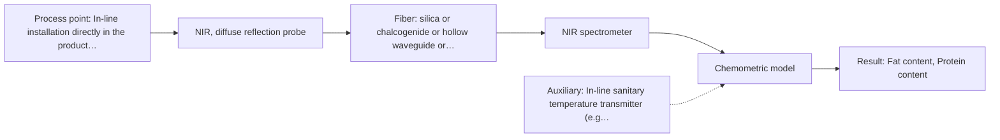

# First technical assessment: Fat and protein monitoring in opaque dairy product

## Answer

**Customer request (our summary):** The customer wants an initial in-line spectroscopy concept and a comparison experiment to detect fat and protein changes in an opaque, concentrated milk product with varying temperature and texture.

### Brief answer

For an opaque, concentrated milk product, in-line NIR diffuse reflection is the recommended method to test first for tracking fat and protein changes. A flush-mounted reflection probe measures backscattered light directly from the flowing stream, while scatter-correction chemometrics decouple chemical composition from texture and particle-size variations. Before proceeding, we need to clarify your expected fat and protein concentration ranges, line operating temperatures and pressures, pipe dimensions, and current laboratory reference methods.

### Proposal

- **Best current option:** O2 (recommended)
- **Basis:** supplied AFS sources
- **What would change it:** If off-line trials demonstrate that product opacity permits adequate light transmission across a narrow transflection gap without clogging, the simpler immersion transflection probe could be selected. Conversely, if extreme texture variations disrupt NIR scatter correction, mid-IR ATR would be evaluated.
- **Next step:** Conduct laboratory feasibility testing with an NIR diffuse reflection probe on representative concentrated milk samples spanning the expected temperature and texture ranges.

**Secondary evidence (external, not AFS material):** G1: no usable external source found; G2: no usable external source found; G3: no usable external source found; G4: no usable external source found. See Expert detail.

**Decision status:** Provisional feasibility assessment

### Solution options

| ID | Tier | Methods | Confidence | Cost class, S01 Table 1 (p.6) | Ease of use | Maintenance | Performance fit | Sources |
|---|---|---|---|---|---|---|---|---|
| O1 | Simple | M3 NIR, transmission/transflection probe | Low: open question: Q1 (starts at Medium); suitability for this sample not confirmed | average cost (row 7) | Standard immersion probe, single insertion port | Regular cleaning of probe optical gap | Tests transflection before modifying pipe wall | [1: S01 p.18] [2: S01 p.18] |
| O2 | Recommended | M1 NIR, diffuse reflection probe | Low: open question: Q1 (starts at Medium); precedent only | average cost (row 8) | Flush sanitary mount, non-intrusive in-line interface | Low maintenance, robust sapphire optical window | Optimal geometry for opaque scattering concentrates | [3: S01 p.17] [4: S01 p.17] [5: S01 p.17] |

*Confidence rates the basis of the advice (how much is known and cited), not a predicted accuracy or probability of success. It starts at High, or at Medium when a key question on the method or the option is open, and drops one level per weakness listed (floor Low).*

*Cost class is the relative rating in S01 Table 1 (p.6) for the in-line method+technique rows named (the highest one for a multi-method option); it is not a price.*

### Setup sketch

*Recommended option O2; drawn by code from the option, a schematic, not a configuration.*

### Key questions

1. What are the expected concentration ranges and required precision/accuracy tolerances for fat and protein in the concentrate stream?
2. What are the operating temperature limits, pipe pressure, and cleaning-in-place (CIP) conditions at the intended measurement location?
3. What are the pipe dimensions, flow rates, and available fitting standards (e.g. Varinline or sanitary clamp) on the processing line?

## Expert detail

**Customer enquiry**

> We produce an opaque, concentrated milk product that flows through a processing line. We currently sample it for fat and protein analysis and would like earlier information about composition changes. Product temperature and texture vary during production. We want an initial spectroscopy concept and a practical comparison experiment, while retaining our laboratory checks.

**Decision status:** Provisional feasibility assessment. A provisional recommendation for in-line NIR diffuse reflection can be justified based on established dairy process analytical precedents for concentrated milk streams, but specific line conditions and target concentration ranges must be confirmed.

### Parameters

| ID | Parameter | Kind | Need | Measured by | Why | Sources |
|---|---|---|---|---|---|---|
| P1 | Fat content | quantitative | required | Spectroscopy: NIR | Primary target parameter required for monitoring product composition and standardization. | [4: S01 p.17] |
| P2 | Protein content | quantitative | required | Spectroscopy: NIR | Primary target parameter required for tracking protein concentration changes during processing. | [4: S01 p.17] |
| P3 | Product temperature | quantitative | required | Auxiliary sensor: In-line sanitary temperature transmitter (e.g., Pt100 RTD) (cited; confirm availability with AFS) | Necessary to compensate for temperature-induced spectral band shifts and texture variations in the multivariate model. | [6: S03 p.5] |
| P4 | Laboratory reference fat and protein | quantitative | required | Reference lab method: Offline reference laboratory analysis (e.g. Gerber / Kjeldahl) | Provides independent offline reference data to train and maintain chemometric calibration models. | *(no verified source: engineering judgement)* |

### Solution option details

- **O1 cost drivers:** Standard NIR spectrometer and transflection probe
- **O2 cost drivers:** NIR spectrometer, diffuse reflectance probe, chemometrics

### Premise check

- **Supported:** In-line optical spectroscopy can track fat and protein composition changes in an opaque concentrated milk product while retaining laboratory checks. Published dairy process analytical technology demonstrates that in-line NIR reflection is used directly in concentrated dairy processing lines to quantify fat and protein with multivariate models, operating alongside routine laboratory testing. [3: S01 p.17] [7: S01 p.17]

### Requirements

**Stated by the customer**

- The product is an opaque, concentrated milk product flowing through an active processing line.
- The company seeks earlier notification of composition changes for fat and protein.
- Product temperature and texture vary during production.
- Existing offline laboratory analysis will be retained alongside the in-line system.
- An initial spectroscopy concept and practical comparison experiment are requested.

**Key unknowns**

- Expected concentration ranges and target accuracy/precision for fat and protein.
- Process line operating temperature and pressure ranges.
- Pipe diameter, flow velocity, and available mounting port standards.
- Cleaning-in-place (CIP) regimens and product fouling propensities.
- Specific analytical laboratory reference methods currently used for calibration.

### Clarification questions (most decision-relevant first)

Q1. What are the expected concentration ranges and required precision/accuracy tolerances for fat and protein in the concentrate stream? *Why it matters:* Determines whether NIR diffuse reflectance calibration can deliver the required sensitivity across production batches. *(affects: method, status)*
Q2. What are the operating temperature limits, pipe pressure, and cleaning-in-place (CIP) conditions at the intended measurement location? *Why it matters:* Dictates probe mechanical specifications, sealing materials, and the extent of temperature compensation needed in calibration models. *(affects: installation, technique)*
Q3. What are the pipe dimensions, flow rates, and available fitting standards (e.g. Varinline or sanitary clamp) on the processing line? *Why it matters:* Determines probe dimensions and mounting geometry to ensure flush alignment with the inner pipe wall. *(affects: installation, technique)*
Q4. Which specific analytical methods (e.g. Gerber, Röse-Gottlieb, Kjeldahl) are used in your routine laboratory checks? *Why it matters:* Identifies the reference standard against which the in-line chemometric models will be calibrated and validated. *(affects: status, M1)*

### Recommendation

- **M1 · Primary candidate: NIR, diffuse reflection probe.** NIR diffuse reflection is the standard process analytical approach for opaque and concentrated dairy products like yogurt and whole milk concentrates (S01 p.17). It measures backscattered light through a flush-mounted window, avoiding pathlength saturation while enabling multivariate calibration for fat and protein. [3: S01 p.17] [5: S01 p.17]
- **M2 · Comparison candidate: MIR, ATR probe.** Mid-IR ATR provides direct access to fundamental molecular vibrations with high chemical selectivity for protein and lipid functional groups (S01 p.6, S01 p.18). However, it samples only a few micrometers at the crystal interface, presenting higher fouling risks in flowing dairy lines. [8: S01 p.18] [9: S01 p.13]
- **M3 · Conditional candidate: NIR, transmission/transflection probe.** Transflection probes can serve as a single-probe solution for liquid dairy products across varying fat levels (S01 p.18). However, for thick and opaque streams, transmission signals can saturate due to strong light attenuation. *Conditions:* Applicable only if sample dilution or pathlength adjustment allows sufficient optical transmission through the opaque product. [1: S01 p.18] [2: S01 p.18]

### Measurement concept

- **Probe and geometry:** A diffuse reflection fiber-optic probe with a sapphire optical window, flush-mounted into the pipe wall to measure backscattered light from the flowing opaque concentrate without creating flow stagnation.
- **Location:** In-line installation directly in the product pipe line, downstream of mixing or concentration units where the stream is homogeneous.
- **Fiber link:** Low-OH silica fiber-optic cable connecting the in-line probe head to an industrial NIR spectrometer positioned safely away from process heat and washdown areas. [10: S01 p.17] [11: S01 p.15] [12: S02 p.7]

### Spectral range

- **NIR:** Nominal NIR range is 780-2500 nm (predominantly overtones and combination bands of C-H, O-H, and N-H bonds); the usable spectral range depends on the spectrometer detector, silica fiber solarisation/attenuation, and probe optics. [13: S01 p.10] [14: REF §3]

### Risks and uncertainty

- Fluctuations in product texture and fat globule size alter light scattering, which can mimic composition changes if not properly corrected by scatter preprocessing. *(rules: R-GEO-6, R-NIR-2)* [15: S01 p.17] [16: S01 p.10]
- Temperature fluctuations shift water and molecular absorption bands, degrading calibration accuracy if temperature variation is not incorporated into the multivariate model. *(rules: R-CAL-1, R-GEN-5)* [6: S03 p.5]
- Product fouling or protein deposition on the optical probe window can distort spectra and cause baseline drift over extended production cycles. *(rules: R-MIR-3, R-GEN-5)* [17: REF §5]
- Changes in raw milk composition or product formulation matrix will require re-validation and updating of the chemometric calibration. *(rules: R-CAL-1)* [18: REF §5]

### First feasibility experiment

1. **Collect representative concentrate samples spanning full operational ranges of fat, protein, temperature, and texture variations.** Ensure the calibration dataset captures the true physical and chemical variance of the production process. *(no verified source: engineering judgement)*
2. **Perform laboratory reference analysis on all collected samples using validated chemical methods.** Provide independent, high-accuracy reference values to serve as calibration truth. [19: REF §3]
3. **Acquire diffuse reflectance NIR spectra across controlled sample temperatures in a laboratory test bench.** Evaluate spectral sensitivity to fat and protein while assessing the impact of temperature shifts and scattering differences. *(no verified source: engineering judgement)*
4. **Develop PLS regression models incorporating scatter corrections (SNV/MSC) and validate against an independent test set of held-out batches.** Quantify prediction accuracy (RMSEP, R2) and verify model robustness against texture and temperature variations. [4: S01 p.17]
5. **Evaluate prediction errors against customer-defined accuracy thresholds for a formal go/no-go milestone before pilot line integration.** Establish clear technical justification for proceeding to in-line pipe trial installation. *(no verified source: engineering judgement)*

**Reference measurements:** Independent offline laboratory reference analyses for fat and protein (such as Gerber/Röse-Gottlieb for fat and Kjeldahl/combustion for protein) performed on split samples taken simultaneously with spectral acquisition.

**Decision basis:** The go/no-go decision will be based on whether the cross-validated and test-set prediction accuracy (RMSEP) meets the customer's specified tolerance limits for fat and protein control, with numerical criteria defined by the customer.

### Assumptions

- The opaque concentrated milk stream remains sufficiently liquid and mobile to flow continuously across a flush-mounted probe face.
- Standard CIP cleaning protocols or periodic flushing can prevent irreversible fouling or deposit build-up on the probe window.
- Offline laboratory reference analytical methods provide sufficient precision to serve as calibration training standards.

### Not covered by the supplied sources

- Achievable accuracy, precision, and limits of detection for fat and protein in this specific concentrated milk matrix.
- Maximum allowable pressure, temperature limits, and food-contact certification details for specific AFS probe models.

### Further notes

- **Chemometrics:** Multivariate regression (Partial Least Squares, PLS) is essential for quantifying fat and protein from overlapping NIR absorption bands. Preprocessing techniques such as Standard Normal Variate (SNV) or Multiplicative Scatter Correction (MSC) must be applied to remove physical scatter variations caused by changing texture and fat globule sizes.
- **Real-time tracking:** Continuous in-line optical acquisition enables immediate detection of composition trends and process upsets, providing early warning between routine laboratory sampling intervals.
- **Future direction:** If the product line stabilizes and specific wavelengths capture the required variance, development of dedicated LED-based optical sensors can provide a compact, cost-effective alternative for multi-point installation across the plant.

### Secondary evidence (external, not AFS material)

*Found by a literature search for gaps the supplied AFS sources leave open. Not AFS material and not proof for this case; every quote below was verified verbatim against the fetched text.*

*Live search unavailable (library only: cache miss (europepmc); cache miss (openalex)); curated library only.*

**G1 · auxiliary sensor:** In-line measurement of Product temperature with In-line sanitary temperature transmitter (e.g., Pt100 RTD)

- No usable external source found.

**G2 · not in the supplied sources:** Achievable accuracy, precision, and limits of detection for fat and protein in this specific concentrated milk matrix.

- No usable external source found.

**G3 · not in the supplied sources:** Maximum allowable pressure, temperature limits, and food-contact certification details for specific AFS probe models.

- No usable external source found.

**G4 · parameter without a source:** Measuring Laboratory reference fat and protein: Provides independent offline reference data to train and maintain chemometric calibration models.

- No usable external source found.

### Evidence (verified quotes)

1. ✓ **S01 p.18** (general): "In some cases, a Transflection probe can already be a combined solution working well for low-fat and high-fat containing milk products."
2. ✓ **S01 p.18** (general): "it fails when the milk becomes too "thick" or fat-rich, as the light cannot penetrate the sample."
3. ✓ **S01 p.17** (application precedent): "Inline NIR Reflection is primarily used for opaque or highly concentrated dairy products, such as yogurt, butter, or whole milk concentrates."
4. ✓ **S01 p.17** (general): "applying Multiplicative Scatter Correction (MSC) or Standard Normal Variate (SNV) transformations to remove physical interference caused by the scattering nature of the milk particles before using Partial Least Squares (PLS) regression to quantify fat and protein."
5. ✓ **S01 p.17** (general): "The main equipment includes a fiber optic probe where one set of fibers delivers light to the sample and the other collects the "backscattered" light."
6. ✓ **S03 p.5** (general): "As the temperature noticeably affects the spectral properties of LEDs, this was controlled using a built-in semiconductor sensor."
7. ✓ **S01 p.17** (general): "using Partial Least Squares (PLS) regression to quantify fat and protein."
8. ✓ **S01 p.18** (general): "advanced labs often incorporate Fluorescence, Raman, and Mid-Infrared (MIR) ATR fiber optic techniques to capture specific chemical or structural information that NIR might miss."
9. ✓ **S01 p.13** (general): "typically at a depth of few microns"
10. ✓ **S01 p.17** (general): "Experimentally, the probe is flush-mounted into a pipe or vat to interact directly with the flowing medium."
11. ✓ **S01 p.15** (general): "located safely away from the vibration and dust of the manufacturing floor."
12. ✓ **S02 p.7** (performance figure): "Robust 100-300m cables made with Silica fibers of low OH-content (<0.1ppm OH) enable remote industrial process-control"
13. ✓ **S01 p.10** (general): "NIR spectra (780-2500 nm) contain predominantly overtones and component bands of fundamental vibrations of molecules and atomic groups, such as -OH, -NH2=NH, -CH3, =CH2, ≥CH, etc., found in many organic and inorganic compounds."
14. ✓ **REF §3** (general): "A nominal method range is not the range of a specific instrument, fiber or probe."
15. ✓ **S01 p.17** (general): "the method is sensitive to the surface characteristics and fat globule size."
16. ✓ **S01 p.10** (general): "The broad absorption bands observed in this region overlap, suggesting the use of chemometrics for quantitative and qualitative analysis of spectral data."
17. ✓ **REF §5** (general): "Usable range limited by fiber and crystal; contact, fouling, compatibility."
18. ✓ **REF §5** (general): "physical variation; calibration specific to the matrix."
19. ✓ **REF §3** (general): "Representative samples or process states, independent reference measurements, what is compared, and the basis for the go / no-go decision."

### Verification

- Citations verified: 28 of 28 (exact or whitespace/hyphen-tolerant match on the cited page, scope checked).
- Hard check failures before deterministic corrections: 0; still open: 0; soft warnings: 1; repair rounds: 0.
- Removed 1 intake item(s) not quoted verbatim from the enquiry:
  - intake.targets[0]: enquiry_quote not found verbatim in the enquiry
- External evidence (cache): 0 quote(s) verified verbatim (exact or whitespace/hyphen-tolerant, at most 400 characters and 2 sentences, against the cited paragraph); 0 item(s) dropped.
- External search: 4 query(ies), 0 hit(s), 3 source(s) (3 from the curated library); ⚠ library only: cache miss (europepmc); cache miss (openalex).
- External step: 2 model call(s), 5.1 s extra (cost in the run JSON).

*Run D02-20261018T075900Z-be1b · models google/gemini-3.8-flash*
