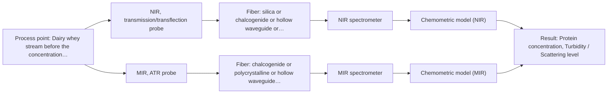

# First technical assessment: A clear whey stream before concentration

## Answer

**Customer request (our summary):** The customer wants a spectroscopy measurement concept to track protein concentration in a dairy whey stream that transitions from clear to turbid.

### Brief answer

To track protein concentration in a whey stream that shifts from clear to turbid, start by testing NIR transflection, which can handle varying dairy liquid conditions. If extreme turbidity causes light blockage, an MIR ATR probe serves as a robust alternative since it samples via surface evanescent waves. Laboratory reference assays should be used to build and validate chemometric calibration models.

### Proposal

- **Best current option:** O2 (recommended)
- **Basis:** supplied AFS sources
- **What would change it:** Definitive turbidity limits and customer accuracy criteria.
- **Next step:** Conduct laboratory multispectral trials using representative clear and turbid whey samples.

**Secondary evidence (external, not AFS material):** G1: E01 ¶34; G2: no usable external source found. See Expert detail.

**Decision status:** Provisional feasibility assessment

### Solution options

| ID | Tier | Methods | Confidence | Cost class, S01 Table 1 (p.6) | Ease of use | Maintenance | Performance fit | Sources |
|---|---|---|---|---|---|---|---|---|
| O1 | Simple | M1 NIR, transmission/transflection probe | Low: sample clarity varies; precedent only | average cost (row 7) | Standard NIR transflection probe | Regular optical window cleaning | Handles clear to moderately turbid dairy liquids well | [1: S01 p.18] |
| O2 | Recommended | M1 NIR, transmission/transflection probe; M2 MIR, ATR probe | Medium: sample clarity varies | high cost (rows 2, 7) | Adaptable optical interface setup | Routine calibration maintenance | Robust against extreme turbidity via ATR backup | [1: S01 p.18] [2: S01 p.16] |

*Confidence rates the basis of the advice (how much is known and cited), not a predicted accuracy or probability of success. It starts at High, or at Medium when a key question on the method or the option is open, and drops one level per weakness listed (floor Low).*

*Cost class is the relative rating in S01 Table 1 (p.6) for the in-line method+technique rows named (the highest one for a multi-method option); it is not a price.*

### Setup sketch

*Recommended option O2; drawn by code from the option, a schematic, not a configuration.*

### Key questions

1. What is the expected range of turbidity or optical density when the stream transitions from clear to turbid?
2. What are the process temperature, pressure, and line dimensions at the installation point before concentration?
3. What are the required measurement accuracy and response time for tracking protein concentration?

## Expert detail

**Customer enquiry**

> Our dairy process includes a relatively clear whey stream before a concentration stage. We want to investigate whether spectroscopy can track protein concentration as the stream changes, with laboratory results used as the reference. The stream can become more turbid under some operating conditions. We need a first measurement concept that handles this change rather than assuming the liquid always remains clear.

**Decision status:** Provisional feasibility assessment. A provisional assessment is justified to test NIR transflection and MIR ATR techniques that can handle varying dairy stream turbidity, while key unknowns regarding precise optical density ranges are clarified.

### Parameters

| ID | Parameter | Kind | Need | Measured by | Why | Sources |
|---|---|---|---|---|---|---|
| P1 | Protein concentration | quantitative | required | Spectroscopy: NIR | Core target variable to track in the whey stream. | *(no verified source: engineering judgement)* |
| P2 | Turbidity / Scattering level | quantitative | required | Spectroscopy: NIR | Needed to ensure the measurement concept handles stream clarity changes. | *(no verified source: engineering judgement)* |

### Solution option details

- **O1 cost drivers:** NIR spectrometer and transflection probe hardware
- **O2 cost drivers:** Multi-method or adaptable probe evaluation

### Premise check

- **Supported:** Spectroscopy can successfully track protein concentration while the stream changes from clear to turbid. Dairy applications such as milk and whey processing demonstrate that optical methods can monitor streams across varying turbidity states using appropriate probes. [1: S01 p.18]

### Requirements

**Stated by the customer**

- Track protein concentration in a dairy whey stream before a concentration stage
- Handle stream turbidity changes from clear to turbid
- Use laboratory results as the reference

**Key unknowns**

- Exact turbidity range and frequency of optical changes in the whey stream
- Process temperature, pressure, and pipe dimensions for probe installation
- Required measurement accuracy and response time

### Clarification questions (most decision-relevant first)

Q1. What is the expected range of turbidity or optical density when the stream transitions from clear to turbid? *Why it matters:* Determines whether standard NIR transflection can maintain sufficient signal or if surface ATR is required. *(affects: technique)*
Q2. What are the process temperature, pressure, and line dimensions at the installation point before concentration? *Why it matters:* Dictates mechanical probe rating and flange or fitting requirements. *(affects: installation)*
Q3. What are the required measurement accuracy and response time for tracking protein concentration? *Why it matters:* Establishes whether single-method performance meets operational targets. *(affects: status)*

### Recommendation

- **M1 · Primary candidate: NIR, transmission/transflection probe.** NIR transflection probes handle dairy liquids across varying scattering and fat/protein profiles by balancing pathlength and penetration. *Conditions:* Applies when pathlength can be controlled for both clear and moderately turbid states. [1: S01 p.18]
- **M2 · Comparison candidate: MIR, ATR probe.** MIR ATR is largely insensitive to bulk turbidity changes because it relies on evanescent wave penetration limited to a micrometre-scale surface layer. *Conditions:* Applies if bulk turbidity fluctuations saturate transmission measurements. [2: S01 p.16]

### Measurement concept

- **Probe and geometry:** NIR transflection probe or MIR ATR probe flush-mounted into the process line.
- **Location:** Dairy whey stream before the concentration stage.
- **Fiber link:** Silica fiber cables for NIR or PIR/CIR fibers for MIR connecting the probe to the spectrometer. [3: S01 p.18]

### Spectral range

- **NIR:** Nominal NIR range is 780-2500 nm; usable range depends on the instrument, fiber, and probe selected. It is not a product specification. [4: S01 p.10]
- **MIR:** Nominal Mid-IR range is 4000-400 cm-1; usable range depends on configuration and sample. It is not a product specification. [5: S01 p.9]

### Risks and uncertainty

- Increased turbidity or scattering can saturate standard transmission measurements or alter pathlength effectiveness. *(rules: R-GEO-2)* [6: S01 p.18]
- Fouling or deposits on the probe crystal/window over time during dairy processing. *(rules: R-MIR-3)* [7: REF §5]
- Calibration drift due to unmonitored physical and compositional changes in the whey matrix. *(rules: R-CAL-1)* [8: REF §5]

### First feasibility experiment

1. **Collect representative dairy whey samples across clear and turbid operating conditions.** Gather representative whey samples across clear and turbid operating conditions. [9: REF §3]
2. **Perform independent laboratory reference testing for protein concentration.** Measure protein concentration using standard laboratory methods as independent reference. *(no verified source: engineering judgement)*
3. **Conduct single-method bench trials using NIR transflection and MIR ATR probes.** Test NIR transflection and MIR ATR probes on samples to evaluate response to turbidity. *(no verified source: engineering judgement)*
4. **Build multivariate chemometric calibration models correlating spectra with reference values.** Build PLS calibration models relating spectra to reference protein concentrations. *(no verified source: engineering judgement)*
5. **Validate prediction accuracy and robustness on independent held-out process runs.** Validate prediction performance on held-out test runs or batches. *(no verified source: engineering judgement)*

**Reference measurements:** Standard laboratory protein test methods.

**Decision basis:** Go/no-go based on customer's required prediction accuracy and robustness across turbidity shifts.

### Assumptions

- The whey stream is accessible for probe insertion before the concentration stage.
- Laboratory reference measurements for protein are available and reliable.

### Further notes

- **Chemometrics:** Chemometric calibration (e.g., PLS) is required to relate broad NIR or MIR spectral bands to protein concentration while accounting for scattering variations.
- **Real-time tracking:** In-line fiber-optic probes enable real-time tracking of protein changes directly in the process stream before concentration.
- **Future direction:** Integration of cloud-based IoT sensing for automated process control.

### Secondary evidence (external, not AFS material)

*Found by a literature search for gaps the supplied AFS sources leave open. Not AFS material and not proof for this case; every quote below was verified verbatim against the fetched text.*

*Live search unavailable (library only: cache miss (europepmc); cache miss (openalex)); curated library only.*

**G1 · parameter without a source:** Measuring Protein concentration: Core target variable to track in the whey stream.

- **E01 ¶34** The combination of ATR-FTIR measurements proved useful for real-time reaction monitoring and identifying faulty batches. *How it applies:* We could test if ATR-FTIR monitoring is capable of tracking concentration parameters in the process stream. *Limits and transfer risks:* The source discusses polysiloxane formation rather than a dairy whey stream, so matrix and chemical composition differ significantly. *(supports O2)*
  > "The combination of ATR-FTIR measurements and PCA proved to be a valuable tool for real-time reaction monitoring and identifying faulty batches."
  > A Process Analytical Concept for In-Line FTIR Monitoring of Polysiloxane Formation. (2020) · Polymers · doi:10.3390/polym12112473 · https://europepmc.org/article/PMC/PMC7693933 · retrieved 2026-10-17, full text, licence: cc by, via curated library

**G2 · parameter without a source:** Measuring Turbidity / Scattering level: Needed to ensure the measurement concept handles stream clarity changes.

- No usable external source found.

### Evidence (verified quotes)

1. ✓ **S01 p.18** (application precedent): "In some cases, a Transflection probe can already be a combined solution working well for low-fat and high-fat containing milk products."
2. ✓ **S01 p.16** (general): "extremely short path length that enables the measurement of "black" or highly scattering fluids without dilution."
3. ✓ **S01 p.18** (general): "The setup typically consists of a transmission / transflection probe, where light passes entirely through a defined layer of the sample to a detector on the opposite side."
4. ✓ **S01 p.10** (general): "NIR spectra (780-2500 nm) contain predominantly overtones and component bands of fundamental vibrations"
5. ✓ **S01 p.9** (general): "Vibrational spectroscopy in the mid-IR range (4000-400 cm-1) is one of the most informative methods of chemical analysis."
6. ✓ **S01 p.18** (general): "it fails when the milk becomes too "thick" or fat-rich, as the light cannot penetrate the sample."
7. ✓ **REF §5** (general): "Usable range limited by fiber and crystal; contact, fouling, compatibility."
8. ✓ **REF §5** (general): "physical variation; calibration specific to the matrix."
9. ✓ **REF §3** (general): "Representative samples or process states, independent reference measurements, what is compared, and the basis for the go / no-go decision."

### Verification

- Citations verified: 10 of 10 (exact or whitespace/hyphen-tolerant match on the cited page, scope checked).
- Hard check failures before deterministic corrections: 0; still open: 0; soft warnings: 1; repair rounds: 1.
- Removed 1 intake item(s) not quoted verbatim from the enquiry:
  - intake.sample.fluorophore: slot value without a verbatim enquiry quote; reset to unknown
- External evidence (cache): 1 quote(s) verified verbatim (exact or whitespace/hyphen-tolerant, at most 400 characters and 2 sentences, against the cited paragraph); 0 item(s) dropped.
- External search: 4 query(ies), 0 hit(s), 3 source(s) (3 from the curated library); ⚠ library only: cache miss (europepmc); cache miss (openalex).
- External step: 2 model call(s), 1.9 s extra (cost in the run JSON).

*Run D03-20261018T075900Z-0b57 · models google/gemini-3.5-flash-lite, google/gemini-3.8-flash*
