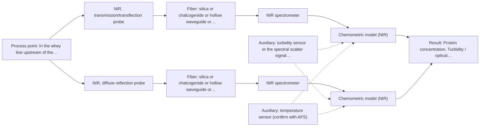
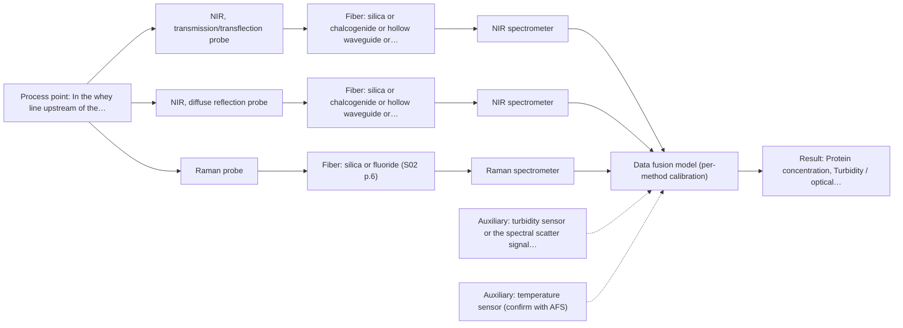

# First technical assessment: A clear whey stream before concentration

## Answer

**Customer request (our summary):** The customer wants to investigate if spectroscopy can track protein concentration in a dairy whey stream that changes from clear to turbid.

### Brief answer

Test NIR first: a transmission/transflection probe for the clear whey and a diffuse-reflection probe for the turbid states, calibrated against your laboratory protein results. This dual-technique NIR approach follows published dairy practice and directly addresses your clear-to-turbid change. Raman is a fallback if NIR accuracy falls short. Open points: how turbid the stream gets, the required accuracy and range, and the installation details.

### Proposal

- **Best current option:** O2 (recommended)
- **Basis:** supplied AFS sources
- **What would change it:** If Q1 shows the turbid state is so opaque that even reflection NIR fails, or Q2 shows a much higher accuracy requirement than NIR can meet, the Raman-based extended option (O3) becomes the focus.
- **Next step:** Run the multi-technique laboratory trial on representative clear and turbid whey samples with independent laboratory protein references, against a customer-agreed accuracy criterion.

**Secondary evidence (external, not AFS material):** G1: no usable external source found; G2: E03 ¶12; G3: no usable external source found; G4: no usable external source found. See Expert detail.

**Decision status:** Provisional feasibility assessment

### Solution options

| ID | Tier | Methods | Confidence | Cost class, S01 Table 1 (p.6) | Ease of use | Maintenance | Performance fit | Sources |
|---|---|---|---|---|---|---|---|---|
| O1 | Simple | M1 NIR, transmission/transflection probe | Low: open question: Q2 (starts at Medium); sample clarity unknown | average cost (row 7) | Standard dairy NIR practice, straightforward probe | Window cleaning; calibration re-validation on matrix change | Fits clear whey; turbid states remain unverified | [1: S01 p.18] [2: S01 p.18] [3: S01 p.17] |
| O2 | Recommended | M1 NIR, transmission/transflection probe; M2 NIR, diffuse reflection probe | Low: open question: Q2 (starts at Medium); sample clarity unknown | average cost (rows 7, 8) | Two NIR techniques, one spectrometer platform | Two probe windows; per-technique calibration upkeep | Covers clear and turbid states within one method | [4: S01 p.18] [1: S01 p.18] [2: S01 p.18] [3: S01 p.17] [5: S01 p.17] [6: S01 p.17] |
| O3 | Extended (multi-method) | M1 NIR, transmission/transflection probe; M2 NIR, diffuse reflection probe; M3 Raman probe | Low: open question: Q2 (starts at Medium); sample clarity unknown; multi-method, fusion benefit not yet shown | high cost (rows 7, 8, 12) | Two instruments, more complex alignment | Per-method calibration and diagnostics; laser upkeep | Adds molecular specificity if NIR alone falls short | [7: S01 p.8] [8: S01 p.16] [1: S01 p.18] [2: S01 p.18] [3: S01 p.17] [5: S01 p.17] [6: S01 p.17] [9: S01 p.11] |

*Confidence rates the basis of the advice (how much is known and cited), not a predicted accuracy or probability of success. It starts at High, or at Medium when a key question on the method or the option is open, and drops one level per weakness listed (floor Low).*

*Cost class is the relative rating in S01 Table 1 (p.6) for the in-line method+technique rows named (the highest one for a multi-method option); it is not a price.*

### Setup sketch

*Recommended option O2; drawn by code from the option, a schematic, not a configuration.*

### Key questions

1. How turbid does the stream become, and is the turbidity caused by fat, fine particles or precipitated protein?
2. What protein concentration range and accuracy does the concentration stage require, and how fast must the result update?
3. Where in the line would the probe sit (pipe size, material, access), and what are the process temperature and CIP/fouling conditions?

## Expert detail

**Customer enquiry**

> Our dairy process includes a relatively clear whey stream before a concentration stage. We want to investigate whether spectroscopy can track protein concentration as the stream changes, with laboratory results used as the reference. The stream can become more turbid under some operating conditions. We need a first measurement concept that handles this change rather than assuming the liquid always remains clear.

**Decision status:** Provisional feasibility assessment. A method shortlist can be justified from the dairy NIR precedents in the supplied material, but the turbidity behaviour, required accuracy and installation details are open, so the choice between NIR transmission/transflection and reflection must be settled by a lab trial.

### Parameters

| ID | Parameter | Kind | Need | Measured by | Why | Sources |
|---|---|---|---|---|---|---|
| P1 | Protein concentration | quantitative | required | Reference lab method: customer laboratory protein method (e.g. Kjeldahl/Dumas or equivalent, to be confirmed) | It is the target variable the spectroscopy must track against the laboratory reference. | *(no verified source: engineering judgement)* |
| P2 | Turbidity / optical scattering state | quantitative | required | Auxiliary sensor: turbidity sensor or the spectral scatter signal itself (cited; confirm availability with AFS) | The clear-to-turbid change is the central risk; it must be quantified to test whether one geometry covers both states. | [6: S01 p.17] |
| P3 | Process temperature | quantitative | optional | Auxiliary sensor: temperature sensor (engineering judgement: confirm availability with AFS) | Temperature shifts affect NIR spectra of dairy streams and should be recorded so its influence can be separated from composition; it should be available from the process. | *(no verified source: engineering judgement)* |

### Solution option details

- **O1 cost drivers:** One NIR spectrometer, one transflection probe, silica fiber link, calibration samples and reference analyses
- **O2 cost drivers:** NIR spectrometer, transflection and reflection probes, fiber link, wider calibration set spanning both states
- **O3 cost drivers:** Second spectrometer and Raman probe, synchronisation software, larger validation set to prove the fusion gain
- **O3 combining methods:** Fusion level: start with one PLS model per method, then join synchronised NIR and Raman spectra or scores with block scaling. Both probes must sample the same spot and the data must be normalised to a common time step. The fused model must beat the best single-method model on held-out batches, otherwise the Raman instrument is dropped.

*Extended (multi-method) option O3; drawn by code from the option, a schematic, not a configuration.*

### Premise check

- **Precedent only:** Spectroscopy can track protein concentration in a dairy stream. The supplied material shows NIR protein/fat analysis in dairy streams as published practice; this is a reason to test, not proof for this specific whey stream. [10: S01 p.17] [3: S01 p.17]
- **Precedent only:** A single probe geometry can handle both the clear and the turbid state of the stream. The dairy example says a transflection probe can in some cases serve both low-fat and high-fat products; whether this transfers to this whey stream is exactly what a trial must show. [11: S01 p.18]

### Requirements

**Stated by the customer**

- Track protein concentration in a whey stream before a concentration stage
- Handle a stream that can become more turbid under some operating conditions
- Use laboratory results as the reference

**Key unknowns**

- How turbid the stream becomes and what causes the turbidity (fat, fines, precipitated protein)
- Required protein range, accuracy and update rate
- Installation point, pipe geometry, temperature and cleaning regime
- Which laboratory reference method is used and its sampling frequency

### Clarification questions (most decision-relevant first)

Q1. How turbid does the stream become, and is the turbidity caused by fat, fine particles or precipitated protein? *Why it matters:* It decides whether a transmission/transflection probe still works or whether a reflection geometry is needed for the turbid states. *(affects: technique)*
Q2. What protein concentration range and accuracy does the concentration stage require, and how fast must the result update? *Why it matters:* It determines whether NIR sensitivity is sufficient and whether a full-spectrum or reduced-channel approach is appropriate. *(affects: method)*
Q3. Where in the line would the probe sit (pipe size, material, access), and what are the process temperature and CIP/fouling conditions? *Why it matters:* It constrains the probe type, pathlength and fiber link, and ATR-style contact surfaces are fouling risks. *(affects: installation)*
Q4. Which laboratory method provides the protein reference, and how often can samples be taken during the trial? *Why it matters:* The calibration is only as good as the reference data covering the clear and turbid states. *(affects: status)*
Q5. Does the stream composition (fat, lactose, minerals) also vary between the clear and turbid conditions? *Why it matters:* Correlated physical and chemical changes can make a calibration look better or worse than it really is. *(affects: M1)*

### Recommendation

- **M1 · Primary candidate: NIR, transmission/transflection probe.** NIR transmission/transflection is the preferred geometry for clear dairy-type liquids and has published dairy precedent for fat and protein quantification. A transflection probe may in some cases also cover the more turbid state, which must be verified on real samples. *Conditions:* The pathlength must be controlled (typically 1-10 mm in the dairy example) and the probe must still work at the highest turbidity encountered. [1: S01 p.18] [2: S01 p.18] [3: S01 p.17]
- **M2 · Comparison candidate: NIR, diffuse reflection probe.** NIR diffuse reflection is the geometry used for opaque or highly concentrated dairy products and is the natural fallback when transmission fails on turbid samples. Testing it beside M1 shows whether one geometry can cover the whole operating window. *Conditions:* Reflection signals are sensitive to surface characteristics and particle size, so scatter correction and a matrix-specific calibration are needed. [5: S01 p.17] [6: S01 p.17]
- **M3 · Conditional candidate: Raman probe.** Raman suits aqueous media because water interferes less than in infrared methods, and it can quantify organic components with a chemometric model. It is worth testing only if NIR cannot meet the accuracy requirement across the turbidity change. *Conditions:* Applies if the NIR trial shows insufficient accuracy or if fluorescence background from the whey does not swamp the Raman signal. [8: S01 p.16] [9: S01 p.11]
- **M4 · Not recommended: UV-Vis, transmission/transflection probe.** A reader might expect simple UV-Vis absorption as the cheapest protein assay, but UV signals of real mixtures overlap strongly and a transmission setup saturates when the stream becomes turbid or highly concentrated. [12: S01 p.5] [13: S01 p.16]

### Measurement concept

- **Probe and geometry:** Immersion NIR transflection probe with a controlled short pathlength as the primary concept; an NIR diffuse-reflection probe tested in parallel for the turbid states.
- **Location:** In the whey line upstream of the concentration stage, at a representative, well-mixed point; exact position to be agreed once pipe geometry is known.
- **Fiber link:** Vis-NIR silica fibers (nominal transmission to about 2400 nm per S02 p.6); the usable range depends on the spectrometer, fiber and probe actually selected. [14: S02 p.6] [15: S01 p.10]

### Spectral range

- **NIR:** Nominal NIR range 780-2500 nm; the usable range depends on the spectrometer, fiber and probe actually selected. [15: S01 p.10]
- **Raman:** Raman is reported as Raman shift in cm-1 with the laser excitation wavelength stated separately; the excitation wavelength for this application is not yet chosen. [16: S01 p.11]

### Risks and uncertainty

- The turbidity change may be caused by particles or fat that scatter light so strongly that no single fixed geometry covers both states, forcing a two-technique or two-probe solution. *(rules: R-GEO-2, R-GEO-6)* [17: S01 p.18]
- Reflection signals respond to surface characteristics and particle size, so physical variation between clear and turbid states can mimic or mask composition change unless scatter correction and a matrix-specific calibration are used. *(rules: R-GEO-6, R-CAL-1)* [6: S01 p.17]
- The dairy precedents cover milk and related streams, not this specific whey; the published applications are a reason to test, not proof of performance for this customer. *(rules: R-EVI-2)* [18: REF §3]
- If the laboratory reference method or its sampling density does not cover the turbid operating states, the calibration will be biased towards the clear condition. *(rules: R-GEN-2)* *(no verified source: engineering judgement)*

### First feasibility experiment

1. **Collect representative whey samples across the full expected variation: clear and turbid states, different operating conditions, and the extremes of the protein range.** Ensure the calibration data cover the physical change the customer explicitly expects. *(no verified source: engineering judgement)*
2. **Measure each sample with the NIR transmission/transflection probe and the NIR diffuse-reflection probe in the laboratory, and record turbidity and temperature alongside.** Compare the two geometries on identical samples rather than assuming one works. *(no verified source: engineering judgement)*
3. **Analyse all samples with the customer's laboratory reference method for protein, taken independently of the spectral measurements.** Provide the independent reference data the calibration and validation need. *(no verified source: engineering judgement)*
4. **Build separate PLS calibrations per technique (single methods first), apply scatter correction where needed, and validate on held-out samples or batches not used in calibration.** Quantify whether either geometry alone meets the requirement across the turbidity change. *(no verified source: engineering judgement)*
5. **Go/no-go: agree with the customer a numerical accuracy criterion for protein prediction on held-out samples covering both clear and turbid states; only if no single geometry meets it, test a combined two-technique or Raman-based approach against the best single method.** Make the decision to proceed, extend or stop objective and customer-owned. *(no verified source: engineering judgement)*

**Reference measurements:** Laboratory protein results per the customer's reference method, on every calibration and validation sample.

**Decision basis:** Customer-defined numerical accuracy for protein prediction on held-out samples spanning the clear-to-turbid range; the criterion value is not yet stated and must come from the customer.

### Assumptions

- The stream is aqueous and its protein is the main quantification target; fat and lactose variations are secondary but present.
- An in-line immersion probe at the whey line is acceptable; no side-stream or at-line constraint was stated.

### Not covered by the supplied sources

- Protein detection limits or accuracy achievable in whey specifically; no source gives figures for this matrix.
- Achievable fiber link length for this installation; the sources state link lengths only for low-OH silica cables in general industrial process control, with no figure for this customer.

### Further notes

- **Chemometrics:** A PLS regression per technique, with scatter correction (MSC or SNV) where reflection data are used, is the published dairy approach; validation must use held-out samples or batches, and the calibration must span both the clear and turbid states.
- **Real-time tracking:** The goal is in-line, time-resolved tracking of protein through the turbidity change; diode-array NIR instruments allow instantaneous full-spectrum acquisition, which supports fast process monitoring.
- **Future direction:** If the trial succeeds, a compact LED-based NIR sensor at selected wavelengths could later replace the full spectrometer for routine monitoring, following the published wavelength-selection approach.

### Secondary evidence (external, not AFS material)

*Found by a literature search for gaps the supplied AFS sources leave open. Not AFS material and not proof for this case; every quote below was verified verbatim against the fetched text.*

*Live search unavailable (library only: cache miss (europepmc); cache miss (openalex)); curated library only.*

**G1 · auxiliary sensor:** In-line measurement of Turbidity / optical scattering state with turbidity sensor or the spectral scatter signal itself

- No usable external source found.

**G2 · auxiliary sensor:** In-line measurement of Process temperature with temperature sensor

- **E03 ¶12** The text notes that the temperature sensitivity of the OH bands represents a severe drawback for measuring aqueous solutions in NIR and MIR, requiring tempered sample holders. *How it applies:* This suggests that temperature fluctuations in the dairy whey stream should be carefully monitored or controlled during NIR measurements to avoid thermal interference with water bands. *Limits and transfer risks:* The source discusses biopharmaceutical downstream processing in general rather than an in-line dairy whey stream, so the exact magnitude of the thermal effect may differ. *(supports O2)*
  > "Additionally, the temperature sensitivity of the OH bands is a severe drawback for measuring aqueous solution in NIR and MIR, which makes tempered sample holders necessary [29]."
  > A critical review of recent trends, and a future perspective of optical spectroscopy as PAT in biopharmaceutical downstream processing. (2020) · Analytical and bioanalytical chemistry · doi:10.1007/s00216-020-02407-z · https://europepmc.org/article/PMC/PMC7072065 · retrieved 2026-10-17, full text, licence: cc by, via curated library

**G3 · multi-method:** Combining several spectroscopy methods (data fusion) (Fusion level: start with one PLS model per method, then join synchronised NIR and Raman spectra or scores with block scaling. Both probes must sample the same spot and the data must be normalised to a common time step. The fused model must beat the best single-method model on held-out batches, otherwise the Raman instrument is dropped.)

- No usable external source found.

**G4 · not in the supplied sources:** Protein detection limits or accuracy achievable in whey specifically; no source gives figures for this matrix.

- No usable external source found.

### Evidence (verified quotes)

1. ✓ **S01 p.18** (general): "Transmission is the preferred method for transparent or semi-transparent liquids, such as skim milk, whey, or permeate."
2. ✓ **S01 p.18** (general): "the precise control of the optical pathlength (usually 1 - 10 mm); if the pathlength is too wide, the signal is lost to absorption; if too narrow, the sample represents a negligible volume."
3. ✓ **S01 p.17** (application precedent): "before using Partial Least Squares (PLS) regression to quantify fat and protein."
4. ✓ **S01 p.18** (application precedent): "By maintaining both, a lab can calibrate models for every stage of production - from raw milk intake to final evaporation - ensuring that no matter how the physical state of the milk changes during processing, the inline monitoring remains accurate and robust."
5. ✓ **S01 p.17** (general): "NIR Reflection is primarily used for opaque or highly concentrated dairy products, such as yogurt, butter, or whole milk concentrates."
6. ✓ **S01 p.17** (general): "the method is sensitive to the surface characteristics and fat globule size."
7. ✓ (precedent only) **S01 p.8** (method gain): "Ultimately, the measurement data must be normalized to a common time step."
8. ✓ (precedent only) **S01 p.16** (method gain): "Raman is particularly well-suited for aqueous environments, as it exhibits low absorbance for water molecules compared to infrared methods."
9. ✓ **S01 p.11** (general): "superposition of luminescence (fluorescence), which has a significantly higher intensity."
10. ✓ **S01 p.17** (application precedent): "The use of Near-Infrared (NIR) spectroscopy for the inline monitoring of milk is a cornerstone of modern dairy "Process Analytical Technology" (PAT)."
11. ✓ **S01 p.18** (application precedent): "In some cases, a Transflection probe can already be a combined solution working well for low-fat and high-fat containing milk products."
12. ✓ **S01 p.5** (general): "the strong overlap of spectral signals in UV spectra complicates the analysis of real samples"
13. ✓ **S01 p.16** (general): "transmission setup becomes saturated because the light cannot penetrate the bulk of the sample."
14. ✓ **S02 p.6** (general): "350 nm Standard VIS-NIR Silica Fibers Al/Cu-coated VIS-NIR Silica Fibers 2400 nm"
15. ✓ **S01 p.10** (general): "NIR spectra (780-2500 nm) contain predominantly overtones and component bands of fundamental vibrations"
16. ✓ **S01 p.11** (general): "The Raman shift is used as the horizontal (spectral) axis in Raman spectroscopy"
17. ✓ **S01 p.18** (general): "it fails when the milk becomes too "thick" or fat-rich, as the light cannot penetrate the sample."
18. ✓ **REF §3** (general): "a published application is a reason to test a method, not proof that it will work for a new customer."

### Verification

- Citations verified: 23 of 23 (exact or whitespace/hyphen-tolerant match on the cited page, scope checked).
- Hard check failures before deterministic corrections: 0; still open: 0; soft warnings: 3; repair rounds: 1.
- Removed 1 intake item(s) not quoted verbatim from the enquiry:
  - intake.sample.optical_regime: slot value without a verbatim enquiry quote; reset to unknown
- External evidence (cache): 1 quote(s) verified verbatim (exact or whitespace/hyphen-tolerant, at most 400 characters and 2 sentences, against the cited paragraph); 0 item(s) dropped.
- External search: 4 query(ies), 0 hit(s), 3 source(s) (3 from the curated library); ⚠ library only: cache miss (europepmc); cache miss (openalex).
- External step: 2 model call(s), 2.5 s extra (cost in the run JSON).

*Run D03-20261018T075900Z-ab70 · models google/gemini-3.5-flash-lite, google/gemini-3.8-flash, z-ai/glm-5.3-flash*
