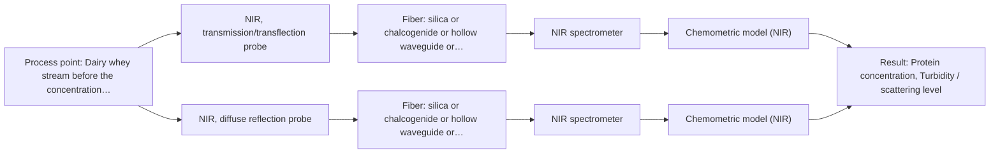

# First technical assessment: A clear whey stream before concentration

## Answer

**Customer request (our summary):** The customer wants to use spectroscopy to track protein concentration in a dairy whey stream that transitions from relatively clear to turbid.

### Brief answer

To track protein concentration in a dairy whey stream transitioning from clear to turbid, NIR spectroscopy using a transflection or adaptable reflection probe is recommended first. Laboratory reference measurements on representative samples will be needed to build robust chemometric calibration models that account for physical scattering changes.

### Proposal

- **Best current option:** O2 (recommended)
- **Basis:** supplied AFS sources
- **What would change it:** Confirmation that turbidity remains within a narrow band allowing standard transmission, or severe fouling requiring MIR-ATR.
- **Next step:** Conduct multi-method laboratory trials with representative clear and turbid whey samples.

**Secondary evidence (external, not AFS material):** G1: no usable external source found; G2: no usable external source found. See Expert detail.

**Decision status:** Provisional feasibility assessment

### Solution options

| ID | Tier | Methods | Confidence | Cost class, S01 Table 1 (p.6) | Ease of use | Maintenance | Performance fit | Sources |
|---|---|---|---|---|---|---|---|---|
| O1 | Simple | M1 NIR, transmission/transflection probe | Low: open question: Q1 (starts at Medium); sample clarity varies; precedent only | average cost (row 7) | Straightforward NIR transflection operation | Regular optical window cleaning | Handles clear to moderate turbidity states well | [1: S01 p.18] |
| O2 | Recommended | M1 NIR, transmission/transflection probe; M2 NIR, diffuse reflection probe | Low: open question: Q1 (starts at Medium); sample clarity varies; precedent only | average cost (rows 7, 8) | Adaptable probe or dual-mode assessment | Periodic calibration and window maintenance | Compensates for wide turbidity swings using flexible probe geometry | [1: S01 p.18] [2: S01 p.17] |

*Confidence rates the basis of the advice (how much is known and cited), not a predicted accuracy or probability of success. It starts at High, or at Medium when a key question on the method or the option is open, and drops one level per weakness listed (floor Low).*

*Cost class is the relative rating in S01 Table 1 (p.6) for the in-line method+technique rows named (the highest one for a multi-method option); it is not a price.*

### Setup sketch

*Recommended option O2; drawn by code from the option, a schematic, not a configuration.*

### Key questions

1. What is the expected quantitative range of turbidity or optical density during the transition from clear to turbid states?
2. What are the required measurement accuracy, precision, and update frequency for protein concentration tracking?
3. What are the mechanical constraints, temperature, and pressure at the intended installation point before the concentration stage?

## Expert detail

**Customer enquiry**

> Our dairy process includes a relatively clear whey stream before a concentration stage. We want to investigate whether spectroscopy can track protein concentration as the stream changes, with laboratory results used as the reference. The stream can become more turbid under some operating conditions. We need a first measurement concept that handles this change rather than assuming the liquid always remains clear.

**Decision status:** Provisional feasibility assessment. The customer's whey stream transitions from clear to turbid, requiring spectroscopic methods and probe geometries that can handle variable optical scattering properties, such as NIR transmission/transflection or diffuse reflection.

### Parameters

| ID | Parameter | Kind | Need | Measured by | Why | Sources |
|---|---|---|---|---|---|---|
| P1 | Protein concentration | quantitative | required | Spectroscopy: NIR | Core target variable to be tracked in-line. | *(no verified source: engineering judgement)* |
| P2 | Turbidity / scattering level | quantitative | required | Spectroscopy: NIR | Tracks the physical transition from clear to turbid which affects optical path response. | *(no verified source: engineering judgement)* |

### Solution option details

- **O1 cost drivers:** Single NIR spectrometer and transflection probe
- **O2 cost drivers:** NIR spectrometer with adaptable probe interface

### Premise check

- **Supported:** Spectroscopy can track protein concentration in whey streams undergoing turbidity changes. The literature confirms NIR spectroscopy is widely used for dairy stream monitoring, handling both clear/semi-transparent and scattering states. [1: S01 p.18]

### Requirements

**Stated by the customer**

- Track protein concentration in a dairy whey stream
- Handle stream transitioning from clear to turbid
- Use laboratory results as reference

**Key unknowns**

- Expected range of turbidity variation and suspended solids
- Required measurement accuracy and response time
- Process temperature, pressure, and pipe dimensions
- Cleaning and fouling management requirements

### Clarification questions (most decision-relevant first)

Q1. What is the expected quantitative range of turbidity or optical density during the transition from clear to turbid states? *Why it matters:* Determines whether a transmission, transflection, or diffuse reflection probe geometry is required to prevent signal saturation. *(affects: technique, method)*
Q2. What are the required measurement accuracy, precision, and update frequency for protein concentration tracking? *Why it matters:* Guides the selection of spectrometer resolution and chemometric model complexity. *(affects: status, installation)*
Q3. What are the mechanical constraints, temperature, and pressure at the intended installation point before the concentration stage? *Why it matters:* Ensures proper probe material and flange mounting selection for in-line operation. *(affects: installation)*

### Recommendation

- **M1 · Primary candidate: NIR, transmission/transflection probe.** NIR transmission and transflection probes are standard for dairy streams and can accommodate variable pathlengths or transflection configurations for clear-to-turbid liquids. *Conditions:* Applies when turbidity does not cause total signal saturation. [1: S01 p.18]
- **M2 · Comparison candidate: NIR, diffuse reflection probe.** Diffuse reflection handles opaque or highly scattering conditions when the stream becomes turbid. *Conditions:* Applies if turbidity increases to the point where transmission fails. [2: S01 p.17]
- **M3 · Conditional candidate: MIR, ATR probe.** MIR-ATR provides high-selectivity fingerprint absorption bands independent of bulk scattering via evanescent wave interaction. *Conditions:* Applies if NIR scattering interference proves too high and optical fouling can be managed. [3: S01 p.10]

### Measurement concept

- **Probe and geometry:** NIR transflection or adaptable reflection probe flush-mounted in the process pipe.
- **Location:** Dairy whey stream before the concentration stage.
- **Fiber link:** Vis-NIR silica fiber cable linking the process probe to the spectrometer. [4: S01 p.18]

### Spectral range

- **NIR:** Nominal NIR range is 780-2500 nm; usable range depends on the specific instrument, fiber, and probe configuration. [5: S01 p.10]

### Risks and uncertainty

- Turbidity shifts cause strong scattering interference that can mimic concentration changes in transmission mode. *(rules: R-GEO-6, R-NIR-2)* [6: S01 p.17]
- Fouling or protein deposition on optical windows leads to signal drift over time. *(rules: R-MIR-3)* [7: S01 p.13]

### First feasibility experiment

1. **Collect representative whey samples covering the full expected range of clear to turbid operating conditions.** Ensure calibration encompasses physical variations. *(no verified source: engineering judgement)*
2. **Acquire reference protein concentration measurements using standard laboratory methods for all sample states.** Provide independent reference data for chemometric model training. *(no verified source: engineering judgement)*
3. **Test NIR transmission/transflection and reflection configurations with the collected samples.** Determine which optical setup best handles the turbidity transition. *(no verified source: engineering judgement)*
4. **Build and cross-validate PLS calibration models relating spectra to protein concentration.** Assess predictive accuracy across varying turbidity states. *(no verified source: engineering judgement)*

**Reference measurements:** Standard laboratory reference measurements for protein concentration.

**Decision basis:** Go/no-go based on achieving the required prediction accuracy for protein concentration across both clear and turbid operating states.

### Assumptions

- The whey stream temperature and pressure are within standard fiber-optic probe ratings.
- Laboratory reference methods provide accurate protein values.

### Further notes

- **Chemometrics:** Requires partial least squares (PLS) calibration with scatter correction methods like SNV or MSC to handle turbidity variations.
- **Real-time tracking:** In-line continuous tracking of protein concentration prior to the concentration stage.
- **Future direction:** Integration of automated cleaning systems or multi-spectral sensor arrays if fouling or extreme scattering occurs.

### Secondary evidence (external, not AFS material)

*Found by a literature search for gaps the supplied AFS sources leave open. Not AFS material and not proof for this case; every quote below was verified verbatim against the fetched text.*

*Live search unavailable (library only: cache miss (europepmc); cache miss (openalex)); curated library only.*

**G1 · parameter without a source:** Measuring Protein concentration: Core target variable to be tracked in-line.

- No usable external source found.

**G2 · parameter without a source:** Measuring Turbidity / scattering level: Tracks the physical transition from clear to turbid which affects optical path response.

- No usable external source found.

### Evidence (verified quotes)

1. ✓ **S01 p.18** (application precedent): "Transmission is the preferred method for transparent or semi-transparent liquids, such as skim milk, whey, or permeate."
2. ✓ **S01 p.17** (application precedent): "NIR Reflection is primarily used for opaque or highly concentrated dairy products, such as yogurt, butter, or whole milk concentrates."
3. ✓ **S01 p.10** (general): "ATR fiber probes (Fig.1) enable the analysis of liquids and solid elastic samples"
4. ✓ **S01 p.18** (application precedent): "In some cases, a Transflection probe can already be a combined solution working well for low-fat and high-fat containing milk products."
5. ✓ **S01 p.10** (general): "NIR spectra (780-2500 nm) contain predominantly overtones and component bands of fundamental vibrations"
6. ✓ **S01 p.17** (general): "the method is sensitive to the surface characteristics and fat globule size."
7. ✓ **S01 p.13** (general): "typically at a depth of few microns"

### Verification

- Citations verified: 8 of 8 (exact or whitespace/hyphen-tolerant match on the cited page, scope checked).
- Hard check failures before deterministic corrections: 0; still open: 0; soft warnings: 1; repair rounds: 0.
- External evidence (cache): 0 quote(s) verified verbatim (exact or whitespace/hyphen-tolerant, at most 400 characters and 2 sentences, against the cited paragraph); 0 item(s) dropped.
- External search: 4 query(ies), 0 hit(s), 3 source(s) (3 from the curated library); ⚠ library only: cache miss (europepmc); cache miss (openalex).
- External step: 2 model call(s), 1.7 s extra (cost in the run JSON).

*Run D03-20261018T075900Z-abda · models google/gemini-3.5-flash-lite*
