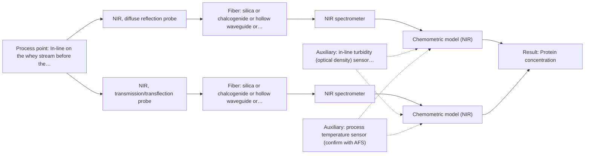
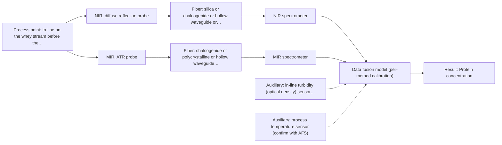

# First technical assessment: A clear whey stream before concentration

## Answer

**Customer request (our summary):** Dairy whey stream before a concentration stage; customer wants to investigate spectroscopy for tracking protein concentration against laboratory reference, while handling possible turbidity changes.

### Brief answer

NIR spectroscopy is the method to test first: the sources describe it as the dairy route to protein with a laboratory reference, and a reflection probe keeps working when the stream turns turbid. A transflection probe on the same spectrometer would cover the clear state. Still open: the turbidity and protein ranges, the accuracy target and the reference method.

### Proposal

- **Best current option:** O2 (recommended)
- **Basis:** supplied AFS sources
- **What would change it:** If the turbid state turns out to be rare or mild, a single transflection probe could replace the dual geometry. If NIR cannot separate a protein change from the scattering change, the MIR-ATR cross-check (O3) becomes the next step.
- **Next step:** Run the feasibility trial on representative clear and turbid samples against the laboratory protein reference, compare the single-method models first, and only then decide whether a second method is needed.

**Secondary evidence (external, not AFS material):** G1: no usable external source found; G2: E01 ¶12; G3: E03 ¶82, E03 ¶36; G4: no usable external source found. See Expert detail.

**Decision status:** Provisional feasibility assessment

### Solution options

| ID | Tier | Methods | Confidence | Cost class, S01 Table 1 (p.6) | Ease of use | Maintenance | Performance fit | Sources |
|---|---|---|---|---|---|---|---|---|
| O1 | Simple | M1 NIR, diffuse reflection probe | Low: open question: Q1 (starts at Medium); precedent only | average cost (row 8) | one probe, standard NIR hardware | window cleaning and fouling checks | covers the turbid state, clear state unproven | [1: S01 p.17] [2: S01 p.17] |
| O2 | Recommended | M1 NIR, diffuse reflection probe; M2 NIR, transmission/transflection probe | Low: open question: Q1 (starts at Medium); sample clarity varies | average cost (rows 7, 8) | one spectrometer, two NIR probes | two probes to clean and re-verify | covers both clear and turbid stream states | [3: S01 p.18] [4: S01 p.18] [1: S01 p.17] [2: S01 p.17] [5: S01 p.18] [6: S01 p.18] |
| O3 | Extended (multi-method) | M1 NIR, diffuse reflection probe; M3 MIR, ATR probe | Low: open question: Q1 (starts at Medium); multi-method, fusion benefit not yet shown | high cost (rows 2, 8) | two instruments, more setup and upkeep | ATR crystal cleaning, two calibrations kept | adds specific amide bands to NIR | [1: S01 p.17] [2: S01 p.17] [7: S04 p.3] [8: S01 p.5] |

*Confidence rates the basis of the advice (how much is known and cited), not a predicted accuracy or probability of success. It starts at High, or at Medium when a key question on the method or the option is open, and drops one level per weakness listed (floor Low).*

*Cost class is the relative rating in S01 Table 1 (p.6) for the in-line method+technique rows named (the highest one for a multi-method option); it is not a price.*

### Setup sketch

*Recommended option O2; drawn by code from the option, a schematic, not a configuration.*

### Key questions

1. What protein concentration range must be covered, and what accuracy and response time are needed to track the change?
2. What turbidity or optical-density range occurs, how often does the stream enter the turbid state, and for how long?
3. Which laboratory method will provide the protein reference, and how closely in time and place can the reference sample be matched to the spectral measurement?

## Expert detail

**Customer enquiry**

> Our dairy process includes a relatively clear whey stream before a concentration stage. We want to investigate whether spectroscopy can track protein concentration as the stream changes, with laboratory results used as the reference. The stream can become more turbid under some operating conditions. We need a first measurement concept that handles this change rather than assuming the liquid always remains clear.

**Decision status:** Provisional feasibility assessment. A method shortlist can be justified from dairy precedent for NIR protein measurement and from a transflection probe reported to cover both low- and high-fat dairy streams. The probe geometry, the accuracy target and the reference protocol are still open, so the assessment stays provisional.

### Parameters

| ID | Parameter | Kind | Need | Measured by | Why | Sources |
|---|---|---|---|---|---|---|
| P1 | Protein concentration | quantitative | required | Spectroscopy: NIR | It is the variable the customer wants to track as the stream changes. | [9: S01 p.10] [1: S01 p.17] |
| P2 | Turbidity / optical density of the stream | quantitative | required | Auxiliary sensor: in-line turbidity (optical density) sensor (cited; confirm availability with AFS) | The scattering state changes independently of protein and shifts the NIR baseline, so it must be recorded alongside every spectrum. | [10: S01 p.17] |
| P3 | Stream temperature | quantitative | optional | Auxiliary sensor: process temperature sensor (engineering judgement: confirm availability with AFS) | It should be available because the water-related NIR bands shift with temperature and the reference samples are taken elsewhere in the process. | *(no verified source: engineering judgement)* |

### Solution option details

- **O1 cost drivers:** one NIR spectrometer, one reflection probe, calibration samples
- **O2 cost drivers:** second NIR probe and pathlength hardware, joint calibration
- **O3 cost drivers:** second MIR spectrometer, ATR probe and MIR fiber, dual calibration
- **O3 combining methods:** Two blocks, NIR reflection and MIR-ATR, would be fused at the variable level with block scaling, because variables from different methods are not equivalent. Both probes must see the same material at the same time, which in a flowing stream means a combined probe or closely co-located ports with acquisition normalised to a common time step. Each block keeps its own calibration and diagnostics, and the fused model must beat the best single method on held-out runs before the second instrument is justified.

*Extended (multi-method) option O3; drawn by code from the option, a schematic, not a configuration.*

### Premise check

- **Not covered:** Laboratory results are a suitable reference. The guidance asks for independent reference measurements in a feasibility plan, but no supplied page says which laboratory protein method is adequate for whey or how closely it must be matched in time to the spectrum. *(no verified source: engineering judgement)*
- **Precedent only:** A first measurement concept can handle the turbidity change. A dairy precedent exists for one probe covering both a low-fat and a high-fat (here: low- and high-turbidity) stream, which is a reason to test it, not a demonstration for this stream. [6: S01 p.18]

### Requirements

**Stated by the customer**

- Track protein concentration in a whey stream before a concentration stage.
- Laboratory results are to be the reference.
- The stream is relatively clear normally but can become more turbid.
- The concept must handle the change, not assume a permanently clear liquid.

**Key unknowns**

- Protein concentration range and the size of the change that must be resolved.
- Turbidity or optical-density range, and how often and how long the turbid state lasts.
- Required accuracy, detection limit and response time.
- Laboratory reference method and how reference samples are matched in time to the spectra.
- Installation point, distance to the analyzer, temperature, pressure and cleaning/fouling regime.
- Whether other matrix changes (dilution, pH, lactose, minerals) vary independently of protein.

### Clarification questions (most decision-relevant first)

Q1. What protein concentration range must be covered, and what accuracy and response time are needed to track the change? *Why it matters:* These numbers are the go/no-go criterion and decide whether NIR alone can meet the target. *(affects: method)*
Q2. What turbidity or optical-density range occurs, how often does the stream enter the turbid state, and for how long? *Why it matters:* It decides whether a reflection geometry is needed throughout or whether a transflection probe is sufficient. *(affects: technique)*
Q3. Which laboratory method will provide the protein reference, and how closely in time and place can the reference sample be matched to the spectral measurement? *Why it matters:* A calibration can only be as good as the reference it is built on, so this decides whether the trial can be evaluated at all. *(affects: status)*
Q4. What are the installation conditions: distance from analyzer to probe, temperature, pressure, and the cleaning (CIP) and fouling regime? *Why it matters:* They decide the probe and fiber type, and whether an ATR crystal could be kept clean enough to be useful. *(affects: installation)*
Q5. Do other composition changes (dilution, pH, lactose, minerals, additives) vary independently of the protein content? *Why it matters:* NIR bands overlap, so an independent matrix change could be read as a protein change. *(affects: method)*

### Recommendation

- **M1 · Primary candidate: NIR, diffuse reflection probe.** NIR is the dairy route for protein, where PLS regression on the spectra is used to quantify fat and protein, and reflection is the geometry described for opaque or concentrated dairy streams. Because the probe reads backscattered light rather than light transmitted through the bulk, a turbid excursion does not block the measurement the way transmission can. *Conditions:* Applies as the geometry that keeps working when the stream turns turbid; its accuracy in the normally clear state still has to be checked against the reference. [1: S01 p.17] [2: S01 p.17]
- **M2 · Conditional candidate: NIR, transmission/transflection probe.** Transmission is the preferred geometry for clear or semi-transparent dairy liquids, with whey named explicitly, and a transflection probe is reported in some cases to cover both low-fat and high-fat products. The same NIR spectrometer and light source serve both this geometry and M1. *Conditions:* Applies while the stream is in its normal clear state; if turbidity dominates, the reflection geometry (M1) carries the measurement. [5: S01 p.18] [6: S01 p.18]
- **M3 · Comparison candidate: MIR, ATR probe.** MIR shows well-defined bands, including the amide I and II bands of the protein peptide group, while ATR samples only a very thin surface layer, so bulk turbidity has little influence on the spectrum. It is the natural orthogonal check if NIR cannot separate a protein change from a scattering change. *Conditions:* Applies only if NIR cannot separate protein from the turbidity change, and after the MIR fiber length and crystal fouling are resolved. [7: S04 p.3] [8: S01 p.5]

### Measurement concept

- **Probe and geometry:** NIR probe flush in the line: diffuse reflection as the turbidity-tolerant geometry, with a transmission/transflection path on the same spectrometer for the clear state; MIR-ATR only as a later orthogonal check.
- **Location:** In-line on the whey stream before the concentration stage; the exact point is open (Q4).
- **Fiber link:** Silica fibers carry the NIR range and are described for remote industrial process control over long cables; no source states an achievable link length for a MIR-ATR probe, so that stays an open question. [11: S02 p.7]

### Spectral range

- **NIR:** 780-2500 nm nominal. [9: S01 p.10]
- **MIR:** 4000-400 cm-1 nominal (2.5-25 μm). [12: S01 p.9]

### Risks and uncertainty

- Turbidity scatters NIR light and can mimic or mask a protein change, so a model calibrated on clear samples alone may fail in the turbid state. *(rules: R-GEO-6)* [10: S01 p.17]
- NIR diffuse reflection may be less representative in the normally clear stream, so accuracy there could be poorer than the dairy transmission precedent suggests. *(rules: R-GEO-4)* *(no verified source: engineering judgement)*
- Protein NIR bands overlap water and other matrix bands, so the calibration may end up tracking total solids or dilution rather than protein. *(rules: R-NIR-2)* [9: S01 p.10]
- MIR link length and ATR crystal fouling are unresolved, so the orthogonal MIR cross-check may not survive the installed conditions. *(rules: R-FIB-2, R-MIR-3)* *(no verified source: engineering judgement)*

### First feasibility experiment

1. **Collect representative whey samples or process states across the expected protein range and across both the clear and the turbid regime, recording turbidity with each sample.** Cover the chemical and physical variation the model must survive. [13: REF §3]
2. **Measure each sample with the single NIR geometries first (diffuse reflection on all samples; transmission or transflection on the clear ones), on the same aliquots.** Compare the single techniques before any combination. *(no verified source: engineering judgement)*
3. **Analyse each sample independently with the customer's laboratory protein method and record the result with the sampling time.** Provide the independent reference the calibration is built on. [14: REF §3]
4. **Build a calibration per geometry and validate it on held-out runs or batches, testing separately whether it holds in the clear and in the turbid state.** Check that the model generalises and does not merely fit the sampled runs. [15: S03 p.14]
5. **Go/no-go: the customer's numerical accuracy target must be met in both regimes; if it is not, test MIR-ATR as the orthogonal method before considering any fused model.** Give the decision a defined criterion supplied by the customer. [16: REF §3]

**Reference measurements:** Independent laboratory protein determination per sample, matched in time to the spectral measurement; the reference method is not yet named (Q3).

**Decision basis:** Customer-defined accuracy and repeatability in both the clear and the turbid state, on held-out runs.

### Assumptions

- The stream is aqueous and the protein content is the dominant varying component in the NIR-visible region; the effect of other matrix changes is unknown (Q5).
- The laboratory protein reference is independent of the spectra and traceable to the sampling time (Q3).
- The turbid state is frequent enough to require a geometry that works in it, but not so dominant that a transflection probe alone would be pointless (Q2).

### Not covered by the supplied sources

- No supplied source gives an accuracy, detection limit or response time for protein measurement in whey, or names a validated laboratory reference method for whey protein.
- No supplied source states an achievable fiber link length for a MIR-ATR probe on a dairy process line.

### Further notes

- **Chemometrics:** Protein tracking needs a PLS calibration on laboratory reference values, with scatter correction (MSC or SNV) to reduce the effect of turbidity. Validate on held-out runs or batches and check separately whether the model holds in the clear and in the turbid state; re-validate if the matrix changes.
- **Real-time tracking:** The stated aim is tracking the stream as it changes; the required update rate and response time are not yet known and are part of Q1.
- **Future direction:** Once the method and wavelengths are settled, a compact LED-based or multisensor analyzer for the selected spectral regions could be considered for routine production control instead of a full spectrometer.

### Secondary evidence (external, not AFS material)

*Found by a literature search for gaps the supplied AFS sources leave open. Not AFS material and not proof for this case; every quote below was verified verbatim against the fetched text.*

*Live search unavailable (library only: cache miss (europepmc); cache miss (openalex)); curated library only.*

**G1 · auxiliary sensor:** In-line measurement of Turbidity / optical density of the stream with in-line turbidity (optical density) sensor

- No usable external source found.

**G2 · auxiliary sensor:** In-line measurement of Stream temperature with process temperature sensor

- **E01 ¶12** The review states that temperature sensitivity of OH bands is a severe drawback for aqueous NIR and MIR measurements, making tempered sample holders necessary. *How it applies:* This could inform the assessment by highlighting the need to monitor or control stream temperature and to test temperature effects on the NIR/MIR signal. *Limits and transfer risks:* The source is a review in biopharmaceutical downstream processing, not dairy whey, and it refers to tempered sample holders rather than an in-line process temperature sensor. *(supports O2)*
  > "Additionally, the temperature sensitivity of the OH bands is a severe drawback for measuring aqueous solution in NIR and MIR, which makes tempered sample holders necessary [29]."
  > A critical review of recent trends, and a future perspective of optical spectroscopy as PAT in biopharmaceutical downstream processing. (2020) · Analytical and bioanalytical chemistry · doi:10.1007/s00216-020-02407-z · https://europepmc.org/article/PMC/PMC7072065 · retrieved 2026-10-17, full text, licence: cc by, via curated library

**G3 · multi-method:** Combining several spectroscopy methods (data fusion) (Two blocks, NIR reflection and MIR-ATR, would be fused at the variable level with block scaling, because variables from different methods are not equivalent. Both probes must see the same material at the same time, which in a flowing stream means a combined probe or closely co-located ports with acquisition normalised to a common time step. Each block keeps its own calibration and diagnostics, and the fused model must beat the best single method on held-out runs before the second instrument is justified.)

- **E03 ¶82** The review recommends evaluating each dataset's contribution and complementarity before fusing data from multiple sources. *How it applies:* This could inform a staged comparison of NIR reflection and MIR-ATR blocks, checking whether each adds information before committing to a fused model. *Limits and transfer risks:* The source is a review of PAT data fusion, not a whey study, and it does not address block scaling or co-located probes in a flowing dairy stream. *(supports O3)*
  > "Before fusing data from multiple sources, it is essential to evaluate the contribution of each dataset to the model and its complementarity."
  > Challenges and Opportunities of Implementing Data Fusion in Process Analytical Technology-A Review. (2022) · Molecules (Basel, Switzerland) · doi:10.3390/molecules27154846 · https://europepmc.org/article/PMC/PMC9369811 · retrieved 2026-10-17, full text, licence: cc by, via curated library
- **E03 ¶36** The review notes that instrument complementarity was not sufficient to improve performance for several CQAs in a Raman and FT-IR food analytical study. *How it applies:* This is a reason to require the fused NIR/MIR model to outperform the best single method on held-out runs before adding the second instrument. *Limits and transfer risks:* The cited example used Raman and FT-IR on food matrices, not NIR reflection and MIR-ATR on whey, so the negative result may not transfer. *(supports O3)*
  > "In some situations, instrument complementarity (not data complementarity) was not sufficient to improve the performance of predictive several CQAs, as shown by a Raman and FT-IR data based food analytical study [73]."
  > Challenges and Opportunities of Implementing Data Fusion in Process Analytical Technology-A Review. (2022) · Molecules (Basel, Switzerland) · doi:10.3390/molecules27154846 · https://europepmc.org/article/PMC/PMC9369811 · retrieved 2026-10-17, full text, licence: cc by, via curated library

**G4 · not in the supplied sources:** No supplied source gives an accuracy, detection limit or response time for protein measurement in whey, or names a validated laboratory reference method for whey protein.

- No usable external source found.

### Evidence (verified quotes)

1. ✓ **S01 p.17** (application precedent): "Partial Least Squares (PLS) regression to quantify fat and protein"
2. ✓ **S01 p.17** (application precedent): "is primarily used for opaque or highly concentrated dairy products, such as yogurt, butter, or whole milk concentrates."
3. ✓ **S01 p.18** (general): "NIR Spectrometer and NIR light source remain the same for both reflection and transmission techniques."
4. ✓ **S01 p.18** (application precedent): "By maintaining both, a lab can calibrate models for every stage of production"
5. ✓ **S01 p.18** (application precedent): "Transmission is the preferred method for transparent or semi-transparent liquids, such as skim milk, whey, or permeate."
6. ✓ **S01 p.18** (application precedent): "In some cases, a Transflection probe can already be a combined solution working well for low-fat and high-fat containing milk products."
7. ✓ **S04 p.3** (general): "the amide I and II bands, two major absorption peaks of the protein peptide group in the infrared region"
8. ✓ **S01 p.5** (general): "strong absorption in the mid-IR region limits the corresponding spectral method to the analysis of very thin samples (usually less than 50 μm), but it opens up the possibility of using attenuated total reflectance (ATR)"
9. ✓ **S01 p.10** (general): "NIR spectra (780-2500 nm) contain predominantly overtones and component bands of fundamental vibrations"
10. ✓ **S01 p.17** (general): "the method is sensitive to the surface characteristics and fat globule size."
11. ✓ **S02 p.7** (general): "Robust 100-300m cables made with Silica fibers of low OH-content (<0.1ppm OH) enable remote industrial process-control"
12. ✓ **S01 p.9** (general): "Vibrational spectroscopy in the mid-IR range (4000-400 cm-1) is one of the most informative methods of chemical analysis."
13. ✓ **REF §3** (general): "Representative samples or process states"
14. ✓ **REF §3** (general): "independent reference measurements"
15. ✓ **S03 p.14** (general): "A thorough validation, including full, segmented and random-subset CVs, as well as randomization tests, are recommended in any cases for which important conclusions depend on calibration or discrimination models built on limited experimental material."
16. ✓ **REF §3** (general): "the basis for the go / no-go decision"

### Verification

- Citations verified: 21 of 21 (exact or whitespace/hyphen-tolerant match on the cited page, scope checked).
- Hard check failures before deterministic corrections: 0; still open: 0; soft warnings: 0; repair rounds: 0.
- External evidence (cache): 3 quote(s) verified verbatim (exact or whitespace/hyphen-tolerant, at most 400 characters and 2 sentences, against the cited paragraph); 0 item(s) dropped.
- External search: 6 query(ies), 0 hit(s), 3 source(s) (3 from the curated library); ⚠ library only: cache miss (europepmc); cache miss (openalex).
- External step: 2 model call(s), 14.7 s extra (cost in the run JSON).

*Run D03-20261018T075900Z-afd2 · models deepseek/deepseek-v4.1-flash-1017*
