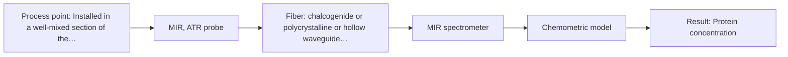

# First technical assessment: A clear whey stream before concentration

## Answer

**Customer request (our summary):** The customer wants to know if process spectroscopy can reliably track protein concentration in a whey stream that shifts from relatively clear to turbid before concentration, referencing laboratory results.

### Brief answer

Mid-infrared ATR spectroscopy is the recommended primary method because its micrometre-scale evanescent wave measures protein amide bands without interference from bulk turbidity changes. Near-infrared transflection provides a simpler, lower-cost alternative, provided peak process turbidity does not extinguish light transmission. Measuring clear and turbid process samples in laboratory trials will determine whether NIR transflection suffices or if MIR-ATR is required.

### Proposal

- **Best current option:** O2 (recommended)
- **Basis:** supplied AFS sources
- **What would change it:** If laboratory feasibility testing demonstrates that peak process turbidity does not saturate or block transmitted NIR light across a short pathlength, option O1 would be preferred for lower instrumental cost.
- **Next step:** Acquire benchtop MIR-ATR and NIR transflection spectra on representative clear and turbid whey samples and benchmark them against reference laboratory protein assays.

**Secondary evidence (external, not AFS material):** G1: no usable external source found; G2: no usable external source found; G3: no usable external source found. See Expert detail.

**Decision status:** Provisional feasibility assessment

### Solution options

| ID | Tier | Methods | Confidence | Cost class, S01 Table 1 (p.6) | Ease of use | Maintenance | Performance fit | Sources |
|---|---|---|---|---|---|---|---|---|
| O1 | Simple | M2 NIR, transmission/transflection probe | Low: open question: Q1, Q2 (starts at Medium); sample clarity varies | average cost (row 7) | standard silica optics with simple alignment | routine optical window inspection and cleaning | low-cost standard dairy PAT for liquids | [1: S01 p.18] [2: S01 p.18] |
| O2 | Recommended | M1 MIR, ATR probe | Medium: open question: Q1, Q2 (starts at Medium) | high cost (row 2) | direct immersion ATR with robust sealing | crystal surface fouling and CIP checks | inherent immunity to bulk turbidity shifts | [3: S01 p.10] [4: S04 p.3] [5: S01 p.18] |

*Confidence rates the basis of the advice (how much is known and cited), not a predicted accuracy or probability of success. It starts at High, or at Medium when a key question on the method or the option is open, and drops one level per weakness listed (floor Low).*

*Cost class is the relative rating in S01 Table 1 (p.6) for the in-line method+technique rows named (the highest one for a multi-method option); it is not a price.*

### Setup sketch

*Recommended option O2; drawn by code from the option, a schematic, not a configuration.*

### Key questions

1. What is the expected protein concentration range and the maximum optical density or turbidity reached during process upsets?
2. What causes the stream to become turbid (e.g. fat droplet breakthrough, insoluble curd particles, or protein denaturation)?
3. What cleaning-in-place (CIP) procedures, chemical wash concentrations, operating pressures, and temperatures are present in the pipe?

## Expert detail

**Customer enquiry**

> Our dairy process includes a relatively clear whey stream before a concentration stage. We want to investigate whether spectroscopy can track protein concentration as the stream changes, with laboratory results used as the reference. The stream can become more turbid under some operating conditions. We need a first measurement concept that handles this change rather than assuming the liquid always remains clear.

**Decision status:** Provisional feasibility assessment. Process spectroscopy is well established for dairy monitoring, but because the optical density and scattering behavior during turbid upset conditions are unquantified, a provisional assessment is provided comparing turbidity-tolerant MIR-ATR with conditional NIR transflection.

### Parameters

| ID | Parameter | Kind | Need | Measured by | Why | Sources |
|---|---|---|---|---|---|---|
| P1 | Protein concentration | quantitative | required | Spectroscopy: MIR | Primary process target required to monitor feed quality and control the downstream concentration stage. | [4: S04 p.3] |
| P2 | Turbidity / scattering background | qualitative | required | Spectroscopy: NIR | Tracks the optical regime of the liquid to verify whether the stream is clear or scattering, guiding spectral preprocessing. | [6: S01 p.17] |
| P3 | Stream temperature | quantitative | optional | Auxiliary sensor: In-line Pt100 RTD sensor (engineering judgement: confirm availability with AFS) | Process temperature shifts alter water absorption bands and hydrogen bonding, so auxiliary temperature tracking improves chemometric robustness. | *(no verified source: engineering judgement)* |

### Solution option details

- **O1 cost drivers:** near-infrared spectrometer, silica fiber cables, transflection probe
- **O2 cost drivers:** FTIR spectrometer, polycrystalline infrared fibers, industrial ATR probe

### Premise check

- **Precedent only:** In-line optical spectroscopy can track protein concentration in dairy whey streams. Published literature and source examples demonstrate that near-infrared and mid-infrared spectroscopy can monitor dairy components such as protein, providing an empirical basis for feasibility testing. [7: S01 p.17]
- **Precedent only:** A single optical interface can handle stream transitions between clear and turbid conditions without assuming the liquid remains clear. Transflection probes have been applied to bridge low-fat and high-fat dairy streams in some cases, while ATR interfaces naturally probe only a surface layer independent of bulk scattering; both represent viable concepts that must be tested across the client's actual turbidity range. [1: S01 p.18]

### Requirements

**Stated by the customer**

- Track protein concentration in a whey stream located upstream of a concentration stage.
- Accommodate process shifts where the liquid changes from relatively clear to more turbid.
- Correlate in-line spectroscopic readings against laboratory reference analytical results.

**Key unknowns**

- Expected protein concentration range and specific protein fractions to monitor.
- Root cause and optical extinction range of the turbidity shifts (e.g., residual fat, suspended fines, or precipitate).
- Process temperature, pressure, flow velocity, and line diameter at the installation point.
- Cleaning-in-place (CIP) and steam sanitization regimes (chemicals, cycle duration, temperatures).
- Required measurement cycle time, accuracy, and repeatability limits.
- Specific analytical reference method used by the quality control laboratory.

### Clarification questions (most decision-relevant first)

Q1. What is the expected protein concentration range and the maximum optical density or turbidity reached during process upsets? *Why it matters:* Determines whether an optical transmission path can remain transparent or if an attenuated total reflection geometry is mandatory. *(affects: method, technique, M2)*
Q2. What causes the stream to become turbid (e.g. fat droplet breakthrough, insoluble curd particles, or protein denaturation)? *Why it matters:* Different turbidity sources introduce distinct spectral interferences such as lipid absorption bands or wavelength-dependent scattering slopes. *(affects: method, technique, M1, M2)*
Q3. What cleaning-in-place (CIP) procedures, chemical wash concentrations, operating pressures, and temperatures are present in the pipe? *Why it matters:* Dictates chemical compatibility for probe optical windows, ATR crystals, braze seals, and probe shaft materials. *(affects: installation)*
Q4. Which laboratory reference method is used for protein quantification, and what is its standard measurement error and turnaround time? *Why it matters:* Sets the statistical benchmark and error floor for training and validating chemometric regression models. *(affects: status)*

### Recommendation

- **M1 · Primary candidate: MIR, ATR probe.** Mid-infrared ATR probes sample an evanescent wave penetrating only a shallow depth into the fluid, making spectral absorption immune to bulk liquid turbidity fluctuations. Fundamental amide absorption bands deliver high molecular specificity for dissolved protein quantification. [3: S01 p.10] [4: S04 p.3] [5: S01 p.18]
- **M2 · Conditional candidate: NIR, transmission/transflection probe.** NIR transflection utilizes standard silica optics and can in some dairy cases bridge clear and high-scattering streams. It offers lower hardware complexity than mid-IR if the maximum turbidity does not completely block light transmission. *Conditions:* Applies if the maximum process turbidity does not completely attenuate light transmission across the chosen pathlength. [1: S01 p.18] [2: S01 p.18]

### Measurement concept

- **Probe and geometry:** An in-line immersible ATR probe (for MIR) or transflection probe with a tightly controlled short pathlength (for NIR) mounted directly into the process piping.
- **Location:** Installed in a well-mixed section of the feed line upstream of the concentration stage to avoid stagnation and ensure representative fluid velocity.
- **Fiber link:** Polycrystalline infrared (PIR) or chalcogenide (CIR) fibers for MIR-ATR, or low-OH silica optical fibers for NIR, connecting the process probe to an analyzer located away from washdown areas. [8: S01 p.10] [9: S02 p.6] [10: S02 p.7]

### Spectral range

- **MIR:** Nominal range 4000 to 400 cm-1 (2.5 to 25 µm); usable coverage is governed by the chosen spectrometer, fiber transmission (CIR or PIR), and ATR crystal window. [11: S01 p.9]
- **NIR:** Nominal range 780 to 2500 nm; usable coverage depends on the specific spectrometer detector, tungsten-halogen source, and silica fiber properties. [12: S01 p.10]

### Risks and uncertainty

- Fouling layers, fat coatings, or protein biofilms on the ATR crystal face will distort readings because the measurement samples only the first few micrometres. *(rules: R-MIR-3)* [13: S01 p.13]
- Severe turbidity surges may extinguish the transmitted optical signal in NIR transflection if the pathlength is set too wide. *(rules: R-GEO-2, R-GEN-4)* [14: S01 p.18]
- Broad overlapping NIR absorption bands require matrix-specific chemometric calibrations that can fail if physical scattering varies independently of protein content. *(rules: R-NIR-2, R-CAL-1)* [15: S01 p.10]
- Variations in fat droplet size distribution or suspended curd particles can mimic concentration shifts in transmission and reflection measurements. *(rules: R-GEO-6)* [6: S01 p.17]

### First feasibility experiment

1. **Collect representative whey process samples across clear, transition, and maximum turbidity operating conditions.** Provide a comprehensive sample matrix covering the full physical and compositional variance of the process. [16: REF §3]
2. **Record benchtop spectra of all whey samples using both MIR-ATR and NIR transflection across several gap pathlengths.** Determine whether turbidity shifts attenuate NIR transmission and evaluate protein band resolution in MIR. *(no verified source: engineering judgement)*
3. **Analyze duplicate aliquots using the customer's laboratory reference method to establish benchmark protein values.** Provide independent, traceable calibration targets for chemometric modeling. *(no verified source: engineering judgement)*
4. **Construct multivariate regression models (PLS) and evaluate root mean square error of cross-validation and prediction on held-out samples.** Confirm that mathematical preprocessing adequately compensates for baseline shifts caused by turbidity. *(no verified source: engineering judgement)*
5. **Install the downselected probe into a pilot sidestream to evaluate signal stability and probe fouling across normal flow and CIP wash cycles.** Verify mechanical durability, seal integrity, and measurement reliability under dynamic plant conditions. *(no verified source: engineering judgement)*

**Reference measurements:** Standard wet-chemistry laboratory protein assays (such as Kjeldahl or Dumas total nitrogen analysis) performed in duplicate on matching sample aliquots.

**Decision basis:** Go/no-go is determined by whether the chemometric validation error meets the customer's stated accuracy threshold across both clear and turbid process states.

### Assumptions

- The whey stream remains in a flowing liquid state across all clear and turbid operating conditions.
- Laboratory reference assays provide consistent, traceable protein concentration measurements.
- Process piping allows insertion of an in-line immersion probe upstream of the concentration stage.

### Not covered by the supplied sources

- Specific limits of detection, prediction accuracy figures, and pricing for dairy whey analyzers.
- Maximum certified industrial link length for mid-infrared polycrystalline fiber cables under hygienic dairy plant conditions.

### Further notes

- **Chemometrics:** A partial least squares (PLS) calibration model based on independent laboratory protein references is necessary. For NIR data, scatter-correction algorithms such as Standard Normal Variate (SNV) or Multiplicative Scatter Correction (MSC) should be evaluated to remove baseline shifts caused by turbidity.
- **Real-time tracking:** In-line fiber-optic probes enable continuous real-time monitoring directly in the process pipe, providing immediate feedback before the concentration unit without requiring physical sample extraction.
- **Future direction:** If the stream exhibits large simultaneous shifts in both fat and protein content, evaluating a multi-wavelength LED sensor or a combined probe could provide an integrated, lower-cost dedicated analyzer.

### Secondary evidence (external, not AFS material)

*Found by a literature search for gaps the supplied AFS sources leave open. Not AFS material and not proof for this case; every quote below was verified verbatim against the fetched text.*

*Live search unavailable (library only: cache miss (europepmc); cache miss (openalex)); curated library only.*

**G1 · auxiliary sensor:** In-line measurement of Stream temperature with In-line Pt100 RTD sensor

- No usable external source found.

**G2 · not in the supplied sources:** Specific limits of detection, prediction accuracy figures, and pricing for dairy whey analyzers.

- No usable external source found.

**G3 · not in the supplied sources:** Maximum certified industrial link length for mid-infrared polycrystalline fiber cables under hygienic dairy plant conditions.

- No usable external source found.

### Evidence (verified quotes)

1. ✓ **S01 p.18** (application precedent): "In some cases, a Transflection probe can already be a combined solution working well for low-fat and high-fat containing milk products."
2. ✓ **S01 p.18** (general): "it fails when the milk becomes too "thick" or fat-rich, as the light cannot penetrate the sample."
3. ✓ **S01 p.10** (general): "ATR fiber probes (Fig.1) enable the analysis of liquids and solid elastic samples, such as biological tissue, using specialized probes utilizing high-transmission fiber optics in the Mid-IR region."
4. ✓ **S04 p.3** (general): "two very similar signals with maxima at 1548 and 1640 cm-1. These are, respectively, the amide I and II bands, two major absorption peaks of the protein peptide group in the infrared region."
5. ✓ **S01 p.18** (application precedent): "While NIR is the workhorse of the dairy industry, advanced labs often incorporate Fluorescence, Raman, and Mid-Infrared (MIR) ATR fiber optic techniques to capture specific chemical or structural information that NIR might miss."
6. ✓ **S01 p.17** (general): "the method is sensitive to the surface characteristics and fat globule size."
7. ✓ **S01 p.17** (application precedent): "The use of Near-Infrared (NIR) spectroscopy for the inline monitoring of milk is a cornerstone of modern dairy "Process Analytical Technology" (PAT)."
8. ✓ **S01 p.10** (general): "These immersion probes operate on the ATR principle but allow analysis at a significant distance from the spectrometer, without the need for sampling."
9. ✓ **S02 p.6** (general): "3000 nm Polycrystalline Infrared Fibers 17 μm"
10. ✓ **S02 p.7** (general): "Robust 100-300m cables made with Silica fibers of low OH-content (<0.1ppm OH) enable remote industrial process-control"
11. ✓ **S01 p.9** (general): "Vibrational spectroscopy in the mid-IR range (4000-400 cm-1) is one of the most informative methods of chemical analysis."
12. ✓ **S01 p.10** (general): "NIR spectra (780-2500 nm) contain predominantly overtones and component bands of fundamental vibrations of molecules and atomic groups"
13. ✓ **S01 p.13** (general): "typically at a depth of few microns"
14. ✓ **S01 p.18** (general): "if the pathlength is too wide, the signal is lost to absorption; if too narrow, the sample represents a negligible volume."
15. ✓ **S01 p.10** (general): "The broad absorption bands observed in this region overlap, suggesting the use of chemometrics for quantitative and qualitative analysis of spectral data."
16. ✓ **REF §3** (general): "Representative samples or process states, independent reference measurements, what is compared, and the basis for the go / no-go decision."

### Verification

- Citations verified: 21 of 21 (exact or whitespace/hyphen-tolerant match on the cited page, scope checked).
- Hard check failures before deterministic corrections: 0; still open: 0; soft warnings: 0; repair rounds: 1.
- External evidence (cache): 0 quote(s) verified verbatim (exact or whitespace/hyphen-tolerant, at most 400 characters and 2 sentences, against the cited paragraph); 0 item(s) dropped.
- External search: 4 query(ies), 0 hit(s), 3 source(s) (3 from the curated library); ⚠ library only: cache miss (europepmc); cache miss (openalex).
- External step: 2 model call(s), 4.3 s extra (cost in the run JSON).

*Run D03-20261018T075900Z-b0fa · models google/gemini-3.8-flash*
