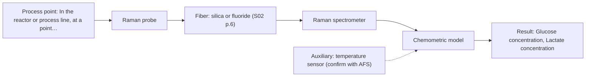
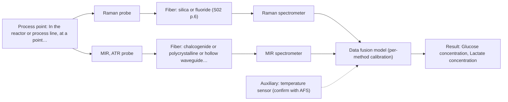

# First technical assessment: Glucose and lactate trends in an aqueous bioprocess

## Answer

**Customer request (our summary):** Customer runs a cell culture process in aqueous medium and wants to explore in situ spectroscopy for glucose and lactate to reduce delay versus sample-based lab measurements.

### Brief answer

Test Raman first: it suits aqueous media and has been used to detect glucose and lactate directly in a reactor. MIR-ATR is a complementary single method to compare, and NIR transmission only if the medium stays clear. Combining Raman and MIR-ATR is a later hypothesis. The pilot can be checked against your existing laboratory measurements. Concentration ranges, medium turbidity and required accuracy are still open.

### Proposal

- **Best current option:** O2 (recommended)
- **Basis:** supplied AFS sources
- **What would change it:** A high fluorescence background or strongly changing turbidity could shift the choice toward MIR-ATR or a combined probe. If one method cannot meet the required accuracy, the extended option becomes relevant.
- **Next step:** Run a multi-method laboratory trial on representative medium samples, with the existing laboratory glucose and lactate values as reference.

**Secondary evidence (external, not AFS material):** G1: no usable external source found; G2: E04 ¶37, E04 ¶11; G3: E02 ¶20; G4: no usable external source found. See Expert detail.

**Decision status:** Provisional feasibility assessment

### Solution options

| ID | Tier | Methods | Confidence | Cost class, S01 Table 1 (p.6) | Ease of use | Maintenance | Performance fit | Sources |
|---|---|---|---|---|---|---|---|---|
| O1 | Simple | M2 MIR, ATR probe | Medium: open question: Q1 (starts at Medium) | high cost (row 2) | single contact probe, moderate handling | crystal cleaning and fouling checks | high selectivity for glucose and lactate | [1: S01 p.9] [2: S01 p.11] |
| O2 | Recommended | M1 Raman probe | Medium: open question: Q1 (starts at Medium) | high cost (row 12) | single probe, no contact needed | probe cleaning, laser and filter checks | aqueous-friendly, direct metabolite detection | [3: S01 p.16] [4: S01 p.16] |
| O3 | Extended (multi-method) | M4 Raman probe + MIR (combination) | Low: open question: Q1 (starts at Medium); multi-method, fusion benefit not yet shown | high cost (rows 2, 12) | two instruments, more setup | two calibrations and diagnostics | complementary information if one method falls short | [5: S01 p.8] [6: S01 p.8] [7: S01 p.8] [2: S01 p.11] [8: S01 p.7] |

*Confidence rates the basis of the advice (how much is known and cited), not a predicted accuracy or probability of success. It starts at High, or at Medium when a key question on the method or the option is open, and drops one level per weakness listed (floor Low).*

*Cost class is the relative rating in S01 Table 1 (p.6) for the in-line method+technique rows named (the highest one for a multi-method option); it is not a price.*

### Setup sketch

*Recommended option O2; drawn by code from the option, a schematic, not a configuration.*

### Key questions

1. What are the expected glucose and lactate concentration ranges in the medium?
2. How turbid is the medium, and how does its optical density change during the run?
3. What accuracy and response time must the in situ measurement meet?

## Expert detail

**Customer enquiry**

> We run a cell culture process in an aqueous medium. Glucose and lactate are measured from samples, and the delay makes it difficult to see changes promptly. We are exploring an in situ spectroscopy pilot that can be checked against those existing laboratory measurements. The medium and cell population change during the run; we have not yet selected a probe or a calibration strategy.

**Decision status:** Provisional feasibility assessment. A shortlist of single methods can be justified for glucose and lactate in an aqueous medium, with stated assumptions. The medium's optical behaviour, the required accuracy and the installation are still open, so the choice stays provisional.

### Parameters

| ID | Parameter | Kind | Need | Measured by | Why | Sources |
|---|---|---|---|---|---|---|
| P1 | Glucose concentration | quantitative | required | Spectroscopy: Raman | It is the customer's main target and replaces the delayed sample-based glucose measurement. | [4: S01 p.16] |
| P2 | Lactate concentration | quantitative | required | Spectroscopy: Raman | It is the customer's second target and replaces the delayed sample-based lactate measurement. | [4: S01 p.16] |
| P3 | Temperature at the measurement point | quantitative | optional | Auxiliary sensor: temperature sensor (engineering judgement: confirm availability with AFS) | Temperature affects the spectra and the process, so a temperature reading supports calibration and interpretation; it should be available in a bioreactor. | *(no verified source: engineering judgement)* |

### Solution option details

- **O1 cost drivers:** one spectrometer, ATR probe, fiber link
- **O2 cost drivers:** one Raman spectrometer, laser, fiber probe
- **O3 cost drivers:** two spectrometers, combined probe, fusion software
- **O3 combining methods:** Low-level data fusion of synchronised Raman and MIR-ATR spectra taken from the same sampling spot, with each block scaled and calibrated separately. The fused model must beat the best single method on held-out runs before the extra instrument is kept.

*Extended (multi-method) option O3; drawn by code from the option, a schematic, not a configuration.*

### Premise check

- **Supported:** An in situ spectroscopy pilot can be checked against the existing laboratory measurements. A feasibility plan is expected to use independent reference measurements and a defined comparison. [9: REF §3]
- **Supported:** In situ spectroscopy will reduce the delay enough to see changes promptly. The source states that online analysis works directly in the process flow without sampling and eliminates delays; the achievable time resolution still depends on the chosen instrument and acquisition settings. [10: S01 p.3]
- **Precedent only:** Glucose and lactate can be measured in situ by fiber spectroscopy in this cell-culture medium. A published bioprocess example shows Raman detecting glucose and lactate in a reactor; this is a reason to test, not proof for this medium. [4: S01 p.16]

### Requirements

**Stated by the customer**

- "cell culture process"
- "aqueous medium"
- "Glucose and lactate are measured from samples"
- "the delay makes it difficult to see changes promptly"
- "We are exploring an in situ spectroscopy pilot"
- *Further statements: see the customer enquiry above.*

**Key unknowns**

- Expected glucose and lactate concentration ranges
- Medium turbidity and how its optical density changes during the run
- Required accuracy and response time
- Fluorescent species present in the medium
- Installation point and distance from spectrometer to reactor
- Reference laboratory method details for glucose and lactate

### Clarification questions (most decision-relevant first)

Q1. What are the expected glucose and lactate concentration ranges in the medium? *Why it matters:* The range decides whether a method has enough sensitivity and which technique is worth testing first. *(affects: method)*
Q2. How turbid is the medium, and how does its optical density change during the run? *Why it matters:* Turbidity decides whether NIR transmission is usable or whether a scattering or ATR geometry is needed. *(affects: technique)*
Q3. What accuracy and response time must the in situ measurement meet? *Why it matters:* These targets set the go/no-go basis and can rule a method in or out. *(affects: status)*
Q4. Where will the probe be installed, and how far is it from the spectrometer? *Why it matters:* The distance and location constrain the fiber family and the probe geometry. *(affects: installation)*
Q5. Does the medium contain fluorescent species such as NADH, tryptophan or riboflavin? *Why it matters:* Fluorescence background can swamp the weak Raman signal and change the method choice. *(affects: M1)*

### Recommendation

- **M1 · Primary candidate: Raman probe.** Raman is well suited to aqueous media and has been used to detect glucose and lactate directly in a reactor. It is the single method to test first. *Conditions:* Applies if the medium's fluorescence background does not swamp the Raman signal. [3: S01 p.16] [4: S01 p.16]
- **M2 · Comparison candidate: MIR, ATR probe.** MIR-ATR is highly informative and its bands are complementary to Raman. ATR also handles turbid, high-optical-density media through a very short sampling path. *Conditions:* Applies if the sample allows tight contact with the ATR crystal. [1: S01 p.9] [2: S01 p.11]
- **M3 · Conditional candidate: NIR, transmission/transflection probe.** NIR is a common online method, but transmission fails when the medium becomes too turbid for light to penetrate. It is worth testing only if the medium stays optically clear enough. *Conditions:* Only if the medium remains transparent or semi-transparent over the run. [11: S01 p.18] [12: S01 p.10]
- **M4 · Conditional candidate: Raman probe + MIR (combination).** Mid-IR and Raman spectra are complementary, and combining methods can help for complex samples. This is a later hypothesis to test against the best single method, not a first choice. *Conditions:* Only after the single-method tests, if one method cannot cover the targets. [2: S01 p.11] [8: S01 p.7]

### Measurement concept

- **Probe and geometry:** In-line fiber probe in the reactor; Raman probe for the primary test, ATR probe as the comparison. Geometry and contact depend on the answers to Q2 and Q4.
- **Location:** In the reactor or process line, at a point representative of the medium (open, see Q4).
- **Fiber link:** Fiber family depends on the method: silica fibers for Raman, chalcogenide or polycrystalline fibers for MIR. No link length is assumed; it is an open question. [13: S02 p.6]

### Spectral range

- **Raman:** Raman shift in cm-1, with the laser excitation wavelength stated separately; the usable range depends on the instrument, fiber and probe selected. [14: S01 p.11]
- **MIR:** Nominal mid-IR range 4000-400 cm-1; the usable range depends on the fiber and crystal actually selected. [1: S01 p.9]

### Risks and uncertainty

- Fluorescence from the medium or cells could swamp the weak Raman signal. *(rules: R-RAM-1)* [15: S01 p.11]
- The medium's turbidity and cell population change during the run, which can shift scattering and break a fixed calibration. *(rules: R-GEN-5, R-CAL-1)* [16: S01 p.16]
- Calibrations are matrix-specific, so a changing medium may require re-validation or rebuilding. *(rules: R-CAL-1)* [17: REF §5]
- ATR contact can foul with cells and proteins, degrading the MIR signal. *(rules: R-MIR-3)* [18: REF §5]

### First feasibility experiment

1. **Collect representative medium samples across the run, covering the expected glucose and lactate levels, cell densities and turbidity states.** Representative samples across the expected chemical and physical variation. [9: REF §3]
2. **Measure each sample with the Raman probe first, and with the MIR-ATR probe as a comparison, under the intended in-line conditions.** Single methods first, before any combination. [19: S01 p.3]
3. **Measure glucose and lactate independently with the existing laboratory method on the same samples.** Independent reference measurements. [9: REF §3]
4. **Build and validate a calibration per method on held-out runs or batches, and compare each single method against the reference values.** Validation on held-out runs or batches. *(no verified source: engineering judgement)*
5. **Only if one method cannot cover the targets, test the combined Raman and MIR-ATR model against the best single method.** Combinations only after single methods, and only if they beat the best single method. [20: REF §5]

**Reference measurements:** Existing laboratory glucose and lactate measurements on the same samples.

**Decision basis:** Go/no-go criteria (accuracy and response time) to be set by the customer; no numerical target is assumed here.

### Assumptions

- The medium is a liquid that can be sampled in-line.
- The existing laboratory measurements can serve as reference values.
- The medium's optical behaviour is not yet known and is treated as an open question.

### Not covered by the supplied sources

- Detection limits, accuracy or response times for glucose and lactate in cell-culture medium.
- An achievable MIR fiber link length for this installation.

### Further notes

- **Chemometrics:** Quantitative glucose and lactate need calibration models (for example PLS) built on reference laboratory values. These models are matrix-specific and should be validated on held-out runs, then re-checked when the medium or cell population changes.
- **Real-time tracking:** The point of the pilot is in-line, continuous tracking. If more than one method is used, the data from each method must be aligned to a common time step before fusion.
- **Future direction:** If the pilot succeeds, a compact optical multisensor system or a spectral fiber sensor for routine control could be considered later.

### Secondary evidence (external, not AFS material)

*Found by a literature search for gaps the supplied AFS sources leave open. Not AFS material and not proof for this case; every quote below was verified verbatim against the fetched text.*

**G1 · auxiliary sensor:** In-line measurement of Temperature at the measurement point with temperature sensor

- No usable external source found.

**G2 · multi-method:** Combining several spectroscopy methods (data fusion) (Low-level data fusion of synchronised Raman and MIR-ATR spectra taken from the same sampling spot, with each block scaled and calibrated separately. The fused model must beat the best single method on held-out runs before the extra instrument is kept.)

- **E04 ¶37** Low-level fusion concatenates FTIR and Raman spectra before training a separate PLSR model, with SNV applied to both spectral blocks before concatenation. *How it applies:* This could inform testing a low-level fusion workflow for Raman and MIR-ATR, where each block is preprocessed and concatenated before model training. *Limits and transfer risks:* The study used liposome samples and laboratory FTIR/Raman instruments, not cell-culture medium or in-line same-spot sampling. *(supports O3)*
  > "The low-level fusion concatenates the dataset for the FTIR and Raman spectra (see Figure 4) prior to training a separate PLSR model, and this was achieved by applying the SNV to both the FTIR and Raman spectra prior to concatenation."
  > Combining IR and Raman Spectroscopies for Enhanced Accuracy and Precision in the Determination of Lipid Composition in Liposomes. (2026) · Biomolecules · doi:10.3390/biom16040489 · https://europepmc.org/article/PMC/PMC13113388 · retrieved 2026-10-18, full text, licence: cc by, via europepmc
- **E04 ¶11** In one study, models based on the infrared modality alone performed best for detecting fish oil adulteration, suggesting fusion does not always improve over a single method. *How it applies:* This supports the requirement to compare a fused model against the best single method on held-out runs before keeping the extra instrument. *Limits and transfer risks:* The study concerned marine oils and laboratory spectroscopy, not cell-culture glucose/lactate or in-line Raman/MIR-ATR. *(supports O3)*
  > "However, they also found that the models based on the infrared modality alone performed the best for detecting generic fish oil adulteration in cod liver and salmon oils, indicating that there are other strategies available to achieve better precision and accuracy with machine learning models."
  > Combining IR and Raman Spectroscopies for Enhanced Accuracy and Precision in the Determination of Lipid Composition in Liposomes. (2026) · Biomolecules · doi:10.3390/biom16040489 · https://europepmc.org/article/PMC/PMC13113388 · retrieved 2026-10-18, full text, licence: cc by, via europepmc

**G3 · not in the supplied sources:** Detection limits, accuracy or response times for glucose and lactate in cell-culture medium.

- **E02 ¶20** Raman is frequently used in upstream processing because of high selectivity and low water interference, though measurement times are relatively long. *How it applies:* For O2, this suggests Raman may handle aqueous medium but response time should be tested against the process need. *Limits and transfer risks:* The source does not give glucose- or lactate-specific detection limits or accuracy, and upstream processing may differ from this cell-culture medium and in-line setup. *(supports O2)*
  > "Raman spectroscopy is frequently applied in upstream processing in research and industry due to its high selectivity and low water interference [55] despite the relatively long measurement times."
  > A critical review of recent trends, and a future perspective of optical spectroscopy as PAT in biopharmaceutical downstream processing. (2020) · Analytical and bioanalytical chemistry · doi:10.1007/s00216-020-02407-z · https://europepmc.org/article/PMC/PMC7072065 · retrieved 2026-10-17, full text, licence: cc by, via curated library

**G4 · not in the supplied sources:** An achievable MIR fiber link length for this installation.

- No usable external source found.

### Evidence (verified quotes)

1. ✓ **S01 p.9** (general): "Vibrational spectroscopy in the mid-IR range (4000-400 cm-1) is one of the most informative methods of chemical analysis."
2. ✓ **S01 p.11** (general): "This property makes mid-IR and Raman spectra complementary, that is, they complement each other."
3. ✓ **S01 p.16** (general): "Raman is particularly well-suited for aqueous environments, as it exhibits low absorbance for water molecules compared to infrared methods."
4. ✓ **S01 p.16** (application precedent): "Raman spectroscopy can be used in the same reactor to provide a "molecular fingerprint" for direct detection of specific metabolites like glucose, acetate, or lactate."
5. ✓ **S01 p.8** (general): "It is crucial that the spectral information obtained by different methods-Mid-IR, NIR, Raman, and fluorescence spectra-is collected from the same small, even pinpoint, area of the sample."
6. ✓ **S01 p.8** (general): "Ultimately, the measurement data must be normalized to a common time step."
7. ✓ **S01 p.8** (general): "If the variables have different units of measurement, the data should be normalized in some way, for example, using an autoscaling algorithm."
8. ✓ (precedent only) **S01 p.7** (method gain): "The analysis of such systems may require a combination of two or even more spectral methods."
9. ✓ **REF §3** (general): "Representative samples or process states, independent reference measurements, what is compared, and the basis for the go / no-go decision."
10. ✓ **S01 p.3** (general): "It allows for in-process analysis, i.e., directly in the process flow or reactor without sampling, eliminating delays and the risk of sample contamination."
11. ✓ **S01 p.18** (general): "it fails when the milk becomes too "thick" or fat-rich, as the light cannot penetrate the sample."
12. ✓ **S01 p.10** (general): "The broad absorption bands observed in this region overlap, suggesting the use of chemometrics for quantitative and qualitative analysis of spectral data."
13. ✓ **S02 p.6** (general): "1100 nm Chalcogenide As-S IR Fibers 6500 nm"
14. ✓ **S01 p.11** (general): "The Raman shift is used as the horizontal (spectral) axis in Raman spectroscopy"
15. ✓ **S01 p.11** (general): "superposition of luminescence (fluorescence), which has a significantly higher intensity."
16. ✓ **S01 p.16** (general): "cell suspension turbidity correlates well with cell density."
17. ✓ **REF §5** (general): "Weak signal, fluorescence background; calibration specific to the matrix."
18. ✓ **REF §5** (general): "Usable range limited by fiber and crystal; contact, fouling, compatibility."
19. ✓ **S01 p.3** (general): "samples of incompletely known composition, in order to select the most suitable method or combination of methods."
20. ✓ **REF §5** (general): "compare with the best single method."

### Verification

- Citations verified: 30 of 30 (exact or whitespace/hyphen-tolerant match on the cited page, scope checked).
- Hard check failures before deterministic corrections: 0; still open: 0; soft warnings: 2; repair rounds: 0.
- External evidence (live): 3 quote(s) verified verbatim (exact or whitespace/hyphen-tolerant, at most 400 characters and 2 sentences, against the cited paragraph); 0 item(s) dropped.
- External search: 6 query(ies), 45 hit(s), 5 source(s) (3 from the curated library).
- External step: 2 model call(s), 23.3 s extra (cost in the run JSON).

*Run D04-20261018T054759Z · models deepseek/deepseek-v4.1-flash*
