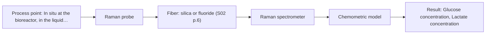
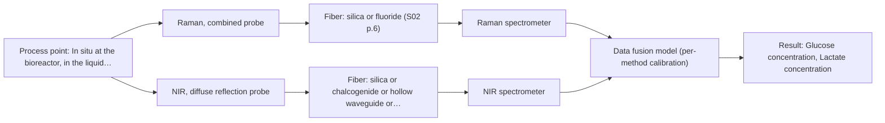

# First technical assessment: Glucose and lactate trends in an aqueous bioprocess

## Answer

**Customer request (our summary):** The customer wants to know whether an in situ spectroscopy pilot can measure glucose and lactate in an aqueous cell culture process fast enough to replace the delay-prone sampling, checked against their existing laboratory measurements.

### Brief answer

Test Raman first: it is the method best suited to glucose and lactate in an aqueous cell culture, with NIR as a comparison. Both need a chemometric calibration checked against your existing laboratory measurements. Still open: the concentration ranges, the required accuracy and update rate, the medium's turbidity and fluorescence, and the probe installation point.

### Proposal

- **Best current option:** O2 (recommended)
- **Basis:** supplied AFS sources
- **What would change it:** If the medium proves highly turbid or strongly fluorescent, or if Raman alone cannot meet the required accuracy or update rate, the choice would move to NIR or to the Raman+NIR combination.
- **Next step:** Run the feasibility experiment: single-method Raman and NIR measurements on representative samples, checked against the existing laboratory reference.

**Secondary evidence (external, not AFS material):** G1: no usable external source found; G2: E02 ¶8, E02 ¶72; G3: E04 ¶1; G4: no usable external source found. See Expert detail.

**Decision status:** Provisional feasibility assessment

### Solution options

| ID | Tier | Methods | Confidence | Cost class, S01 Table 1 (p.6) | Ease of use | Maintenance | Performance fit | Sources |
|---|---|---|---|---|---|---|---|---|
| O1 | Simple | M2 NIR, diffuse reflection probe | Low: open question: Q1 (starts at Medium); sample clarity unknown | average cost (row 8) | Standard optics, common online method | Routine probe cleaning and recalibration | Common online method, glucose in millimolar range | [1: S01 p.10] [2: S01 p.5] [3: S01 p.16] [4: S01 p.17] |
| O2 | Recommended | M1 Raman probe | Medium: open question: Q1 (starts at Medium) | high cost (row 12) | Laser-based probe, needs careful setup | Probe cleaning, laser and detector service | Direct metabolite detection in aqueous medium | [5: S01 p.16] [6: S01 p.11] [7: S01 p.16] |
| O3 | Extended (multi-method) | M3 Raman, combined probe + NIR (combination) | Low: open question: Q1 (starts at Medium); technique not screened for this sample, sample clarity unknown; multi-method, fusion benefit not yet shown | average cost (row 8); not rated in S01 Table 1: Raman, combined probe | Two instruments, more complex operation | Two calibrations, two instrument service lines | Complementary information if one method falls short | [8: S01 p.8] [9: S01 p.8] [10: S01 p.9] [11: S01 p.15] [12: S01 p.7] |

*Confidence rates the basis of the advice (how much is known and cited), not a predicted accuracy or probability of success. It starts at High, or at Medium when a key question on the method or the option is open, and drops one level per weakness listed (floor Low).*

*Cost class is the relative rating in S01 Table 1 (p.6) for the in-line method+technique rows named (the highest one for a multi-method option); it is not a price.*

### Setup sketch

*Recommended option O2; drawn by code from the option, a schematic, not a configuration.*

### Key questions

1. What concentration ranges of glucose and lactate must be covered, and what accuracy and precision must the in situ measurement reach?
2. What response time or update rate is needed to see changes promptly?
3. How turbid is the medium across the run (cell density range, colour, scattering)?

## Expert detail

**Customer enquiry**

> We run a cell culture process in an aqueous medium. Glucose and lactate are measured from samples, and the delay makes it difficult to see changes promptly. We are exploring an in situ spectroscopy pilot that can be checked against those existing laboratory measurements. The medium and cell population change during the run; we have not yet selected a probe or a calibration strategy.

**Decision status:** Provisional feasibility assessment. The sources support Raman for glucose and lactate in an aqueous bioprocess, so a method shortlist can be justified. The concentration ranges, the required accuracy and update rate, and the medium's optical behaviour are still open, so the choice stays provisional.

### Parameters

| ID | Parameter | Kind | Need | Measured by | Why | Sources |
|---|---|---|---|---|---|---|
| P1 | Glucose concentration | quantitative | required | Spectroscopy: Raman | It is one of the two stated targets of the pilot. | [7: S01 p.16] |
| P2 | Lactate concentration | quantitative | required | Spectroscopy: Raman | It is the second stated target of the pilot. | [7: S01 p.16] |
| P3 | Cell density / biomass | quantitative | optional | Reference lab method: offline viable cell count | The cell population changes during the run and its scattering affects the spectra, so it should be available to interpret them. | [13: S01 p.16] [14: S01 p.7] |
| P4 | Temperature | quantitative | optional | Auxiliary sensor: temperature sensor (engineering judgement: confirm availability with AFS) | Temperature affects the spectra and the process, so it should be available to correct or interpret the measurement. | *(no verified source: engineering judgement)* |

### Solution option details

- **O1 cost drivers:** NIR spectrometer, light source, fiber probe, chemometric calibration
- **O2 cost drivers:** Raman spectrometer, laser, fiber probe, chemometric calibration
- **O3 cost drivers:** Two spectrometers, two probes, data fusion and calibration
- **O3 combining methods:** Fusion level: start with one model per method, then join the spectra with block scaling so neither method dominates. Both probes must look at the same small area of the medium, and the data must be aligned to a common time step. Each block needs its own calibration and diagnostics, and the fused model must beat the best single method on independent runs before the extra instrument is kept.

*Extended (multi-method) option O3; drawn by code from the option, a schematic, not a configuration.*

### Premise check

- **Precedent only:** In situ spectroscopy is a suitable way to measure glucose and lactate in this cell culture process. A source describes Raman in a reactor for direct detection of metabolites such as glucose and lactate and notes Raman suits aqueous media; this is a reason to test, not proof for this process. [7: S01 p.16] [5: S01 p.16]
- **Not covered:** The existing laboratory measurements are a valid reference against which the pilot can be checked. The sources require independent reference measurements in a feasibility plan but do not assess the customer's specific laboratory method or its uncertainty. [15: REF §3]
- **Supported:** Moving in situ will resolve the promptness problem caused by the sampling delay. A source states that in-process analysis directly in the reactor without sampling eliminates delays. [16: S01 p.3]

### Requirements

**Stated by the customer**

- In situ measurement of glucose and lactate in an aqueous cell culture process.
- Faster than the current sampling delay, so changes are seen promptly.
- Checked against the existing laboratory measurements.
- Must cope with a medium and cell population that change during the run.

**Key unknowns**

- Concentration ranges of glucose and lactate.
- Required accuracy and precision.
- Required response time or update rate.
- Optical behaviour of the medium (turbidity, cell density, colour).
- Medium composition and any fluorescent species.
- Installation point, interface and distance to the analyser.

### Clarification questions (most decision-relevant first)

Q1. What concentration ranges of glucose and lactate must be covered, and what accuracy and precision must the in situ measurement reach? *Why it matters:* These numbers decide whether a method can meet the target and set the go/no-go basis. *(affects: method, status)*
Q2. What response time or update rate is needed to see changes promptly? *Why it matters:* The required rate decides the acquisition conditions and whether the technique is fast enough. *(affects: technique, status)*
Q3. How turbid is the medium across the run (cell density range, colour, scattering)? *Why it matters:* Turbidity decides whether NIR transmission is usable and how much scattering affects the spectra. *(affects: technique, status)*
Q4. What is the installation point and interface (bioreactor type, port, single-use or stainless), and the distance to the analyser? *Why it matters:* This fixes the probe geometry and the fiber link. *(affects: installation)*
Q5. Does the medium contain fluorescent species, and would a fluorescent indicator or reagent be acceptable? *Why it matters:* Fluorescence can swamp Raman bands, and an indicator would change the method choice. *(affects: method, status)*
Q6. What is the existing laboratory method for glucose and lactate, and what is its uncertainty? *Why it matters:* The reference must be good enough to judge the in situ result against. *(affects: status)*

### Recommendation

- **M1 · Primary candidate: Raman probe.** Raman gives direct detection of glucose and lactate and is well suited to aqueous media, where water interferes less than in infrared methods. It is the single method to test first. [7: S01 p.16] [5: S01 p.16]
- **M2 · Conditional candidate: NIR, diffuse reflection probe.** NIR is the most common online fiber-probe method and can track glucose in the millimolar range, but its bands overlap and need chemometrics. It applies only if the medium is turbid or highly scattering. *Conditions:* Applies if the medium is turbid or highly scattering (high cell density); if it proves clear, NIR transmission or transflection would be the alternative geometry. [1: S01 p.10] [3: S01 p.16] [4: S01 p.17]
- **M3 · Comparison candidate: Raman, combined probe + NIR (combination).** NIR and Raman capture complementary chemical information, and a NIR+Raman combination has shown the best results in an online process example. Any gain is a hypothesis to test against the best single method, after the single-method tests. *Conditions:* Applies only if a single method does not meet the stated accuracy or update-rate targets. [11: S01 p.15] [12: S01 p.7]
- **M4 · Not recommended: fluorescence probe.** Fluorescence is not a direct measurement of glucose or lactate and needs a fluorescent species or a justified indicator, which has not been identified. It is not recommended for these targets. [17: REF §5] [18: S01 p.5]

### Measurement concept

- **Probe and geometry:** An in-line fiber-optic probe in contact with the medium: a Raman probe for the primary method, with a NIR diffuse-reflection probe as the comparison geometry, mounted at a bioreactor port.
- **Location:** In situ at the bioreactor, in the liquid medium, at a port that allows contact with the process stream.
- **Fiber link:** A fiber-optic link between the probe and the spectrometer, so the spectrometer can sit away from the process point; the achievable length is not stated in the sources for this case. [19: S01 p.5] [20: S01 p.15] [21: S01 p.11] [22: S02 p.7]

### Spectral range

- **Raman:** Raman is reported as a Raman shift in cm-1, with the laser excitation wavelength stated separately; the nominal range is not the range of a specific instrument, fiber or probe. [23: S01 p.11] [24: REF §3]
- **NIR:** The nominal NIR range is 780-2500 nm; the usable range depends on the instrument, fiber and probe actually selected. [25: S01 p.10] [26: REF §5]

### Risks and uncertainty

- The medium's optical regime (turbidity, cell density, colour) is unknown and may rule out NIR transmission and complicate Raman sampling. *(rules: R-GEO-2, R-GEN-5)* [27: S01 p.18] [14: S01 p.7]
- Fluorescence from the medium or cells may swamp the weak Raman signal. *(rules: R-RAM-1)* [28: S01 p.11] [29: S01 p.11]
- The changing medium and cell population may invalidate a fixed calibration, which would then need re-validation. *(rules: R-CAL-1)* [30: REF §5]
- The required accuracy, the concentration ranges and the reference method's uncertainty are unknown, so feasibility cannot be confirmed. *(no verified source: engineering judgement)*

### First feasibility experiment

1. **Define a sample set that spans the expected chemical and physical variation: medium composition, cell density, glucose and lactate levels, and different run stages.** Representativeness, so the calibration covers the real variation. [15: REF §3]
2. **Measure the samples with the single methods first (Raman, then NIR) on the same sampling spot, and record the spectra.** Compare single methods before any combination. [31: REF §5]
3. **Obtain independent reference measurements of glucose and lactate with the existing laboratory method for every sample.** An independent reference for calibration and validation. [15: REF §3]
4. **Build calibration models and validate them on held-out runs or batches; then test the Raman+NIR combination against the best single method.** Guard against overfitting and check whether the combination adds value. [32: S03 p.6] [33: REF §5]
5. **Decide go/no-go by comparing the in situ prediction with the reference against the accuracy and update-rate criteria the customer sets.** A defined go/no-go basis. [15: REF §3]

**Reference measurements:** The customer's existing laboratory glucose and lactate measurements, applied to the same samples; their uncertainty should be stated.

**Decision basis:** Go/no-go: the in situ prediction must agree with the reference within the accuracy and update rate the customer specifies; those numbers are not yet given.

### Assumptions

- The process is a cell culture in an aqueous medium, as stated.
- The existing laboratory glucose and lactate measurements can serve as the independent reference.
- The medium's optical regime (turbidity, cell density) is not yet known.
- No fluorescent indicator or reagent has been selected.

### Not covered by the supplied sources

- No source gives detection limits or accuracy for glucose or lactate in cell culture media.
- No source covers sterilisation, CIP/SIP or single-use bioreactor interfaces for these probes.
- No source states an achievable fiber length for a Raman or NIR link to a bioreactor.

### Further notes

- **Chemometrics:** Both Raman and NIR need a chemometric calibration; their bands overlap and the model is specific to the matrix, so it must be re-validated as the medium and cell population change.
- **Real-time tracking:** In-line fiber probes allow near-real-time results without sampling; the achievable update rate depends on the instrument and acquisition conditions and is not stated in the sources.
- **Future direction:** Once the key spectral features are identified, a compact optical multisensor system or an LED-based sensor for the specific analytes could be a later extension.

### Secondary evidence (external, not AFS material)

*Found by a literature search for gaps the supplied AFS sources leave open. Not AFS material and not proof for this case; every quote below was verified verbatim against the fetched text.*

**G1 · auxiliary sensor:** In-line measurement of Temperature with temperature sensor

- No usable external source found.

**G2 · multi-method:** Combining several spectroscopy methods (data fusion) (Fusion level: start with one model per method, then join the spectra with block scaling so neither method dominates. Both probes must look at the same small area of the medium, and the data must be aligned to a common time step. Each block needs its own calibration and diagnostics, and the fused model must beat the best single method on independent runs before the extra instrument is kept.)

- **E02 ¶8** The source states that a continuous process with a fixed probe location is meant to run in a steady-state window, which simplifies model design, lets calibrations be narrower and centred on the operational envelope, and allows validation on independent steady-state runs. *How it applies:* This supports the fusion plan's requirement that the fused model be validated on independent runs: define a steady-state operating window for the cell culture pilot and validate the fused model on separate runs rather than on the calibration data. *Limits and transfer risks:* The work concerns FT-IR and Raman in reactive liquid-liquid extraction for lithium recycling, not an aqueous cell culture matrix, and the probe geometry and process dynamics differ, so the modelling and validation approach would need re-testing here. *(supports O3)*
  > "In contrast, a continuous process at a fixed probe location is intended to operate in a steady-state window, which simplifies the model design: calibrations can be narrower and centered on the operational envelope, validation can rely on independent steady-state runs, and online monitoring focuses on drift and out-of-specification detection rather than resolving the rapidly changing composition."
  > Process Analytical Technology-Integrated FT-IR and Raman Spectroscopies for Efficient Reactive Liquid-Liquid Extraction Processing in Lithium Recycling. (2025) · ACS omega · doi:10.1021/acsomega.5c05705 · https://europepmc.org/article/PMC/PMC12573149 · retrieved 2026-10-17, full text, licence: cc by, via curated library
- **E02 ¶72** The source notes that typical drawbacks of any in-line method are maintenance and calibration effort, and that drift and aging can be handled by checking the baseline in each cycle of pure component phases and monitoring drift so one can react. *How it applies:* This supports giving each spectral block its own calibration and diagnostics: plan periodic baseline checks and drift monitoring for each method before and after fusion, so a drifting block does not silently bias the fused model. *Limits and transfer risks:* The recommendation comes from a lithium-recycling extraction process with defined pure component phases; a cell culture medium may not offer such clean reference phases, and the drift behaviour of the probes here is untested. *(supports O3)*
  > "Potential typical drawbacks of any in-line method are maintenance efforts like calibration, and actions to sensor drift and aging could be easily overcome by checking the baseline in each cycle of pure component phases of process operation and monitoring any drift in order to be able to react."
  > Process Analytical Technology-Integrated FT-IR and Raman Spectroscopies for Efficient Reactive Liquid-Liquid Extraction Processing in Lithium Recycling. (2025) · ACS omega · doi:10.1021/acsomega.5c05705 · https://europepmc.org/article/PMC/PMC12573149 · retrieved 2026-10-17, full text, licence: cc by, via curated library

**G3 · not in the supplied sources:** No source gives detection limits or accuracy for glucose or lactate in cell culture media.

- **E04 ¶1** The source reports a miniaturized electrochemical device with linear detection ranges of 0.5-35 mM for glucose and 0.5-40 mM for lactate and limits of detection of 0.18 ± 0.01 mM and 0.19 ± 0.01 mM in human induced pluripotent stem cell culture media. *How it applies:* These figures give a reference for the concentration span and detection levels reported for glucose and lactate in a cell culture medium, which can help frame what the spectroscopy pilot would need to cover; they are not spectroscopic values and would have to be established separately for the pilot. *Limits and transfer risks:* The device is electrochemical and microfluidic, the source is an abstract only, the matrix is hiPSC culture media, and measurements were made on serially collected small-volume samples rather than in line, so the numbers do not transfer to an in situ spectroscopic probe.
  > "The device exhibits linear detection ranges of 0.5-35 mM for Glu and 0.5-40 mM for LA, with limits of detection (LODs) of 0.18 ± 0.01 mM and 0.19 ± 0.01 mM, respectively."
  > Micropillar-Based Biosensor for Monitoring Contamination- and Compound-Induced Metabolic States in Cell Cultures. (2026) · ACS applied materials & interfaces · doi:10.1021/acsami.6c05566 · https://europepmc.org/article/MED/42323808 · retrieved 2026-10-18, abstract only, licence: unknown, via europepmc

**G4 · not in the supplied sources:** No source covers sterilisation, CIP/SIP or single-use bioreactor interfaces for these probes.

- No usable external source found.

### Evidence (verified quotes)

1. ✓ **S01 p.10** (general): "Near-IR vibrational spectroscopy (NIR) is the most common online analysis method performed using fiber optic probes."
2. ✓ **S01 p.5** (general): "NIR spectroscopy, with its relatively large penetration depth (up to several millimetres) even into dense solid samples due to low absorption and strong scattering, allows the use of ordinary glass for optics"
3. ✓ **S01 p.16** (general): "NIR spectroscopy is effective for tracking major components like glucose or glycerol in the millimolar range but may lack the sensitivity to detect trace compounds below 0.1 percent."
4. ✓ **S01 p.17** (general): "NIR Reflection is primarily used for opaque or highly concentrated dairy products, such as yogurt, butter, or whole milk concentrates."
5. ✓ **S01 p.16** (general): "Raman is particularly well-suited for aqueous environments, as it exhibits low absorbance for water molecules compared to infrared methods."
6. ✓ **S01 p.11** (general): "This property makes mid-IR and Raman spectra complementary, that is, they complement each other."
7. ✓ **S01 p.16** (application precedent): "direct detection of specific metabolites like glucose, acetate, or lactate."
8. ✓ **S01 p.8** (general): "It is crucial that the spectral information obtained by different methods-Mid-IR, NIR, Raman, and fluorescence spectra-is collected from the same small, even pinpoint, area of the sample."
9. ✓ **S01 p.8** (general): "Ultimately, the measurement data must be normalized to a common time step."
10. ✓ **S01 p.9** (general): "One of the challenges of multispectral analysis is the need to simultaneously connect at least two independently operating measuring instruments."
11. ✓ (precedent only) **S01 p.15** (method gain): "NIR detects hydrogen bonds and asymmetric polar groups, while Raman provides information on the molecular backbone and symmetrical non-polar groups."
12. ✓ **S01 p.7** (application precedent): "Online analysis of the pellet coating process in a fluidized bed showed the best results with the simultaneous use of NIR and Raman spectroscopy."
13. ✓ **S01 p.16** (general): "cell suspension turbidity correlates well with cell density."
14. ✓ **S01 p.7** (general): "Morphological factors, such as sample inhomogeneity (e.g., biological tissue) or process turbulence, must also be considered when selecting a measurement technique."
15. ✓ **REF §3** (general): "Representative samples or process states, independent reference measurements, what is compared, and the basis for the go / no-go decision."
16. ✓ **S01 p.3** (general): "It allows for in-process analysis, i.e., directly in the process flow or reactor without sampling, eliminating delays and the risk of sample contamination."
17. ✓ **REF §5** (general): "High sensitivity, low selectivity; not a direct measurement of every analyte."
18. ✓ **S01 p.5** (general): "However, most chemicals do not exhibit this property."
19. ✓ **S01 p.5** (general): "making it ideal for online applications, including remote measurements via fiber optic probes."
20. ✓ **S01 p.15** (general): "located safely away from the vibration and dust of the manufacturing floor."
21. ✓ **S01 p.11** (general): "The kit includes a Raman spectrometer, laser, and Raman fiber probe."
22. ✓ **S02 p.7** (general): "Robust 100-300m cables made with Silica fibers of low OH-content (<0.1ppm OH) enable remote industrial process-control"
23. ✓ **S01 p.11** (general): "The Raman shift is used as the horizontal (spectral) axis in Raman spectroscopy"
24. ✓ **REF §3** (general): "A nominal method range is not the range of a specific instrument, fiber or probe."
25. ✓ **S01 p.10** (general): "NIR spectra (780-2500 nm) contain predominantly overtones and component bands of fundamental vibrations"
26. ✓ **REF §5** (general): "It is not a product specification: actual spectral coverage, fiber length, component ratings, detection limits and accuracy depend on the configuration and the sample."
27. ✓ **S01 p.18** (general): "if the pathlength is too wide, the signal is lost to absorption"
28. ✓ **S01 p.11** (general): "the low intensity of Raman signals, which are several orders of magnitude weaker than IR absorption peaks"
29. ✓ **S01 p.11** (general): "superposition of luminescence (fluorescence), which has a significantly higher intensity."
30. ✓ **REF §5** (general): "physical variation; calibration specific to the matrix."
31. ✓ **REF §5** (general): "compare with the best single method."
32. ✓ **S03 p.6** (general): "In order to reduce the risk of overfitting caused by the limited experimental data volume, a thorough validation of the discrimination models was required."
33. ✓ **REF §5** (general): "Sampling location and timing must be aligned; a gain is a hypothesis to test."

### Verification

- Citations verified: 43 of 43 (exact or whitespace/hyphen-tolerant match on the cited page, scope checked).
- Hard check failures before deterministic corrections: 0; still open: 0; soft warnings: 2; repair rounds: 0.
- External evidence (live): 3 quote(s) verified verbatim (exact or whitespace/hyphen-tolerant, at most 400 characters and 2 sentences, against the cited paragraph); 1 item(s) dropped.
- External search: 6 query(ies), 45 hit(s), 5 source(s) (3 from the curated library).
- External step: 2 model call(s), 41.5 s extra (cost in the run JSON).
  - ⚠ dropped G3 E05 ¶1: figure not in its own quote: 0.90 mM, 0.17 mM

*Run D04-20261018T060215Z · models deepseek/deepseek-v4.1-flash*
