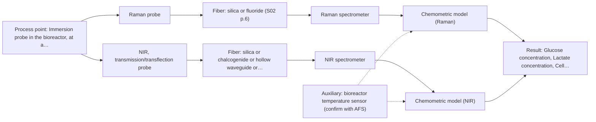
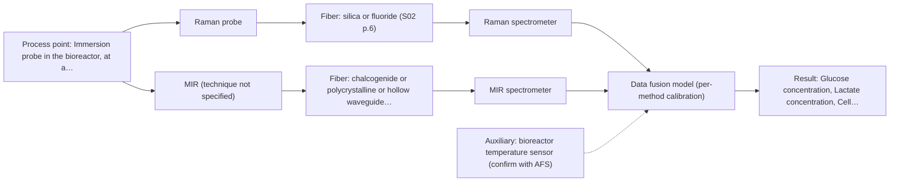

# First technical assessment: Glucose and lactate trends in an aqueous bioprocess

## Answer

**Customer request (our summary):** Customer runs a cell culture process in an aqueous medium; glucose and lactate are measured off-line from samples, and the delay makes it hard to see changes promptly. They are exploring an in situ spectroscopy pilot to be checked against the existing lab measurements. They state the medium and cell population change during the run, and that they have not yet selected a probe or a calibration strategy.

### Brief answer

Test Raman first: it tolerates water and has published precedent for direct glucose and lactate detection in bioreactors. Test NIR transmission/transflection as a second single method, since its fit depends on how turbid the medium becomes. Combine Raman and NIR only if the single methods fall short. Open points: concentration ranges, turbidity over the run, required accuracy, and installation constraints.

### Proposal

- **Best current option:** O2 (recommended)
- **Basis:** supplied AFS sources
- **What would change it:** A strongly fluorescing medium could shift the primary choice toward NIR, and very high turbidity throughout the run would rule out NIR transmission in favour of reflection or transflection geometry.
- **Next step:** Answer the concentration-range, turbidity and installation questions, then run the single-method Raman and NIR trials on representative samples against the existing laboratory measurements.

**Secondary evidence (external, not AFS material):** G1: no usable external source found; G2: E01 ¶31, E01 ¶82, E01 ¶36; G3: no usable external source found; G4: E03 ¶23, E03 ¶24. See Expert detail.

**Decision status:** Provisional feasibility assessment

### Solution options

| ID | Tier | Methods | Confidence | Cost class, S01 Table 1 (p.6) | Ease of use | Maintenance | Performance fit | Sources |
|---|---|---|---|---|---|---|---|---|
| O1 | Simple | M1 Raman probe | High | high cost (row 12) | Immersion probe, moderate setup effort | Probe window cleaning between runs | Direct aqueous metabolite detection, water interference low | [1: S01 p.16] [2: S01 p.16] |
| O2 | Recommended | M1 Raman probe; M2 NIR, transmission/transflection probe | Medium: sample clarity unknown | high cost (rows 7, 12) | Two probes, more installation effort | Two probe windows to keep clean | Two independent methods hedge the turbidity and sensitivity unknowns | [3: S01 p.16] [1: S01 p.16] [2: S01 p.16] |
| O3 | Extended (multi-method) | M3 Raman probe + MIR (combination) | Low: precedent only; multi-method, fusion benefit not yet shown | at least high cost (row 12); MIR row not identified | Most complex, needs data fusion expertise | Two instruments, each with own diagnostics | Complementary information if single methods fall short | [4: S01 p.8] [5: S01 p.7] |

*Confidence rates the basis of the advice (how much is known and cited), not a predicted accuracy or probability of success. It starts at High, or at Medium when a key question on the method or the option is open, and drops one level per weakness listed (floor Low).*

*Cost class is the relative rating in S01 Table 1 (p.6) for the in-line method+technique rows named (the highest one for a multi-method option); it is not a price.*

### Setup sketch

*Recommended option O2; drawn by code from the option, a schematic, not a configuration.*

### Key questions

1. What are the expected glucose and lactate concentration ranges during the run, and what accuracy and response time does the in situ measurement need?
2. How optically clear or turbid is the medium over the run as cell density grows?
3. Where can a probe be installed, at what distance from the analyser, and under what sterilisation and cleaning constraints?

## Expert detail

**Customer enquiry**

> We run a cell culture process in an aqueous medium. Glucose and lactate are measured from samples, and the delay makes it difficult to see changes promptly. We are exploring an in situ spectroscopy pilot that can be checked against those existing laboratory measurements. The medium and cell population change during the run; we have not yet selected a probe or a calibration strategy.

**Decision status:** Provisional feasibility assessment. A method shortlist can be justified from published bioprocess precedents, but the probe geometry, calibration design and go/no-go criteria depend on concentration ranges, turbidity and installation facts the customer has not yet provided.

### Parameters

| ID | Parameter | Kind | Need | Measured by | Why | Sources |
|---|---|---|---|---|---|---|
| P1 | Glucose concentration | quantitative | required | Spectroscopy: Raman | Glucose is a stated target of the in situ pilot and the calibration response variable. | [1: S01 p.16] |
| P2 | Lactate concentration | quantitative | required | Spectroscopy: Raman | Lactate is the second stated target and the second calibration response variable. | [1: S01 p.16] |
| P3 | Cell density / turbidity (biomass trend) | quantitative | required | Spectroscopy: NIR | The stated change in cell population scatters light and confounds the analyte signal, so it must be tracked or included in the calibration. | [6: S01 p.16] |
| P4 | Temperature | quantitative | optional | Auxiliary sensor: bioreactor temperature sensor (engineering judgement: confirm availability with AFS) | Temperature should be available from the bioreactor and helps explain spectral drift; it is not itself a spectroscopy target. | *(no verified source: engineering judgement)* |

### Solution option details

- **O1 cost drivers:** Raman spectrometer, laser and immersion probe; calibration samples and reference analyses
- **O2 cost drivers:** Two probes and spectrometers, doubled calibration and validation workload
- **O3 cost drivers:** Two spectrometers, synchronisation software, fused model development and validation
- **O3 combining methods:** Low-level fusion: synchronised Raman and NIR spectra merged into one augmented matrix with block scaling, one calibration per method as baseline. Both probes must sample the same bioreactor zone and the data must be normalised to a common time step. The fused model must beat the best single method on held-out runs, otherwise the second instrument is dropped.

*Extended (multi-method) option O3; drawn by code from the option, a schematic, not a configuration.*

### Premise check

- **Precedent only:** In situ spectroscopy can track glucose and lactate in a cell culture process. The sources show published bioprocess examples of fiber-optic Raman and NIR metabolite tracking; this is a reason to test, not proof for this customer's process. [1: S01 p.16]

### Requirements

**Stated by the customer**

- "We run a cell culture process in an aqueous medium"
- "Glucose and lactate are measured from samples"
- "the delay makes it difficult to see changes promptly"
- *Further statements: see the customer enquiry above.*

**Key unknowns**

- Expected glucose and lactate concentration ranges and required accuracy
- Optical clarity/turbidity of the medium over the run
- Installation point, probe format, fiber distance and sterilisation constraints
- Number and duration of runs available for calibration data
- Fluorescence background of the medium and its effect on Raman
- Frequency and accuracy of the laboratory reference measurements

### Clarification questions (most decision-relevant first)

Q1. What are the expected glucose and lactate concentration ranges during the run, and what accuracy and response time does the in situ measurement need? *Why it matters:* Concentration range and accuracy targets decide whether NIR sensitivity suffices and set the go/no-go criteria for the pilot. *(affects: technique)*
Q2. How optically clear or turbid is the medium over the run as cell density grows? *Why it matters:* Turbidity decides whether NIR transmission is viable or a reflection/transflection geometry is needed. *(affects: technique)*
Q3. Where can a probe be installed, at what distance from the analyser, and under what sterilisation and cleaning constraints? *Why it matters:* Installation point, fiber length and sterilisation compatibility determine which probe and fiber families are realistic. *(affects: installation)*
Q4. How many runs, and of what duration, are available for the pilot and for collecting calibration data against the lab reference? *Why it matters:* The number of representative runs bounds how robust the calibration model can be and whether a fusion model can be fairly validated. *(affects: status)*
Q5. Do the medium components or cells fluoresce strongly enough to interfere with Raman, and are other analytes or parameters (e.g. biomass, pH) wanted in the same pilot? *Why it matters:* Fluorescence background can hamper Raman, and extra targets may change which method or combination is optimal. *(affects: method)*

### Recommendation

- **M1 · Primary candidate: Raman probe.** Raman tolerates the aqueous medium better than infrared methods and has published precedent for direct detection of glucose and lactate in bioreactors. Fluorescence background from the medium must be checked on real samples. [1: S01 p.16] [2: S01 p.16]
- **M2 · Conditional candidate: NIR, transmission/transflection probe.** NIR is the most common online fiber-probe method and has precedent for tracking glucose in the millimolar range in bioprocesses. Its transmission geometry depends on the medium staying optically clear, which is currently unknown. *Conditions:* Viable if the medium stays transparent enough for a controlled transmission pathlength; if it becomes too turbid, a reflection or transflection geometry must be tested instead. [3: S01 p.16]
- **M3 · Comparison candidate: Raman probe + MIR (combination).** If one method cannot separate glucose and lactate from the changing matrix, a combination may add complementary information. Any fusion gain is a hypothesis to test against the best single method. *Conditions:* Only if the single-method tests show that neither Raman nor NIR alone meets the accuracy targets. [5: S01 p.7] Later hypothesis, after single-method tests.
- **M4 · Not recommended: fluorescence probe.** Glucose and lactate are not fluorescent species, and no fluorescent indicator has been identified, so fluorescence cannot measure the stated targets directly. [7: S01 p.5]

### Measurement concept

- **Probe and geometry:** Raman fiber immersion probe as the primary candidate; NIR transmission/transflection immersion probe as the second single-method candidate, geometry to be fixed after the turbidity question is answered.
- **Location:** Immersion probe in the bioreactor, at a representative, well-mixed position away from walls and sparger influence.
- **Fiber link:** Silica fibers suit Raman and NIR; metal-coated silica fibers avoid polymer-jacket fluorescence, which matters for Raman (S02 p.7). Link length depends on the selected configuration and is an open question. [2: S01 p.16]

### Spectral range

- **Raman:** Raman is reported as Raman shift in cm-1 with the laser excitation wavelength stated separately; the usable shift range depends on the selected spectrometer and probe. [8: S01 p.11]
- **NIR:** Nominal NIR range is 780-2500 nm; the usable range depends on the instrument, fiber and probe actually selected. [9: S01 p.10]

### Risks and uncertainty

- Fluorescence background from medium components could swamp the weak Raman signal and make the primary choice unworkable. *(rules: R-RAM-1)* [10: S01 p.11]
- Changing cell density and turbidity during the run can mimic composition changes in reflectance-type measurements and degrade the calibration. *(rules: R-GEO-6)* [11: S01 p.17]
- Calibrations are specific to the matrix, so a model built on early-run medium may fail as the medium and cell population change. *(rules: R-CAL-1)* [12: REF §5]
- If lactate stays at low concentration, NIR sensitivity may be insufficient and Raman would carry the pilot alone. *(rules: R-NIR-4)* [13: S01 p.16]

### First feasibility experiment

1. **Collect representative samples across several runs spanning the expected glucose and lactate ranges and the change in medium and cell population.** Cover the expected chemical and physical variation: early and late medium, low and high cell density, and the full expected glucose and lactate ranges. *(no verified source: engineering judgement)*
2. **Measure glucose and lactate in all samples with the existing laboratory reference method.** Provide the independent reference the customer already trusts. *(no verified source: engineering judgement)*
3. **Test Raman alone on the samples, then NIR transmission/transflection alone, each with its own chemometric calibration against the reference values.** Single methods first, per the multi-method guidance. [1: S01 p.16]
4. **Validate each single-method model on held-out runs or batches not used in calibration.** Estimate real-world performance before any hardware decision. *(no verified source: engineering judgement)*
5. **Only if a single method misses the targets, build a fused Raman+NIR model and test whether it beats the best single method on the same held-out runs.** Combinations only after the single methods are benchmarked. [5: S01 p.7]

**Reference measurements:** Pair every spectrum with a laboratory glucose and lactate measurement taken as close in time as possible; record temperature and, if available, cell density with each sample.

**Decision basis:** Go/no-go against the customer's own laboratory glucose and lactate measurements: the customer defines the acceptable prediction error and response time; proceed only if the held-out validation meets those numbers for both analytes.

### Not covered by the supplied sources

- Achievable fiber link length for the selected Raman or NIR configuration in this bioreactor
- Sterilisation and cleaning procedures for the probes in a cell culture environment
- Detection limits and accuracy achievable for glucose and lactate in this specific medium

### Further notes

- **Chemometrics:** A PLS regression per method, calibrated on spectra paired with the existing laboratory glucose and lactate measurements, is the natural calibration route; the sources note NIR and Raman calibrations are matrix-specific and NIR bands overlap, so preprocessing and validation design matter (S01 p.10).
- **Real-time tracking:** The pilot's purpose is time-resolved in situ tracking of glucose and lactate to remove the sampling delay; spectra should be acquired continuously or at a fixed interval and synchronised with the laboratory reference measurements in time for calibration.
- **Future direction:** If the pilot succeeds, a compact LED- or filter-based spectral sensor specialised to the validated wavelength set could be considered for routine in-line control, following the multisensor concept described in the sources (S01 p.9, S02 p.18).

### Secondary evidence (external, not AFS material)

*Found by a literature search for gaps the supplied AFS sources leave open. Not AFS material and not proof for this case; every quote below was verified verbatim against the fetched text.*

*Live search unavailable (library only: cache miss (europepmc); cache miss (openalex)); curated library only.*

**G1 · auxiliary sensor:** In-line measurement of Temperature with bioreactor temperature sensor

- No usable external source found.

**G2 · multi-method:** Combining several spectroscopy methods (data fusion) (Low-level fusion: synchronised Raman and NIR spectra merged into one augmented matrix with block scaling, one calibration per method as baseline. Both probes must sample the same bioreactor zone and the data must be normalised to a common time step. The fused model must beat the best single method on held-out runs, otherwise the second instrument is dropped.)

- **E01 ¶31** Low-level data fusion is described as the simplest combination approach, where variables from different sources are concatenated into a single new data matrix. *How it applies:* This supports the planned augmented-matrix approach for synchronised Raman and NIR spectra; the assessment can check that the concatenation and block scaling are implemented as described before judging fused-model performance. *Limits and transfer risks:* The review is generic and not specific to bioreactor Raman/NIR pairs, so the simplicity claim does not guarantee better predictions in this aqueous cell culture matrix. *(supports O3)*
  > "Low-level data fusion (LLDF) is considered the simplest method to achieve a combination of inputs. In this case, the data is rearranged into a new data matrix, where the variables coming from different sources are placed one after the other."
  > Challenges and Opportunities of Implementing Data Fusion in Process Analytical Technology-A Review. (2022) · Molecules (Basel, Switzerland) · doi:10.3390/molecules27154846 · https://europepmc.org/article/PMC/PMC9369811 · retrieved 2026-10-17, full text, licence: cc by, via curated library
- **E01 ¶82** The review states that each dataset's contribution and complementarity should be evaluated before fusing data from multiple sources. *How it applies:* This justifies the planned baseline of one calibration per method and the requirement that the fused model beat the best single method on held-out runs before keeping the second instrument. *Limits and transfer risks:* The statement is a general recommendation from a review, not a validated protocol for this bioreactor, so complementarity must still be demonstrated on the customer's own runs. *(supports O3)*
  > "Before fusing data from multiple sources, it is essential to evaluate the contribution of each dataset to the model and its complementarity."
  > Challenges and Opportunities of Implementing Data Fusion in Process Analytical Technology-A Review. (2022) · Molecules (Basel, Switzerland) · doi:10.3390/molecules27154846 · https://europepmc.org/article/PMC/PMC9369811 · retrieved 2026-10-17, full text, licence: cc by, via curated library
- **E01 ¶36** A cited Raman and FT-IR food study showed that instrument complementarity alone was sometimes not enough to improve prediction of several quality attributes. *How it applies:* This is a reason to treat the fused model's advantage over the best single method as an open question to be tested on held-out runs rather than assumed. *Limits and transfer risks:* The cited example is a food application with Raman/FT-IR, not a cell culture bioreactor with Raman/NIR, so the outcome may differ here. *(supports O3)*
  > "In some situations, instrument complementarity (not data complementarity) was not sufficient to improve the performance of predictive several CQAs, as shown by a Raman and FT-IR data based food analytical study [73]."
  > Challenges and Opportunities of Implementing Data Fusion in Process Analytical Technology-A Review. (2022) · Molecules (Basel, Switzerland) · doi:10.3390/molecules27154846 · https://europepmc.org/article/PMC/PMC9369811 · retrieved 2026-10-17, full text, licence: cc by, via curated library

**G3 · not in the supplied sources:** Achievable fiber link length for the selected Raman or NIR configuration in this bioreactor

- No usable external source found.

**G4 · not in the supplied sources:** Sterilisation and cleaning procedures for the probes in a cell culture environment

- **E03 ¶23** For biopharmaceutical Raman use, the probe housing must be compatible with the installation environment, process chemistry, and sterilization and cleaning protocols across multiple scales. *How it applies:* The assessment should verify that any candidate Raman probe's housing is specified for the customer's sterilisation and cleaning regime before pilot selection. *Limits and transfer risks:* This is a general requirement statement from a review, not a validated sterilisation procedure for the customer's specific cell culture process or probe model. *(supports O1)*
  > "The first requirement is that the probe housing needs to be compatible with the installation environment, process chemistry, and sterilization and cleaning protocols across multiple scales."
  > The role of Raman spectroscopy in biopharmaceuticals from development to manufacturing. (2022) · Analytical and bioanalytical chemistry · doi:10.1007/s00216-021-03727-4 · https://europepmc.org/article/PMC/PMC8724084 · retrieved 2026-10-17, full text, licence: cc by, via curated library
- **E03 ¶24** Fiber optic probes with backscattered geometry and a focus slightly away from the optical window have been reported to give consistent and robust results across scales. *How it applies:* This suggests a probe geometry worth considering for robustness against fouling at the optical window in a cell culture environment, to be checked against the customer's cleaning constraints. *Limits and transfer risks:* The cited results come from other processes and scales, so consistency in this aqueous cell culture medium and with the customer's sterilisation cycle is not established. *(supports O1)*
  > "Thus, fiber optic probes with a backscattered optical fiber geometry with a focus slightly away from the optical window have been shown to yield consistent and robust results across scales [45, 46]."
  > The role of Raman spectroscopy in biopharmaceuticals from development to manufacturing. (2022) · Analytical and bioanalytical chemistry · doi:10.1007/s00216-021-03727-4 · https://europepmc.org/article/PMC/PMC8724084 · retrieved 2026-10-17, full text, licence: cc by, via curated library

### Evidence (verified quotes)

1. ✓ **S01 p.16** (application precedent): "Raman spectroscopy can be used in the same reactor to provide a "molecular fingerprint" for direct detection of specific metabolites like glucose, acetate, or lactate."
2. ✓ **S01 p.16** (general): "Raman is particularly well-suited for aqueous environments, as it exhibits low absorbance for water molecules compared to infrared methods."
3. ✓ **S01 p.16** (application precedent): "NIR spectroscopy is effective for tracking major components like glucose or glycerol in the millimolar range"
4. ✓ (precedent only) **S01 p.8** (method gain): "It is crucial that the spectral information obtained by different methods-Mid-IR, NIR, Raman, and fluorescence spectra-is collected from the same small, even pinpoint, area of the sample."
5. ✓ (precedent only) **S01 p.7** (method gain): "The analysis of such systems may require a combination of two or even more spectral methods."
6. ✓ **S01 p.16** (general): "cell suspension turbidity correlates well with cell density."
7. ✓ **S01 p.5** (general): "However, most chemicals do not exhibit this property."
8. ✓ **S01 p.11** (general): "The Raman shift is used as the horizontal (spectral) axis in Raman spectroscopy"
9. ✓ **S01 p.10** (general): "NIR spectra (780-2500 nm) contain predominantly overtones and component bands of fundamental vibrations"
10. ✓ **S01 p.11** (general): "superposition of luminescence (fluorescence), which has a significantly higher intensity."
11. ✓ **S01 p.17** (general): "the method is sensitive to the surface characteristics and fat globule size."
12. ✓ **REF §5** (general): "Weak signal, fluorescence background; calibration specific to the matrix."
13. ✓ **S01 p.16** (general): "may lack the sensitivity to detect trace compounds below 0.1 percent."

### Verification

- Citations verified: 21 of 21 (exact or whitespace/hyphen-tolerant match on the cited page, scope checked).
- Hard check failures before deterministic corrections: 0; still open: 0; soft warnings: 3; repair rounds: 1.
- External evidence (cache): 5 quote(s) verified verbatim (exact or whitespace/hyphen-tolerant, at most 400 characters and 2 sentences, against the cited paragraph); 0 item(s) dropped.
- External search: 6 query(ies), 0 hit(s), 3 source(s) (3 from the curated library); ⚠ library only: cache miss (europepmc); cache miss (openalex).
- External step: 2 model call(s), 33.1 s extra (cost in the run JSON).

*Run D04-20261018T075900Z-11f7 · models z-ai/glm-5.3-flash*
