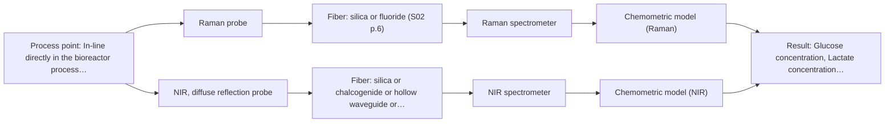

# First technical assessment: Glucose and lactate trends in an aqueous bioprocess

## Answer

**Customer request (our summary):** The customer wants to explore an in-situ spectroscopy pilot to monitor glucose and lactate in a cell culture process to avoid analytical delays.

### Brief answer

For monitoring glucose and lactate in a cell culture aqueous medium, Raman spectroscopy is recommended as the primary method due to its low water interference. A single-probe Raman setup forms the simplest test option, while NIR or combined approaches can be compared if turbidity and biomass tracking are required. Feasibility trials with representative samples and reference lab data are the necessary next step.

### Proposal

- **Best current option:** O2 (recommended)
- **Basis:** supplied AFS sources
- **What would change it:** High fluorescence background or severe turbidity requiring multi-method fusion.
- **Next step:** Conduct multi-method laboratory trials with representative cell culture samples.

**Secondary evidence (external, not AFS material):** G1: no usable external source found; G2: E03 ¶20; G3: no usable external source found. See Expert detail.

**Decision status:** Provisional feasibility assessment

### Solution options

| ID | Tier | Methods | Confidence | Cost class, S01 Table 1 (p.6) | Ease of use | Maintenance | Performance fit | Sources |
|---|---|---|---|---|---|---|---|---|
| O1 | Simple | M1 Raman probe | Medium: open question: Q1 (starts at Medium) | high cost (row 12) | Straightforward single probe setup | Regular cleaning and calibration upkeep | Directly measures metabolites with low water interference | [1: S01 p.16] |
| O2 | Recommended | M1 Raman probe; M2 NIR, diffuse reflection probe | Low: open question: Q1 (starts at Medium); sample clarity unknown | high cost (rows 8, 12) | Dual method evaluation setup | Upkeep for spectrometer and probe interfaces | Handles both chemical metabolites and turbidity changes | [1: S01 p.16] [2: S01 p.17] |

*Confidence rates the basis of the advice (how much is known and cited), not a predicted accuracy or probability of success. It starts at High, or at Medium when a key question on the method or the option is open, and drops one level per weakness listed (floor Low).*

*Cost class is the relative rating in S01 Table 1 (p.6) for the in-line method+technique rows named (the highest one for a multi-method option); it is not a price.*

### Setup sketch

*Recommended option O2; drawn by code from the option, a schematic, not a configuration.*

### Key questions

1. What are the required concentration ranges and target accuracy for glucose and lactate?
2. What is the expected turbidity or optical density variation during high cell density phases?
3. What standard port sizes and flange fittings are available on the bioreactor for in situ probe insertion?

## Expert detail

**Customer enquiry**

> We run a cell culture process in an aqueous medium. Glucose and lactate are measured from samples, and the delay makes it difficult to see changes promptly. We are exploring an in situ spectroscopy pilot that can be checked against those existing laboratory measurements. The medium and cell population change during the run; we have not yet selected a probe or a calibration strategy.

**Decision status:** Provisional feasibility assessment. A provisional assessment is justified for testing vibrational spectroscopy on aqueous bioprocess media, with Raman as the primary method due to water compatibility and NIR as a comparison option.

### Parameters

| ID | Parameter | Kind | Need | Measured by | Why | Sources |
|---|---|---|---|---|---|---|
| P1 | Glucose concentration | quantitative | required | Spectroscopy: Raman | Primary target analyte to monitor in-line to avoid delays. | *(no verified source: engineering judgement)* |
| P2 | Lactate concentration | quantitative | required | Spectroscopy: Raman | Secondary target metabolite reflecting metabolic state. | *(no verified source: engineering judgement)* |
| P3 | Biomass / cell population | quantitative | optional | Spectroscopy: NIR | Tracks physical changes and turbidity in the cell culture. | *(no verified source: engineering judgement)* |

### Solution option details

- **O1 cost drivers:** Single spectrometer and Raman probe
- **O2 cost drivers:** Two spectroscopic channels and chemometric integration

### Premise check

- **Supported:** An in situ spectroscopy pilot can be straightforwardly checked against existing laboratory measurements. Online analysis allows direct in-process monitoring that can be calibrated against laboratory measurements, provided timing and synchronization are managed. [3: S01 p.3]

### Requirements

**Stated by the customer**

- Monitor glucose in-line
- Monitor lactate in-line
- Compare with existing laboratory measurements
- Handle changing medium and cell population

**Key unknowns**

- Required concentration ranges for glucose and lactate
- Detailed optical properties and turbidity of the medium
- Probe insertion point and reactor interface
- Presence of background fluorescence or luminescence

### Clarification questions (most decision-relevant first)

Q1. What are the required concentration ranges and target accuracy for glucose and lactate? *Why it matters:* Determines whether Raman or NIR sensitivity is adequate for trace or millimolar metabolite levels. *(affects: method, M1)*
Q2. What is the expected turbidity or optical density variation during high cell density phases? *Why it matters:* Affects light penetration and the choice between reflection, transmission, or Raman probes. *(affects: technique)*
Q3. What standard port sizes and flange fittings are available on the bioreactor for in situ probe insertion? *Why it matters:* Determines the physical installation and probe shaft mechanical compatibility. *(affects: installation)*

### Recommendation

- **M1 · Primary candidate: Raman probe.** Raman spectroscopy is well-suited for aqueous media because water exhibits low absorbance compared to infrared methods, enabling direct metabolite tracking. [1: S01 p.16]
- **M2 · Comparison candidate: NIR, diffuse reflection probe.** NIR diffuse reflection can monitor major components and turbidity changes in scattering media, though calibration is matrix-specific. *Conditions:* If scattering and optical density permit reflection measurements [2: S01 p.17]
- **M3 · Conditional candidate: fluorescence probe + NIR (combination).** Fluorescence provides high sensitivity for metabolic cofactors and can be combined with vibrational methods for comprehensive bioprocess tracking. *Conditions:* Applies if trace metabolites or fluorescent cofactors need to be tracked alongside glucose and lactate. [4: S01 p.16] Later hypothesis, after single-method tests.

### Measurement concept

- **Probe and geometry:** Immersion Raman probe with laser excitation and optical filtering
- **Location:** In-line directly in the bioreactor process flow
- **Fiber link:** Silica fiber cable connecting probe to spectrometer [3: S01 p.3]

### Spectral range

- **Raman:** Raman shift is expressed in cm-1 with laser excitation in nm; usable range depends on configuration. [5: S01 p.11]
- **NIR:** Nominal NIR range is 780-2500 nm; usable range depends on the instrument, fiber, and probe actually selected. [6: S01 p.10]

### Risks and uncertainty

- Raman signals are weak and can be swamped by fluorescence background from the cell culture medium. *(rules: R-RAM-1)* [7: S01 p.11]
- Changing cell population and turbidity during the run can alter scattering and affect chemometric calibration robustness. *(rules: R-CAL-1, R-GEN-5)* [8: S01 p.7]

### First feasibility experiment

1. **Analyze representative cell culture samples across expected concentration and biomass ranges.** Test method response across process variations. *(no verified source: engineering judgement)*
2. **Collect independent reference measurements using existing laboratory analyzers.** Provide reference data for chemometric calibration. *(no verified source: engineering judgement)*
3. **Compare Raman single-method calibration against NIR or combined approaches.** Select the optimal analytical configuration. *(no verified source: engineering judgement)*
4. **Validate chemometric models on held-out process runs.** Confirm model robustness and prediction accuracy. *(no verified source: engineering judgement)*

**Reference measurements:** Laboratory measurements of glucose and lactate from extracted samples.

**Decision basis:** Go/no-go based on achieving customer-defined prediction error thresholds for glucose and lactate.

### Assumptions

- Cell culture medium is accessible via standard bioreactor ports.
- Laboratory reference measurements are available for model calibration.
- Background fluorescence from media components can be handled via optical filtering or baseline correction.

### Not covered by the supplied sources

- Specific bioreactor geometry and port dimensions

### Further notes

- **Chemometrics:** Calibration models must be developed using multivariate partial least squares regression mapped against independent reference laboratory measurements.
- **Real-time tracking:** In-line fiber probes enable continuous tracking of metabolite consumption and production without sampling delays.
- **Future direction:** Integration of fluorescence sensors for tracking metabolic cofactors alongside Raman metabolite monitoring.

### Secondary evidence (external, not AFS material)

*Found by a literature search for gaps the supplied AFS sources leave open. Not AFS material and not proof for this case; every quote below was verified verbatim against the fetched text.*

*Live search unavailable (library only: cache miss (europepmc); cache miss (openalex)); curated library only.*

**G1 · not in the supplied sources:** Specific bioreactor geometry and port dimensions

- No usable external source found.

**G2 · parameter without a source:** Measuring Glucose concentration: Primary target analyte to monitor in-line to avoid delays.

- **E03 ¶20** Raman spectroscopy is often used in upstream processing because of its high selectivity and low water interference. *How it applies:* This supports evaluating Raman for monitoring target analytes like glucose in aqueous bioreactor media. *Limits and transfer risks:* Published upstream results may not directly transfer to this specific cell culture process or scale due to differences in matrix composition and instrument configuration. *(supports O2)*
  > "Raman spectroscopy is frequently applied in upstream processing in research and industry due to its high selectivity and low water interference [55] despite the relatively long measurement times."
  > A critical review of recent trends, and a future perspective of optical spectroscopy as PAT in biopharmaceutical downstream processing. (2020) · Analytical and bioanalytical chemistry · doi:10.1007/s00216-020-02407-z · https://europepmc.org/article/PMC/PMC7072065 · retrieved 2026-10-17, full text, licence: cc by, via curated library

**G3 · parameter without a source:** Measuring Lactate concentration: Secondary target metabolite reflecting metabolic state.

- No usable external source found.

### Evidence (verified quotes)

1. ✓ **S01 p.16** (general): "Raman is particularly well-suited for aqueous environments, as it exhibits low absorbance for water molecules compared to infrared methods."
2. ✓ **S01 p.17** (application precedent): "NIR Reflection is primarily used for opaque or highly concentrated dairy products, such as yogurt, butter, or whole milk concentrates."
3. ✓ **S01 p.3** (general): "in-process analysis, i.e., directly in the process flow or reactor without sampling, eliminating delays and the risk of sample contamination."
4. ✓ **S01 p.16** (general): "Fluorescence spectroscopy can be used for high-sensitivity detection (down to the nM-μM range) of critical cofactors and amino acids like NADH, tryptophan, and riboflavin."
5. ✓ **S01 p.11** (general): "The Raman shift is used as the horizontal (spectral) axis in Raman spectroscopy"
6. ✓ **S01 p.10** (general): "NIR spectra (780-2500 nm) contain predominantly overtones and component bands of fundamental vibrations"
7. ✓ **S01 p.11** (general): "superposition of luminescence (fluorescence), which has a significantly higher intensity."
8. ✓ **S01 p.7** (general): "Morphological factors, such as sample inhomogeneity (e.g., biological tissue) or process turbulence, must also be considered when selecting a measurement technique."

### Verification

- Citations verified: 9 of 9 (exact or whitespace/hyphen-tolerant match on the cited page, scope checked).
- Hard check failures before deterministic corrections: 0; still open: 0; soft warnings: 1; repair rounds: 1.
- External evidence (cache): 1 quote(s) verified verbatim (exact or whitespace/hyphen-tolerant, at most 400 characters and 2 sentences, against the cited paragraph); 0 item(s) dropped.
- External search: 4 query(ies), 0 hit(s), 3 source(s) (3 from the curated library); ⚠ library only: cache miss (europepmc); cache miss (openalex).
- External step: 2 model call(s), 2.1 s extra (cost in the run JSON).

*Run D04-20261018T075900Z-19fa · models google/gemini-3.5-flash-lite*
