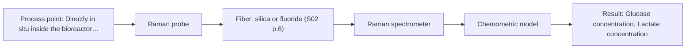

# First technical assessment: Glucose and lactate trends in an aqueous bioprocess

## Answer

**Customer request (our summary):** The customer wants to explore an in situ optical spectroscopy pilot to monitor glucose and lactate in a cell culture process in order to detect changes faster than existing laboratory sampling allows.

### Brief answer

Raman spectroscopy with an in situ immersion probe is recommended as the primary method to test first for monitoring glucose and lactate in your aqueous cell culture, because water does not interfere significantly with Raman scattering. Mid-IR ATR spectroscopy provides a viable comparison method, though strong water absorption limits measurement to the crystal surface. Crucial open items are the required metabolite concentration ranges, vessel port dimensions, and bioreactor sterilization requirements.

### Proposal

- **Best current option:** O2 (recommended)
- **Basis:** supplied AFS sources
- **What would change it:** If media fluorescence swamps the Raman spectrum or target concentrations fall below Raman detection thresholds, ATR Mid-IR would be re-evaluated as the primary path.
- **Next step:** Conduct initial feasibility testing with a Raman probe on retained cell culture samples spanning expected glucose and lactate ranges to confirm signal quality and spectral linearity.

**Secondary evidence (external, not AFS material):** G1: no usable external source found; G2: no usable external source found. See Expert detail.

**Decision status:** Provisional feasibility assessment

### Solution options

| ID | Tier | Methods | Confidence | Cost class, S01 Table 1 (p.6) | Ease of use | Maintenance | Performance fit | Sources |
|---|---|---|---|---|---|---|---|---|
| O1 | Simple | M2 MIR, ATR probe | Medium: open question: Q1, Q3 (starts at Medium) | high cost (row 2) | Direct crystal contact immersion measurement | Frequent cleaning for crystal fouling | Selective fundamental bands for metabolites | [1: S01 p.5] [2: S01 p.10] |
| O2 | Recommended | M1 Raman probe | Medium: open question: Q1, Q3 (starts at Medium) | high cost (row 12) | Immersion probe in aqueous media | Periodic optical window cleaning | Low water interference detects metabolites | [3: S01 p.16] [4: S01 p.16] |

*Confidence rates the basis of the advice (how much is known and cited), not a predicted accuracy or probability of success. It starts at High, or at Medium when a key question on the method or the option is open, and drops one level per weakness listed (floor Low).*

*Cost class is the relative rating in S01 Table 1 (p.6) for the in-line method+technique rows named (the highest one for a multi-method option); it is not a price.*

### Setup sketch

*Recommended option O2; drawn by code from the option, a schematic, not a configuration.*

### Key questions

1. What are the expected concentration ranges and required limits of detection for glucose and lactate across the culture cycle?
2. What are the physical dimensions, port geometry, and insertion depth available on the bioreactor vessel?
3. What sterilization and hygiene protocols must the in situ probe withstand (e.g., steam-in-place, autoclaving, or gamma irradiation)?

## Expert detail

**Customer enquiry**

> We run a cell culture process in an aqueous medium. Glucose and lactate are measured from samples, and the delay makes it difficult to see changes promptly. We are exploring an in situ spectroscopy pilot that can be checked against those existing laboratory measurements. The medium and cell population change during the run; we have not yet selected a probe or a calibration strategy.

**Decision status:** Provisional feasibility assessment. Raman spectroscopy is supported in the supplied sources for in situ detection of glucose and lactate in aqueous bioprocesses, but metabolite concentration ranges, bioreactor port specifications, and sterilization requirements remain to be confirmed.

### Parameters

| ID | Parameter | Kind | Need | Measured by | Why | Sources |
|---|---|---|---|---|---|---|
| P1 | Glucose concentration | quantitative | required | Spectroscopy: Raman | Primary nutrient tracking is necessary to maintain cell viability and control feed additions. | [5: S01 p.16] |
| P2 | Lactate concentration | quantitative | required | Spectroscopy: Raman | Metabolic byproduct monitoring is needed to identify cellular stress, growth inhibition, and metabolic state transitions. | [5: S01 p.16] |

### Solution option details

- **O1 cost drivers:** FTIR spectrometer and infrared fibers
- **O2 cost drivers:** Raman spectrometer, laser, filtered probe

### Premise check

- **Supported:** Existing laboratory measurements on discrete samples can directly serve as calibration and reference data for in situ spectroscopy. Reference laboratory measurements on representative samples provide the necessary ground-truth data for building and validating multivariate spectroscopic calibration models, though discrete sampling delays must be carefully synchronised. [6: S01 p.3] [7: REF §3]

### Requirements

**Stated by the customer**

- Cell culture process running in an aqueous liquid medium.
- Target analytes are glucose and lactate.
- Prompt detection required to eliminate delays inherent in laboratory sample testing.
- In situ spectroscopy pilot to be cross-checked against existing laboratory reference measurements.
- Medium composition and cell population evolve over the duration of the run.
- Probe selection and calibration strategy not yet determined.

**Key unknowns**

- Expected concentration ranges and required limits of detection for glucose and lactate.
- Bioreactor type, working volume, and vessel port specifications for probe insertion.
- Cleaning and sterilization constraints (e.g., autoclave, SIP, CIP, or single-use).
- Extent of media autofluorescence and optical turbidity changes over the culture run.
- Specific analytical reference method used in the laboratory.

### Clarification questions (most decision-relevant first)

Q1. What are the expected concentration ranges and required limits of detection for glucose and lactate across the culture cycle? *Why it matters:* Determines whether Raman spectroscopy has sufficient sensitivity or whether alternative methods must be evaluated. *(affects: method, M1, M2)*
Q2. What are the physical dimensions, port geometry, and insertion depth available on the bioreactor vessel? *Why it matters:* Dictates probe shaft mechanical design, immersion length, and pressure/seal requirements. *(affects: installation, technique)*
Q3. What sterilization and hygiene protocols must the in situ probe withstand (e.g., steam-in-place, autoclaving, or gamma irradiation)? *Why it matters:* Constrains probe construction materials, window bonding, and optical fiber jacket durability. *(affects: installation, M1, M2)*
Q4. Which analytical reference method is currently utilized in the laboratory to quantify glucose and lactate? *Why it matters:* Confirms reference data accuracy and precision for chemometric model calibration and validation. *(affects: status)*

### Recommendation

- **M1 · Primary candidate: Raman probe.** Raman spectroscopy provides distinct molecular fingerprint signals for glucose and lactate, and it experiences minimal interference from water in aqueous media. This makes an in situ immersion probe the ideal candidate to test first for dissolved metabolite monitoring. [4: S01 p.16]
- **M2 · Comparison candidate: MIR, ATR probe.** Mid-IR spectroscopy detects fundamental vibrational bands of dissolved organic compounds with high selectivity. However, strong solvent water absorption requires an attenuated total reflectance crystal geometry, which samples only a shallow evanescent boundary layer. *Conditions:* Optical crystal surface must remain free of cell adhesion, fouling, or media crusting throughout the run. [1: S01 p.5] [2: S01 p.10]
- **M3 · Conditional candidate: NIR, transmission/transflection probe.** Near-IR spectroscopy can monitor major components such as glucose in millimolar concentrations, but broad overtone bands and sensitivity limits below 0.1 percent present significant calibration challenges. Changing scattering from biomass growth also impacts transmission pathlengths. *Conditions:* Applies only if metabolite concentrations remain above trace levels and optical density does not saturate the transmission path. [8: S01 p.16]

### Measurement concept

- **Probe and geometry:** An immersible Raman fiber optic probe inserted directly into the culture medium for backscattered collection, or an immersible ATR crystal probe with multi-bounce geometry.
- **Location:** Directly in situ inside the bioreactor vessel below the minimum working liquid level, positioned away from aeration spargers to avoid gas bubble interference.
- **Fiber link:** Standard metal-coated silica fibers for Raman excitation and collection to eliminate polymer jacket background fluorescence, or polycrystalline/chalcogenide infrared fibers if MIR-ATR is tested. [5: S01 p.16] [9: S02 p.7]

### Spectral range

- **Raman:** Raman spectroscopy is recorded as Raman shift in units of frequency-wavenumbers (cm-1), with the laser excitation wavelength stated separately; the usable range depends on the instrument, fiber and probe actually selected. [10: S01 p.11] [11: REF §3]
- **MIR:** Nominal mid-IR range is 4000-400 cm-1; usable spectral coverage is determined by the FTIR spectrometer, IR fiber transmission, and ATR crystal substrate. [12: S01 p.9] [13: REF §5]

### Risks and uncertainty

- Fluorescence background from media components or cellular metabolites may superimpose on and obscure weak Raman scattering signals. *(rules: R-RAM-1)* [14: S01 p.11]
- Cellular adhesion, biofilm buildup, or protein deposition on the optical window or ATR crystal can distort in situ measurements. *(rules: R-MIR-3)* [15: REF §5]
- Strong solvent water absorption in infrared spectroscopy limits optical penetration and can mask low metabolite concentrations. *(rules: R-GEN-3)* [16: S01 p.16]
- Dynamic changes in cell population and aeration bubbles introduce physical scattering variations that complicate multivariate calibrations. *(rules: R-GEN-5, R-CAL-1)* [17: S01 p.7]

### First feasibility experiment

1. **Collect representative bioreactor media samples across initial, exponential, and plateau phases spanning the expected glucose and lactate ranges.** Capture the full biochemical and optical matrix variation present across the culture run. [7: REF §3]
2. **Acquire Raman and benchtop ATR-MIR spectra of each sample under controlled laboratory temperature conditions.** Evaluate signal-to-noise ratios, water background interference, and analyte spectral feature prominence. [18: S02 p.20]
3. **Perform independent reference laboratory measurements for glucose and lactate on corresponding sample aliquots.** Establish accurate numerical reference targets for quantitative chemometric calibration. [7: REF §3]
4. **Develop single-method multivariate calibration models (e.g., PLS regression) and evaluate prediction error using cross-validation and held-out validation batches.** Quantify prediction accuracy and assess sensitivity to evolving matrix components. [19: S01 p.12]
5. **Evaluate performance against customer-defined accuracy and response time criteria to decide whether to proceed to in situ vessel trials.** Provide a clear quantitative go/no-go basis for bioreactor probe integration. [7: REF §3]

**Reference measurements:** Independent laboratory quantification of glucose and lactate from split aliquots using the customer's established laboratory assay (e.g., enzymatic bioanalyzer or HPLC).

**Decision basis:** Go/no-go progression depends on whether the chemometric root mean square error of prediction on held-out samples satisfies the customer's operational accuracy criteria for process control.

### Assumptions

- Target metabolite concentrations in the culture medium are within typical millimolar ranges accessible to optical spectroscopy.
- A standard port can be allocated for probe insertion into the bioreactor vessel.
- The bioreactor medium does not exhibit severe baseline autofluorescence that completely obscures Raman signals at the selected excitation wavelength.

### Not covered by the supplied sources

- Specific spectral cross-sections or detection limits for lactate in various cell culture media formulations.
- Certified hygienic or autoclaving endurance ratings for specific fiber probe assemblies.

### Further notes

- **Chemometrics:** A multivariate calibration model (such as Partial Least Squares regression) is required to resolve overlapping spectral bands and correlate optical spectra with glucose and lactate concentrations across changing media backgrounds.
- **Real-time tracking:** In situ immersion measurement enables continuous, real-time tracking of metabolite dynamics, eliminating sample withdrawal and analytical processing delays.
- **Future direction:** If single-technique models encounter interference from dramatic turbidity shifts, integrating UV-Vis transmission or turbidity tracking for biomass could provide complementary physical context.

### Secondary evidence (external, not AFS material)

*Found by a literature search for gaps the supplied AFS sources leave open. Not AFS material and not proof for this case; every quote below was verified verbatim against the fetched text.*

*Live search unavailable (library only: cache miss (europepmc); cache miss (openalex)); curated library only.*

**G1 · not in the supplied sources:** Specific spectral cross-sections or detection limits for lactate in various cell culture media formulations.

- No usable external source found.

**G2 · not in the supplied sources:** Certified hygienic or autoclaving endurance ratings for specific fiber probe assemblies.

- No usable external source found.

### Evidence (verified quotes)

1. ✓ **S01 p.5** (general): "strong absorption in the mid-IR region limits the corresponding spectral method to the analysis of very thin samples (usually less than 50 μm), but it opens up the possibility of using attenuated total reflectance (ATR)"
2. ✓ **S01 p.10** (general): "ATR fiber probes (Fig.1) enable the analysis of liquids and solid elastic samples"
3. ✓ **S01 p.16** (general): "Raman is particularly well-suited for aqueous environments, as it exhibits low absorbance for water molecules compared to infrared methods."
4. ✓ **S01 p.16** (general): "Raman spectroscopy can be used in the same reactor to provide a "molecular fingerprint" for direct detection of specific metabolites like glucose, acetate, or lactate. This combination is practical because Raman is particularly well-suited for aqueous environments, as it exhibits low absorbance for water molecules compared to infrared methods."
5. ✓ **S01 p.16** (application precedent): "Raman spectroscopy can be used in the same reactor to provide a "molecular fingerprint" for direct detection of specific metabolites like glucose, acetate, or lactate."
6. ✓ **S01 p.3** (general): "directly in the process flow or reactor without sampling, eliminating delays and the risk of sample contamination."
7. ✓ **REF §3** (general): "Representative samples or process states, independent reference measurements, what is compared, and the basis for the go / no-go decision."
8. ✓ **S01 p.16** (general): "NIR spectroscopy is effective for tracking major components like glucose or glycerol in the millimolar range but may lack the sensitivity to detect trace compounds below 0.1 percent."
9. ✓ **S02 p.7** (general): "Free of Polymer jacket fluorescence for Raman and Fluo- Spectroscopy"
10. ✓ **S01 p.11** (general): "The Raman shift is used as the horizontal (spectral) axis in Raman spectroscopy, while the vertical axis shows the absolute intensity of the recorded signals (photon counts)."
11. ✓ **REF §3** (general): "A nominal method range is not the range of a specific instrument, fiber or probe."
12. ✓ **S01 p.9** (general): "Vibrational spectroscopy in the mid-IR range (4000-400 cm-1) is one of the most informative methods of chemical analysis."
13. ✓ **REF §5** (general): "It is not a product specification: actual spectral coverage, fiber length, component ratings, detection limits and accuracy depend on the configuration and the sample."
14. ✓ **S01 p.11** (general): "superposition of luminescence (fluorescence), which has a significantly higher intensity."
15. ✓ **REF §5** (general): "Usable range limited by fiber and crystal; contact, fouling, compatibility."
16. ✓ **S01 p.16** (general): "low absorbance for water molecules compared to infrared methods."
17. ✓ **S01 p.7** (general): "Morphological factors, such as sample inhomogeneity (e.g., biological tissue) or process turbulence, must also be considered when selecting a measurement technique."
18. ✓ **S02 p.20** (general): "1. Multi-Method Lab Trials AFS tests your process using all key fiber optic spectroscopy methods."
19. ✓ **S01 p.12** (general): "Raman spectra (as well as IR absorption spectra) can be used to construct chemometric models-calibration or classification ones."

### Verification

- Citations verified: 26 of 26 (exact or whitespace/hyphen-tolerant match on the cited page, scope checked).
- Hard check failures before deterministic corrections: 0; still open: 0; soft warnings: 1; repair rounds: 1.
- External evidence (cache): 0 quote(s) verified verbatim (exact or whitespace/hyphen-tolerant, at most 400 characters and 2 sentences, against the cited paragraph); 0 item(s) dropped.
- External search: 3 query(ies), 0 hit(s), 3 source(s) (3 from the curated library); ⚠ library only: cache miss (europepmc); cache miss (openalex).
- External step: 2 model call(s), 5.3 s extra (cost in the run JSON).

*Run D04-20261018T075900Z-2721 · models google/gemini-3.8-flash*
