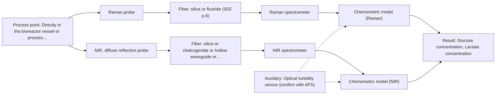

# First technical assessment: Glucose and lactate trends in an aqueous bioprocess

## Answer

**Customer request (our summary):** The customer is exploring an in situ spectroscopy pilot to monitor glucose and lactate concentrations in a cell culture process to overcome measurement delays.

### Brief answer

To monitor glucose and lactate in your aqueous cell culture process, we recommend starting with single-method lab trials using Raman and NIR spectroscopy. Raman is particularly well-suited for aqueous media due to low water absorbance, while NIR can track major components. Key unknowns such as concentration ranges and vessel installation details should be clarified to finalize the probe selection and calibration strategy.

### Proposal

- **Best current option:** O2 (recommended)
- **Basis:** supplied AFS sources
- **What would change it:** Definitive concentration ranges and pilot trial results showing clear superiority of one method would narrow the approach to a single recommended option.
- **Next step:** Conduct multi-method laboratory trials comparing Raman and NIR probes on representative cell culture samples against reference laboratory measurements.

**Secondary evidence (external, not AFS material):** G1: no usable external source found. See Expert detail.

**Decision status:** Provisional feasibility assessment

### Solution options

| ID | Tier | Methods | Confidence | Cost class, S01 Table 1 (p.6) | Ease of use | Maintenance | Performance fit | Sources |
|---|---|---|---|---|---|---|---|---|
| O1 | Simple | M1 Raman probe | Medium: open question: Q1 (starts at Medium) | high cost (row 12) | Single immersion probe operation | Standard probe cleaning and calibration maintenance | Directly targets aqueous metabolites using Raman spectroscopy with low water interference. | [1: S01 p.16] |
| O2 | Recommended | M1 Raman probe; M2 NIR, diffuse reflection probe | Low: open question: Q1 (starts at Medium); sample clarity unknown | high cost (rows 8, 12) | Comparative multi-method evaluation during trial phase | Periodic calibration maintenance for trial instruments | Evaluates both Raman and NIR to determine the optimal fit for changing cell populations and aqueous backgrounds. | [2: S01 p.3] [1: S01 p.16] [3: S01 p.16] |

*Confidence rates the basis of the advice (how much is known and cited), not a predicted accuracy or probability of success. It starts at High, or at Medium when a key question on the method or the option is open, and drops one level per weakness listed (floor Low).*

*Cost class is the relative rating in S01 Table 1 (p.6) for the in-line method+technique rows named (the highest one for a multi-method option); it is not a price.*

### Setup sketch

*Recommended option O2; drawn by code from the option, a schematic, not a configuration.*

### Key questions

1. What are the expected concentration ranges and required detection limits for glucose and lactate?
2. Where in the bioreactor or process flow will the probe be installed, and what is the expected cell density or turbidity range?
3. What reference laboratory method and sampling frequency are currently used for glucose and lactate?

## Expert detail

**Customer enquiry**

> We run a cell culture process in an aqueous medium. Glucose and lactate are measured from samples, and the delay makes it difficult to see changes promptly. We are exploring an in situ spectroscopy pilot that can be checked against those existing laboratory measurements. The medium and cell population change during the run; we have not yet selected a probe or a calibration strategy.

**Decision status:** Provisional feasibility assessment. The customer's goal to monitor glucose and lactate in an aqueous cell culture process is well supported by optical spectroscopy principles, but specific concentration ranges, installation geometry, and calibration strategies must be determined through pilot trials.

### Parameters

| ID | Parameter | Kind | Need | Measured by | Why | Sources |
|---|---|---|---|---|---|---|
| P1 | Glucose concentration | quantitative | required | Spectroscopy: Raman | Primary target variable to monitor in-line to overcome sample delay. | [4: S01 p.16] |
| P2 | Lactate concentration | quantitative | required | Spectroscopy: Raman | Secondary target variable to monitor metabolic activity in-line. | [4: S01 p.16] |
| P3 | Cell density / turbidity | quantitative | optional | Auxiliary sensor: Optical turbidity sensor (cited; confirm availability with AFS) | Helps account for scattering and morphological changes during the cell culture run. | [5: S01 p.16] |

### Solution option details

- **O1 cost drivers:** Single spectrometer and immersion probe hardware.
- **O2 cost drivers:** Trial instrumentation and probes for multiple methods.

### Premise check

- **Supported:** Spectroscopy can monitor glucose and lactate in an aqueous bioprocess medium with changing cell populations. Sources indicate Raman and NIR spectroscopy are applied to bioprocess monitoring and aqueous environments. [1: S01 p.16]

### Requirements

**Stated by the customer**

- Monitor glucose and lactate concentrations in-line to overcome sample delay
- Check in situ spectroscopy pilot against existing laboratory measurements
- Handle changing medium and cell population during the run

**Key unknowns**

- Required concentration ranges for glucose and lactate
- Reactor/vessel installation point and insertion depth
- Process temperature, pressure, and turbidity/cell density range

### Clarification questions (most decision-relevant first)

Q1. What are the expected concentration ranges and required detection limits for glucose and lactate? *Why it matters:* Concentration ranges determine the required sensitivity and path length or optical configuration. *(affects: method, technique)*
Q2. Where in the bioreactor or process flow will the probe be installed, and what is the expected cell density or turbidity range? *Why it matters:* Installation location and turbidity affect probe design, insertion depth, and scattering compensation. *(affects: installation, technique)*
Q3. What reference laboratory method and sampling frequency are currently used for glucose and lactate? *Why it matters:* Reference data quality directly dictates chemometric calibration accuracy and validation robustness. *(affects: status)*
Q4. What are the process operating temperatures and pressures during the cell culture run? *Why it matters:* Hardware materials and sealing mechanisms must be rated for the reactor operating conditions. *(affects: installation)*

### Recommendation

- **M1 · Primary candidate: Raman probe.** Raman spectroscopy is well-suited for aqueous environments because water exhibits low absorbance compared to infrared methods, making it ideal for tracking dissolved metabolites like glucose and lactate. [1: S01 p.16]
- **M2 · Comparison candidate: NIR, diffuse reflection probe.** NIR spectroscopy is widely used for monitoring major bioprocess components and can be implemented via robust immersion probes. *Conditions:* Requires robust scatter correction and chemometric calibration to account for changing cell populations. [3: S01 p.16]

### Measurement concept

- **Probe and geometry:** Immersion Raman probe or NIR diffuse reflection probe mounted flush or via an insertion port into the bioreactor.
- **Location:** Directly in the bioreactor vessel or process line in contact with the liquid medium.
- **Fiber link:** Silica fiber cable connecting the immersion probe to the spectrometer located safely away from the processing floor. [6: S01 p.15]

### Spectral range

- **Raman:** Raman shift measured in cm-1 with laser excitation stated separately in nm; usable range depends on instrument configuration. [7: S01 p.11]
- **NIR:** Nominal range 780-2500 nm; usable range depends on the instrument, fiber, and probe actually selected. [8: S01 p.10]

### Risks and uncertainty

- Fluorescence background or weak signal intensity in Raman measurements could obscure metabolite peaks. *(rules: R-RAM-1)* [9: S01 p.11]
- Changes in cell population and turbidity during the run can introduce scattering variations that affect calibration robustness. *(rules: R-CAL-1, R-GEN-5)* [10: S01 p.7]

### First feasibility experiment

1. **Collect representative cell culture samples across process stages** Collect representative liquid samples across expected variations in cell population, glucose, and lactate concentrations during culture runs. *(no verified source: engineering judgement)*
2. **Perform independent reference laboratory measurements** Obtain independent reference measurements for glucose and lactate using existing laboratory methods for each sample. *(no verified source: engineering judgement)*
3. **Acquire single-method spectra on representative samples** Test single-method probes (Raman and NIR) on liquid samples to evaluate signal-to-noise ratio and background interference. *(no verified source: engineering judgement)*
4. **Develop multivariate chemometric calibration models** Develop initial chemometric calibration models (e.g., PLS) relating spectra to reference concentrations. *(no verified source: engineering judgement)*
5. **Validate models on independent batches** Validate models on held-out test runs or independent batches against customer-defined accuracy criteria. *(no verified source: engineering judgement)*

**Reference measurements:** Existing laboratory measurements for glucose and lactate.

**Decision basis:** Customer-defined prediction error thresholds (RMSEP) compared against laboratory delay requirements.

### Assumptions

- The cell culture medium is accessible via standard immersion fiber probes.
- Reference laboratory measurements are sufficiently accurate to serve as calibration training data.

### Further notes

- **Chemometrics:** Calibration models (e.g., PLS) must be built using reference laboratory measurements and updated to handle spectral variations caused by changing cell populations and medium evolution.
- **Real-time tracking:** In-line fiber probes enable continuous monitoring of glucose and lactate directly in the reactor, eliminating sample delay.
- **Future direction:** Transitioning from multi-method lab trials to a dedicated single-method analyzer or optical sensor once optimal wavelengths and calibration models are established.

### Secondary evidence (external, not AFS material)

*Found by a literature search for gaps the supplied AFS sources leave open. Not AFS material and not proof for this case; every quote below was verified verbatim against the fetched text.*

*Live search unavailable (library only: cache miss (europepmc); cache miss (openalex)); curated library only.*

**G1 · auxiliary sensor:** In-line measurement of Cell density / turbidity with Optical turbidity sensor

- No usable external source found.

### Evidence (verified quotes)

1. ✓ **S01 p.16** (general): "Raman is particularly well-suited for aqueous environments, as it exhibits low absorbance for water molecules compared to infrared methods."
2. ✓ **S01 p.3** (general): "The exploratory nature of scientific research does not always allow for a precise prediction of which existing method will yield the desired result."
3. ✓ **S01 p.16** (general): "Having access to a full suite of fiber-optic spectroscopic techniques - rather than relying on a single method - allows a lab to address the diverse analytical challenges of bioprocessing"
4. ✓ **S01 p.16** (general): "Raman spectroscopy can be used in the same reactor to provide a "molecular fingerprint" for direct detection of specific metabolites like glucose, acetate, or lactate."
5. ✓ **S01 p.16** (general): "cell suspension turbidity correlates well with cell density."
6. ✓ **S01 p.15** (general): "The use of fiber optics is critical here, as it allows the sensitive spectrometers to be located safely away from the vibration and dust of the manufacturing floor."
7. ✓ **S01 p.11** (general): "The Raman shift is used as the horizontal (spectral) axis in Raman spectroscopy"
8. ✓ **S01 p.10** (general): "NIR spectra (780-2500 nm) contain predominantly overtones and component bands of fundamental vibrations"
9. ✓ **S01 p.11** (general): "Furthermore, observing Raman bands is often complicated by light scattering from the illuminating laser, and for many organic compounds, by the superposition of luminescence (fluorescence), which has a significantly higher intensity."
10. ✓ **S01 p.7** (general): "Morphological factors, such as sample inhomogeneity (e.g., biological tissue) or process turbulence, must also be considered when selecting a measurement technique."

### Verification

- Citations verified: 13 of 13 (exact or whitespace/hyphen-tolerant match on the cited page, scope checked).
- Hard check failures before deterministic corrections: 0; still open: 0; soft warnings: 0; repair rounds: 1.
- Corrected deterministically after verification (1):
  - ⚠ clarification_questions[0].affects: affects normalised to ['method', 'technique']; dropped ['P1', 'P2'] (not method, technique, installation, status, an M id or an O id)
- External evidence (cache): 0 quote(s) verified verbatim (exact or whitespace/hyphen-tolerant, at most 400 characters and 2 sentences, against the cited paragraph); 0 item(s) dropped.
- External search: 2 query(ies), 0 hit(s), 2 source(s) (2 from the curated library); ⚠ library only: cache miss (europepmc); cache miss (openalex).
- External step: 2 model call(s), 1.6 s extra (cost in the run JSON).

*Run D04-20261018T075900Z-3287 · models google/gemini-3.5-flash-lite, google/gemini-3.8-flash*
