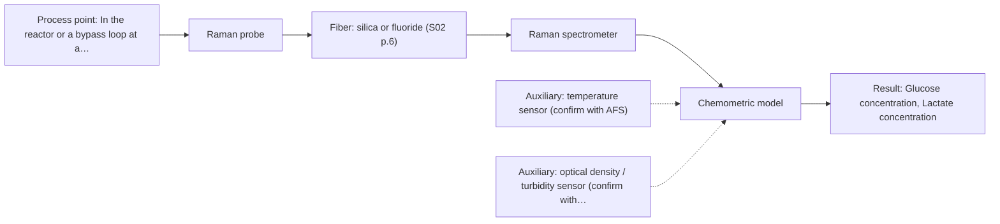
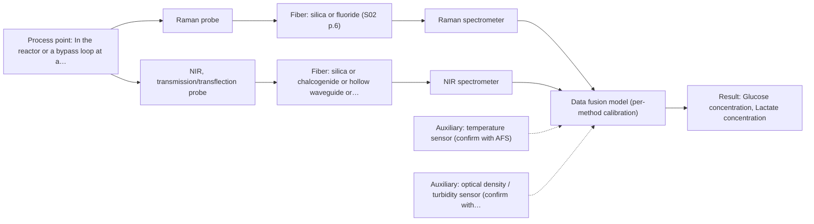

# First technical assessment: Glucose and lactate trends in an aqueous bioprocess

## Answer

**Customer request (our summary):** The customer wants to explore an in situ spectroscopy pilot to monitor glucose and lactate in a cell culture process to overcome delays from laboratory measurements.

### Brief answer

Test an immersion Raman fiber probe first: it suits aqueous media and has published precedent for glucose and lactate in bioreactors, validated against your existing laboratory measurements. Keep an NIR transmission/transflection probe as a comparison where the medium is clear enough, and a Raman+NIR fusion only if single methods miss your accuracy targets. Still open: the medium's turbidity, your required accuracy and response time, and the installation constraints.

### Proposal

- **Best current option:** O2 (recommended)
- **Basis:** supplied AFS sources
- **What would change it:** If the real medium shows strong fluorescence background that Raman filters cannot suppress, or if the required accuracy is only achievable with complementary information, the choice moves to the fused Raman+NIR option (O3) or to NIR (O1) where the medium stays clear.
- **Next step:** Run a multi-method laboratory trial on representative samples from across the run, pairing Raman (and NIR where clear) spectra with the existing laboratory glucose and lactate references.

**Secondary evidence (external, not AFS material):** G1: E01 ¶12; G2: no usable external source found; G3: E02 ¶31; G4: no usable external source found. See Expert detail.

**Decision status:** Provisional feasibility assessment

### Solution options

| ID | Tier | Methods | Confidence | Cost class, S01 Table 1 (p.6) | Ease of use | Maintenance | Performance fit | Sources |
|---|---|---|---|---|---|---|---|---|
| O1 | Simple | M2 NIR, transmission/transflection probe | Low: open question: Q1 (starts at Medium); sample clarity unknown | average cost (row 7) | Standard glass optics, simple probe hardware | Pathlength windows need cleaning and checks | Fits clear streams but water absorption limits pathlength | [1: S01 p.10] [2: S01 p.10] [3: S01 p.18] [4: S01 p.10] |
| O2 | Recommended | M1 Raman probe | Medium: open question: Q2 (starts at Medium) | high cost (row 12) | Immersion probe, no sampling or reagents | Probe window fouling and laser checks | Aqueous-tolerant molecular specificity for glucose and lactate | [5: S01 p.16] [6: S01 p.16] [7: S01 p.11] |
| O3 | Extended (multi-method) | M3 Raman probe + NIR (combination) | Low: open question: Q2 (starts at Medium); sample clarity unknown; multi-method, fusion benefit not yet shown | high cost (rows 7, 12) | Two instruments and fused data handling | Each block needs its own calibration and diagnostics | Adds robustness if single methods miss accuracy targets | [8: S01 p.8] [9: S01 p.8] [10: S01 p.7] [11: S01 p.8] |

*Confidence rates the basis of the advice (how much is known and cited), not a predicted accuracy or probability of success. It starts at High, or at Medium when a key question on the method or the option is open, and drops one level per weakness listed (floor Low).*

*Cost class is the relative rating in S01 Table 1 (p.6) for the in-line method+technique rows named (the highest one for a multi-method option); it is not a price.*

### Setup sketch

*Recommended option O2; drawn by code from the option, a schematic, not a configuration.*

### Key questions

1. How optically clear or turbid is the medium across the run (cell density, colour, particles)?
2. What accuracy, detection limit and response time do you need for glucose and lactate, compared with the laboratory method?
3. Where can a probe be installed (existing ports, sterilisation, immersion depth), and how far is the spectrometer location?

## Expert detail

**Customer enquiry**

> We run a cell culture process in an aqueous medium. Glucose and lactate are measured from samples, and the delay makes it difficult to see changes promptly. We are exploring an in situ spectroscopy pilot that can be checked against those existing laboratory measurements. The medium and cell population change during the run; we have not yet selected a probe or a calibration strategy.

**Decision status:** Provisional feasibility assessment. A shortlist can be justified from the sources, but the optical regime of the medium, the required accuracy and the installation constraints are unknown, so the assessment is provisional and the deciding questions are asked first.

### Parameters

| ID | Parameter | Kind | Need | Measured by | Why | Sources |
|---|---|---|---|---|---|---|
| P1 | Glucose concentration | quantitative | required | Spectroscopy: Raman | It is the primary target the in-line pilot must track against the laboratory reference. | [6: S01 p.16] |
| P2 | Lactate concentration | quantitative | required | Spectroscopy: Raman | It is the second target the in-line pilot must track against the laboratory reference. | [6: S01 p.16] |
| P3 | Process temperature | quantitative | optional | Auxiliary sensor: temperature sensor (engineering judgement: confirm availability with AFS) | Temperature shifts spectral features and should be recorded as a model variable if it varies; it should be available from existing process instrumentation. | *(no verified source: engineering judgement)* |
| P4 | Cell density / turbidity state | quantitative | optional | Auxiliary sensor: optical density / turbidity sensor (cited; confirm availability with AFS) | The changing cell population alters scattering and the spectral background, so it should be recorded to make the calibration robust across the run. | [12: S01 p.16] |

### Solution option details

- **O1 cost drivers:** NIR spectrometer, transmission/transflection probe, reference sampling for calibration
- **O2 cost drivers:** Raman spectrometer and laser, immersion probe, chemometric calibration across process states
- **O3 cost drivers:** Second spectrometer and probe, synchronisation software, larger calibration dataset
- **O3 combining methods:** Low-level fusion: Raman and NIR spectra from the same sampling spot, synchronised to a common time step, joined with block scaling into one model per method first. Each instrument keeps its own calibration and diagnostics. The fused model must beat the best single method on held-out runs, otherwise the extra instrument is dropped.

*Extended (multi-method) option O3; drawn by code from the option, a schematic, not a configuration.*

### Premise check

- **Precedent only:** In situ spectroscopy can track glucose and lactate in a cell culture process. A published bioprocess example shows Raman used in a reactor for metabolites including glucose and lactate; this is a reason to test, not proof for this customer's process. [6: S01 p.16]
- **Supported:** An aqueous medium is compatible with in-line optical measurement. The sources state Raman tolerates water far better than infrared absorption methods, which supports Raman as the first test in this aqueous process. [5: S01 p.16]

### Requirements

**Stated by the customer**

- In situ (in-reactor) measurement
- Track glucose and lactate
- Check against existing laboratory sample measurements
- Cope with medium and cell population changing during the run

**Key unknowns**

- Optical clarity/turbidity range of the medium over the run
- Required accuracy, detection limits and response time for glucose and lactate
- Reactor ports, sterilisation and installation constraints
- Process temperature range
- How many runs and reference samples are available to build a calibration

### Clarification questions (most decision-relevant first)

Q1. How optically clear or turbid is the medium across the run (cell density, colour, particles)? *Why it matters:* It decides whether NIR transmission/transflection is viable or only contact techniques such as Raman or ATR work. *(affects: technique, M2)*
Q2. What accuracy, detection limit and response time do you need for glucose and lactate, compared with the laboratory method? *Why it matters:* It sets the go/no-go criteria and decides whether one method suffices or a combination is needed. *(affects: status, M1, M3)*
Q3. Where can a probe be installed (existing ports, sterilisation, immersion depth), and how far is the spectrometer location? *Why it matters:* It constrains the probe geometry and fiber link before any hardware can be specified. *(affects: installation)*
Q4. What temperature range does the process cover, and is temperature measured in the reactor? *Why it matters:* Temperature shifts spectral features and should be a model variable or at least recorded. *(affects: method)*
Q5. How many runs and reference sample points can you provide for calibration and validation? *Why it matters:* A matrix-specific chemometric calibration needs representative data across the run; too little data risks overfitting. *(affects: status, M1)*

### Recommendation

- **M1 · Primary candidate: Raman probe.** Raman tolerates water far better than infrared methods and a published bioprocess example shows in-reactor detection of metabolites including glucose and lactate. Its weak signal and possible fluorescence background must be checked on the real medium. *Conditions:* Check fluorescence background and signal quality on representative medium and cell suspensions before committing. [5: S01 p.16] [6: S01 p.16] [7: S01 p.11]
- **M2 · Conditional candidate: NIR, transmission/transflection probe.** NIR is the most common online fiber-probe method and could track major components, but its broad overlapping bands need chemometrics and water absorption limits the pathlength. Its screening status is unknown because the optical regime of the medium is not yet known. *Conditions:* Applies only if the medium stays transparent enough for a controlled 1-10 mm pathlength; test on real samples at high cell density. [2: S01 p.10] [3: S01 p.18] [4: S01 p.10]
- **M3 · Conditional candidate: Raman probe + NIR (combination).** If Raman alone cannot hold accuracy while the medium and cell population change, adding NIR could contribute complementary information; any fusion gain is a hypothesis to test against the best single method. *Conditions:* Only after the single-method tests, and only if the best single method misses the customer's accuracy targets. [10: S01 p.7] [11: S01 p.8]
- **M4 · Not recommended: fluorescence probe.** Not recommended as a glucose/lactate measurement: no fluorescent species or indicator has been identified, and fluorescence is highly sensitive but not a direct measurement of these analytes. [13: S01 p.5]

### Measurement concept

- **Probe and geometry:** Immersion Raman fiber probe at an existing reactor port; NIR transmission/transflection probe as the comparison where the medium is clear enough.
- **Location:** In the reactor or a bypass loop at a representative, well-mixed spot; avoid dead zones and turbulence artefacts.
- **Fiber link:** Silica fibers for Raman (excitation in the visible/NIR region); metal-coated jackets avoid polymer fluorescence. Exact fiber and cable length depend on the selected configuration and is an open question. [14: S01 p.7] [15: S02 p.7]

### Spectral range

- **Raman:** Raman shift in cm-1 with laser excitation wavelength stated separately (e.g. 785 nm excitation is used in the published pharma example); the usable shift range depends on the spectrometer, laser and probe selected. [16: S01 p.11] [17: S01 p.15]
- **NIR:** Nominal NIR range 780-2500 nm; the usable range depends on the instrument, fiber and probe actually selected. [2: S01 p.10]

### Risks and uncertainty

- Fluorescence background from medium components could swamp the weak Raman signal and must be checked on real samples. *(rules: R-RAM-1)* *(no verified source: engineering judgement)*
- Changing cell density and medium composition alter scattering, so a calibration built on one process state may not transfer across the run. *(rules: R-CAL-1, R-GEN-5)* *(no verified source: engineering judgement)*
- If the medium becomes too turbid, NIR transmission fails and only contact or reflection geometries remain viable. *(rules: R-GEO-2)* *(no verified source: engineering judgement)*
- The laboratory reference measurements are delayed and off-line, so time-alignment of reference and in-line data is a validation risk. *(no verified source: engineering judgement)*

### First feasibility experiment

1. **Collect representative samples across process stages** Collect representative samples across the expected variation: early, mid and late process states with different cell densities and medium compositions. *(no verified source: engineering judgement)*
2. **Measure Raman spectra paired with lab reference** Measure Raman spectra on each sample with a lab Raman probe and pair them with independent laboratory glucose and lactate reference values from the existing analytical method. *(no verified source: engineering judgement)*
3. **Test NIR transmission on clear samples** On the same samples, test NIR transmission/transflection where the sample is clear enough, to check the M2 condition and compare methods on identical material. *(no verified source: engineering judgement)*
4. **Build single-method chemometric calibration models** Build one chemometric model per method (single methods first) and validate on held-out runs or batches, including temperature and biomass as recorded variables. *(no verified source: engineering judgement)*
5. **Evaluate against customer accuracy targets** Go/no-go against customer-defined accuracy criteria for glucose and lactate versus the laboratory reference; only then consider a fused Raman+NIR model and check it beats the best single method. *(no verified source: engineering judgement)*

**Reference measurements:** Existing laboratory glucose and lactate measurements on the same samples, taken at matched time points.

**Decision basis:** Customer-defined numerical accuracy and detection-limit targets for glucose and lactate, met on held-out validation runs.

### Assumptions

- The process runs at conditions compatible with an immersed fiber probe (temperature and pressure to be confirmed).
- The existing laboratory measurements are accurate enough to serve as calibration reference.

### Not covered by the supplied sources

- Required accuracy, detection limits and response time for glucose and lactate in this specific medium
- Achievable in-line accuracy of Raman or NIR for glucose and lactate in this customer's cell culture medium

### Further notes

- **Chemometrics:** A PLS regression per method (and later a fused model if O3 is pursued) needs reference glucose and lactate values spanning the full run, with validation on held-out runs or batches; the sources note NIR and Raman calibrations are specific to the matrix and must be re-validated when the medium changes.
- **Real-time tracking:** The pilot's purpose is time-resolved in-line tracking to replace delayed sample measurements; spectra must be acquired fast enough to resolve the process changes the customer needs to see, and the required response time is an open question (Q2).
- **Future direction:** If the pilot succeeds, a compact LED-based or multisensor version focused on the informative wavelengths could be considered later, following the multisensor concept described in the sources.

### Secondary evidence (external, not AFS material)

*Found by a literature search for gaps the supplied AFS sources leave open. Not AFS material and not proof for this case; every quote below was verified verbatim against the fetched text.*

*Live search unavailable (library only: cache miss (europepmc); cache miss (openalex)); curated library only.*

**G1 · auxiliary sensor:** In-line measurement of Process temperature with temperature sensor

- **E01 ¶12** The source notes that the temperature sensitivity of OH bands poses a significant drawback for measuring aqueous solutions using infrared spectroscopy. *How it applies:* This highlights the necessity of monitoring or controlling temperature when acquiring spectra in aqueous media to account for potential spectral shifts. *Limits and transfer risks:* The finding stems from a review of downstream processing and may not directly reflect the thermal conditions in an upstream cell culture. *(supports O2)*
  > "Additionally, the temperature sensitivity of the OH bands is a severe drawback for measuring aqueous solution in NIR and MIR, which makes tempered sample holders necessary [29]."
  > A critical review of recent trends, and a future perspective of optical spectroscopy as PAT in biopharmaceutical downstream processing. (2020) · Analytical and bioanalytical chemistry · doi:10.1007/s00216-020-02407-z · https://europepmc.org/article/PMC/PMC7072065 · retrieved 2026-10-17, full text, licence: cc by, via curated library

**G2 · auxiliary sensor:** In-line measurement of Cell density / turbidity state with optical density / turbidity sensor

- No usable external source found.

**G3 · multi-method:** Combining several spectroscopy methods (data fusion) (Low-level fusion: Raman and NIR spectra from the same sampling spot, synchronised to a common time step, joined with block scaling into one model per method first. Each instrument keeps its own calibration and diagnostics. The fused model must beat the best single method on held-out runs, otherwise the extra instrument is dropped.)

- **E02 ¶31** Low-level data fusion rearranges data from different sources into a new matrix where variables are placed sequentially. *How it applies:* This supports structuring low-level data combination by concatenating variable blocks from different spectroscopic methods for subsequent modeling. *Limits and transfer risks:* The literature source discusses general PAT applications, so the specific matrix and analytical methods must be tested for cell culture monitoring. *(supports O3)*
  > "Low-level data fusion (LLDF) is considered the simplest method to achieve a combination of inputs. In this case, the data is rearranged into a new data matrix, where the variables coming from different sources are placed one after the other."
  > Challenges and Opportunities of Implementing Data Fusion in Process Analytical Technology-A Review. (2022) · Molecules (Basel, Switzerland) · doi:10.3390/molecules27154846 · https://europepmc.org/article/PMC/PMC9369811 · retrieved 2026-10-17, full text, licence: cc by, via curated library

**G4 · not in the supplied sources:** Required accuracy, detection limits and response time for glucose and lactate in this specific medium

- No usable external source found.

### Evidence (verified quotes)

1. ✓ **S01 p.10** (general): "Near-IR vibrational spectroscopy (NIR) is the most common online analysis method performed using fiber optic probes."
2. ✓ **S01 p.10** (general): "NIR spectra (780-2500 nm) contain predominantly overtones and component bands of fundamental vibrations"
3. ✓ **S01 p.18** (general): "the precise control of the optical pathlength (usually 1 - 10 mm); if the pathlength is too wide, the signal is lost to absorption; if too narrow, the sample represents a negligible volume."
4. ✓ **S01 p.10** (general): "The broad absorption bands observed in this region overlap, suggesting the use of chemometrics for quantitative and qualitative analysis of spectral data."
5. ✓ **S01 p.16** (general): "Raman is particularly well-suited for aqueous environments, as it exhibits low absorbance for water molecules compared to infrared methods."
6. ✓ **S01 p.16** (application precedent): "Raman spectroscopy can be used in the same reactor to provide a "molecular fingerprint" for direct detection of specific metabolites like glucose, acetate, or lactate."
7. ✓ **S01 p.11** (general): "superposition of luminescence (fluorescence), which has a significantly higher intensity."
8. ✓ **S01 p.8** (general): "two or more probes, belonging to different methods, can be used for measurements, but the data from each method must be obtained simultaneously."
9. ✓ **S01 p.8** (general): "If the variables have different units of measurement, the data should be normalized in some way, for example, using an autoscaling algorithm."
10. ✓ (precedent only) **S01 p.7** (method gain): "The analysis of such systems may require a combination of two or even more spectral methods."
11. ✓ **S01 p.8** (general): "It is crucial that the spectral information obtained by different methods-Mid-IR, NIR, Raman, and fluorescence spectra-is collected from the same small, even pinpoint, area of the sample."
12. ✓ **S01 p.16** (general): "cell suspension turbidity correlates well with cell density."
13. ✓ **S01 p.5** (general): "However, most chemicals do not exhibit this property."
14. ✓ **S01 p.7** (general): "Morphological factors, such as sample inhomogeneity (e.g., biological tissue) or process turbulence, must also be considered when selecting a measurement technique."
15. ✓ **S02 p.7** (general): "Free of Polymer jacket fluorescence for Raman and Fluo- Spectroscopy"
16. ✓ **S01 p.11** (general): "The Raman shift is used as the horizontal (spectral) axis in Raman spectroscopy"
17. ✓ **S01 p.15** (general): "Raman spectrometer and Raman fiber probe for contact measurements with 785 nm excitation wavelength"

### Verification

- Citations verified: 23 of 23 (exact or whitespace/hyphen-tolerant match on the cited page, scope checked).
- Hard check failures before deterministic corrections: 0; still open: 0; soft warnings: 1; repair rounds: 1.
- Corrected deterministically after verification (2):
  - ⚠ recommendations[2].combined_with: combined_with normalised to ['NIR'] (duplicates and the entry's own method removed)
  - ⚠ clarification_questions[3].affects: affects normalised to ['method']; dropped ['P3'] (not method, technique, installation, status, an M id or an O id)
- External evidence (cache): 2 quote(s) verified verbatim (exact or whitespace/hyphen-tolerant, at most 400 characters and 2 sentences, against the cited paragraph); 0 item(s) dropped.
- External search: 3 query(ies), 0 hit(s), 3 source(s) (3 from the curated library); ⚠ library only: cache miss (europepmc); cache miss (openalex).
- External step: 2 model call(s), 2.6 s extra (cost in the run JSON).

*Run D04-20261018T075900Z-57a3 · models google/gemini-3.5-flash-lite, google/gemini-3.8-flash, z-ai/glm-5.3-flash*
