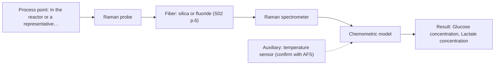
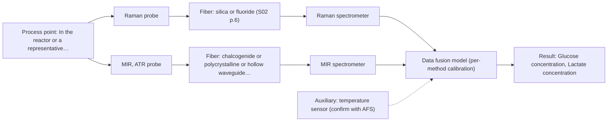

# First technical assessment: Glucose and lactate trends in an aqueous bioprocess

## Answer

**Customer request (our summary):** Customer is exploring an in situ spectroscopy pilot for glucose and lactate in an aqueous cell culture process, currently measured from samples with a delay. They want to check the pilot against existing laboratory measurements, but probe and calibration strategy are not yet selected.

### Brief answer

Test a single in-line Raman probe first, using your existing glucose and lactate assays as independent references across the run. MIR-ATR is the main single-method comparison if Raman bands are weak or fluorescence interferes. Before fixing the configuration, define the glucose/lactate ranges and accuracy, the medium's optical density and cell density range, and the reference sampling frequency; probe and calibration strategy remain open.

### Proposal

- **Best current option:** O2 (recommended)
- **Basis:** supplied AFS sources
- **What would change it:** If the medium is highly turbid or strongly fluorescent, or if the required glucose/lactate accuracy is not reached by Raman, MIR-ATR or a combined Raman+MIR option would move up. The concentration, accuracy and optical-density answers decide this.
- **Next step:** Run a Raman single-method feasibility trial on representative run samples, using the existing glucose and lactate assays as independent references, then compare with MIR-ATR.

**Secondary evidence (external, not AFS material):** G1: no usable external source found; G2: E01 ¶8; G3: no usable external source found; G4: E03 ¶24, E02 ¶7. See Expert detail.

**Decision status:** Provisional feasibility assessment

### Solution options

| ID | Tier | Methods | Confidence | Cost class, S01 Table 1 (p.6) | Ease of use | Maintenance | Performance fit | Sources |
|---|---|---|---|---|---|---|---|---|
| O1 | Simple | M2 MIR, ATR probe | Low: open question: Q1 (starts at Medium); uncited auxiliary sensor | high cost (row 2) | single probe, direct contact | crystal cleaning and fouling checks | tests MIR fingerprint in aqueous medium | [1: S01 p.10] [2: S01 p.9] [3: S01 p.5] |
| O2 | Recommended | M1 Raman probe | Low: open question: Q1 (starts at Medium); uncited auxiliary sensor | high cost (row 12) | single probe, no sample preparation | probe cleaning and fluorescence checks | aqueous-compatible glucose and lactate target | [4: S01 p.16] [5: S01 p.16] |
| O3 | Extended (multi-method) | M3 Raman probe + MIR (combination) | Low: open question: Q1 (starts at Medium); uncited auxiliary sensor; multi-method, fusion benefit not yet shown | high cost (rows 2, 12) | two synchronized probes, more setup | two instruments, two calibrations | adds MIR fingerprint to Raman | [6: S01 p.11] [7: S01 p.8] [8: S01 p.7] |

*Confidence rates the basis of the advice (how much is known and cited), not a predicted accuracy or probability of success. It starts at High, or at Medium when a key question on the method or the option is open, and drops one level per weakness listed (floor Low).*

*Cost class is the relative rating in S01 Table 1 (p.6) for the in-line method+technique rows named (the highest one for a multi-method option); it is not a price.*

### Setup sketch

*Recommended option O2; drawn by code from the option, a schematic, not a configuration.*

### Key questions

1. What glucose and lactate concentration ranges, and what accuracy and precision, must the pilot meet to be useful?
2. What are the typical optical density or turbidity and cell density across the run, and does the medium show strong fluorescence?
3. At what temperature and pressure does the process run, and where could a probe be installed relative to the analyzer?

## Expert detail

**Customer enquiry**

> We run a cell culture process in an aqueous medium. Glucose and lactate are measured from samples, and the delay makes it difficult to see changes promptly. We are exploring an in situ spectroscopy pilot that can be checked against those existing laboratory measurements. The medium and cell population change during the run; we have not yet selected a probe or a calibration strategy.

**Decision status:** Provisional feasibility assessment. The evidence supports a shortlist, not a fixed configuration: the sources cover Raman's aqueous fit and metabolite examples, but not this medium's performance. The open optical and accuracy questions decide whether MIR-ATR or a combined probe is needed.

### Parameters

| ID | Parameter | Kind | Need | Measured by | Why | Sources |
|---|---|---|---|---|---|---|
| P1 | Glucose concentration | quantitative | required | Spectroscopy: Raman | Glucose is one of the two target analytes and must be tracked against the existing laboratory assay. | [5: S01 p.16] |
| P2 | Lactate concentration | quantitative | required | Spectroscopy: Raman | Lactate is the second target analyte and must be tracked against the existing laboratory assay. | [5: S01 p.16] |
| P3 | Cell density and viability | quantitative | optional | Reference lab method: cell count and viability (laboratory reference) | Should be available as a reference because the changing cell population can affect scattering and the calibration matrix. | [9: S01 p.7] |
| P4 | Process temperature | quantitative | required | Auxiliary sensor: temperature sensor (engineering judgement: confirm availability with AFS) | Temperature is needed to interpret spectral variation and to keep calibration conditions comparable. | *(no verified source: engineering judgement)* |

### Solution option details

- **O1 cost drivers:** one MIR spectrometer, ATR probe, cleaning and calibration
- **O2 cost drivers:** one Raman spectrometer, probe, laser safety and calibration
- **O3 cost drivers:** two spectrometers, combined probe, synchronization, dual calibration
- **O3 combining methods:** Low-level fusion of synchronized Raman and MIR-ATR spectra from a combined probe at the same sampling point; each method gets its own calibration. The fused model must beat the best single method on held-out runs before it is adopted.

*Extended (multi-method) option O3; drawn by code from the option, a schematic, not a configuration.*

### Premise check

- **Supported:** An in situ spectroscopy pilot can be checked against the existing laboratory measurements. This is a feasibility-plan requirement, not proof that the existing assays are suitable references for a specific probe. [10: REF §3]
- **Supported:** A pilot spectroscopy setup can reduce the delay in seeing changes promptly. The source states the general advantage of online analysis; it does not establish a response time for this process. [11: S01 p.3]

### Requirements

**Stated by the customer**

- "We run a cell culture process in an aqueous medium."
- "Glucose and lactate are measured from samples, and the delay makes it difficult to see changes promptly."
- *Further statements: see the customer enquiry above.*

**Key unknowns**

- Glucose and lactate concentration ranges and required accuracy/precision
- Optical density/turbidity and cell density range during the run
- Fluorescence background from medium and cells
- Process temperature, pressure and installation point
- Existing laboratory reference method and sampling frequency
- Acceptable calibration strategy and transfer across runs

### Clarification questions (most decision-relevant first)

Q1. What glucose and lactate concentration ranges, and what accuracy and precision, must the pilot meet to be useful? *Why it matters:* These limits decide whether a single method is sufficient and set the go/no-go basis. *(affects: method)*
Q2. What are the typical optical density or turbidity and cell density across the run, and does the medium show strong fluorescence? *Why it matters:* These optical properties decide the probe geometry and whether Raman fluorescence background or MIR-ATR contact is workable. *(affects: technique)*
Q3. At what temperature and pressure does the process run, and where could a probe be installed relative to the analyzer? *Why it matters:* These conditions determine probe compatibility, cleaning needs and fiber-link constraints. *(affects: installation)*
Q4. Which laboratory methods currently measure glucose and lactate, at what sampling frequency, and what is their uncertainty? *Why it matters:* The existing assays must be adequate independent references before they can validate the pilot. *(affects: M1)*
Q5. What calibration strategy is acceptable: a matrix-specific model per run, or transfer across runs and batches? *Why it matters:* The answer decides how much reference data and model maintenance the pilot needs. *(affects: technique)*

### Recommendation

- **M1 · Primary candidate: Raman probe.** Raman is compatible with aqueous media because water absorbs less than in infrared methods, and a supplied source lists glucose and lactate among metabolites Raman can target in a reactor. This makes a single Raman probe the first method to test. *Conditions:* Test on real medium first because fluorescence background and weak Raman signal can obscure the bands. [4: S01 p.16] [5: S01 p.16]
- **M2 · Comparison candidate: MIR, ATR probe.** MIR-ATR is a passing single-method option for liquids and soft solids in contact with the crystal and gives well-defined absorption bands. It is a comparison because water absorbs strongly in the mid-IR and ATR samples only a thin surface layer. *Conditions:* Use if the medium can contact the ATR crystal without fouling and if the customer accepts contact cleaning. [2: S01 p.9] [3: S01 p.5] [1: S01 p.10]
- **M3 · Conditional candidate: Raman probe + MIR (combination).** Mid-IR and Raman spectra are complementary, and a combined probe can collect both from the same small sample area. The gain is a hypothesis to test only if the best single method misses the accuracy target. *Conditions:* Apply only after single-method tests if Raman or MIR alone cannot meet the customer's accuracy target. [6: S01 p.11] [7: S01 p.8] [8: S01 p.7]

### Measurement concept

- **Probe and geometry:** Start with a single in-line Raman probe in the aqueous medium; keep MIR-ATR as a contact comparison and only later consider a combined Raman + MIR-ATR probe at the same sampling point.
- **Location:** In the reactor or a representative flow/bypass line, at a point where the medium and cell population are well mixed and accessible for cleaning.
- **Fiber link:** Fiber type and length depend on the selected method and probe; they are not fixed by the supplied sources. *(no verified source: engineering judgement)*

### Spectral range

- **Raman:** Report Raman shift in cm-1 and state the laser excitation wavelength separately; the usable range depends on the instrument, laser, fiber and probe actually selected. [12: S01 p.11]
- **MIR:** Nominal MIR range is 4000-400 cm-1; the usable range depends on the fiber, crystal and spectrometer selected. [2: S01 p.9]

### Risks and uncertainty

- Fluorescence background or weak Raman signal could obscure glucose and lactate bands, especially as the medium and cell population change. [13: S01 p.11]
- The changing medium and cell population can make the calibration matrix-specific, so a model from one run may not transfer unchanged to later runs. [14: REF §5]
- MIR-ATR adds contact and fouling risk at the crystal and samples only a thin surface layer. [15: REF §5]
- No supplied source gives accuracy, detection limits or response time for glucose or lactate in this cell culture medium, so the pilot may not meet acceptance criteria. [16: REF §3]

### First feasibility experiment

1. **Collect representative samples across the run, including early and late stages, different cell densities, feed changes and the expected glucose and lactate range.** Cover the chemical and physical variation the calibration must handle. [10: REF §3]
2. **Measure the samples with the single Raman probe first; if available, also measure the same samples with the MIR-ATR comparison probe under controlled temperature.** Compare single methods before testing any combination. [5: S01 p.16]
3. **Record independent reference glucose and lactate values from the existing laboratory assays at the same times, plus cell count/viability and temperature.** Provide the reference data for calibration and validation. [10: REF §3]
4. **Build a matrix-specific calibration on a calibration set and validate it on held-out runs or batches; compare Raman alone, MIR alone, and only later the combined Raman + MIR data.** Test whether a single method is enough before adding a second instrument. *(no verified source: engineering judgement)*
5. **Apply customer-defined numerical go/no-go criteria for glucose and lactate accuracy, precision and response time; proceed to a combination only if the best single method misses them.** Make the decision on stated acceptance criteria, not on spectral appearance alone. [10: REF §3]

**Reference measurements:** Existing laboratory glucose and lactate assays, with cell count/viability and temperature recorded at the same times.

**Decision basis:** Customer-defined accuracy, precision and response-time limits for glucose and lactate; single-method performance must be compared with the best single method before any combined option is adopted.

### Assumptions

- The aqueous medium can be sampled in-line without unacceptable fouling of the selected probe.
- The existing laboratory glucose and lactate assays are precise enough to serve as independent references.
- A matrix-specific chemometric calibration is acceptable for the pilot.

### Not covered by the supplied sources

- No supplied source gives detection limits, accuracy, precision or response time for glucose or lactate in an in-line cell culture medium.
- No supplied source specifies a validated probe, fiber length or calibration transfer for this process.

### Further notes

- **Chemometrics:** Plan a matrix-specific chemometric calibration and validate it on held-out runs; the existing glucose and lactate assays supply the reference values.
- **Real-time tracking:** In-line Raman can track the run continuously; align spectrum timestamps with the reference sample times.
- **Future direction:** If single-method performance is insufficient, test a combined Raman + MIR-ATR probe with synchronized data fusion.

### Secondary evidence (external, not AFS material)

*Found by a literature search for gaps the supplied AFS sources leave open. Not AFS material and not proof for this case; every quote below was verified verbatim against the fetched text.*

**G1 · auxiliary sensor:** In-line measurement of Process temperature with temperature sensor

- No usable external source found.

**G2 · multi-method:** Combining several spectroscopy methods (data fusion) (Low-level fusion of synchronized Raman and MIR-ATR spectra from a combined probe at the same sampling point; each method gets its own calibration. The fused model must beat the best single method on held-out runs before it is adopted.)

- **E01 ¶8** The source says a continuous process at a fixed probe location simplifies model design, allowing narrower calibrations centered on the operating envelope and validation with independent steady-state runs. *How it applies:* For a fused Raman/MIR model, this suggests defining the operating envelope and using independent runs as held-out validation, while watching drift and out-of-specification behavior. *Limits and transfer risks:* The source concerns reactive liquid-liquid extraction in lithium recycling, not cell culture, and it does not describe Raman/MIR data fusion or glucose/lactate calibration. *(supports O3)*
  > "In contrast, a continuous process at a fixed probe location is intended to operate in a steady-state window, which simplifies the model design: calibrations can be narrower and centered on the operational envelope, validation can rely on independent steady-state runs, and online monitoring focuses on drift and out-of-specification detection rather than resolving the rapidly changing composition."
  > Process Analytical Technology-Integrated FT-IR and Raman Spectroscopies for Efficient Reactive Liquid-Liquid Extraction Processing in Lithium Recycling. (2025) · ACS omega · doi:10.1021/acsomega.5c05705 · https://europepmc.org/article/PMC/PMC12573149 · retrieved 2026-10-17, full text, licence: cc by, via curated library

**G3 · not in the supplied sources:** No supplied source gives detection limits, accuracy, precision or response time for glucose or lactate in an in-line cell culture medium.

- No usable external source found.

**G4 · not in the supplied sources:** No supplied source specifies a validated probe, fiber length or calibration transfer for this process.

- **E03 ¶24** The source reports that fiber-optic probes with a backscattered geometry and a focus slightly away from the optical window have been shown to give consistent, robust results across scales. *How it applies:* This could inform Raman probe geometry selection and prompt testing of consistency across scales or installations before adoption. *Limits and transfer risks:* The cited evidence is from biopharmaceutical contexts, not this cell culture matrix, and the quote gives no fiber length, calibration-transfer procedure, or glucose/lactate performance. *(supports O2)*
  > "Thus, fiber optic probes with a backscattered optical fiber geometry with a focus slightly away from the optical window have been shown to yield consistent and robust results across scales [45, 46]."
  > The role of Raman spectroscopy in biopharmaceuticals from development to manufacturing. (2022) · Analytical and bioanalytical chemistry · doi:10.1007/s00216-021-03727-4 · https://europepmc.org/article/PMC/PMC8724084 · retrieved 2026-10-17, full text, licence: cc by, via curated library
- **E02 ¶7** The source notes that the desired sampling volume is an important question when selecting a fiber-optic probe for turbid media or solids where optical scattering is significant. *How it applies:* For an in-line cell culture application, this suggests defining and testing the sampling volume rather than assuming a probe configuration transfers. *Limits and transfer risks:* The source is a review of Raman PAT in pharmaceutical manufacturing and bioprocessing, not a validated probe specification for glucose or lactate in this process. *(supports O2)*
  > "An important question when selecting a fiber-optic probe for measurements in turbid media or solids is the desired sampling volume where optical scattering is significant."
  > Raman spectroscopy as a process analytical technology for pharmaceutical manufacturing and bioprocessing. (2017) · Analytical and bioanalytical chemistry · doi:10.1007/s00216-016-9824-1 · https://europepmc.org/article/PMC/PMC5233728 · retrieved 2026-10-17, full text, licence: cc by, via curated library

### Evidence (verified quotes)

1. ✓ **S01 p.10** (general): "ATR fiber probes (Fig.1) enable the analysis of liquids and solid elastic samples"
2. ✓ **S01 p.9** (general): "Vibrational spectroscopy in the mid-IR range (4000-400 cm-1) is one of the most informative methods of chemical analysis."
3. ✓ **S01 p.5** (general): "strong absorption in the mid-IR region limits the corresponding spectral method to the analysis of very thin samples (usually less than 50 μm), but it opens up the possibility of using attenuated total reflectance (ATR)"
4. ✓ **S01 p.16** (general): "Raman is particularly well-suited for aqueous environments, as it exhibits low absorbance for water molecules compared to infrared methods."
5. ✓ **S01 p.16** (application precedent): "Raman spectroscopy can be used in the same reactor to provide a "molecular fingerprint" for direct detection of specific metabolites like glucose, acetate, or lactate."
6. ✓ **S01 p.11** (general): "This property makes mid-IR and Raman spectra complementary, that is, they complement each other."
7. ✓ **S01 p.8** (general): "It is crucial that the spectral information obtained by different methods-Mid-IR, NIR, Raman, and fluorescence spectra-is collected from the same small, even pinpoint, area of the sample."
8. ✓ (precedent only) **S01 p.7** (method gain): "This often provides a synergistic effect, allowing one to solve a problem that either method alone cannot handle or only partially."
9. ✓ **S01 p.7** (general): "Morphological factors, such as sample inhomogeneity (e.g., biological tissue) or process turbulence, must also be considered when selecting a measurement technique."
10. ✓ **REF §3** (general): "Representative samples or process states, independent reference measurements, what is compared, and the basis for the go / no-go decision."
11. ✓ **S01 p.3** (general): "It allows for in-process analysis, i.e., directly in the process flow or reactor without sampling, eliminating delays and the risk of sample contamination."
12. ✓ **S01 p.11** (general): "The Raman shift is used as the horizontal (spectral) axis in Raman spectroscopy"
13. ✓ **S01 p.11** (general): "superposition of luminescence (fluorescence), which has a significantly higher intensity."
14. ✓ **REF §5** (general): "calibration specific to the matrix."
15. ✓ **REF §5** (general): "Usable range limited by fiber and crystal; contact, fouling, compatibility."
16. ✓ **REF §3** (general): "accuracy, detection limits, response times, fiber lengths or other performance figures that no source supports"

### Verification

- Citations verified: 28 of 28 (exact or whitespace/hyphen-tolerant match on the cited page, scope checked).
- Hard check failures before deterministic corrections: 0; still open: 0; soft warnings: 2; repair rounds: 1.
- Corrected deterministically after verification (1):
  - ⚠ recommendations[2].combined_with: combined_with normalised to ['MIR'] (duplicates and the entry's own method removed)
- External evidence (cache): 3 quote(s) verified verbatim (exact or whitespace/hyphen-tolerant, at most 400 characters and 2 sentences, against the cited paragraph); 0 item(s) dropped.
- External search: 6 query(ies), 10 hit(s), 3 source(s) (3 from the curated library).
- External step: 2 model call(s), 23.9 s extra (cost in the run JSON).

*Run D04-20261018T075900Z-5ac7 · models deepseek/deepseek-v4.1-flash-1017*
