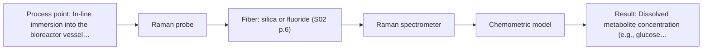
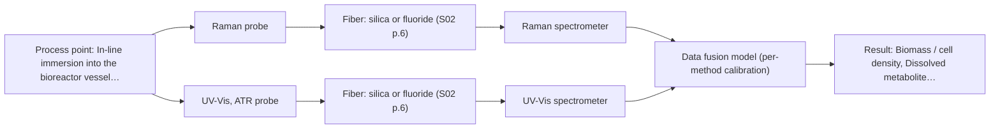

# First technical assessment: Biomass related monitoring during yeast fermentation

## Answer

**Customer request (our summary):** The customer wants assistance designing an initial feasibility study and selecting reference measurements for an optical monitoring approach to track yeast growth and metabolic changes in a broth that increases in optical density.

### Brief answer

For yeast fermentation, we recommend evaluating in-line Raman spectroscopy first to monitor dissolved metabolites without severe water interference, alongside UV-Vis ATR to track biomass in high-turbidity broth. Multi-method combination should only be tested if single-method models prove insufficient. To proceed, please clarify your specific target metabolites, your biomass reference methods, and your bioreactor port specifications.

### Proposal

- **Best current option:** O2 (recommended)
- **Basis:** supplied AFS sources
- **What would change it:** If Raman alone cannot resolve growth or suffers severe fluorescence background, or if specific target metabolites require high-sensitivity UV/Vis or combined multi-method data fusion, the recommended configuration would shift.
- **Next step:** Test Raman and UV-Vis ATR individually on representative fermentation samples with independent reference assays to determine single-method feasibility before exploring combined probe instrumentation.

**Secondary evidence (external, not AFS material):** G1: no usable external source found; G2: no usable external source found; G3: no usable external source found; G4: no usable external source found. See Expert detail.

**Decision status:** Provisional feasibility assessment

### Solution options

| ID | Tier | Methods | Confidence | Cost class, S01 Table 1 (p.6) | Ease of use | Maintenance | Performance fit | Sources |
|---|---|---|---|---|---|---|---|---|
| O1 | Simple | M2 UV-Vis, ATR probe | Medium: open question: Q1, Q2 (starts at Medium) | average cost (row 14) | Straightforward single probe setup and alignment | Periodic cleaning of ATR crystal face | Directly tracks broth turbidity without saturation | [1: S01 p.16] [2: S01 p.16] |
| O2 | Recommended | M1 Raman probe | Medium: open question: Q1, Q2 (starts at Medium) | high cost (row 12) | Single immersion probe with fiber link | Probe window inspection and laser calibration | Measures dissolved metabolites without water interference | [3: S01 p.16] |
| O3 | Extended (multi-method) | M1 Raman probe; M2 UV-Vis, ATR probe; M3 Raman probe + UV-Vis (combination) | Low: open question: Q1, Q2 (starts at Medium); multi-method, fusion benefit not yet shown | high cost (rows 12, 14) | Dual instrument setup requiring synchronization software | Independent maintenance and calibration of two systems | Simultaneously tracks biomass growth and metabolites | [4: S01 p.8] [5: S01 p.8] [6: S01 p.9] [7: REF §5] [3: S01 p.16] [1: S01 p.16] [2: S01 p.16] [8: S01 p.16] |

*Confidence rates the basis of the advice (how much is known and cited), not a predicted accuracy or probability of success. It starts at High, or at Medium when a key question on the method or the option is open, and drops one level per weakness listed (floor Low).*

*Cost class is the relative rating in S01 Table 1 (p.6) for the in-line method+technique rows named (the highest one for a multi-method option); it is not a price.*

### Setup sketch

*Recommended option O2; drawn by code from the option, a schematic, not a configuration.*

### Key questions

1. Which specific chemical metabolites (such as glucose, ethanol, or organic acids) do you plan to track, and what are their expected concentration ranges throughout the fermentation?
2. What offline reference analytical method is used for biomass (e.g., OD600, dry cell weight, or cell count), and what peak optical density is reached during late-stage broth growth?
3. What bioreactor interface, port dimensions (such as standard Ingold fittings), and sterilization conditions (autoclave, CIP, or SIP) are available for probe installation?

## Expert detail

**Customer enquiry**

> We would like an optical measurement during yeast fermentation to help us follow growth and notice changes earlier. Our team has mentioned both a biomass signal and a metabolic signal, but these have not been defined as separate targets. The broth becomes more optically dense as the run develops. We need help turning this request into an initial feasibility study with useful reference measurements.

**Decision status:** Provisional feasibility assessment. The customer outlines goals for biomass and early metabolic tracking in an aqueous broth with rising optical density, but specific analytes, concentration ranges, and reference definitions remain undefined. A provisional shortlist is justified using bioprocess precedents, prioritizing single-method evaluation before multi-method data fusion.

### Parameters

| ID | Parameter | Kind | Need | Measured by | Why | Sources |
|---|---|---|---|---|---|---|
| P1 | Biomass / cell density | quantitative | required | Spectroscopy: UV-Vis | Tracking yeast cell growth is a core objective stated by the customer. | [1: S01 p.16] |
| P2 | Dissolved metabolite concentration (e.g., glucose, ethanol) | quantitative | required | Spectroscopy: Raman | Following metabolic shifts early requires tracking critical carbon substrates or fermentation products. | [9: S01 p.16] |
| P3 | Offline reference biomass (DCW / OD600) | quantitative | required | Reference lab method: Spectrophotometer (OD600) / Gravimetric dry cell weight | Provides an independent analytical ground truth to train and validate spectroscopic calibration models. | *(no verified source: engineering judgement)* |
| P4 | Offline reference metabolites (HPLC / enzymatic assay) | quantitative | required | Reference lab method: High-performance liquid chromatography (HPLC) or enzymatic assays | Provides an independent ground truth for validating in-line metabolite quantification. | *(no verified source: engineering judgement)* |
| P5 | Broth temperature | quantitative | optional | Auxiliary sensor: Pt100 resistance thermometer or thermocouple (engineering judgement: confirm availability with AFS) | Fermentation temperature affects metabolic rates and optical spectral baselines. | *(no verified source: engineering judgement)* |

### Solution option details

- **O1 cost drivers:** Standard UV spectrometer and ATR probe
- **O2 cost drivers:** Raman spectrometer, excitation laser source, probe
- **O3 cost drivers:** Two separate spectrometers and combined probe
- **O3 combining methods:** Both optical techniques must sample the same broth volume simultaneously or via a unified probe interface. Spectral acquisition times must be synchronized to a common time step, and variables normalized using block autoscaling before low-level or mid-level multivariate regression. The fused multi-method model must demonstrate statistically superior predictive accuracy on independent batches over the best single method before justifying permanent dual instrumentation.

*Extended (multi-method) option O3; drawn by code from the option, a schematic, not a configuration.*

### Premise check

- **Precedent only:** Optical spectroscopy can monitor biomass growth and distinguish metabolic changes during yeast fermentation. Published literature reports that optical spectroscopy can differentiate biomass and intra- or extracellular metabolites in yeast fermentation, providing an empirical basis to test rather than proof for a new customer process. [10: S01 p.7]

### Requirements

**Stated by the customer**

- Optical measurement during yeast fermentation to follow growth and notice changes earlier.
- Monitoring both a biomass signal and a metabolic signal (currently undefined as separate targets).
- Measurement in a fermentation broth that becomes more optically dense as the run develops.
- Formulation of an initial feasibility study with useful reference measurements.

**Key unknowns**

- Specific metabolic analytes of interest (e.g., glucose, ethanol, glycerol, organic acids) and expected concentration ranges
- Biomass definition and offline reference analytical method (e.g., dry cell weight, OD600, or cell count)
- Bioreactor port dimensions, immersion probe mounting geometry, and immersion location
- Fluid dynamics, agitation rate, and aeration/sparging gas bubble interference at the probe location
- Operating temperature, pressure, and vessel sterilization regime (autoclave, CIP, or SIP)

### Clarification questions (most decision-relevant first)

Q1. Which specific chemical metabolites (such as glucose, ethanol, or organic acids) do you plan to track, and what are their expected concentration ranges throughout the fermentation? *Why it matters:* Identifying specific chemical targets dictates whether vibrational spectroscopy like Raman has sufficient selectivity and sensitivity. *(affects: method, M1)*
Q2. What offline reference analytical method is used for biomass (e.g., OD600, dry cell weight, or cell count), and what peak optical density is reached during late-stage broth growth? *Why it matters:* Peak optical density and turbidity determine whether transmission geometries will saturate and whether an ATR interface is strictly required. *(affects: technique, method)*
Q3. What bioreactor interface, port dimensions (such as standard Ingold fittings), and sterilization conditions (autoclave, CIP, or SIP) are available for probe installation? *Why it matters:* Vessel ports and thermal or chemical sterilization cycles dictate probe shaft dimensions, window materials, and sealing. *(affects: installation)*
Q4. How does sparging, bubbling, or mechanical agitation affect optical clarity and fluid flow at your intended probe immersion point? *Why it matters:* Sparging bubbles passing the probe window cause intense physical scattering fluctuations that can disrupt baseline measurements. *(affects: technique, installation)*

### Recommendation

- **M1 · Primary candidate: Raman probe.** Raman spectroscopy provides a molecular fingerprint for dissolved broth metabolites such as glucose or organic acids while experiencing low water interference in aqueous media. An immersion Raman probe allows direct in-line monitoring of molecular changes inside the broth. [3: S01 p.16]
- **M2 · Comparison candidate: UV-Vis, ATR probe.** UV-Vis turbidity correlates directly with suspension cell density to track biomass growth. An ATR interface provides an evanescent path of a few micrometers, preventing detector saturation that occurs with standard transmission probes in high-OD broths. [1: S01 p.16] [2: S01 p.16]
- **M3 · Conditional candidate: Raman probe + UV-Vis (combination).** Combining Raman molecular tracking with UV-Vis turbidity allows simultaneous monitoring of dissolved metabolites and biomass trends from the same culture. This multi-method configuration should only be considered if single-method Raman or UV-Vis fails to track both growth and metabolic shifts adequately. *Conditions:* Applies if single-method spectroscopy cannot simultaneously resolve both biomass growth and target metabolite concentrations. [8: S01 p.16] [7: REF §5] Later hypothesis, after single-method tests.

### Measurement concept

- **Probe and geometry:** Direct immersion probe using either a Raman immersion probe with filtered optics or a UV-ATR probe utilizing an attenuated total reflection crystal with an evanescent wave path of a few micrometers to measure high-optical-density broth without transmission saturation.
- **Location:** In-line immersion into the bioreactor vessel below the liquid level, positioned away from direct sparger gas streams to reduce bubble interference.
- **Fiber link:** Standard or metal-coated silica fibers for UV-Vis and Raman delivery and collection, allowing the spectrometers to be positioned safely away from the fermenter. [2: S01 p.16] [11: S01 p.15] [12: S02 p.7]

### Spectral range

- **Raman:** Nominal Raman shift is expressed in cm-1, typically excited at 785 nm; usable range depends on the instrument and probe selected. [13: S01 p.11] [14: S01 p.15]
- **UV-Vis:** Nominal UV-Vis range covers 190 nm to visible wavelengths; usable range depends on the spectrometer, optics, and probe selected. [15: S01 p.5] [16: REF §5]

### Risks and uncertainty

- In high optical density or highly turbid broth, standard optical transmission signals saturate, requiring an ATR geometry or scatter correction. *(rules: R-GEO-2, R-GEO-7)* [17: S01 p.16]
- Raman scattering signals are inherently weak and can be obscured by background fluorescence from fermentation media components or cellular metabolites. *(rules: R-RAM-1)* [18: S01 p.11]
- Process turbulence, aeration bubbles from sparging, and cellular sedimentation can distort in-line optical spectra if the probe is placed inappropriately. *(rules: R-GEN-5)* [19: S01 p.7]
- Turbidity and optical density measure physical light attenuation rather than a direct viable cell count, requiring validated matrix-specific calibration. *(rules: R-UV-2, R-CAL-1)* [20: REF §5]

### First feasibility experiment

1. **Collect representative offline and at-line broth samples across the complete fermentation timeline, spanning low to high cell density and varying nutrient/metabolite concentrations.** Capture the full chemical, physical, and optical variation of the broth across the growth cycle. [21: REF §3]
2. **Acquire independent offline reference measurements, such as dry cell weight and OD600 for biomass, and HPLC or enzymatic assays for key dissolved metabolites (glucose, ethanol).** Establish true analytical baselines to calibrate and evaluate optical measurements. *(no verified source: engineering judgement)*
3. **Perform single-method benchtop optical evaluations (Raman spectroscopy for metabolites and UV-Vis ATR for turbidity/biomass) on the representative samples to assess signal quality, water interference, and fluorescence background.** Determine whether either single optical method can independently resolve biomass and metabolic indicators without unnecessary hardware complexity. *(no verified source: engineering judgement)*
4. **Test multi-method data fusion combining synchronized Raman and UV-Vis spectra only if single-method models prove insufficient to resolve both targets.** Evaluate whether fused spectral data yield statistically lower prediction errors than the best single method. *(no verified source: engineering judgement)*
5. **Validate multivariate calibration models (e.g., PLS regression) on independent, held-out fermentation batches to determine prediction accuracy against customer criteria.** Verify model robustness and establish go/no-go performance on unseen process runs. *(no verified source: engineering judgement)*

**Reference measurements:** Independent laboratory reference analysis using dry cell weight (DCW) or OD600 for biomass, alongside HPLC or enzymatic assays for specific dissolved metabolites (e.g., glucose, ethanol, organic acids).

**Decision basis:** Go/no-go progression depends on meeting the customer's required quantitative accuracy (e.g., RMSEP relative to reference assays) and early-detection sensitivity for metabolic inflection points, validated on held-out fermentation runs.

### Assumptions

- The fermentation operates in an aqueous broth where yeast cells grow to high turbidity.
- The customer has access to independent reference analytical techniques (e.g., OD600, dry cell weight, HPLC).
- Immersion probe access is available via standard bioreactor ports.
- Testing single spectroscopy methods precedes any consideration of dual-method instrumentation.

### Not covered by the supplied sources

- Specific detection limits and quantitative accuracy for yeast metabolic tracking in a fermenter.
- Bioreactor port dimensional standards, pressure ratings, and SIP/CIP temperature tolerance of specific probes.

### Further notes

- **Chemometrics:** Multivariate calibration (such as PLS regression) will be required to relate spectral features to offline reference values (DCW, OD600, or HPLC concentrations). Preprocessing, including baseline correction and scatter normalization, must be validated on independent fermentation batches to prevent overfitting.
- **Real-time tracking:** In-line immersion monitoring allows continuous acquisition of broth spectra during fermentation, capturing rapid growth inflections and substrate exhaustion without extractive sampling delays.
- **Future direction:** If single-method tracking proves robust, the optical configuration can be miniaturized into a dedicated photometer or compact optical multisensor system focused on optimal wavelengths for routine production control.

### Secondary evidence (external, not AFS material)

*Found by a literature search for gaps the supplied AFS sources leave open. Not AFS material and not proof for this case; every quote below was verified verbatim against the fetched text.*

*Live search unavailable (library only: cache miss (europepmc); cache miss (openalex)); curated library only.*

**G1 · auxiliary sensor:** In-line measurement of Broth temperature with Pt100 resistance thermometer or thermocouple

- No usable external source found.

**G2 · multi-method:** Combining several spectroscopy methods (data fusion) (Both optical techniques must sample the same broth volume simultaneously or via a unified probe interface. Spectral acquisition times must be synchronized to a common time step, and variables normalized using block autoscaling before low-level or mid-level multivariate regression. The fused multi-method model must demonstrate statistically superior predictive accuracy on independent batches over the best single method before justifying permanent dual instrumentation.)

- No usable external source found.

**G3 · not in the supplied sources:** Specific detection limits and quantitative accuracy for yeast metabolic tracking in a fermenter.

- No usable external source found.

**G4 · not in the supplied sources:** Bioreactor port dimensional standards, pressure ratings, and SIP/CIP temperature tolerance of specific probes.

- No usable external source found.

### Evidence (verified quotes)

1. ✓ **S01 p.16** (general): "UV/Vis spectroscopy can be deployed as a low-cost, robust tool for real-time biomass monitoring, as cell suspension turbidity correlates well with cell density."
2. ✓ **S01 p.16** (general): "In these high-OD scenarios, a UV-ATR (Attenuated Total Reflection) probe is used. Instead of passing light through the sample, ATR relies on the evanescent wave that penetrates only a few micrometers into the medium at the crystal interface, effectively creating an extremely short path length that enables the measurement of "black" or highly scattering fluids without dilution."
3. ✓ **S01 p.16** (general): "While UV/Vis tracks growth, Raman spectroscopy can be used in the same reactor to provide a "molecular fingerprint" for direct detection of specific metabolites like glucose, acetate, or lactate. This combination is practical because Raman is particularly well-suited for aqueous environments, as it exhibits low absorbance for water molecules compared to infrared methods."
4. ✓ **S01 p.8** (general): "It is crucial that the spectral information obtained by different methods-Mid-IR, NIR, Raman, and fluorescence spectra-is collected from the same small, even pinpoint, area of the sample."
5. ✓ **S01 p.8** (general): "Ultimately, the measurement data must be normalized to a common time step."
6. ✓ **S01 p.9** (general): "Furthermore, methods containing a larger number of variables have a greater impact on the model."
7. ✓ **REF §5** (general): "compare with the best single method."
8. ✓ (precedent only) **S01 p.16** (method gain): "a primary advantage of having multiple techniques is the ability to monitor both complex chemical structures and overall physical process trends simultaneously. For instance, UV/Vis spectroscopy can be deployed as a low-cost, robust tool for real-time biomass monitoring, as cell suspension turbidity correlates well with cell density. While UV/Vis tracks growth, Raman spectroscopy can be used in the same reactor to provide a "molecular fingerprint" for direct detection of specific metabolites like glucose, acetate, or lactate."
9. ✓ **S01 p.16** (general): "While UV/Vis tracks growth, Raman spectroscopy can be used in the same reactor to provide a "molecular fingerprint" for direct detection of specific metabolites like glucose, acetate, or lactate."
10. ✓ **S01 p.7** (application precedent): "Thus, the combination of NIR spectroscopy with fluorescence spectroscopy demonstrated the possibility of more accurately determining the biomass content during yeast fermentation, as well as distinguishing between their intra- and extracellular metabolites."
11. ✓ **S01 p.15** (general): "located safely away from the vibration and dust of the manufacturing floor."
12. ✓ **S02 p.7** (general): "Free of Polymer jacket fluorescence for Raman and Fluo- Spectroscopy"
13. ✓ **S01 p.11** (general): "The difference between the observed frequencies and the laser frequency is called the Raman shift, expressed in units of frequency-wavenumbers (cm-1)."
14. ✓ **S01 p.15** (general): "with 785 nm excitation wavelength"
15. ✓ **S01 p.5** (general): "especially in the UV region (190-360 nm)"
16. ✓ **REF §5** (general): "It is not a product specification: actual spectral coverage, fiber length, component ratings, detection limits and accuracy depend on the configuration and the sample."
17. ✓ **S01 p.16** (general): "transmission setup becomes saturated because the light cannot penetrate the bulk of the sample."
18. ✓ **S01 p.11** (general): "superposition of luminescence (fluorescence), which has a significantly higher intensity."
19. ✓ **S01 p.7** (general): "Morphological factors, such as sample inhomogeneity (e.g., biological tissue) or process turbulence, must also be considered when selecting a measurement technique."
20. ✓ **REF §5** (general): "optical density is not a viable cell count."
21. ✓ **REF §3** (general): "Representative samples or process states, independent reference measurements, what is compared, and the basis for the go / no-go decision."

### Verification

- Citations verified: 28 of 28 (exact or whitespace/hyphen-tolerant match on the cited page, scope checked).
- Hard check failures before deterministic corrections: 0; still open: 0; soft warnings: 2; repair rounds: 1.
- External evidence (cache): 0 quote(s) verified verbatim (exact or whitespace/hyphen-tolerant, at most 400 characters and 2 sentences, against the cited paragraph); 0 item(s) dropped.
- External search: 5 query(ies), 0 hit(s), 3 source(s) (3 from the curated library); ⚠ library only: cache miss (europepmc); cache miss (openalex).
- External step: 2 model call(s), 4.8 s extra (cost in the run JSON).

*Run D05-20261018T075900Z-122d · models google/gemini-3.8-flash*
