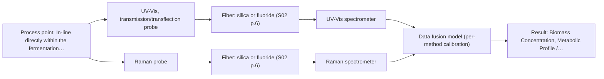

# First technical assessment: Biomass related monitoring during yeast fermentation

## Answer

**Customer request (our summary):** The customer wants to apply optical measurements during yeast fermentation to monitor biomass and metabolic signals, and requests help with an initial feasibility study.

### Brief answer

To follow yeast growth and metabolic changes during fermentation, start by testing UV-Vis transmission for real-time biomass turbidity tracking, supported by Raman spectroscopy as a secondary method for metabolic signatures. Clarifying the specific target metabolites and expected optical density range will determine the final probe configuration.

### Proposal

- **Best current option:** O2 (recommended)
- **Basis:** supplied AFS sources
- **What would change it:** Clarification that metabolic tracking is not required would shift the recommendation to the simple UV-Vis option (O1).
- **Next step:** Perform multi-method laboratory trials using representative fermentation broth samples across varying optical densities.

**Decision status:** Provisional feasibility assessment

### Solution options

| ID | Tier | Methods | Confidence | Cost class, S01 Table 1 (p.6) | Ease of use | Maintenance | Performance fit | Sources |
|---|---|---|---|---|---|---|---|---|
| O1 | Simple | M1 UV-Vis, transmission/transflection probe | Low: open question: Q1 (starts at Medium); sample clarity varies | low cost (row 16) | High, straightforward turbidity tracking | Low optical probe maintenance | Fits real-time biomass growth monitoring effectively | [1: S01 p.16] |
| O2 | Recommended | M1 UV-Vis, transmission/transflection probe; M2 Raman probe + UV-Vis (combination) | Low: open question: Q1 (starts at Medium); sample clarity varies; multi-method, fusion benefit not yet shown | high cost (rows 12, 16) | Moderate, requires multi-sensor alignment | Moderate, dual instrument upkeep | Covers both growth tracking and metabolic changes comprehensively | [2: S01 p.16] [1: S01 p.16] [3: S01 p.16] |

*Confidence rates the basis of the advice (how much is known and cited), not a predicted accuracy or probability of success. It starts at High, or at Medium when a key question on the method or the option is open, and drops one level per weakness listed (floor Low).*

*Cost class is the relative rating in S01 Table 1 (p.6) for the in-line method+technique rows named (the highest one for a multi-method option); it is not a price.*

### Setup sketch

*Recommended option O2; drawn by code from the option, a schematic, not a configuration.*

### Key questions

1. What specific chemical species or metabolic products define the metabolic signal (e.g., specific amino acids, carbon source, or cofactors like NADH)?
2. What is the expected range of optical density or cell concentration during the fermentation run?
3. What independent reference analytical methods will be used to generate calibration and validation data?

## Expert detail

**Customer enquiry**

> We would like an optical measurement during yeast fermentation to help us follow growth and notice changes earlier. Our team has mentioned both a biomass signal and a metabolic signal, but these have not been defined as separate targets. The broth becomes more optically dense as the run develops. We need help turning this request into an initial feasibility study with useful reference measurements.

**Decision status:** Provisional feasibility assessment. The customer's request to monitor yeast fermentation biomass and metabolic signals via optical measurements can be assessed provisionally using established bioprocess spectroscopic approaches, though specific analyte definitions and installation constraints remain open.

### Parameters

| ID | Parameter | Kind | Need | Measured by | Why | Sources |
|---|---|---|---|---|---|---|
| P1 | Biomass Concentration | quantitative | required | Spectroscopy: UV-Vis | Needed to monitor yeast growth progress in real time. | [1: S01 p.16] |
| P2 | Metabolic Profile / Metabolites | qualitative | optional | Spectroscopy: Raman | Needed to notice metabolic changes earlier if turbidity alone is insufficient. | [4: S01 p.16] |

### Solution option details

- **O1 cost drivers:** Single spectrometer and standard immersion probe
- **O2 cost drivers:** Combination of UV-Vis and Raman spectroscopic hardware

### Premise check

- **Supported:** An initial feasibility study with useful reference measurements can be directly formulated from the current request. The sources describe typical bioprocess monitoring approaches combining multiple optical methods for biomass and metabolite tracking, providing a solid basis for an initial feasibility plan. [2: S01 p.16]

### Requirements

**Stated by the customer**

- Optical measurement during yeast fermentation
- Follow growth via a biomass signal
- Notice changes earlier via a metabolic signal
- Handle increasing optical density as the run develops

**Key unknowns**

- Exact chemical definitions and target species for biomass and metabolic signals
- Process temperature, pressure, and exact bioreactor interface requirements
- Fouling propensity and cleaning-in-place (CIP) requirements
- Reference laboratory methods available for calibration

### Clarification questions (most decision-relevant first)

Q1. What specific chemical species or metabolic products define the metabolic signal (e.g., specific amino acids, carbon source, or cofactors like NADH)? *Why it matters:* Determines whether molecular vibrational methods (Raman, NIR) or fluorescence is required. *(affects: method, M1, M2)*
Q2. What is the expected range of optical density or cell concentration during the fermentation run? *Why it matters:* Informs whether transmission/transflection or ATR/reflection interfaces are needed to avoid signal saturation as the broth thickens. *(affects: technique, installation)*
Q3. What independent reference analytical methods will be used to generate calibration and validation data? *Why it matters:* A robust reference method is mandatory for building and validating chemometric calibration models. *(affects: status)*
Q4. Are there specific sterilization or clean-in-place (CIP) requirements for the in-line probe installation? *Why it matters:* Dictates probe material compatibility and mechanical design for reactor mounting. *(affects: installation)*

### Recommendation

- **M1 · Primary candidate: UV-Vis, transmission/transflection probe.** Cell suspension turbidity correlates well with cell density, providing a robust, low-cost primary method for real-time biomass tracking. *Conditions:* Applicable while optical density remains within non-saturating limits; switch to ATR if scattering becomes excessive. [1: S01 p.16]
- **M2 · Comparison candidate: Raman probe + UV-Vis (combination).** Raman spectroscopy provides a molecular fingerprint for direct detection of specific metabolites in aqueous environments with low water absorbance. *Conditions:* Tested as a subsequent hypothesis if UV-Vis turbidity tracking is insufficient for metabolic differentiation. [3: S01 p.16] Later hypothesis, after single-method tests.

### Measurement concept

- **Probe and geometry:** Immersion probe configured for UV-Vis transmission or turbidity measurement, and optionally combined with Raman or fluorescence.
- **Location:** In-line directly within the fermentation vessel or reactor process flow.
- **Fiber link:** Silica fiber optic cables connecting the immersion probe to the remote optical analyzers outside the bioreactor environment. [5: S01 p.3] [6: S01 p.15]

### Spectral range

- **UV-Vis:** Nominal method range covers electronic transitions (190-360 nm and visible range); usable range depends on the selected probe and spectrometer configuration. [7: S01 p.5]
- **Raman:** Raman shift measured in cm-1 with laser excitation wavelength stated separately; usable range depends on filters and spectrometer configuration. [8: S01 p.11]

### Risks and uncertainty

- Turbidity signal saturation or optical path failure as the broth optical density increases during fermentation growth. *(rules: R-UV-2)* [9: S01 p.16]
- Interference from fluorescence background or biological matrix variations when applying Raman or optical sensors. *(rules: R-RAM-1)* [10: S01 p.11]

### First feasibility experiment

1. **Collect representative broth samples across various stages of fermentation growth, covering low to high optical density states.** Capture expected physical and chemical variations during the process. *(no verified source: engineering judgement)*
2. **Perform baseline optical measurements using UV-Vis transmission/turbidity and evaluate signal response against cell density.** Establish single-method performance for biomass tracking. *(no verified source: engineering judgement)*
3. **Test secondary methods (such as Raman or fluorescence) on the same sample states if metabolic compound tracking requires higher molecular specificity.** Evaluate multi-method complementarity for metabolic changes. *(no verified source: engineering judgement)*
4. **Validate chemometric models against independent reference measurements on held-out fermentation runs.** Ensure predictive robustness and generalizability. *(no verified source: engineering judgement)*

**Reference measurements:** Independent offline reference assays for cell dry weight, viable cell counts, and targeted metabolite concentrations (e.g., HPLC or standard laboratory assays).

**Decision basis:** Customer-defined numerical accuracy criteria for biomass concentration prediction error and early metabolic detection time thresholds.

### Assumptions

- The fermentation broth is accessible via standard port installations for immersion probes.
- Offline reference measurements can be synchronized in time with inline spectral acquisition.

### Further notes

- **Chemometrics:** Multivariate calibration (such as PLS) is required to convert continuous spectral data into quantitative concentration parameters and handle optical density variations.
- **Real-time tracking:** In-line probe installation enables continuous data acquisition to track fermentation kinetics in real time.
- **Future direction:** Integration of automated cloud data transfer and IoT-based spectral sensors for remote fermentation monitoring.

### Evidence (verified quotes)

1. ✓ **S01 p.16** (general): "UV/Vis spectroscopy can be deployed as a low-cost, robust tool for real-time biomass monitoring, as cell suspension turbidity correlates well with cell density."
2. ✓ **S01 p.16** (general): "Multimodal Metabolite and Biomass Tracking: a primary advantage of having multiple techniques is the ability to monitor both complex chemical structures and overall physical process trends simultaneously."
3. ✓ **S01 p.16** (general): "While UV/Vis tracks growth, Raman spectroscopy can be used in the same reactor to provide a "molecular fingerprint" for direct detection of specific metabolites like glucose, acetate, or lactate."
4. ✓ **S01 p.16** (general): "Raman spectroscopy can be used in the same reactor to provide a "molecular fingerprint" for direct detection of specific metabolites like glucose, acetate, or lactate."
5. ✓ **S01 p.3** (general): "It allows for in-process analysis, i.e., directly in the process flow or reactor without sampling, eliminating delays and the risk of sample contamination."
6. ✓ **S01 p.15** (general): "The use of fiber optics is critical here, as it allows the sensitive spectrometers to be located safely away from the vibration and dust of the manufacturing floor."
7. ✓ **S01 p.5** (general): "UV-visible spectroscopy is based on electronic transitions between molecular energy levels. It has very high sensitivity, especially in the UV region (190-360 nm)"
8. ✓ **S01 p.11** (general): "The difference between the observed frequencies and the laser frequency is called the Raman shift, expressed in units of frequency-wavenumbers (cm-1)."
9. ✓ **S01 p.16** (general): "as the media becomes more opaque, turbid, or highly concentrated, the signal in a standard transmission setup becomes saturated because the light cannot penetrate the bulk of the sample."
10. ✓ **S01 p.11** (general): "Furthermore, observing Raman bands is often complicated by light scattering from the illuminating laser, and for many organic compounds, by the superposition of luminescence (fluorescence),"

### Verification

- Citations verified: 13 of 13 (exact or whitespace/hyphen-tolerant match on the cited page, scope checked).
- Hard check failures before deterministic corrections: 0; still open: 0; soft warnings: 0; repair rounds: 1.
- External evidence: no gap found, so no search.

*Run D05-20261018T075900Z-1713 · models google/gemini-3.5-flash-lite, google/gemini-3.8-flash*
