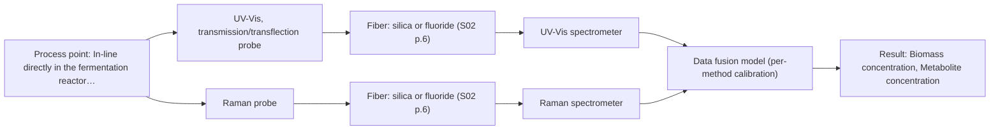

# First technical assessment: Biomass related monitoring during yeast fermentation

## Answer

**Customer request (our summary):** The customer wants an optical measurement during yeast fermentation to monitor biomass and metabolic signals, and requests help setting up an initial feasibility study.

### Brief answer

To monitor yeast fermentation growth and metabolism, we recommend starting with UV-Vis spectroscopy for biomass turbidity and Raman spectroscopy for metabolite tracking. Because broth optical density increases during the run, transmission limits must be tested. We propose multi-method laboratory trials with cell dry weight and HPLC reference measurements to validate calibration models.

### Proposal

- **Best current option:** O2 (recommended)
- **Basis:** supplied AFS sources
- **What would change it:** If metabolite targets are not Raman-active or fluorescence cofactors are preferred, the recommended method mix would shift.
- **Next step:** Conduct multi-method laboratory trials on representative fermentation broth samples across various optical densities with independent reference measurements.

**Decision status:** Provisional feasibility assessment

### Solution options

| ID | Tier | Methods | Confidence | Cost class, S01 Table 1 (p.6) | Ease of use | Maintenance | Performance fit | Sources |
|---|---|---|---|---|---|---|---|---|
| O1 | Simple | M1 UV-Vis, transmission/transflection probe | Low: open question: Q1, Q3 (starts at Medium); sample clarity varies | low cost (row 16) | Easy single-probe operation | Regular window cleaning | Tracks biomass via UV-Vis turbidity | [1: S01 p.16] [2: S01 p.16] |
| O2 | Recommended | M1 UV-Vis, transmission/transflection probe; M2 Raman probe + UV-Vis (combination) | Low: open question: Q1, Q3 (starts at Medium); sample clarity varies; multi-method, fusion benefit not yet shown | high cost (rows 12, 16) | Moderate setup complexity | Dual instrument upkeep | Covers both biomass and metabolites comprehensively | [1: S01 p.16] [2: S01 p.16] [3: S01 p.16] |

*Confidence rates the basis of the advice (how much is known and cited), not a predicted accuracy or probability of success. It starts at High, or at Medium when a key question on the method or the option is open, and drops one level per weakness listed (floor Low).*

*Cost class is the relative rating in S01 Table 1 (p.6) for the in-line method+technique rows named (the highest one for a multi-method option); it is not a price.*

### Setup sketch

*Recommended option O2; drawn by code from the option, a schematic, not a configuration.*

### Key questions

1. What specific metabolites or metabolic groups (e.g., glucose, acetate, lactate, or cofactors like NADH) should the metabolic signal target?
2. What is the expected range of optical density or cell dry weight during the fermentation run?
3. Are there known fluorescent species in the broth that can be monitored for metabolic state?

## Expert detail

**Customer enquiry**

> We would like an optical measurement during yeast fermentation to help us follow growth and notice changes earlier. Our team has mentioned both a biomass signal and a metabolic signal, but these have not been defined as separate targets. The broth becomes more optically dense as the run develops. We need help turning this request into an initial feasibility study with useful reference measurements.

**Decision status:** Provisional feasibility assessment. A provisional assessment is possible using UV-Vis for biomass turbidity and Raman or fluorescence for metabolic tracking, but exact chemical definitions and optical density saturation limits require experimental verification.

### Parameters

| ID | Parameter | Kind | Need | Measured by | Why | Sources |
|---|---|---|---|---|---|---|
| P1 | Biomass concentration | quantitative | required | Spectroscopy: UV-Vis | To follow yeast growth and monitor fermentation development. | [2: S01 p.16] |
| P2 | Metabolite concentration | quantitative | required | Spectroscopy: Raman | To monitor metabolic activity and detect changes earlier. | [4: S01 p.16] |

### Solution option details

- **O1 cost drivers:** Single UV-Vis spectrometer and immersion probe
- **O2 cost drivers:** UV-Vis and Raman spectrometers with fiber probes
- **O2 combining methods:** Combines UV-Vis turbidity and Raman molecular fingerprinting from aligned sampling spots with time-step synchronization to monitor growth and metabolites simultaneously.

### Requirements

**Stated by the customer**

- Optical measurement during yeast fermentation
- Follow growth (biomass signal)
- Notice changes earlier (metabolic signal)
- Handle increasing optical density during the run

**Key unknowns**

- Exact chemical definitions and concentration ranges of the biomass and metabolic targets
- Maximum optical density and turbidity profile during the fermentation run
- Specific fluorophores or fluorescent species present in the broth
- Process temperature, pressure, and sterilisability requirements for probe installation

### Clarification questions (most decision-relevant first)

Q1. What specific metabolites or metabolic groups (e.g., glucose, acetate, lactate, or cofactors like NADH) should the metabolic signal target? *Why it matters:* Determines whether Raman, infrared, or fluorescence spectroscopy is best suited for the chemical species. *(affects: method, M1)*
Q2. What is the expected range of optical density or cell dry weight during the fermentation run? *Why it matters:* Defines whether transmission pathlengths will saturate and whether ATR or transflection geometry is required. *(affects: technique)*
Q3. Are there known fluorescent species in the broth that can be monitored for metabolic state? *Why it matters:* Decides if fluorescence spectroscopy should be added for high-sensitivity cofactor tracking. *(affects: method)*
Q4. What independent reference laboratory methods (such as cell dry weight or HPLC) are available for calibration? *Why it matters:* Essential for building robust chemometric calibration models. *(affects: installation)*

### Recommendation

- **M1 · Primary candidate: UV-Vis, transmission/transflection probe.** UV-Vis spectroscopy with transmission or transflection can track cell suspension turbidity as a reliable proxy for biomass growth in real time. *Conditions:* Applicable while optical density remains within non-saturating transmission limits. [2: S01 p.16]
- **M2 · Comparison candidate: Raman probe + UV-Vis (combination).** Raman spectroscopy provides a molecular fingerprint for direct detection of specific metabolites like glucose, acetate, or lactate with low water interference. *Conditions:* Requires checking fluorescence background and signal strength for the specific fermentation broth. [3: S01 p.16] Later hypothesis, after single-method tests.
- **M3 · Conditional candidate: fluorescence probe + UV-Vis (combination).** Fluorescence spectroscopy enables high-sensitivity detection of intracellular cofactors such as NADH, tryptophan, and riboflavin. *Conditions:* Applies if trace metabolites or cofactors below standard vibrational detection limits must be tracked. [5: S01 p.16] Later hypothesis, after single-method tests.

### Measurement concept

- **Probe and geometry:** Immersion transmission/transflection probe for UV-Vis biomass turbidity and immersion Raman probe for metabolites.
- **Location:** In-line directly in the fermentation reactor vessel.
- **Fiber link:** Silica fiber optic cables connecting the immersion probes to remote spectrometers outside the processing area. [6: S01 p.3]

### Spectral range

- **UV-Vis:** Nominal UV-Vis range is 190-360 nm (UV) and visible; usable range depends on instrument and probe configuration. [7: S01 p.5]
- **Raman:** Raman shift is measured in cm-1 with laser excitation stated separately; usable range depends on optical filters and probe. [8: S01 p.11]

### Risks and uncertainty

- Increasing optical density and turbidity during fermentation can saturate standard transmission signals. *(rules: R-UV-2)* [9: S01 p.16]
- Fluorescence background or luminescence can swamp weak Raman signals from metabolites. *(rules: R-RAM-1)* [10: S01 p.11]

### First feasibility experiment

1. **Collect representative liquid broth samples across different growth stages from early exponential to high optical density phase.** Capture physical and chemical variation during fermentation. *(no verified source: engineering judgement)*
2. **Perform independent reference measurements including cell dry weight (CDW) for biomass and HPLC for specific metabolites.** Establish ground-truth reference data for calibration. *(no verified source: engineering judgement)*
3. **Test single-method spectroscopic setups (UV-Vis transmission/transflection and Raman) independently on the sample series.** Evaluate individual method performance before considering data fusion. *(no verified source: engineering judgement)*
4. **Build and validate partial least-squares (PLS) calibration models on held-out runs or cross-validation sets.** Determine prediction accuracy for biomass and metabolic targets. *(no verified source: engineering judgement)*

**Reference measurements:** Cell dry weight (CDW) by gravimetric analysis for biomass and HPLC assay for specific metabolites (glucose, organic acids).

**Decision basis:** Proceed to in-line installation if calibration error (RMSEP) meets customer-defined accuracy thresholds for biomass and metabolite tracking.

### Assumptions

- The yeast fermentation broth is accessible for immersion probe installation.
- Reference laboratory methods (such as CDW and HPLC) are available for model calibration.

### Further notes

- **Chemometrics:** Partial least-squares (PLS) regression models are required to relate UV-Vis turbidity and Raman spectra to biomass and metabolite concentrations, validated using independent reference batches.
- **Real-time tracking:** In-line immersion probes enable real-time tracking of fermentation dynamics directly in the reactor without sampling delays.
- **Future direction:** Integration of fluorescence spectroscopy for trace cofactor monitoring or transitioning to customized optical multisensor systems (OMS) with optimized LED wavelengths.

### Evidence (verified quotes)

1. ✓ **S01 p.16** (general): "UV/Vis spectroscopy can be deployed as a low-cost, robust tool for real-time biomass monitoring, as cell suspension turbidity correlates well with cell density."
2. ✓ **S01 p.16** (general): "cell suspension turbidity correlates well with cell density."
3. ✓ **S01 p.16** (general): "Raman spectroscopy can be used in the same reactor to provide a "molecular fingerprint" for direct detection of specific metabolites like glucose, acetate, or lactate."
4. ✓ **S01 p.16** (general): "direct detection of specific metabolites like glucose, acetate, or lactate."
5. ✓ **S01 p.16** (general): "To fill this gap, Fluorescence spectroscopy can be used for high-sensitivity detection (down to the nM-μM range) of critical cofactors and amino acids like NADH, tryptophan, and riboflavin."
6. ✓ **S01 p.3** (general): "in-process analysis, i.e., directly in the process flow or reactor without sampling, eliminating delays and the risk of sample contamination."
7. ✓ **S01 p.5** (general): "It has very high sensitivity, especially in the UV region (190-360 nm)"
8. ✓ **S01 p.11** (general): "The Raman shift is used as the horizontal (spectral) axis in Raman spectroscopy, while the vertical axis shows the absolute intensity of the recorded signals"
9. ✓ **S01 p.16** (general): "transmission setup becomes saturated because the light cannot penetrate the bulk of the sample."
10. ✓ **S01 p.11** (general): "superposition of luminescence (fluorescence), which has a significantly higher intensity."

### Verification

- Citations verified: 12 of 12 (exact or whitespace/hyphen-tolerant match on the cited page, scope checked).
- Hard check failures before deterministic corrections: 0; still open: 0; soft warnings: 2; repair rounds: 1.
- Removed 1 intake item(s) not quoted verbatim from the enquiry:
  - intake.customer_premises[0]: enquiry_quote not found verbatim in the enquiry
- External evidence: no gap found, so no search.

*Run D05-20261018T075900Z-2cdd · models google/gemini-3.5-flash-lite*
