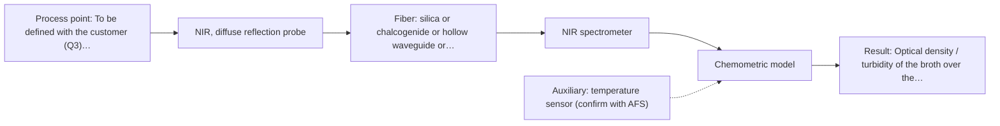
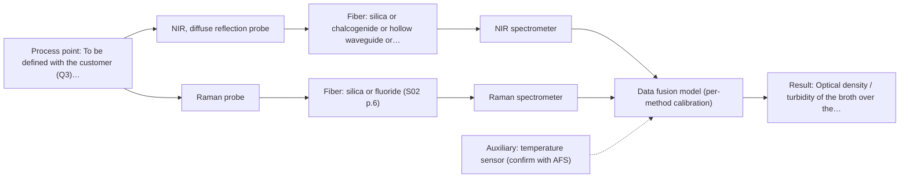

# First technical assessment: Biomass related monitoring during yeast fermentation

## Answer

**Customer request (our summary):** Customer wants an optical measurement during yeast fermentation to follow growth and detect changes earlier. Biomass and metabolic signals are mentioned but not defined as separate targets. Broth becomes more optically dense during the run. They request help setting up an initial feasibility study with reference measurements.

### Brief answer

Start with a multi-method lab trial on representative broth samples: NIR diffuse reflection as the first single method to test, since it can track both the scattering-related biomass signal and, with a chemometric calibration, major metabolites. Raman is the second single method to test for the metabolic fingerprint in the aqueous broth. Still open: the exact biomass and metabolite targets, their reference methods, and the installation point.

### Proposal

- **Best current option:** O2 (recommended)
- **Basis:** supplied AFS sources
- **What would change it:** If the metabolite targets turn out to need molecular specificity that NIR cannot deliver, or the OD range rules out reflection-based measurement, the ranking between NIR diffuse reflection, Raman and a transmission/ATR turbidity option changes.
- **Next step:** Answer the target and installation questions, then run the multi-method lab trial on representative broth samples with matched offline biomass and metabolite references.

**Secondary evidence (external, not AFS material):** G1: E01 ¶12; G2: E02 ¶31, E02 ¶82, E02 ¶36; G3: no usable external source found; G4: no usable external source found. See Expert detail.

**Decision status:** Provisional feasibility assessment

### Solution options

| ID | Tier | Methods | Confidence | Cost class, S01 Table 1 (p.6) | Ease of use | Maintenance | Performance fit | Sources |
|---|---|---|---|---|---|---|---|---|
| O1 | Simple | M3 UV-Vis, transmission/transflection probe | Low: open question: Q1 (starts at Medium); sample clarity varies; uncited auxiliary sensor | low cost (row 16) | simple probe, minimal calibration effort | low, occasional window cleaning | answers growth tracking only, cheapest start | [1: S01 p.16] [2: S01 p.16] |
| O2 | Recommended | M1 NIR, diffuse reflection probe | Low: open question: Q1 (starts at Medium); uncited auxiliary sensor | average cost (row 8) | standard fiber probe, established workflow | moderate, calibration upkeep per matrix | one probe covers biomass and major metabolites | [3: S01 p.5] [4: S01 p.10] |
| O3 | Extended (multi-method) | M4 NIR, diffuse reflection probe + Raman (combination) | Low: open question: Q1 (starts at Medium); uncited auxiliary sensor; multi-method, fusion benefit not yet shown | high cost (rows 8, 12) | two instruments, more complex operation | higher, two instruments to calibrate and monitor | adds metabolite specificity NIR may lack | [5: S01 p.16] [6: S01 p.8] [7: S01 p.8] |

*Confidence rates the basis of the advice (how much is known and cited), not a predicted accuracy or probability of success. It starts at High, or at Medium when a key question on the method or the option is open, and drops one level per weakness listed (floor Low).*

*Cost class is the relative rating in S01 Table 1 (p.6) for the in-line method+technique rows named (the highest one for a multi-method option); it is not a price.*

### Setup sketch

*Recommended option O2; drawn by code from the option, a schematic, not a configuration.*

### Key questions

1. How is biomass defined for you: units (OD, dry weight, cell count), expected concentration range, and which offline reference method (OD meter, dry weight, cell counting) will be used?
2. Which metabolites should the metabolic signal track (e.g. glucose, ethanol, glycerol), at what concentration ranges, and how will they be measured offline?
3. Where would the probe sit (in-line in the vessel or a bypass), what optical access and sterilisation/cleaning constraints apply, and how far is the measurement point from where the analyser can be placed?

## Expert detail

**Customer enquiry**

> We would like an optical measurement during yeast fermentation to help us follow growth and notice changes earlier. Our team has mentioned both a biomass signal and a metabolic signal, but these have not been defined as separate targets. The broth becomes more optically dense as the run develops. We need help turning this request into an initial feasibility study with useful reference measurements.

**Decision status:** Provisional feasibility assessment. A method shortlist can be justified from the sources, but the biomass and metabolite targets are not yet defined, so the ranking is provisional and rests on the stated assumptions and the answers to the questions above.

### Parameters

| ID | Parameter | Kind | Need | Measured by | Why | Sources |
|---|---|---|---|---|---|---|
| P1 | Biomass / cell density | quantitative | required | Reference lab method: not named | It is the stated growth-tracking target and the reference against which any optical biomass calibration is built. | *(no verified source: engineering judgement)* |
| P2 | Target metabolites (e.g. glucose, ethanol) | quantitative | required | Reference lab method: not named | The metabolic signal must be defined as named analytes with ranges before a spectral calibration for them can be built. | *(no verified source: engineering judgement)* |
| P3 | Optical density / turbidity of the broth over the run | quantitative | required | Spectroscopy: UV-Vis | It defines the physical challenge for the optical method and is itself the simplest biomass-related signal. | [1: S01 p.16] |
| P4 | Presence of intrinsic fluorescent species in the medium | qualitative | optional | Not measurable in-line by spectroscopy; alternative: offline fluorimetry or medium knowledge | It should be available from medium composition knowledge and decides whether a fluorescence channel could later add metabolic-state information. | [8: S01 p.16] |
| P5 | Broth temperature | quantitative | required | Auxiliary sensor: temperature sensor (engineering judgement: confirm availability with AFS) | Temperature affects both the spectra and the reference measurements and must be recorded to interpret the calibration. | *(no verified source: engineering judgement)* |

### Solution option details

- **O1 cost drivers:** one UV-Vis probe and spectrometer, simple turbidity calibration, offline OD references
- **O2 cost drivers:** NIR reflection probe and spectrometer, chemometric calibration on reference runs, offline biomass and metabolite references
- **O3 cost drivers:** two spectrometers and probes, synchronisation and data-fusion software, per-method calibrations, larger reference dataset
- **O3 combining methods:** Low-level fusion: NIR diffuse-reflection and Raman spectra from the same sampling spot, synchronised to a common time step, merged into one augmented matrix with block scaling so neither method dominates. Each method keeps its own calibration and diagnostics. The fused model must beat the best single method on held-out runs, otherwise the second instrument is dropped.

*Extended (multi-method) option O3; drawn by code from the option, a schematic, not a configuration.*

### Premise check

- **Precedent only:** A single optical signal can serve as the biomass measurement. Turbidity correlates with cell density, but optical density is not a viable cell count, and the enquiry does not state whether the OD rise is due to cells alone; the biomass signal needs definition and reference data. [1: S01 p.16]
- **Not covered:** One optical measurement can cover both the biomass and the metabolic signal. The sources show biomass and metabolite tracking typically addressed by different techniques (e.g. UV/Vis or NIR for turbidity, Raman for metabolites), so one method covering both is a hypothesis to test, not an established fact. [5: S01 p.16]
- **Supported:** An initial feasibility study with reference measurements is the right next step. A multi-method lab trial on representative samples followed by chemometric model development is exactly the pathway the sources describe for an undefined process request. [9: S02 p.20]

### Requirements

**Stated by the customer**

- "optical measurement during yeast fermentation"
- "follow growth and notice changes earlier"
- "The broth becomes more optically dense as the run develops"
- "a biomass signal"
- "a metabolic signal"

**Key unknowns**

- Definition of the biomass target: units, range and offline reference method
- Which metabolites define the metabolic signal and their concentration ranges
- Installation point, optical access and sterilisation/cleaning constraints
- Optical-density range over the run and the cause of the turbidity
- Required accuracy, detection limits and response time
- Distance between measurement point and analyser

### Clarification questions (most decision-relevant first)

Q1. How is biomass defined for you: units (OD, dry weight, cell count), expected concentration range, and which offline reference method (OD meter, dry weight, cell counting) will be used? *Why it matters:* The reference method and range determine whether a scattering-based optical signal can be calibrated and what accuracy is achievable. *(affects: method)*
Q2. Which metabolites should the metabolic signal track (e.g. glucose, ethanol, glycerol), at what concentration ranges, and how will they be measured offline? *Why it matters:* The metabolite set decides whether NIR chemometrics suffice or whether Raman's molecular specificity is needed. *(affects: technique, M2)*
Q3. Where would the probe sit (in-line in the vessel or a bypass), what optical access and sterilisation/cleaning constraints apply, and how far is the measurement point from where the analyser can be placed? *Why it matters:* Installation constraints and fiber distance determine which probe types and methods are practically possible. *(affects: installation)*
Q4. How much does the optical density rise over a typical run, and is the turbidity due to cells alone or also to other particles or bubbles? *Why it matters:* A large OD rise can saturate a transmission measurement, and non-cell turbidity would confound a biomass calibration. *(affects: M3)*
Q5. What accuracy, detection limits and response time do you need for the biomass and metabolite signals, and how often can offline reference samples be taken during the feasibility runs? *Why it matters:* These set the go/no-go criteria for the feasibility study and the feasible sampling design. *(affects: status)*

### Recommendation

- **M1 · Primary candidate: NIR, diffuse reflection probe.** NIR diffuse reflection handles the rising turbidity, captures the scattering-related biomass signal, and with a chemometric calibration can also track major metabolites through overtone bands. It is the standard online fiber-probe method and needs only silica fibers and glass optics. [3: S01 p.5] [4: S01 p.10]
- **M2 · Comparison candidate: Raman probe.** Raman gives a molecular fingerprint for direct detection of specific metabolites in aqueous media, complementing the NIR scattering information. The weak signal and possible fluorescence background must be checked on real broth samples. [10: S01 p.16] [11: S01 p.11]
- **M3 · Conditional candidate: UV-Vis, transmission/transflection probe.** A UV-Vis transmission or ATR measurement of turbidity is the lowest-effort biomass-related signal, since cell suspension turbidity correlates with cell density. It is a proxy, not a cell count, and transmission can saturate as the broth becomes opaque. *Conditions:* Applies if the optical-density range over the run stays within what a transmission path (or ATR if it saturates) can handle; the OD range is an open question (Q4). [1: S01 p.16] [2: S01 p.16]
- **M4 · Comparison candidate: NIR, diffuse reflection probe + Raman (combination).** Combining a scattering-based biomass signal with a Raman metabolite fingerprint is a published bioprocess pattern and a plausible way to cover both targets, but the gain is a hypothesis to test against the best single method. It requires the same sampling spot and synchronised data. *Conditions:* Only if the single-method tests show that neither NIR diffuse reflection nor Raman alone covers both targets with the required accuracy. [5: S01 p.16] Later hypothesis, after single-method tests.
- **M5 · Not recommended: fluorescence probe.** A reader might expect fluorescence from bioprocess monitoring, but no fluorescent species or indicator has been defined in this medium, and most chemicals do not fluoresce. It can be revisited if intrinsic fluorophores such as NADH or riboflavin are confirmed as targets. [12: S01 p.5]

### Measurement concept

- **Probe and geometry:** Primary concept: immersion NIR diffuse-reflection (reflection) fiber probe in the broth, with a Raman fiber probe at the same sampling spot as the second single method to test. A UV-Vis transmission or ATR probe is a low-effort turbidity option. Final geometry depends on the installation answers (Q3).
- **Location:** To be defined with the customer (Q3): in-line probe in the vessel or a bypass line, at a well-mixed spot.
- **Fiber link:** Vis-NIR silica fibers for the NIR diffuse-reflection and Raman options; long cables are stated only for low-OH silica fibers, so the required distance should be checked against the selected fiber (S02 p.7). *(no verified source: engineering judgement)*

### Spectral range

- **NIR:** Nominal NIR range 780-2500 nm; the usable range depends on the spectrometer, fiber and probe actually selected. [13: S01 p.10]
- **Raman:** Raman is reported as Raman shift in cm-1 with the laser excitation wavelength stated separately; the exact shift range and excitation wavelength depend on the selected instrument. [14: S01 p.11]
- **UV-Vis:** UV-Vis nominal sensitivity is highest in the UV region (190-360 nm); the working range for turbidity tracking depends on the selected source, probe and pathlength. [15: S01 p.5]

### Risks and uncertainty

- The turbidity rise may come from sources other than cells (particles, bubbles, CO2), which would confound a scattering-based biomass calibration. *(rules: R-GEO-6)* *(no verified source: engineering judgement)*
- NIR metabolite sensitivity may be insufficient for trace components, so the defined metabolite set could force a Raman or combined solution. *(rules: R-NIR-4)* *(no verified source: engineering judgement)*
- Raman signals may be swamped by fluorescence from medium components, which only a measurement on real broth will reveal. *(rules: R-RAM-1)* *(no verified source: engineering judgement)*
- Probe fouling and sterilisation constraints at the installation point may rule out the preferred probe geometry. *(rules: R-MIR-3)* *(no verified source: engineering judgement)*

### First feasibility experiment

1. **Collect representative broth samples across the expected chemical and physical variation: several runs, early to late, covering the full optical-density range and including any expected process changes.** Collect representative broth samples across the expected chemical and physical variation: several runs, early to late, covering the full optical-density range and including any expected process changes. *(no verified source: engineering judgement)*
2. **Take independent reference measurements on each sample: offline biomass (OD/dry weight) and offline metabolite analysis, at time points matched to the spectra.** Take independent reference measurements on each sample: offline biomass (OD/dry weight) and offline metabolite analysis, at time points matched to the spectra. *(no verified source: engineering judgement)*
3. **Measure each sample with the single candidate methods first: NIR diffuse reflection, Raman probe, and a UV-Vis transmission/ATR turbidity measurement; build one calibration per method per target.** Measure each sample with the single candidate methods first: NIR diffuse reflection, Raman probe, and a UV-Vis transmission/ATR turbidity measurement; build one calibration per method per target. *(no verified source: engineering judgement)*
4. **Only after the single-method results, test whether combining NIR and Raman data improves on the best single method, with synchronised data from the same sampling spot.** Only after the single-method results, test whether combining NIR and Raman data improves on the best single method, with synchronised data from the same sampling spot. *(no verified source: engineering judgement)*
5. **Validate all models on held-out runs or batches not used in calibration, and compare against the customer's go/no-go criteria.** Validate all models on held-out runs or batches not used in calibration, and compare against the customer's go/no-go criteria. *(no verified source: engineering judgement)*

**Reference measurements:** Offline OD or dry weight for biomass (P1) and offline biochemical analysis for each target metabolite (P2) on every sampled time point; record temperature (P5) alongside each spectrum.

**Decision basis:** Go/no-go agreed with the customer before the trial: e.g. prediction error for biomass and each target metabolite within customer-specified limits on held-out runs, and earlier detection of a defined process change than the current practice allows. The numerical criteria must come from the customer (Q5).

### Not covered by the supplied sources

- Required accuracy, detection limits and response time for the customer's specific biomass and metabolite targets are not in the supplied material and must come from the customer.

### Further notes

- **Chemometrics:** Both the biomass and the metabolite targets will need calibration or classification models built on reference data spanning the full run: NIR bands are broad and overlapping, so chemometrics are required (S01 p.10), and the calibration is specific to the medium matrix and must be validated on held-out runs. The feasibility study should therefore collect reference samples across the whole optical-density range, not only at the start and end.
- **Real-time tracking:** The request is for in-line, time-resolved tracking of growth and process changes; online measurements require high-speed spectral acquisition, and results must be available in near real time to be useful for process decisions (S01 p.5). Acquisition rate and data synchronisation should be fixed during the feasibility trial.
- **Future direction:** If the feasibility trial succeeds, a later step could be a compact customized spectral fiber sensor or multisensor system for routine in-line control, following the AFS pathway from lab trial to a tailored process solution (S02 p.20).

### Secondary evidence (external, not AFS material)

*Found by a literature search for gaps the supplied AFS sources leave open. Not AFS material and not proof for this case; every quote below was verified verbatim against the fetched text.*

**G1 · auxiliary sensor:** In-line measurement of Broth temperature with temperature sensor

- **E01 ¶12** The review states that the temperature sensitivity of the OH bands is a severe drawback for measuring aqueous solutions in NIR and MIR, making tempered sample holders necessary. *How it applies:* This links the auxiliary temperature measurement to the optical measurement itself: broth temperature should be recorded during the study because temperature variation can affect the NIR spectra used for biomass and metabolite models. *Limits and transfer risks:* The statement concerns NIR and MIR spectroscopy of aqueous solutions generally, with tempered sample holders, whereas the customer's application is in-line measurement in fermenting broth without such holders, so the impact must be assessed under real process conditions. *(supports O2)*
  > "Additionally, the temperature sensitivity of the OH bands is a severe drawback for measuring aqueous solution in NIR and MIR, which makes tempered sample holders necessary [29]."
  > A critical review of recent trends, and a future perspective of optical spectroscopy as PAT in biopharmaceutical downstream processing. (2020) · Analytical and bioanalytical chemistry · doi:10.1007/s00216-020-02407-z · https://europepmc.org/article/PMC/PMC7072065 · retrieved 2026-10-17, full text, licence: cc by, via curated library

**G2 · multi-method:** Combining several spectroscopy methods (data fusion) (Low-level fusion: NIR diffuse-reflection and Raman spectra from the same sampling spot, synchronised to a common time step, merged into one augmented matrix with block scaling so neither method dominates. Each method keeps its own calibration and diagnostics. The fused model must beat the best single method on held-out runs, otherwise the second instrument is dropped.)

- **E02 ¶31** Low-level data fusion is described as the simplest way to combine inputs, by rearranging variables from different sources into a single new data matrix placed one after the other. *How it applies:* This supports the planned augmented-matrix approach for merging NIR and Raman spectra from the same spot; in the feasibility study, the fused model should be benchmarked against the best single-method model on held-out runs before committing to a second instrument. *Limits and transfer risks:* The review is general PAT literature, not yeast fermentation or NIR/Raman specifically, and it does not state that fusion improves performance, only how it is structured. *(supports O3)*
  > "Low-level data fusion (LLDF) is considered the simplest method to achieve a combination of inputs. In this case, the data is rearranged into a new data matrix, where the variables coming from different sources are placed one after the other."
  > Challenges and Opportunities of Implementing Data Fusion in Process Analytical Technology-A Review. (2022) · Molecules (Basel, Switzerland) · doi:10.3390/molecules27154846 · https://europepmc.org/article/PMC/PMC9369811 · retrieved 2026-10-17, full text, licence: cc by, via curated library
- **E02 ¶82** The review states that before fusing data from multiple sources, the contribution of each dataset to the model and its complementarity must be evaluated. *How it applies:* This justifies keeping each method's own calibration and diagnostics during the study and checking whether the second instrument adds predictive value before it is kept. *Limits and transfer risks:* It is a general recommendation from a review, not a validated result for NIR plus Raman in fermenting broth, so the actual benefit must be demonstrated on the customer's own runs. *(supports O3)*
  > "Before fusing data from multiple sources, it is essential to evaluate the contribution of each dataset to the model and its complementarity."
  > Challenges and Opportunities of Implementing Data Fusion in Process Analytical Technology-A Review. (2022) · Molecules (Basel, Switzerland) · doi:10.3390/molecules27154846 · https://europepmc.org/article/PMC/PMC9369811 · retrieved 2026-10-17, full text, licence: cc by, via curated library
- **E02 ¶36** The review cites a Raman and FT-IR food analytical study in which instrument complementarity alone was not sufficient to improve the prediction of several CQAs. *How it applies:* This is a caution that adding a second spectroscopy method may not improve predictions, so the feasibility study should include the pre-defined condition that the fused model must beat the best single method or the second instrument is dropped. *Limits and transfer risks:* The cited example is a food application with Raman and FT-IR, not NIR and Raman in yeast fermentation, so the outcome there does not predict the result here. *(supports O3)*
  > "In some situations, instrument complementarity (not data complementarity) was not sufficient to improve the performance of predictive several CQAs, as shown by a Raman and FT-IR data based food analytical study [73]."
  > Challenges and Opportunities of Implementing Data Fusion in Process Analytical Technology-A Review. (2022) · Molecules (Basel, Switzerland) · doi:10.3390/molecules27154846 · https://europepmc.org/article/PMC/PMC9369811 · retrieved 2026-10-17, full text, licence: cc by, via curated library

**G3 · not in the supplied sources:** Required accuracy, detection limits and response time for the customer's specific biomass and metabolite targets are not in the supplied material and must come from the customer.

- No usable external source found.

**G4 · premise not covered:** One optical measurement can cover both the biomass and the metabolic signal

- No usable external source found.

### Evidence (verified quotes)

1. ✓ **S01 p.16** (general): "cell suspension turbidity correlates well with cell density."
2. ✓ **S01 p.16** (general): "extremely short path length that enables the measurement of "black" or highly scattering fluids without dilution."
3. ✓ **S01 p.5** (general): "making it ideal for online applications, including remote measurements via fiber optic probes."
4. ✓ **S01 p.10** (general): "The broad absorption bands observed in this region overlap, suggesting the use of chemometrics for quantitative and qualitative analysis of spectral data."
5. ✓ (precedent only) **S01 p.16** (method gain): "While UV/Vis tracks growth, Raman spectroscopy can be used in the same reactor to provide a "molecular fingerprint" for direct detection of specific metabolites like glucose, acetate, or lactate."
6. ✓ **S01 p.8** (general): "collected from the same small, even pinpoint, area of the sample."
7. ✓ **S01 p.8** (general): "Ultimately, the measurement data must be normalized to a common time step."
8. ✓ **S01 p.16** (general): "critical cofactors and amino acids like NADH, tryptophan, and riboflavin."
9. ✓ **S02 p.20** (general): "1. Multi-Method Lab Trials AFS tests your process using all key fiber optic spectroscopy methods."
10. ✓ **S01 p.16** (general): "Raman is particularly well-suited for aqueous environments, as it exhibits low absorbance for water molecules compared to infrared methods."
11. ✓ **S01 p.11** (general): "superposition of luminescence (fluorescence), which has a significantly higher intensity."
12. ✓ **S01 p.5** (general): "However, most chemicals do not exhibit this property."
13. ✓ **S01 p.10** (general): "NIR spectra (780-2500 nm) contain predominantly overtones and component bands of fundamental vibrations"
14. ✓ **S01 p.11** (general): "The Raman shift is used as the horizontal (spectral) axis in Raman spectroscopy"
15. ✓ **S01 p.5** (general): "It has very high sensitivity, especially in the UV region (190-360 nm)"

### Verification

- Citations verified: 22 of 22 (exact or whitespace/hyphen-tolerant match on the cited page, scope checked).
- Hard check failures before deterministic corrections: 0; still open: 0; soft warnings: 4; repair rounds: 1.
- External evidence (cache): 4 quote(s) verified verbatim (exact or whitespace/hyphen-tolerant, at most 400 characters and 2 sentences, against the cited paragraph); 1 item(s) dropped.
- External search: 5 query(ies), 5 hit(s), 4 source(s) (3 from the curated library).
- External step: 2 model call(s), 33.3 s extra (cost in the run JSON).
  - ⚠ dropped G1 E04 ¶52: quote not verified (too_long: quote longer than 400 characters (579)); figure not in its own quote: 2007

*Run D05-20261018T075900Z-b621 · models z-ai/glm-5.3-flash*
