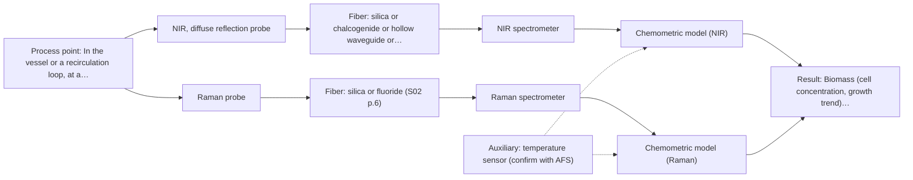
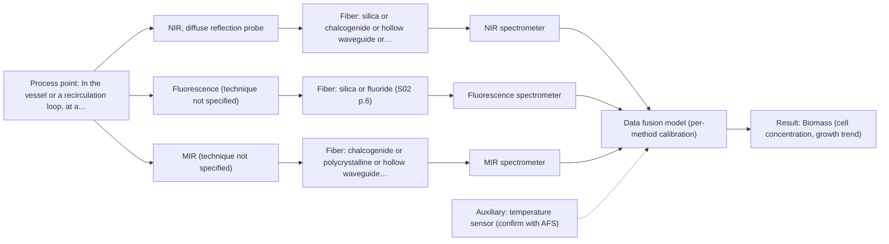

# First technical assessment: Biomass related monitoring during yeast fermentation

## Answer

**Customer request (our summary):** Customer wants an optical measurement during yeast fermentation to follow growth and notice changes earlier. They mention a biomass signal and a metabolic signal but have not defined them as separate targets. The broth becomes more optically dense as the run develops. They want help turning this into an initial feasibility study with useful reference measurements.

### Brief answer

Test a single NIR reflection probe first against offline references: it suits an increasingly turbid, scattering broth and is the usual in-line fiber method. Run Raman beside it as a separate single-method test for the metabolic signal. Fluorescence is added only if the broth proves to contain a fluorescent species; the closest published example combines NIR with fluorescence on yeast fermentation. The metabolic target, optical-density range and go/no-go figures remain open.

### Proposal

- **Best current option:** O2 (recommended)
- **Basis:** supplied AFS sources
- **What would change it:** If the metabolic species proves to be present only at trace level and Raman is swamped by fluorescence, the second method shifts toward fluorescence or MIR ATR. If the early-run broth is optically thin, a UV-Vis transmission probe becomes the simplest biomass option.
- **Next step:** Define the metabolic species and the go/no-go figures, then provide broth samples across the run for a side-by-side NIR and Raman trial with offline references.

**Secondary evidence (external, not AFS material):** G1: E01 ¶12; G2: E02 ¶31, E02 ¶82; G3: E03 ¶13; G4: no usable external source found. See Expert detail.

**Decision status:** Provisional feasibility assessment

### Solution options

| ID | Tier | Methods | Confidence | Cost class, S01 Table 1 (p.6) | Ease of use | Maintenance | Performance fit | Sources |
|---|---|---|---|---|---|---|---|---|
| O1 | Simple | M1 NIR, diffuse reflection probe | Medium: open question: Q1 (starts at Medium) | average cost (row 8) | One probe, standard glass optics | Window cleaning and scatter checks | Covers growth trend and major components | [1: S01 p.10] [2: S01 p.5] [3: S01 p.17] [4: S01 p.10] [5: REF §5] |
| O2 | Recommended | M1 NIR, diffuse reflection probe; M2 Raman probe | Medium: open question: Q1 (starts at Medium) | high cost (rows 8, 12) | Two probes, one sampling point | Two instruments, separate diagnostics | Adds metabolite fingerprint NIR may miss | [1: S01 p.10] [2: S01 p.5] [3: S01 p.17] [4: S01 p.10] [5: REF §5] [6: S01 p.16] [7: S01 p.16] [8: S01 p.11] |
| O3 | Extended (multi-method) | M3 NIR, diffuse reflection probe + Fluorescence, MIR (combination) | Low: open question: Q1 (starts at Medium); fluorescent target unknown; multi-method, fusion benefit not yet shown | at least average cost (row 8); Fluorescence row not identified; MIR row not identified | One combined probe shaft | Two spectrometers, both blocks monitored | Adds early metabolic state to growth | [9: S01 p.7] [10: S01 p.12] [11: S01 p.16] |

*Confidence rates the basis of the advice (how much is known and cited), not a predicted accuracy or probability of success. It starts at High, or at Medium when a key question on the method or the option is open, and drops one level per weakness listed (floor Low).*

*Cost class is the relative rating in S01 Table 1 (p.6) for the in-line method+technique rows named (the highest one for a multi-method option); it is not a price.*

### Setup sketch

*Recommended option O2; drawn by code from the option, a schematic, not a configuration.*

### Key questions

1. Which chemical species defines the 'metabolic signal', and over what concentration range must it be followed?
2. What is the optical-density or turbidity range across the run, and at which point does the broth stop transmitting light?
3. What accuracy, detection limit and response time must the measurement meet for the go/no-go decision?

## Expert detail

**Customer enquiry**

> We would like an optical measurement during yeast fermentation to help us follow growth and notice changes earlier. Our team has mentioned both a biomass signal and a metabolic signal, but these have not been defined as separate targets. The broth becomes more optically dense as the run develops. We need help turning this request into an initial feasibility study with useful reference measurements.

**Decision status:** Provisional feasibility assessment. The sources support a shortlist of single methods worth testing, so a provisional assessment is possible. It stays provisional because the metabolic target, the optical-density range of the broth and the reference measurements are still open.

### Parameters

| ID | Parameter | Kind | Need | Measured by | Why | Sources |
|---|---|---|---|---|---|---|
| P1 | Biomass (cell concentration, growth trend) | quantitative | required | Spectroscopy: NIR | The growth target has to be traceable both to a spectral signal and to an independent cell-mass reference. | *(no verified source: engineering judgement)* |
| P2 | Optical density / turbidity of the broth | quantitative | required | Reference lab method: offline absorbance (optical density) at a fixed wavelength | It decides whether a transmission path is usable at all and gives the cheapest growth reference series. | [12: S01 p.16] [13: REF §5] |
| P3 | Metabolic marker (species to be defined: for example glucose, acetate, lactate or ethanol) | quantitative | required | Spectroscopy: Raman | The second target is undefined, so a named metabolite with a concentration range is needed before a method can be chosen. | [7: S01 p.16] |
| P4 | Broth temperature | quantitative | optional | Auxiliary sensor: temperature sensor (engineering judgement: confirm availability with AFS) | It should be available because it is a basic process variable that must be recorded alongside the spectra to interpret run-to-run changes. | *(no verified source: engineering judgement)* |

### Solution option details

- **O1 cost drivers:** One spectrometer, one reflection probe, reference analyses
- **O2 cost drivers:** Second spectrometer and probe, more reference analyses
- **O3 cost drivers:** Combined probe, two spectrometers, fusion and calibration work
- **O3 combining methods:** Low-level fusion of NIR and fluorescence spectra into one matrix with block scaling, from a combined probe at the same spot. Acquisition must be synchronised to a common time step, and each block needs its own calibration and drift checks. The fused model must beat the best single method on held-out runs, otherwise the extra channel is dropped.

*Extended (multi-method) option O3; drawn by code from the option, a schematic, not a configuration.*

### Premise check

- **Precedent only:** A biomass signal and a metabolic signal can be separated and measured optically. A review-style source maps UV/Vis for growth and Raman for specific metabolites in the same reactor, which is a reason to test the separation, not proof that it works in this broth. [7: S01 p.16]
- **Supported:** The broth becoming more optically dense as the run develops gives useful information about growth. Turbidity is described as tracking cell density, so the optical-density trend is a usable growth indicator. It remains a proxy, not a cell count. [12: S01 p.16]

### Requirements

**Stated by the customer**

- "optical measurement during yeast fermentation"
- "Our team has mentioned both a biomass signal and a metabolic signal, but these have not been defined as separate targets."
- *Further statements: see the customer enquiry above.*

**Key unknowns**

- Identity and concentration range of the metabolic signal
- Optical-density or turbidity range across the run, and where light transmission stops
- Offline reference methods available and their sampling frequency
- Installation point, fiber run, cleaning and sterilisation requirements
- Required accuracy, detection limit and response time (go/no-go criteria)
- Whether the broth contains a usable fluorescent species

### Clarification questions (most decision-relevant first)

Q1. Which chemical species defines the 'metabolic signal', and over what concentration range must it be followed? *Why it matters:* Without a named species and range, no technique can be chosen for the second target, and Raman can only be tested blindly. *(affects: method, technique)*
Q2. What is the optical-density or turbidity range across the run, and at which point does the broth stop transmitting light? *Why it matters:* It decides whether a transmission or transflection path remains usable or whether only reflection and ATR geometries can work. *(affects: technique)*
Q3. What accuracy, detection limit and response time must the measurement meet for the go/no-go decision? *Why it matters:* These figures are the acceptance basis for the trial and are not in the supplied sources. *(affects: status)*
Q4. Where will the probe be installed (vessel wall or recirculation loop), what fiber run length is needed, and what cleaning or sterilisation is required? *Why it matters:* Installation and cleaning determine the probe geometry, window material and fiber family, and no link length for the required range is stated in the sources. *(affects: installation)*
Q5. Which offline reference methods and sampling frequency are available for biomass and for the metabolite? *Why it matters:* The calibration and the comparison against single methods rest entirely on these references. *(affects: status)*

### Recommendation

- **M1 · Primary candidate: NIR, diffuse reflection probe.** NIR is the most common in-line method with fiber probes and tolerates the scattering of an increasingly turbid broth, so one probe can follow both the scattering trend and the major organic components. Its nominal range is 780-2500 nm, and the usable range depends on the instrument, fiber and probe actually selected. *Conditions:* Applies if a flush-mounted reflection window can be kept clean enough between measurements. [1: S01 p.10] [2: S01 p.5] [3: S01 p.17] [4: S01 p.10] [5: REF §5]
- **M2 · Comparison candidate: Raman probe.** Raman is well suited to aqueous media and gives a molecular fingerprint for specific metabolites such as glucose, acetate or lactate. The signal is weak and can be swamped by fluorescence, so the background must be checked on the real broth. *Conditions:* Applies once a named metabolite has a usable Raman band and the broth's fluorescence background is acceptable at the chosen excitation wavelength. [6: S01 p.16] [7: S01 p.16] [8: S01 p.11]
- **M3 · Conditional candidate: NIR, diffuse reflection probe + Fluorescence, MIR (combination).** The closest published example to this enquiry combines NIR with fluorescence on yeast fermentation, for biomass and intra- and extracellular metabolites. Fluorescence only works if the broth contains a fluorescent species, so this stays conditional. *Conditions:* Applies only if the broth shows an intrinsic fluorescent species at usable intensity, such as NADH, tryptophan or riboflavin. [9: S01 p.7] [10: S01 p.12] [11: S01 p.16] Later hypothesis, after single-method tests.

### Measurement concept

- **Probe and geometry:** A flush-mounted NIR diffuse-reflection probe in contact with the broth, with the spectrometer set back on a fiber link.
- **Location:** In the vessel or a recirculation loop, at a point that sees the same broth throughout the run.
- **Fiber link:** Silica fibers cover the NIR range; the achievable length depends on the fiber and probe chosen and is not stated in the sources. [14: S01 p.15]

### Spectral range

- **NIR:** Nominal range 780-2500 nm. [4: S01 p.10]
- **Raman:** Raman is recorded in the visible and NIR spectral regions and reported as Raman shift in cm-1, with the laser excitation wavelength stated separately; the usable shift range depends on the laser, spectrometer and probe selected. [15: S01 p.5] [16: S01 p.11]

### Risks and uncertainty

- The metabolic signal is undefined, so the second method may end up targeting a species that does not matter to the process. *(no verified source: engineering judgement)*
- As the broth becomes more optically dense, a transmission path saturates and a growth signal can reflect scattering and window fouling rather than cell mass. *(no verified source: engineering judgement)*
- Raman may be swamped by fluorescence from the broth, while fluorescence may find no usable species at all. *(no verified source: engineering judgement)*
- Calibrations are specific to this matrix, so a change of medium, feed or strain would require them to be rebuilt. *(no verified source: engineering judgement)*

### First feasibility experiment

1. **Collect representative broth across the run: early, mid and late phase, plus at least one run with a deliberate change in feed or temperature; record optical density and temperature at every sampling point.** Cover the expected chemical and physical variation of the broth. *(no verified source: engineering judgement)*
2. **Measure independent references on each sample: dry cell weight or viable count for biomass, offline optical density, and the chosen metabolite by a laboratory method.** Provide independent reference values for calibration and comparison. *(no verified source: engineering judgement)*
3. **Measure the same samples with NIR reflection and with Raman as separate single-method tests, plus one in-line trial of each; report Raman as shift in cm-1 with the laser excitation wavelength stated separately.** Compare single methods first, on the same samples and in-line. [17: S01 p.3] [16: S01 p.11]
4. **Only if neither single method meets the agreed criteria, test the combined NIR + fluorescence probe with synchronised acquisition and one calibration per block, and compare the fused model with the best single method on held-out runs.** Test the combination only as a later hypothesis against the best single method. [18: S01 p.8] [19: S01 p.8]
5. **Set the go/no-go thresholds with the customer before the trial and validate on held-out runs or batches.** Give the trial a numerical acceptance basis supplied by the customer. [20: REF §3]

**Reference measurements:** Dry cell weight or viable count, offline optical density, and the chosen metabolite by a laboratory method.

**Decision basis:** Thresholds to be set by the customer before the trial.

### Not covered by the supplied sources

- Which offline reference methods suit this broth, and at what frequency, is not addressed by the supplied sources.
- A quantitative relationship between optical density and cell mass for this broth is not given in the sources.

### Further notes

- **Chemometrics:** Both NIR and Raman need calibration models built on reference data from this broth; NIR bands overlap strongly, and Raman calibration is matrix-specific. Plan the reference analyses at the same time points as the spectra, and re-validate if the medium, feed or strain changes.
- **Real-time tracking:** A flush-mounted probe can log continuously through the run; each spectrum must be time-stamped against the offline reference samples so that early changes can be compared with the references.
- **Future direction:** Once the informative bands are known, a compact analyser at a few selected wavelengths could replace the full spectrometer, following the multisensor route described in the sources.

### Secondary evidence (external, not AFS material)

*Found by a literature search for gaps the supplied AFS sources leave open. Not AFS material and not proof for this case; every quote below was verified verbatim against the fetched text.*

*Live search unavailable (library only: cache miss (europepmc); cache miss (openalex)); curated library only.*

**G1 · auxiliary sensor:** In-line measurement of Broth temperature with temperature sensor

- **E01 ¶12** The source notes that OH-band temperature sensitivity is a severe drawback for aqueous NIR and MIR measurement, making tempered sample holders necessary. *How it applies:* This supports including broth temperature monitoring or control and checking temperature drift when interpreting optical signals. *Limits and transfer risks:* The quote comes from a review on biopharmaceutical downstream processing and does not validate an in-line temperature sensor in yeast broth or define its placement or calibration. *(supports O2)*
  > "Additionally, the temperature sensitivity of the OH bands is a severe drawback for measuring aqueous solution in NIR and MIR, which makes tempered sample holders necessary [29]."
  > A critical review of recent trends, and a future perspective of optical spectroscopy as PAT in biopharmaceutical downstream processing. (2020) · Analytical and bioanalytical chemistry · doi:10.1007/s00216-020-02407-z · https://europepmc.org/article/PMC/PMC7072065 · retrieved 2026-10-17, full text, licence: cc by, via curated library

**G2 · multi-method:** Combining several spectroscopy methods (data fusion) (Low-level fusion of NIR and fluorescence spectra into one matrix with block scaling, from a combined probe at the same spot. Acquisition must be synchronised to a common time step, and each block needs its own calibration and drift checks. The fused model must beat the best single method on held-out runs, otherwise the extra channel is dropped.)

- **E02 ¶31** Low-level fusion is described as the simplest way to combine inputs by rearranging variables from different sources into one new data matrix. *How it applies:* This could inform building a fused NIR-plus-fluorescence matrix, but synchronisation and block scaling still need separate design and checks. *Limits and transfer risks:* The review is general PAT data fusion, not a yeast fermentation or a combined NIR/fluorescence probe, and it does not report performance on held-out runs. *(supports O3)*
  > "Low-level data fusion (LLDF) is considered the simplest method to achieve a combination of inputs. In this case, the data is rearranged into a new data matrix, where the variables coming from different sources are placed one after the other."
  > Challenges and Opportunities of Implementing Data Fusion in Process Analytical Technology-A Review. (2022) · Molecules (Basel, Switzerland) · doi:10.3390/molecules27154846 · https://europepmc.org/article/PMC/PMC9369811 · retrieved 2026-10-17, full text, licence: cc by, via curated library
- **E02 ¶82** The source advises evaluating each dataset's contribution and complementarity before fusing multiple sources. *How it applies:* This supports comparing the fused model against the best single method and dropping an extra channel if it does not add value. *Limits and transfer risks:* It is a general recommendation, not a tested NIR/fluorescence fusion in this broth, and it gives no threshold for when a fused model has beaten a single method. *(supports O3)*
  > "Before fusing data from multiple sources, it is essential to evaluate the contribution of each dataset to the model and its complementarity."
  > Challenges and Opportunities of Implementing Data Fusion in Process Analytical Technology-A Review. (2022) · Molecules (Basel, Switzerland) · doi:10.3390/molecules27154846 · https://europepmc.org/article/PMC/PMC9369811 · retrieved 2026-10-17, full text, licence: cc by, via curated library

**G3 · not in the supplied sources:** Which offline reference methods suit this broth, and at what frequency, is not addressed by the supplied sources.

- **E03 ¶13** The source says NIR spectra are harder to interpret than conventional analyses such as chromatography and UV-VIS because absorption bands overlap. *How it applies:* This could justify including conventional reference analyses alongside NIR to help interpret overlapping bands, but it does not identify broth-specific methods or sampling frequency. *Limits and transfer risks:* The context is pharmaceutical unit operations, not yeast fermentation broth, and the quote does not establish that these methods are offline or suitable at any frequency.
  > "However, a disadvantage of NIRS is that it is more difficult to interpret a signal than by using conventional analysis methods, such as chromatography, ultraviolet/visible (UV-VIS) light, and others, because the absorption bands overlap due to spectral complexity."
  > Process Analytical Technology Tools for Monitoring Pharmaceutical Unit Operations: A Control Strategy for Continuous Process Verification. (2021) · Pharmaceutics · doi:10.3390/pharmaceutics13060919 · https://europepmc.org/article/PMC/PMC8234957 · retrieved 2026-10-17, full text, licence: cc by, via curated library

**G4 · not in the supplied sources:** A quantitative relationship between optical density and cell mass for this broth is not given in the sources.

- No usable external source found.

### Evidence (verified quotes)

1. ✓ **S01 p.10** (general): "Near-IR vibrational spectroscopy (NIR) is the most common online analysis method performed using fiber optic probes."
2. ✓ **S01 p.5** (general): "NIR spectroscopy, with its relatively large penetration depth (up to several millimetres) even into dense solid samples due to low absorption and strong scattering, allows the use of ordinary glass for optics"
3. ✓ **S01 p.17** (general): "NIR Reflection is primarily used for opaque or highly concentrated dairy products, such as yogurt, butter, or whole milk concentrates."
4. ✓ **S01 p.10** (general): "NIR spectra (780-2500 nm) contain predominantly overtones and component bands of fundamental vibrations"
5. ✓ **REF §5** (general): "It is not a product specification: actual spectral coverage, fiber length, component ratings, detection limits and accuracy depend on the configuration and the sample."
6. ✓ **S01 p.16** (general): "Raman is particularly well-suited for aqueous environments, as it exhibits low absorbance for water molecules compared to infrared methods."
7. ✓ **S01 p.16** (application precedent): "While UV/Vis tracks growth, Raman spectroscopy can be used in the same reactor to provide a "molecular fingerprint" for direct detection of specific metabolites like glucose, acetate, or lactate."
8. ✓ **S01 p.11** (general): "superposition of luminescence (fluorescence), which has a significantly higher intensity."
9. ✓ **S01 p.7** (application precedent): "Thus, the combination of NIR spectroscopy with fluorescence spectroscopy demonstrated the possibility of more accurately determining the biomass content during yeast fermentation, as well as distinguishing between their intra- and extracellular metabolites."
10. ✓ **S01 p.12** (general): "Fluorescence spectroscopy can be used for multispectral measurements, for example, in combination with Mid-IR or NIR spectroscopy."
11. ✓ **S01 p.16** (general): "critical cofactors and amino acids like NADH, tryptophan, and riboflavin."
12. ✓ **S01 p.16** (general): "cell suspension turbidity correlates well with cell density."
13. ✓ **REF §5** (general): "optical density is not a viable cell count."
14. ✓ **S01 p.15** (general): "located safely away from the vibration and dust of the manufacturing floor."
15. ✓ **S01 p.5** (general): "Measurement of the weak Raman effect requires special probes but is recorded in the visible and NIR spectral regions."
16. ✓ **S01 p.11** (general): "The Raman shift is used as the horizontal (spectral) axis in Raman spectroscopy"
17. ✓ **S01 p.3** (general): "samples of incompletely known composition, in order to select the most suitable method or combination of methods."
18. ✓ **S01 p.8** (general): "the data from each method must be obtained simultaneously."
19. ✓ **S01 p.8** (general): "Variables obtained from different spectral methods are not equivalent."
20. ✓ **REF §3** (general): "Representative samples or process states, independent reference measurements, what is compared, and the basis for the go / no-go decision."

### Verification

- Citations verified: 25 of 25 (exact or whitespace/hyphen-tolerant match on the cited page, scope checked).
- Hard check failures before deterministic corrections: 0; still open: 0; soft warnings: 1; repair rounds: 1.
- External evidence (cache): 4 quote(s) verified verbatim (exact or whitespace/hyphen-tolerant, at most 400 characters and 2 sentences, against the cited paragraph); 0 item(s) dropped.
- External search: 6 query(ies), 0 hit(s), 3 source(s) (3 from the curated library); ⚠ library only: cache miss (europepmc); cache miss (openalex).
- External step: 2 model call(s), 22.5 s extra (cost in the run JSON).

*Run D05-20261018T075900Z-d88f · models deepseek/deepseek-v4.1-flash-1017*
