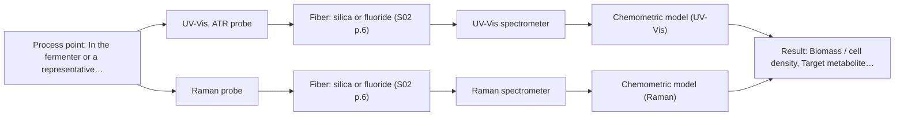
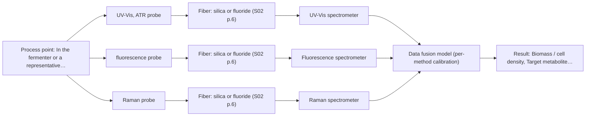

# First technical assessment: Biomass related monitoring during yeast fermentation

## Answer

**Customer request (our summary):** The customer wants to use optical measurements to monitor biomass and metabolic changes during yeast fermentation and seeks a feasibility study.

### Brief answer

Test two single methods first in a lab feasibility study: a UV-Vis ATR probe for the biomass-related turbidity signal, which tolerates the broth becoming optically dense, and a Raman probe for the metabolite fingerprint. Fluorescence is worth adding only if your team defines a fluorescent marker. Avoid NIR transmission, which fails as the broth thickens. Still open: which metabolites define the metabolic signal, the OD range, and your reference methods and go/no-go criteria.

### Proposal

- **Best current option:** O2 (recommended)
- **Basis:** supplied AFS sources
- **What would change it:** Defining the metabolite targets (Q1) and the actual OD range (Q3) could shift the technique choice, for example reopening a transflection geometry if the broth stays clear, or adding fluorescence if a fluorophore is accepted (Q5).
- **Next step:** Run a multi-method lab feasibility trial on representative broth samples with independent reference measurements, single methods first.

**Secondary evidence (external, not AFS material):** G1: E01 ¶31; G2: no usable external source found; G3: no usable external source found. See Expert detail.

**Decision status:** Provisional feasibility assessment

### Solution options

| ID | Tier | Methods | Confidence | Cost class, S01 Table 1 (p.6) | Ease of use | Maintenance | Performance fit | Sources |
|---|---|---|---|---|---|---|---|---|
| O1 | Simple | M1 UV-Vis, ATR probe | Medium: open question: Q1, Q2, Q3 (starts at Medium) | average cost (row 14) | Simple probe, low integration effort | Low; crystal cleaning and checks | Covers biomass trend only, not metabolites | [1: S01 p.16] [2: S01 p.16] |
| O2 | Recommended | M1 UV-Vis, ATR probe; M2 Raman probe | Medium: open question: Q1, Q2, Q3 (starts at Medium) | high cost (rows 12, 14) | Two lab methods, moderate effort | Moderate; two instruments to run | Tests both stated targets before committing hardware | [3: S02 p.20] [1: S01 p.16] [2: S01 p.16] [4: S01 p.16] [5: S01 p.16] |
| O3 | Extended (multi-method) | M4 UV-Vis, ATR probe + Raman (combination); M3 fluorescence probe | Low: open question: Q1 (starts at Medium); fluorescent target unknown; multi-method, fusion benefit not yet shown | high cost (rows 12, 14, 19) | Most complex; multi-instrument setup | Higher; per-method calibration and diagnostics | Covers both targets in-line if fusion beats single methods | [6: S01 p.8] [7: S01 p.8] [8: S01 p.7] [4: S01 p.16] [9: S01 p.16] [10: S01 p.5] |

*Confidence rates the basis of the advice (how much is known and cited), not a predicted accuracy or probability of success. It starts at High, or at Medium when a key question on the method or the option is open, and drops one level per weakness listed (floor Low).*

*Cost class is the relative rating in S01 Table 1 (p.6) for the in-line method+technique rows named (the highest one for a multi-method option); it is not a price.*

### Setup sketch

*Recommended option O2; drawn by code from the option, a schematic, not a configuration.*

### Key questions

1. Which specific metabolites (e.g. glucose, ethanol, organic acids) and concentration ranges should the metabolic signal track?
2. What reference measurements can you provide during the study (offline cell density, HPLC or enzymatic metabolite assays)?
3. What optical-density range does the broth reach from inoculation to the end of the run?

## Expert detail

**Customer enquiry**

> We would like an optical measurement during yeast fermentation to help us follow growth and notice changes earlier. Our team has mentioned both a biomass signal and a metabolic signal, but these have not been defined as separate targets. The broth becomes more optically dense as the run develops. We need help turning this request into an initial feasibility study with useful reference measurements.

**Decision status:** Provisional feasibility assessment. A method shortlist for a feasibility study can be justified from the supplied bioprocess material, but the two targets (biomass and metabolic signal) are still undefined, so the choice of techniques remains provisional.

### Parameters

| ID | Parameter | Kind | Need | Measured by | Why | Sources |
|---|---|---|---|---|---|---|
| P1 | Biomass / cell density | quantitative | required | Spectroscopy: UV-Vis | It is the quantity behind the requested biomass signal and the anchor for validating the turbidity-type proxy. | [11: S01 p.16] |
| P2 | Target metabolite concentrations | quantitative | required | Spectroscopy: Raman | They define the metabolic signal and the calibration targets for Raman. | [12: S01 p.16] |
| P3 | Broth optical-density range over the run | quantitative | required | Reference lab method: offline OD measurement (dilution series) | It decides whether transmission-type geometries stay viable or a short-path ATR geometry is required. | *(no verified source: engineering judgement)* |
| P4 | Presence of relevant fluorescent species | qualitative | optional | Reference lab method: lab fluorescence scan of broth samples | It should be known because it decides whether the fluorescence option (M3) can be tested at all. | [9: S01 p.16] |

### Solution option details

- **O1 cost drivers:** One UV-Vis spectrometer, one ATR probe, reference cell-density analyses
- **O2 cost drivers:** Lab trial with UV-Vis ATR and Raman, reference cell-density and metabolite assays, chemometric modelling
- **O3 cost drivers:** Two or more spectrometers, synchronised probes, fused-model development and validation
- **O3 combining methods:** Low-level fusion of UV-Vis ATR and Raman (and optionally fluorescence) spectra from the same sampling spot, synchronised to a common time step. Each method keeps its own calibration block with block scaling so no method dominates. The fused model must beat the best single method on independent runs, otherwise the extra instrument is dropped.

*Extended (multi-method) option O3; drawn by code from the option, a schematic, not a configuration.*

### Premise check

- **Precedent only:** A single optical method can deliver both the biomass signal and the metabolic signal in one measurement. The sources show UV/Vis for biomass and Raman for metabolites as separate techniques used in the same reactor, and combination only as a hypothesis; no source shows one method covering both. [1: S01 p.16] [4: S01 p.16]
- **Precedent only:** An optical-density-type signal can serve as the biomass measure the team wants. Turbidity is reported to correlate with cell density in bioprocess contexts, but it is a proxy, not a cell count; the correlation must be verified against an independent reference in this broth. [11: S01 p.16]

### Requirements

**Stated by the customer**

- Follow yeast growth during fermentation (biomass signal).
- Notice metabolic changes earlier (metabolic signal).
- Broth optical density increases over the run.
- An initial feasibility study with useful reference measurements.

**Key unknowns**

- Which metabolites and concentration ranges define the metabolic signal
- Expected optical-density range of the broth during the run
- Available reference methods (cell density, metabolite analysis) for calibration
- Reactor installation point, access and sterilisation constraints
- Whether a defined fluorescent species or indicator is relevant

### Clarification questions (most decision-relevant first)

Q1. Which specific metabolites (e.g. glucose, ethanol, organic acids) and concentration ranges should the metabolic signal track? *Why it matters:* The metabolite targets decide whether Raman, NIR or fluorescence is the right second method and what calibration data are needed. *(affects: method, M2, M3)*
Q2. What reference measurements can you provide during the study (offline cell density, HPLC or enzymatic metabolite assays)? *Why it matters:* Without independent reference data no calibration or go/no-go judgement is possible. *(affects: status, M1, M2)*
Q3. What optical-density range does the broth reach from inoculation to the end of the run? *Why it matters:* The OD range decides whether a transmission-type geometry stays viable or an ATR-type short-path geometry is needed. *(affects: technique, M1, M5)*
Q4. Where would a probe be installed (port, side glass, recirculation loop) and what sterilisation or cleaning constraints apply? *Why it matters:* Installation constraints determine probe type, crystal material and fouling risk before any hardware is specified. *(affects: installation)*
Q5. Is there a fluorescent species or indicator (e.g. NADH-related signal) your team would accept as the metabolic marker? *Why it matters:* Fluorescence only works for defined fluorophores, so this decides whether the fluorescence option can be tested at all. *(affects: M3)*

### Recommendation

- **M1 · Primary candidate: UV-Vis, ATR probe.** Turbidity-type signals are reported to track cell density in bioprocesses, and the ATR geometry keeps working as the broth becomes optically dense, where transmission saturates. It is the simplest route to the biomass signal. *Conditions:* The turbidity-to-cell-density correlation must be verified against an independent reference in this broth. [1: S01 p.16] [2: S01 p.16]
- **M2 · Comparison candidate: Raman probe.** Raman gives a molecular fingerprint for direct metabolite detection and tolerates water better than infrared methods, fitting an aqueous fermentation broth. Signal weakness and fluorescence background must be checked on real broth. [4: S01 p.16] [5: S01 p.16]
- **M3 · Conditional candidate: fluorescence probe.** Fluorescence is used in bioprocesses for intrinsic fluorophores such as NADH, tryptophan and riboflavin and could serve as a sensitive metabolic-state signal. It only applies if a defined fluorescent species or indicator is accepted as the marker. *Conditions:* Applies only if the customer identifies a fluorescent species or accepts an intrinsic-fluorophore indicator (Q5). [9: S01 p.16] [10: S01 p.5]
- **M4 · Comparison candidate: UV-Vis, ATR probe + Raman (combination).** A later hypothesis: fusing the biomass-oriented UV-Vis signal with the Raman metabolite fingerprint may cover both targets better than either single method. Any gain must be shown against the best single method on independent runs. *Conditions:* Test only after the single-method trials (M1, M2) show which alone is insufficient. [8: S01 p.7] [4: S01 p.16]
- **M5 · Not recommended: NIR, transmission/transflection probe.** The customer's broth becomes more optically dense during the run, and transmission fails when the sample becomes too thick or opaque for light to penetrate. A transflection probe could be revisited only if the measured OD range turns out low (Q3). [13: S01 p.18]

### Measurement concept

- **Probe and geometry:** Immersion UV-Vis ATR probe for the biomass/turbidity signal; Raman fiber probe at the same sampling zone for the metabolite fingerprint; fluorescence probe only if a fluorophore is defined.
- **Location:** In the fermenter or a representative sidestream at the same point for all methods.
- **Fiber link:** Silica fibers for UV-Vis and Raman; the achievable link length depends on the selected configuration and is not stated in the sources. [14: S01 p.16]

### Spectral range

- **UV-Vis:** Nominal UV-Vis range with high sensitivity especially at 190-360 nm; the usable range depends on the instrument, fiber and probe selected. [15: S01 p.5]
- **Raman:** Raman is reported in Raman shift (cm-1) with the laser excitation wavelength stated separately; excitation wavelength to be chosen in the study. [16: S01 p.11]

### Risks and uncertainty

- The turbidity signal is a proxy, not a cell count, so it may drift with morphology or media changes unless anchored to an independent reference. *(rules: R-UV-2)* *(no verified source: engineering judgement)*
- Raman signals are weak and can be swamped by fluorescence background from the broth or the fiber jacket. *(rules: R-RAM-1, R-FIB-4)* [17: S01 p.11]
- Any calibration will be specific to this broth matrix and must be re-validated after media or process changes. *(rules: R-CAL-1)* *(no verified source: engineering judgement)*
- An immersed ATR-type probe samples only a surface layer a few micrometres deep, so fouling and surface representativeness in a heterogeneous broth are risks. *(rules: R-MIR-3, R-GEN-5)* [18: S01 p.13]

### First feasibility experiment

1. **Collect representative broth samples across the expected variation: several runs, early to late stages, covering the full OD range and any media differences.** Represent the chemical and physical variation the method must handle. *(no verified source: engineering judgement)*
2. **Take independent reference measurements on each sample: offline cell density (e.g. dry weight or count) and metabolite concentrations by the customer's lab method.** Provide the ground truth for calibration and go/no-go criteria. *(no verified source: engineering judgement)*
3. **Measure each sample with the single methods first: UV-Vis ATR for the biomass-related signal and Raman probe for metabolite features; add fluorescence only if a fluorophore is defined.** Establish what each single method can and cannot see before any combination. *(no verified source: engineering judgement)*
4. **Build preliminary calibrations/classifications per method and validate them on held-out runs or batches not used in modelling.** Estimate real predictive performance rather than fit quality. *(no verified source: engineering judgement)*
5. **Apply the customer's go/no-go criteria (accuracy and early-warning targets to be defined by the customer) and only then consider a combined UV-Vis + Raman option against the best single method.** Decide whether single methods suffice or fusion is justified. [3: S02 p.20]

**Reference measurements:** Offline cell density and metabolite assays supplied by the customer (Q2); without them no calibration or go/no-go decision is possible.

**Decision basis:** Customer-defined numerical criteria for biomass-tracking accuracy and early detection of metabolic changes; these figures are not in the sources and must come from the customer.

### Assumptions

- The broth is aqueous and the process is a standard yeast fermentation at ambient-to-moderate temperature; extremes would change the probe specification.
- The feasibility study runs on lab-scale samples before any in-line installation.

### Not covered by the supplied sources

- Yeast-specific metabolite targets and their concentration ranges are not covered by the supplied material; the bioprocess examples name glucose, acetate and lactate generically.

### Further notes

- **Chemometrics:** Each method needs its own calibration against the reference measurements (cell density, metabolite assays); validate on held-out runs and use scatter-appropriate preprocessing, since physical turbidity variation can mimic composition change.
- **Real-time tracking:** The goal is continuous in-line tracking of growth and metabolic changes; acquisition rate and time resolution should be set so early changes are captured, and any fused data must be normalised to a common time step.
- **Future direction:** If the feasibility study succeeds, a compact dedicated sensor configuration for the validated method(s) can be considered later for routine in-line use.

### Secondary evidence (external, not AFS material)

*Found by a literature search for gaps the supplied AFS sources leave open. Not AFS material and not proof for this case; every quote below was verified verbatim against the fetched text.*

*Live search unavailable (library only: cache miss (europepmc); cache miss (openalex)); curated library only.*

**G1 · multi-method:** Combining several spectroscopy methods (data fusion) (Low-level fusion of UV-Vis ATR and Raman (and optionally fluorescence) spectra from the same sampling spot, synchronised to a common time step. Each method keeps its own calibration block with block scaling so no method dominates. The fused model must beat the best single method on independent runs, otherwise the extra instrument is dropped.)

- **E01 ¶31** Low-level data fusion is considered the simplest method to achieve a combination of inputs by rearranging data into a new matrix where variables from different sources are placed one after the other. *How it applies:* This supports testing whether combining multiple spectroscopic inputs via low-level fusion improves monitoring compared to single methods. Careful evaluation of each dataset's contribution remains necessary. *Limits and transfer risks:* The reviewed literature discusses general or different chemical matrices rather than yeast fermentation, so transferability across matrices and scales is uncertain. *(supports O3)*
  > "Low-level data fusion (LLDF) is considered the simplest method to achieve a combination of inputs. In this case, the data is rearranged into a new data matrix, where the variables coming from different sources are placed one after the other."
  > Challenges and Opportunities of Implementing Data Fusion in Process Analytical Technology-A Review. (2022) · Molecules (Basel, Switzerland) · doi:10.3390/molecules27154846 · https://europepmc.org/article/PMC/PMC9369811 · retrieved 2026-10-17, full text, licence: cc by, via curated library

**G2 · not in the supplied sources:** Yeast-specific metabolite targets and their concentration ranges are not covered by the supplied material; the bioprocess examples name glucose, acetate and lactate generically.

- No usable external source found.

**G3 · parameter without a source:** Measuring Broth optical-density range over the run: It decides whether transmission-type geometries stay viable or a short-path ATR geometry is required.

- No usable external source found.

### Evidence (verified quotes)

1. ✓ **S01 p.16** (application precedent): "UV/Vis spectroscopy can be deployed as a low-cost, robust tool for real-time biomass monitoring, as cell suspension turbidity correlates well with cell density."
2. ✓ **S01 p.16** (general): "extremely short path length that enables the measurement of "black" or highly scattering fluids without dilution."
3. ✓ **S02 p.20** (general): "1. Multi-Method Lab Trials AFS tests your process using all key fiber optic spectroscopy methods."
4. ✓ **S01 p.16** (application precedent): "Raman spectroscopy can be used in the same reactor to provide a "molecular fingerprint" for direct detection of specific metabolites like glucose, acetate, or lactate."
5. ✓ **S01 p.16** (general): "Raman is particularly well-suited for aqueous environments, as it exhibits low absorbance for water molecules compared to infrared methods."
6. ✓ **S01 p.8** (general): "the data from each method must be obtained simultaneously."
7. ✓ **S01 p.8** (general): "If the variables have different units of measurement, the data should be normalized in some way, for example, using an autoscaling algorithm."
8. ✓ (precedent only) **S01 p.7** (method gain): "The analysis of such systems may require a combination of two or even more spectral methods."
9. ✓ **S01 p.16** (application precedent): "critical cofactors and amino acids like NADH, tryptophan, and riboflavin."
10. ✓ **S01 p.5** (general): "However, most chemicals do not exhibit this property."
11. ✓ **S01 p.16** (application precedent): "cell suspension turbidity correlates well with cell density."
12. ✓ **S01 p.16** (application precedent): "direct detection of specific metabolites like glucose, acetate, or lactate."
13. ✓ **S01 p.18** (general): "it fails when the milk becomes too "thick" or fat-rich, as the light cannot penetrate the sample."
14. ✓ **S01 p.16** (general): "In these high-OD scenarios, a UV-ATR (Attenuated Total Reflection) probe is used."
15. ✓ **S01 p.5** (general): "It has very high sensitivity, especially in the UV region (190-360 nm)"
16. ✓ **S01 p.11** (general): "The Raman shift is used as the horizontal (spectral) axis in Raman spectroscopy"
17. ✓ **S01 p.11** (general): "superposition of luminescence (fluorescence), which has a significantly higher intensity."
18. ✓ **S01 p.13** (general): "typically at a depth of few microns"

### Verification

- Citations verified: 24 of 24 (exact or whitespace/hyphen-tolerant match on the cited page, scope checked).
- Hard check failures before deterministic corrections: 0; still open: 0; soft warnings: 3; repair rounds: 0.
- External evidence (cache): 1 quote(s) verified verbatim (exact or whitespace/hyphen-tolerant, at most 400 characters and 2 sentences, against the cited paragraph); 0 item(s) dropped.
- External search: 3 query(ies), 0 hit(s), 3 source(s) (3 from the curated library); ⚠ library only: cache miss (europepmc); cache miss (openalex).
- External step: 2 model call(s), 2.3 s extra (cost in the run JSON).

*Run D05-20261018T075900Z-d894 · models google/gemini-3.5-flash-lite, z-ai/glm-5.3-flash*
