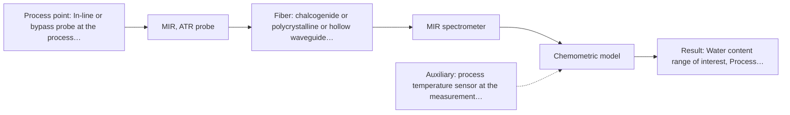

# First technical assessment: Water content in a petroleum stream

## Answer

**Customer request (our summary):** Customer handles a petroleum stream, currently determines water content by sending samples to a laboratory, and wants to investigate a fiber based measurement closer to the process with the analyzer outside the process area. They explicitly ask what to clarify and what a first comparison experiment should establish.

### Brief answer

Test mid-infrared ATR first: a fiber ATR probe measuring water in petroleum is a shown application precedent, and ATR suits direct in-line contact. Near-infrared transmission or transflection is a worthwhile comparison if the stream is optically clear. Open points that decide the design: the water range and accuracy needed, the stream's optical clarity and temperature, and the fiber distance plus hazardous-area constraints between sample point and analyzer location.

### Proposal

- **Best current option:** O2 (recommended)
- **Basis:** supplied AFS sources
- **What would change it:** A long required fiber distance with mid-IR, or heavy fouling at the sample point, would shift the choice toward NIR or Raman; a turbid or emulsified stream would rule out transmission techniques.
- **Next step:** Answer Q1-Q3 and collect representative samples across the water range for the offline mid-IR ATR comparison against the laboratory reference.

**Secondary evidence (external, not AFS material):** G1: E03 ¶3, E03 ¶1; G2: no usable external source found; G3: no usable external source found; G4: no usable external source found. See Expert detail.

**Decision status:** Provisional feasibility assessment

### Solution options

| ID | Tier | Methods | Confidence | Cost class, S01 Table 1 (p.6) | Ease of use | Maintenance | Performance fit | Sources |
|---|---|---|---|---|---|---|---|---|
| O1 | Simple | M1 MIR, ATR probe; M2 NIR, transmission/transflection probe | Low: open question: Q1 (starts at Medium); sample clarity unknown; uncited auxiliary sensor and a parameter is not measurable in-line | high cost (rows 2, 7) | straightforward offline lab work | none during lab trial | answers method choice cheaply before hardware commitment | [1: S02 p.13] [2: S01 p.10] [3: S01 p.5] [4: S01 p.18] |
| O2 | Recommended | M1 MIR, ATR probe | Low: open question: Q1 (starts at Medium); uncited auxiliary sensor | high cost (row 2) | continuous in-line, needs fouling control | periodic crystal cleaning and calibration checks | direct in-line water reading with strong mid-IR selectivity | [1: S02 p.13] [2: S01 p.10] |

*Confidence rates the basis of the advice (how much is known and cited), not a predicted accuracy or probability of success. It starts at High, or at Medium when a key question on the method or the option is open, and drops one level per weakness listed (floor Low).*

*Cost class is the relative rating in S01 Table 1 (p.6) for the in-line method+technique rows named (the highest one for a multi-method option); it is not a price.*

### Setup sketch

*Recommended option O2; drawn by code from the option, a schematic, not a configuration.*

### Key questions

1. What water content range and what accuracy or detection limit does the process need?
2. What is the distance and route between the sample point and the analyzer location, and what is the hazardous-area classification at the probe?
3. Is the stream optically clear, turbid or opaque, and is water present dissolved, as emulsion or as free water? At what temperature and pressure?

## Expert detail

**Customer enquiry**

> We handle a petroleum stream and currently send samples to a laboratory for water determination. We want to investigate a fiber based measurement closer to the process so that changes can be noticed sooner. The analyzer would be outside the process area. Before selecting equipment, we need to know what to clarify and what a first comparison experiment should establish.

**Decision status:** Provisional feasibility assessment. A method shortlist can be justified from the shown water-in-petroleum ATR application and general method properties, but the stream's optical behaviour, the required accuracy and the fiber distance are unknown, so the assessment stays provisional.

### Parameters

| ID | Parameter | Kind | Need | Measured by | Why | Sources |
|---|---|---|---|---|---|---|
| P1 | Water content range of interest | quantitative | required | Reference lab method: not named | It defines the calibration range and the go/no-go accuracy criteria for the trial. | *(no verified source: engineering judgement)* |
| P2 | Optical clarity of the stream (clear, turbid, opaque) | qualitative | required | Not measurable in-line by spectroscopy; alternative: offline optical assessment of samples during the lab trial | It decides whether a transmission/transflection technique is viable or an ATR or reflection geometry is needed. | *(no verified source: engineering judgement)* |
| P3 | Process temperature at the sample point | quantitative | required | Auxiliary sensor: process temperature sensor at the measurement point (engineering judgement: confirm availability with AFS) | Temperature shifts spectral band positions and water band shapes, so it must be known and compensated in the calibration. | *(no verified source: engineering judgement)* |
| P4 | Water phase state (dissolved, emulsion, free water) | qualitative | required | Reference lab method: not named | Free water or emulsions change what the measured spectrum represents and may exceed what a surface-layer technique sees. | *(no verified source: engineering judgement)* |

### Solution option details

- **O1 cost drivers:** sample collection, two probe types on loan, laboratory reference analyses, chemometric modelling time
- **O2 cost drivers:** mid-IR ATR probe and spectrometer, fiber link engineering, installation and cleaning provision, calibration maintenance

### Premise check

- **Precedent only:** A fiber-based measurement closer to the process would notice changes sooner than the current laboratory workflow. Online fiber-probe analysis giving near-real-time results is described generally, but the actual response time depends on the installation and is not quantified for this stream. [5: S01 p.2]
- **Precedent only:** The analyzer can be located outside the process area with a fiber link to the sample point. Long remote cables are stated only for silica fibers; the mid-IR fiber samples shown are short laboratory lengths, so a remote mid-IR analyzer is plausible but its link length is unproven in the sources. [6: S02 p.7]

### Requirements

**Stated by the customer**

- "We handle a petroleum stream"
- "currently send samples to a laboratory for water determination"
- "investigate a fiber based measurement closer to the process"
- *Further statements: see the customer enquiry above.*

**Key unknowns**

- Water content range and required accuracy or detection limit
- Optical clarity of the stream (clear, turbid, opaque) and whether water is dissolved, emulsified or free
- Distance between sample point and analyzer location, and hazardous-area classification
- Fouling and cleaning situation at the measurement point
- Laboratory reference method and its uncertainty

### Clarification questions (most decision-relevant first)

Q1. What water content range and what accuracy or detection limit does the process need? *Why it matters:* The range and required accuracy decide which method sensitivity is adequate and define the go/no-go criteria for the trial. *(affects: method, technique)*
Q2. What is the distance and route between the sample point and the analyzer location, and what is the hazardous-area classification at the probe? *Why it matters:* Long remote cables are stated only for silica fibers, while no source states an achievable length for a mid-IR fiber link, so distance may rule mid-IR in or out. *(affects: installation)*
Q3. Is the stream optically clear, turbid or opaque, and is water present dissolved, as emulsion or as free water? At what temperature and pressure? *Why it matters:* Transmission techniques fail when light cannot penetrate the sample, and free water versus dissolved water changes what the spectrum can represent. *(affects: technique)*
Q4. What fouling, wax or asphaltene deposition is expected at the proposed measurement point, and how would the probe be cleaned or accessed? *Why it matters:* ATR probes sample only a surface layer a few micrometres deep, so crystal fouling directly corrupts the reading. *(affects: installation)*
Q5. Which laboratory method is used for water determination, and what is its own uncertainty? *Why it matters:* The reference method and its uncertainty define what the spectroscopic comparison can be validated against. *(affects: status)*

### Recommendation

- **M1 · Primary candidate: MIR, ATR probe.** Water in petroleum measured with ATR probes is a shown application in the supplied material, and ATR suits direct in-line liquid contact. Mid-IR spectra have well-defined bands, giving good selectivity for the water signal. [1: S02 p.13] [2: S01 p.10]
- **M2 · Comparison candidate: NIR, transmission/transflection probe.** NIR is the standard online fiber-probe method and allows long silica cables to a remote analyzer, but transmission fails when the sample is too opaque or fat-rich. Its suitability for this stream is unknown until clarity is checked. *Conditions:* Applies only if the stream is transparent or semi-transparent enough for a defined, controlled optical pathlength; otherwise drop it. [3: S01 p.5] [4: S01 p.18]
- **M3 · Conditional candidate: Raman probe.** Raman tolerates water and aqueous media better than infrared methods and passed screening with a fiber probe. Its weak signal and possible fluorescence background from petroleum components make it a fallback to test rather than the first choice. *Conditions:* Applies only if the mid-IR fiber link to the remote analyzer proves impractical or fouling rules out ATR; fluorescence background from the petroleum must be checked first. [7: S01 p.16]

### Measurement concept

- **Probe and geometry:** Primary: immersion ATR fiber probe (mid-IR, e.g. ZrO2 or diamond ATR tip). Comparison: NIR transmission or transflection probe if the stream is clear.
- **Location:** In-line or bypass probe at the process stream, spectrometer outside the process area connected by fiber.
- **Fiber link:** Mid-IR ATR needs mid-IR-transmitting fiber (CIR or PIR); no supplied source states an achievable length for such a link, so the analyzer distance is a deciding question. Vis-NIR silica fibers are stated for robust long cables enabling remote industrial process-control. [1: S02 p.13]

### Spectral range

- **MIR:** Mid-IR nominal range 4000-400 cm-1 (2.5-25 µm); the usable range depends on the selected fiber (CIR or PIR) and ATR crystal. [8: S01 p.9]
- **NIR:** NIR nominal range 780-2500 nm; the usable range depends on the spectrometer, fiber and probe actually selected. [9: S01 p.10]

### Risks and uncertainty

- ATR reads only a surface layer a few micrometres deep, so crystal fouling or a non-representative surface can corrupt the water reading. *(rules: R-MIR-3)* [10: S01 p.13]
- No supplied source states an achievable length for a mid-IR fiber link, so the required analyzer distance could make the primary option impractical. *(rules: R-FIB-2)* [11: S02 p.9]
- If the stream is opaque or emulsified, the NIR transmission comparison fails and only contact techniques remain. *(rules: R-GEO-2)* [4: S01 p.18]
- The calibration is matrix-specific; changes in petroleum composition or temperature can degrade it and require re-validation. *(rules: R-CAL-1)* [12: S01 p.10]

### First feasibility experiment

1. **Collect representative petroleum samples spanning the expected water content range, temperature and matrix variation.** Cover the expected chemical and physical variation of the stream. *(no verified source: engineering judgement)*
2. **Measure water content of each sample with the laboratory reference method.** Provide the independent reference for calibration and validation. *(no verified source: engineering judgement)*
3. **Record mid-IR ATR spectra of each sample with a fiber ATR probe; if samples are optically clear, also record NIR transmission/transflection spectra.** Compare the candidate methods on identical samples. [1: S02 p.13]
4. **Build a calibration per method against the reference values and validate on held-out samples.** Establish whether the spectral information supports the required accuracy. *(no verified source: engineering judgement)*
5. **If the offline result is positive, run a short in-line side-by-side trial at the sample point, including a fouling check.** Confirm the result survives real installation conditions before committing hardware. *(no verified source: engineering judgement)*

**Reference measurements:** Laboratory water determination on every sample (Q5 method), taken at the same time as the spectral measurement.

**Decision basis:** Go/no-go against the customer's required water range and accuracy (Q1): the spectroscopic result must meet those criteria on held-out samples with the laboratory method as reference.

### Not covered by the supplied sources

- Achievable fiber link length for a mid-IR (CIR/PIR) probe to a remote analyzer
- Water detection limits or accuracy achievable in petroleum for any of the candidate methods
- Behaviour of the specific petroleum matrix (crude versus refined, emulsions) in any spectroscopic method

### Further notes

- **Chemometrics:** Water in petroleum will require a chemometric calibration against the laboratory reference, covering the expected water range, temperature and matrix variation; validate on held-out samples before any in-line use.
- **Real-time tracking:** The aim is earlier detection of water changes in-line; once calibrated, the fiber probe gives continuous tracking, with the achievable response time set by acquisition and the installation, to be confirmed in the side-by-side trial.

### Secondary evidence (external, not AFS material)

*Found by a literature search for gaps the supplied AFS sources leave open. Not AFS material and not proof for this case; every quote below was verified verbatim against the fetched text.*

*Live search unavailable (library only: cache miss (europepmc); cache miss (openalex)); curated library only.*

**G1 · auxiliary sensor:** In-line measurement of Process temperature at the sample point with process temperature sensor at the measurement point

- **E03 ¶3** Temperature is identified as a factor that can strongly affect NIR model performance, because shifts in the water absorbance bands with temperature can reduce model performance. *How it applies:* This is a reason to measure temperature at the sample point (as in O2) and to test how temperature variation across the expected process range affects the water model. A first comparison experiment could include spectra at several temperatures to check for band shifts. *Limits and transfer risks:* The finding concerns NIR spectra of kiwifruit juice, not mid-IR spectra of petroleum, so the magnitude and direction of temperature effects may differ. It is a published sensitivity observation, not evidence that any specific sensor or compensation approach works for this stream. *(supports O2)*
  > "A factor that can strongly affect NIR model performance is temperature [8]. Shifts in the water absorbance bands with temperature can reduce model performance [9,10,11,12]."
  > Correction of Temperature Variation with Independent Water Samples to Predict Soluble Solids Content of Kiwifruit Juice Using NIR Spectroscopy. (2022) · Molecules (Basel, Switzerland) · doi:10.3390/molecules27020504 · https://europepmc.org/article/PMC/PMC8777915 · retrieved 2026-10-17, full text, licence: cc by, via curated library
- **E03 ¶1** In the studied juice, increasing temperature mainly caused a lateral wavelength shift in the first overtone region and a vertical amplitude shift in the second overtone region of water. *How it applies:* It suggests concrete spectral signatures of temperature influence (wavelength and amplitude shifts of water bands) that a comparison experiment could look for when varying temperature at the measurement point. *Limits and transfer risks:* Derived from NIR overtone regions of water in kiwifruit juice; petroleum matrices and mid-IR methods may show different temperature behaviour. It does not quantify any accuracy or detection limit. *(supports O2)*
  > "The influence of increasing temperature on the peak absorbance of the juice was largely a lateral wavelength shift in the first overtone region and a vertical amplitude shift in the second overtone region of water."
  > Correction of Temperature Variation with Independent Water Samples to Predict Soluble Solids Content of Kiwifruit Juice Using NIR Spectroscopy. (2022) · Molecules (Basel, Switzerland) · doi:10.3390/molecules27020504 · https://europepmc.org/article/PMC/PMC8777915 · retrieved 2026-10-17, full text, licence: cc by, via curated library

**G2 · not in the supplied sources:** Achievable fiber link length for a mid-IR (CIR/PIR) probe to a remote analyzer

- No usable external source found.

**G3 · not in the supplied sources:** Water detection limits or accuracy achievable in petroleum for any of the candidate methods

- No usable external source found.

**G4 · not in the supplied sources:** Behaviour of the specific petroleum matrix (crude versus refined, emulsions) in any spectroscopic method

- No usable external source found.

### Evidence (verified quotes)

1. ✓ **S02 p.13** (application precedent): "Application: measurement of water content in petroleum"
2. ✓ **S01 p.10** (general): "Probe-based analysis is gaining widespread use in online analysis, such as in-line, in-process (chemical, biotechnological, natural) environments"
3. ✓ **S01 p.5** (general): "making it ideal for online applications, including remote measurements via fiber optic probes."
4. ✓ **S01 p.18** (general): "it fails when the milk becomes too "thick" or fat-rich, as the light cannot penetrate the sample."
5. ✓ **S01 p.2** (general): "enabling on-site online analysis and obtaining results in near real time"
6. ✓ **S02 p.7** (general): "Robust 100-300m cables made with Silica fibers of low OH-content (<0.1ppm OH) enable remote industrial process-control"
7. ✓ **S01 p.16** (general): "Raman is particularly well-suited for aqueous environments, as it exhibits low absorbance for water molecules compared to infrared methods."
8. ✓ **S01 p.9** (general): "Vibrational spectroscopy in the mid-IR range (4000-400 cm-1) is one of the most informative methods of chemical analysis."
9. ✓ **S01 p.10** (general): "NIR spectra (780-2500 nm) contain predominantly overtones and component bands of fundamental vibrations"
10. ✓ **S01 p.13** (general): "typically at a depth of few microns"
11. ✓ **S02 p.9** (general): "HWG-750-2m PIR 600/700 -2m"
12. ✓ **S01 p.10** (general): "The broad absorption bands observed in this region overlap, suggesting the use of chemometrics for quantitative and qualitative analysis of spectral data."

### Verification

- Citations verified: 16 of 16 (exact or whitespace/hyphen-tolerant match on the cited page, scope checked).
- Hard check failures before deterministic corrections: 0; still open: 0; soft warnings: 1; repair rounds: 1.
- External evidence (cache): 2 quote(s) verified verbatim (exact or whitespace/hyphen-tolerant, at most 400 characters and 2 sentences, against the cited paragraph); 0 item(s) dropped.
- External search: 6 query(ies), 0 hit(s), 3 source(s) (3 from the curated library); ⚠ library only: cache miss (europepmc); cache miss (openalex).
- External step: 2 model call(s), 17.7 s extra (cost in the run JSON).

*Run D06-20261018T075900Z-1d74 · models z-ai/glm-5.3-flash*
