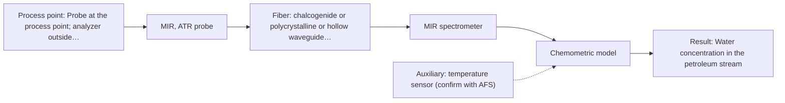
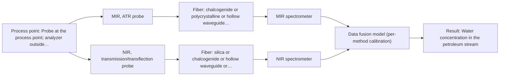

# First technical assessment: Water content in a petroleum stream

## Answer

**Customer request (our summary):** Customer handles a petroleum stream, currently uses laboratory water determination, and wants to investigate a fiber-based measurement closer to the process with the analyzer outside the process area, so changes can be noticed sooner. They ask what to clarify and what a first comparison experiment should establish before selecting equipment.

### Brief answer

Start with a single-method MIR-ATR test, because a supplied example shows water content in petroleum measured with ATR probes; compare it with NIR transmission/transflection only if the stream is clear enough. The first experiment should compare both against your laboratory water method on representative samples. Still open are the water range and phase, stream state, required response time, and the fiber route from process to analyzer.

### Proposal

- **Best current option:** O2 (recommended)
- **Basis:** supplied AFS sources
- **What would change it:** If the stream is opaque or emulsified, or if the water range is outside MIR-ATR capability, NIR or the combined option would move ahead; if the laboratory reference is unsuitable, the comparison cannot decide.
- **Next step:** Run the first comparison on representative samples against the laboratory water method, starting with MIR-ATR and NIR as separate single-method tests.

**Secondary evidence (external, not AFS material):** G1: E02 ¶12, E01 ¶19; G2: E03 ¶31, E03 ¶82; G3: no usable external source found; G4: no usable external source found. See Expert detail.

**Decision status:** Provisional feasibility assessment

### Solution options

| ID | Tier | Methods | Confidence | Cost class, S01 Table 1 (p.6) | Ease of use | Maintenance | Performance fit | Sources |
|---|---|---|---|---|---|---|---|---|
| O1 | Simple | M2 NIR, transmission/transflection probe | Low: open question: Q1 (starts at Medium); physical state unknown, sample clarity unknown | average cost (row 7) | standard silica optics, simple flow cell | window cleaning and pathlength checks | least effort if stream is clear | [1: S01 p.10] [2: S01 p.18] [3: S01 p.18] |
| O2 | Recommended | M1 MIR, ATR probe | Low: open question: Q1 (starts at Medium); physical state unknown, sample clarity unknown; precedent only; a parameter is not measurable in-line | high cost (row 2) | ATR contact probe, moderate handling | crystal cleaning and fouling checks | best fit from petroleum-water precedent | [4: S02 p.13] [5: S04 p.4] |
| O3 | Extended (multi-method) | M3 MIR, ATR probe + NIR (combination) | Low: open question: Q1 (starts at Medium); physical state unknown, sample clarity unknown; a parameter is not measurable in-line; multi-method, fusion benefit not yet shown | high cost (rows 2, 7) | two probes need synchronisation | two calibrations and two cleanings | only if single methods miss fractions | [6: S01 p.7] [7: S01 p.8] [8: S01 p.8] |

*Confidence rates the basis of the advice (how much is known and cited), not a predicted accuracy or probability of success. It starts at High, or at Medium when a key question on the method or the option is open, and drops one level per weakness listed (floor Low).*

*Cost class is the relative rating in S01 Table 1 (p.6) for the in-line method+technique rows named (the highest one for a multi-method option); it is not a price.*

### Setup sketch

*Recommended option O2; drawn by code from the option, a schematic, not a configuration.*

### Key questions

1. What water concentration range, required accuracy, detection limit and response time must the measurement meet?
2. What is the water phase and the stream's physical state at the measurement point: clear liquid, opaque emulsion, free water or gas?
3. Where will the probe sit, what is the distance and routing to an analyzer outside the process area, and what are the temperature, pressure and area-classification conditions?

## Expert detail

**Customer enquiry**

> We handle a petroleum stream and currently send samples to a laboratory for water determination. We want to investigate a fiber based measurement closer to the process so that changes can be noticed sooner. The analyzer would be outside the process area. Before selecting equipment, we need to know what to clarify and what a first comparison experiment should establish.

**Decision status:** Provisional feasibility assessment. No central premise is contradicted; the petroleum-water MIR-ATR example is a precedent, not proof. The stream state, water range and reference method are open, so the shortlist is provisional.

### Parameters

| ID | Parameter | Kind | Need | Measured by | Why | Sources |
|---|---|---|---|---|---|---|
| P1 | Water concentration in the petroleum stream | quantitative | required | Spectroscopy: MIR | This is the target the customer wants to follow sooner than the laboratory result. | [4: S02 p.13] |
| P2 | Water phase or speciation: dissolved, emulsified or free water | qualitative | required | Not measurable in-line by spectroscopy; alternative: laboratory water-phase separation or the customer's existing water-determination method | It determines whether a surface ATR measurement or a bulk transmission measurement represents the stream. | *(no verified source: engineering judgement)* |
| P3 | Stream temperature at the measurement point | quantitative | optional | Auxiliary sensor: temperature sensor (engineering judgement: confirm availability with AFS) | It should be available to compare spectra and to keep the MIR-ATR and NIR calibrations valid. | *(no verified source: engineering judgement)* |

### Solution option details

- **O1 cost drivers:** NIR spectrometer, silica fiber probe, flow cell, calibration
- **O2 cost drivers:** MIR spectrometer, ATR probe, IR fiber, calibration
- **O3 cost drivers:** two spectrometers, two probes, synchronisation, fusion modelling
- **O3 combining methods:** Low-level fusion of synchronised MIR-ATR and NIR transmission/transflection spectra, with block scaling so neither method dominates. Both probes must view the same stream volume and time step; each method needs its own calibration. The fused model must beat the best single method on held-out runs, otherwise drop the extra method.

*Extended (multi-method) option O3; drawn by code from the option, a schematic, not a configuration.*

### Premise check

- **Supported:** A fiber-based measurement closer to the process will make changes noticeable sooner. The source describes in-process fiber-probe analysis without sampling and states that it removes delays. [9: S01 p.3]
- **Not covered:** The existing laboratory water determination is suitable as the reference for a first comparison experiment. No supplied source describes the customer's laboratory method or its uncertainty; the guidance only states that a feasibility plan needs independent reference measurements. *(no verified source: engineering judgement)*
- **Precedent only:** A fiber-based measurement is an appropriate method to investigate for this petroleum stream. A supplied example shows water content in petroleum measured with ATR probes, which is a reason to test, not proof for this stream. [4: S02 p.13] [10: S01 p.10]

### Requirements

**Stated by the customer**

- Water determination in a petroleum stream.
- Fiber-based measurement closer to the process so changes can be noticed sooner.
- Analyzer located outside the process area.
- Before equipment selection, clarify what to establish in a first comparison experiment.

**Key unknowns**

- Water concentration range, required accuracy, detection limit and response time.
- Water phase and speciation: dissolved, emulsified or free water.
- Stream physical state and optical regime at the measurement point.
- Process temperature, pressure, installation distance and area classification.
- Laboratory reference method, sampling procedure and uncertainty.
- Fouling, cleaning and maintenance requirements.

### Clarification questions (most decision-relevant first)

Q1. What water concentration range, required accuracy, detection limit and response time must the measurement meet? *Why it matters:* These figures decide whether a single method can meet the target and which method is worth testing first. *(affects: method)*
Q2. What is the water phase and the stream's physical state at the measurement point: clear liquid, opaque emulsion, free water or gas? *Why it matters:* This decides whether an ATR contact probe, a transmission path or a diffuse-reflection geometry is appropriate. *(affects: technique)*
Q3. Where will the probe sit, what is the distance and routing to an analyzer outside the process area, and what are the temperature, pressure and area-classification conditions? *Why it matters:* These constraints affect the fiber family, probe design and installation feasibility. *(affects: installation)*
Q4. Which laboratory method and sampling procedure give the reference water values, and what is their uncertainty? *Why it matters:* The first comparison cannot decide anything if the reference values are not independent and comparable. *(affects: status)*
Q5. What are the stream composition, additives, fouling tendency, flow and pipe conditions at the proposed point? *Why it matters:* These factors affect probe fouling, calibration stability and whether the primary MIR-ATR option remains representative. *(affects: M1)*

### Recommendation

- **M1 · Primary candidate: MIR, ATR probe.** MIR-ATR has a supplied precedent for water content in petroleum and suits liquid or soft-solid contact measurements. It is the single method to test first for water changes. *Conditions:* Use only if the stream is a liquid or paste that can wet the ATR crystal and if the water level is within the method's usable range, which is unknown. [4: S02 p.13] [5: S04 p.4]
- **M2 · Comparison candidate: NIR, transmission/transflection probe.** NIR transmission/transflection is the most common online fiber method and can sample a defined path through clear liquids. It is a useful cross-check against MIR-ATR, but its fit depends on low scattering and a controlled pathlength. *Conditions:* Test only if the stream is transparent or semi-transparent and a pathlength in the 1-10 mm range is practical. [1: S01 p.10] [2: S01 p.18] [3: S01 p.18]
- **M3 · Conditional candidate: MIR, ATR probe + NIR (combination).** If single-method tests show that MIR-ATR misses free or emulsified water while NIR sees bulk water, the two methods may be complementary and should be compared with the best single method. Any gain is a hypothesis, not an established result. *Conditions:* Only after single-method tests, and only if both methods can view the same stream location and their data can be synchronised. [6: S01 p.7] [7: S01 p.8] [8: S01 p.8]

### Measurement concept

- **Probe and geometry:** Start with an ATR fiber probe in contact with the liquid or soft-solid stream; compare with a NIR transmission or transflection probe only if the stream is clear enough and a controlled pathlength is practical.
- **Location:** Probe at the process point; analyzer outside the process area, with the fiber route and length still to be defined.
- **Fiber link:** Fiber family depends on the chosen method; MIR needs a fiber that transmits the mid-IR range, while NIR can use silica fibers. No link length is stated here. *(no verified source: engineering judgement)*

### Spectral range

- **MIR:** Nominal MIR range is 4000-400 cm-1; the usable range depends on the instrument, fiber and ATR probe selected. [11: S01 p.9]
- **NIR:** Nominal NIR range is 780-2500 nm; the usable range depends on the instrument, fiber and probe selected. [12: S01 p.10]

### Risks and uncertainty

- The stream may be opaque, emulsified or contain free water, so a surface ATR reading may not represent the bulk and NIR transmission may fail. *(no verified source: engineering judgement)*
- Water concentration may be below the detection capability of the chosen method; the sources give no detection limit for this stream. *(no verified source: engineering judgement)*
- The customer's laboratory water determination may not be independent or comparable enough to serve as a reference. *(no verified source: engineering judgement)*
- The analyzer may be outside the process area but the required fiber length, routing, temperature and safety conditions are unknown and could rule out a configuration. *(no verified source: engineering judgement)*

### First feasibility experiment

1. **Collect representative petroleum-stream samples or process states across the expected water range, water phases, temperatures and flow conditions; include duplicates and normal variation.** To cover the chemical and physical variation the method must handle. [13: REF §3]
2. **Measure each sample independently by the customer's laboratory water method and record its uncertainty and sampling procedure.** To provide an independent reference for comparison. [13: REF §3]
3. **Run MIR-ATR (M1) and NIR transmission/transflection (M2) as separate single-method tests on the same samples, recording probe, pathlength and measurement conditions.** To compare each method alone before any combination. *(no verified source: engineering judgement)*
4. **Only if a single method cannot cover the water range or phases, run the combined MIR-ATR + NIR test with synchronised data and per-method calibration.** To test the combination as a later hypothesis against the best single method. [8: S01 p.8]
5. **Check on held-out runs or batches and set the go/no-go with the customer's numerical accuracy, repeatability and response-time criteria; compare each method and any fusion against the best single method.** To decide with the customer's criteria whether a method is worth taking forward. [14: REF §5]

**Reference measurements:** Customer's laboratory water determination, with its uncertainty and sampling procedure recorded.

**Decision basis:** Go/no-go uses the customer's numerical accuracy, repeatability and response-time criteria and agreement with the laboratory reference on held-out runs or batches.

### Assumptions

- The stream is a liquid or paste that can contact an ATR crystal.
- The laboratory method can provide independent reference values for the first comparison.
- A single method may be enough; the combination is only a later hypothesis.

### Not covered by the supplied sources

- Water concentration range, detection limit, accuracy and response time for this petroleum stream.
- The water phase and the stream's physical state: clear, opaque, emulsified or free water.
- A usable MIR fiber length or routing from the process to an analyzer outside the process area.
- Area classification and safety requirements for the installation.
- The customer's laboratory water method and its uncertainty.
- A demonstrated detection limit for water in petroleum by the cited ATR example.

### Further notes

- **Chemometrics:** MIR-ATR and NIR water calibrations are matrix-specific; build them on representative petroleum samples and re-check after stream composition changes.
- **Real-time tracking:** The aim is earlier notice of water changes; define whether the measurement must be continuous, time-resolved or a short cycle, because that sets the acquisition and synchronisation needs.
- **Future direction:** If single-method tests show different water fractions are missed, a combined MIR-ATR/NIR probe or a dedicated water sensor could be considered later.

### Secondary evidence (external, not AFS material)

*Found by a literature search for gaps the supplied AFS sources leave open. Not AFS material and not proof for this case; every quote below was verified verbatim against the fetched text.*

*Live search unavailable (library only: cache miss (europepmc); cache miss (openalex)); curated library only.*

**G1 · auxiliary sensor:** In-line measurement of Stream temperature at the measurement point with temperature sensor

- **E02 ¶12** The source states that OH bands in NIR and MIR are temperature-sensitive when measuring aqueous solutions, so tempered sample holders are necessary. *How it applies:* For the MIR ATR option, this supports measuring or controlling stream temperature at the probe and testing temperature variation during the comparison. *Limits and transfer risks:* The source is a review of biopharmaceutical downstream processing and refers to aqueous solutions, not a petroleum stream; it does not establish an in-line temperature-sensor design. *(supports O2)*
  > "Additionally, the temperature sensitivity of the OH bands is a severe drawback for measuring aqueous solution in NIR and MIR, which makes tempered sample holders necessary [29]."
  > A critical review of recent trends, and a future perspective of optical spectroscopy as PAT in biopharmaceutical downstream processing. (2020) · Analytical and bioanalytical chemistry · doi:10.1007/s00216-020-02407-z · https://europepmc.org/article/PMC/PMC7072065 · retrieved 2026-10-17, full text, licence: cc by, via curated library
- **E01 ¶19** In the cited study, temperature was varied together with concentration and ionic strength to obtain a robust model. *How it applies:* This supports treating temperature as a calibration variable and checking it at the measurement point when assessing the MIR ATR option. *Limits and transfer risks:* The work concerns reactive liquid-liquid extraction in lithium recycling, not petroleum; it is model-development evidence rather than proof of an in-line temperature sensor. *(supports O2)*
  > "The concentrations of nitric acid and hydrochloric acid as well as the ionic strength and temperature were varied to obtain a robust model."
  > Process Analytical Technology-Integrated FT-IR and Raman Spectroscopies for Efficient Reactive Liquid-Liquid Extraction Processing in Lithium Recycling. (2025) · ACS omega · doi:10.1021/acsomega.5c05705 · https://europepmc.org/article/PMC/PMC12573149 · retrieved 2026-10-17, full text, licence: cc by, via curated library

**G2 · multi-method:** Combining several spectroscopy methods (data fusion) (Low-level fusion of synchronised MIR-ATR and NIR transmission/transflection spectra, with block scaling so neither method dominates. Both probes must view the same stream volume and time step; each method needs its own calibration. The fused model must beat the best single method on held-out runs, otherwise drop the extra method.)

- **E03 ¶31** Low-level data fusion is described as combining inputs by placing variables from different sources one after the other in a new data matrix. *How it applies:* For the extended MIR ATR option, this is a basis for testing whether synchronised MIR-ATR and NIR variables can be concatenated and whether the fused model beats the best single method on held-out runs. *Limits and transfer risks:* The source is a general review of data fusion in process analytical technology, not a petroleum study, and the quoted paragraph does not address block scaling or probe synchronisation. *(supports O3)*
  > "Low-level data fusion (LLDF) is considered the simplest method to achieve a combination of inputs. In this case, the data is rearranged into a new data matrix, where the variables coming from different sources are placed one after the other."
  > Challenges and Opportunities of Implementing Data Fusion in Process Analytical Technology-A Review. (2022) · Molecules (Basel, Switzerland) · doi:10.3390/molecules27154846 · https://europepmc.org/article/PMC/PMC9369811 · retrieved 2026-10-17, full text, licence: cc by, via curated library
- **E03 ¶82** The source says that before fusing data from multiple sources, the contribution of each dataset and its complementarity should be evaluated. *How it applies:* This supports a first comparison that checks whether NIR adds useful information to MIR ATR before keeping the extra method in the fused model. *Limits and transfer risks:* The source is a general review, not a petroleum-stream experiment; it does not show that fusion will improve performance for this application. *(supports O3)*
  > "Before fusing data from multiple sources, it is essential to evaluate the contribution of each dataset to the model and its complementarity."
  > Challenges and Opportunities of Implementing Data Fusion in Process Analytical Technology-A Review. (2022) · Molecules (Basel, Switzerland) · doi:10.3390/molecules27154846 · https://europepmc.org/article/PMC/PMC9369811 · retrieved 2026-10-17, full text, licence: cc by, via curated library

**G3 · not in the supplied sources:** Water concentration range, detection limit, accuracy and response time for this petroleum stream.

- No usable external source found.

**G4 · not in the supplied sources:** The water phase and the stream's physical state: clear, opaque, emulsified or free water.

- No usable external source found.

### Evidence (verified quotes)

1. ✓ **S01 p.10** (general): "Near-IR vibrational spectroscopy (NIR) is the most common online analysis method performed using fiber optic probes."
2. ✓ **S01 p.18** (general): "Transmission is the preferred method for transparent or semi-transparent liquids, such as skim milk, whey, or permeate."
3. ✓ (precedent only) **S01 p.18** (performance figure): "the precise control of the optical pathlength (usually 1 - 10 mm)"
4. ✓ **S02 p.13** (application precedent): "Application: measurement of water content in petroleum"
5. ✓ **S04 p.4** (general): "suitability of analyzed samples for ATR measurements, which is true for liquid or soft solid samples and their components, allowing a tight contact with the probe head."
6. ✓ (precedent only) **S01 p.7** (method gain): "The analysis of such systems may require a combination of two or even more spectral methods."
7. ✓ **S01 p.8** (general): "It is crucial that the spectral information obtained by different methods-Mid-IR, NIR, Raman, and fluorescence spectra-is collected from the same small, even pinpoint, area of the sample."
8. ✓ **S01 p.8** (general): "the data from each method must be obtained simultaneously."
9. ✓ **S01 p.3** (general): "It allows for in-process analysis, i.e., directly in the process flow or reactor without sampling, eliminating delays and the risk of sample contamination."
10. ✓ **S01 p.10** (general): "ATR fiber probes (Fig.1) enable the analysis of liquids and solid elastic samples"
11. ✓ **S01 p.9** (general): "Vibrational spectroscopy in the mid-IR range (4000-400 cm-1) is one of the most informative methods of chemical analysis."
12. ✓ **S01 p.10** (general): "NIR spectra (780-2500 nm) contain predominantly overtones and component bands of fundamental vibrations"
13. ✓ **REF §3** (general): "Representative samples or process states, independent reference measurements, what is compared, and the basis for the go / no-go decision."
14. ✓ **REF §5** (general): "compare with the best single method."

### Verification

- Citations verified: 18 of 18 (exact or whitespace/hyphen-tolerant match on the cited page, scope checked).
- Hard check failures before deterministic corrections: 0; still open: 0; soft warnings: 3; repair rounds: 0.
- Corrected deterministically after verification (1):
  - ⚠ recommendations[2].combined_with: combined_with normalised to ['NIR'] (duplicates and the entry's own method removed)
- External evidence (cache): 4 quote(s) verified verbatim (exact or whitespace/hyphen-tolerant, at most 400 characters and 2 sentences, against the cited paragraph); 0 item(s) dropped.
- External search: 6 query(ies), 0 hit(s), 3 source(s) (3 from the curated library); ⚠ library only: cache miss (europepmc); cache miss (openalex).
- External step: 2 model call(s), 17.8 s extra (cost in the run JSON).

*Run D06-20261018T075900Z-3fca · models deepseek/deepseek-v4.1-flash-1017*
