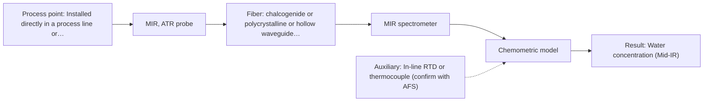

# First technical assessment: Water content in a petroleum stream

## Answer

**Customer request (our summary):** The customer wants to know what parameters to clarify and what initial comparison experiment to perform before selecting a fiber-based optical spectroscopy system to monitor water in a petroleum process stream from an analyzer located outside the process area.

### Brief answer

Mid-IR ATR spectroscopy is recommended as the primary method to test first, supported by demonstrated precedent for measuring water in petroleum. Near-IR transmission is a conditional alternative if the distance to the analyzer outside the process area requires silica cabling. Target water concentration, stream transparency, and physical distance must be clarified before finalizing equipment selection.

### Proposal

- **Best current option:** O1 (recommended)
- **Basis:** supplied AFS sources
- **What would change it:** If the physical routing distance to the analyzer outside the process area exceeds mid-IR fiber transmission limits, or if the stream is transparent with sufficiently high water content, near-IR transmission (O2) would become the preferred approach.
- **Next step:** Obtain target water concentration ranges and distance to the analyzer shelter, then initiate benchtop multi-method trials on representative stream samples.

**Secondary evidence (external, not AFS material):** G1: no usable external source found; G2: no usable external source found; G3: no usable external source found; G4: no usable external source found. See Expert detail.

**Decision status:** Provisional feasibility assessment

### Solution options

| ID | Tier | Methods | Confidence | Cost class, S01 Table 1 (p.6) | Ease of use | Maintenance | Performance fit | Sources |
|---|---|---|---|---|---|---|---|---|
| O1 | Recommended | M1 MIR, ATR probe | Medium: open question: Q1, Q2, Q3 (starts at Medium) | high cost (row 2) | Direct probe immersion in stream | Periodic crystal cleaning and checking | Direct fundamental water band sensitivity | [1: S02 p.13] [2: S01 p.10] [3: S01 p.9] |
| O2 | Simple | M2 NIR, transmission/transflection probe | Low: open question: Q1, Q2, Q3 (starts at Medium); sample clarity unknown | average cost (row 7) | Standard silica fiber probe handling | Flow cell optical window cleaning | Enables long remote fiber run | [4: S02 p.7] [5: S01 p.18] [6: S01 p.16] |

*Confidence rates the basis of the advice (how much is known and cited), not a predicted accuracy or probability of success. It starts at High, or at Medium when a key question on the method or the option is open, and drops one level per weakness listed (floor Low).*

*Cost class is the relative rating in S01 Table 1 (p.6) for the in-line method+technique rows named (the highest one for a multi-method option); it is not a price.*

### Setup sketch

*Recommended option O1; drawn by code from the option, a schematic, not a configuration.*

### Key questions

1. What is the expected water concentration range and required detection limit in the petroleum stream?
2. What is the physical cable distance between the probe installation tap and the analyzer location outside the process area?
3. What is the optical clarity and phase state of the petroleum stream (e.g., clear refined distillate vs. opaque crude; dissolved vs. emulsified water)?

## Expert detail

**Customer enquiry**

> We handle a petroleum stream and currently send samples to a laboratory for water determination. We want to investigate a fiber based measurement closer to the process so that changes can be noticed sooner. The analyzer would be outside the process area. Before selecting equipment, we need to know what to clarify and what a first comparison experiment should establish.

**Decision status:** Provisional feasibility assessment. A provisional assessment is provided because mid-IR ATR has demonstrated technical precedent for water determination in petroleum, while key installation parameters including distance to the remote analyzer and target concentration range remain to be clarified.

### Parameters

| ID | Parameter | Kind | Need | Measured by | Why | Sources |
|---|---|---|---|---|---|---|
| P1 | Water concentration (Mid-IR) | quantitative | required | Spectroscopy: MIR | Target analyte concentration required to detect process upsets and monitor product quality. | [1: S02 p.13] |
| P2 | Water concentration (Near-IR) | quantitative | optional | Spectroscopy: NIR | Alternative measurement approach if remote routing distance mandates silica optical fibers. | [7: S01 p.10] |
| P3 | Laboratory reference water content | quantitative | required | Reference lab method: Karl Fischer titration or laboratory distillation | Primary analytical standard required to train and validate spectroscopic calibration models. | *(no verified source: engineering judgement)* |
| P4 | Process stream temperature | quantitative | optional | Auxiliary sensor: In-line RTD or thermocouple (engineering judgement: confirm availability with AFS) | Temperature variations alter water solubility in hydrocarbons and shift vibrational band baselines. | *(no verified source: engineering judgement)* |

### Solution option details

- **O1 cost drivers:** FTIR spectrometer and mid-IR fiber cable
- **O2 cost drivers:** Standard near-IR spectrometer and silica cabling

### Premise check

- **Precedent only:** Water content in petroleum can be determined in-line using fiber-optic spectroscopy. Mid-IR ATR has demonstrated precedent for measuring water content in petroleum in a laboratory setting, which serves as a technical basis to test rather than operational proof for a new stream. [1: S02 p.13]
- **Supported:** The spectrometer can be located remotely outside the process area linked via optical fibers. Silica fiber cables enable remote industrial process control, but long-distance transmission is not documented in the sources for mid-IR fibers. [4: S02 p.7]

### Requirements

**Stated by the customer**

- Fiber-based optical measurement closer to the process to replace or supplement off-line laboratory water determination.
- Detection of process changes faster than off-line sampling.
- Analyzer positioned outside the process area.

**Key unknowns**

- Expected water concentration range (trace ppm vs. percent levels) and target detection limit.
- Physical distance between the in-line sampling point and the analyzer location outside the process area.
- Optical regime and physical state of the petroleum stream (transparent vs. opaque; dissolved vs. free water droplets).
- Process operating temperature, pressure, flow rate, and hazardous area classification.
- Potential fouling mechanisms (waxes, asphaltenes, or scale adhering to optical probe surfaces).
- Current laboratory reference method and its measurement precision.

### Clarification questions (most decision-relevant first)

Q1. What is the expected water concentration range and required detection limit in the petroleum stream? *Why it matters:* Determines whether near-IR overtone sensitivity is sufficient or if mid-IR fundamental absorption is required. *(affects: method)*
Q2. What is the physical cable distance between the probe installation tap and the analyzer location outside the process area? *Why it matters:* Long fiber runs favor silica fibers used in near-IR, whereas mid-IR fibers exhibit higher attenuation and short laboratory lengths in available sources. *(affects: method, installation)*
Q3. What is the optical clarity and phase state of the petroleum stream (e.g., clear refined distillate vs. opaque crude; dissolved vs. emulsified water)? *Why it matters:* Heavy opacity or scattering prevents transmission measurements, and droplet morphology alters sampling representativeness. *(affects: method, technique)*
Q4. What are the line temperature, pressure, flow rate, and Ex/ATEX zone classification at the sampling point? *Why it matters:* Dictates probe mechanical construction, crystal seal materials, and installation safety requirements. *(affects: installation)*
Q5. What specific laboratory reference method (e.g., Karl Fischer titration) is currently used, and what is its precision? *Why it matters:* Establishes the quantitative accuracy target and quality of reference data needed to calibrate multivariate models. *(affects: status)*

### Recommendation

- **M1 · Primary candidate: MIR, ATR probe.** Mid-IR ATR has direct demonstrated application precedent for measuring water in petroleum. It detects fundamental OH vibrational absorption without being blinded by high bulk sample opacity. *Conditions:* The physical distance to the analyzer must remain within achievable mid-IR fiber cable limits and the stream must maintain clean crystal contact. [1: S02 p.13] [2: S01 p.10] [3: S01 p.9]
- **M2 · Conditional candidate: NIR, transmission/transflection probe.** Near-IR spectroscopy utilizes silica fibers that enable remote industrial process control to an analyzer shelter. It serves as a practical alternative if the stream is optically transparent and water levels are sufficiently high. *Conditions:* Applies if the physical distance requires silica fiber links and the hydrocarbon stream has sufficient optical transmission across a controlled pathlength. [4: S02 p.7] [5: S01 p.18] [6: S01 p.16]

### Measurement concept

- **Probe and geometry:** An immersion mid-IR ATR probe with a ZrO2 or diamond crystal head, or alternatively an in-line near-IR transmission/transflection flow cell with an adjustable optical pathlength.
- **Location:** Installed directly in a process line or conditioning bypass loop, with the spectrometer console positioned safely in an analyzer shelter outside the process area.
- **Fiber link:** Polycrystalline infrared (PIR) or chalcogenide (CIR) fibers for mid-IR, or low-OH silica optical fiber cables supporting remote process monitoring for near-IR. [4: S02 p.7] [8: S01 p.15] [2: S01 p.10]

### Spectral range

- **MIR:** The nominal mid-IR range is 4000 to 400 cm-1 (2.5 to 25 µm); usable spectral coverage depends on the specific spectrometer, ATR crystal, and PIR/CIR fiber transmission. [3: S01 p.9] [9: REF §5]
- **NIR:** The nominal near-IR range is 780 to 2500 nm; usable range depends on the instrument detector, light source, and silica fiber transmission windows. [7: S01 p.10] [9: REF §5]

### Risks and uncertainty

- If the petroleum stream is dark, heavy, or highly scattering, near-IR transmission signals will saturate and fail. *(rules: R-GEO-2)* [10: S01 p.18]
- Achievable mid-IR fiber cable lengths may be insufficient to bridge the physical distance to an analyzer outside the process area. *(rules: R-FIB-1, R-FIB-2)* [4: S02 p.7]
- Mid-IR ATR samples only a depth of a few micrometres, making the measurement vulnerable to surface fouling from waxes, asphaltenes, or deposits. *(rules: R-MIR-2, R-MIR-3)* [11: S01 p.13] [12: REF §5]
- Near-IR spectroscopy may lack the sensitivity required to detect trace moisture below 0.1 percent in hydrocarbons. *(rules: R-NIR-4)* [6: S01 p.16]

### First feasibility experiment

1. **Collect representative petroleum stream samples reflecting the expected range of water content, hydrocarbon matrix variations, and process temperatures.** Ensure the calibration dataset encompasses real-world chemical and physical stream fluctuations. [13: REF §3]
2. **Perform comparative off-line benchtop measurements using mid-IR ATR and near-IR transmission on static and stirred petroleum samples across varying water concentrations.** Establish whether water absorption bands are clearly detectable above hydrocarbon background and assess pathlength limits. [14: S01 p.3]
3. **Analyze split samples concurrently with the established laboratory reference method (e.g., Karl Fischer titration).** Provide primary analytical truth data for quantitative calibration and limit-of-detection calculations. [13: REF §3]
4. **Build and cross-validate multivariate regression models, evaluating performance on an independent held-out validation batch.** Determine prediction precision, bias, and stability against hydrocarbon composition changes without overfitting. [15: S01 p.5]
5. **Evaluate optical signal attenuation across the required fiber link distance and examine probe fouling under continuous contact with the flowing petroleum stream.** Verify operational signal-to-noise ratio over remote fiber routing and assess maintenance cleaning intervals. [4: S02 p.7]

**Reference measurements:** Independent off-line laboratory water determination (such as Karl Fischer titration) performed on identical sample aliquots.

**Decision basis:** Go/no-go is determined by customer-defined precision and detection limits relative to laboratory titration, together with signal stability across the required fiber run.

### Assumptions

- The petroleum stream remains liquid and flowing under process operating conditions.
- Water is sufficiently dispersed or dissolved at the probe location to permit representative optical sampling.
- An established laboratory reference procedure is available to supply benchmark quantitative values.

### Not covered by the supplied sources

- Maximum achievable link length and attenuation limits for mid-IR polycrystalline (PIR) fiber cables in industrial conduits.
- Explosion-proof (Ex/ATEX) certifications and housing designs for optical probe assemblies in classified petroleum areas.

### Further notes

- **Chemometrics:** A multivariate calibration model (such as PLS regression) is required to resolve water absorption bands from fluctuating hydrocarbon background absorption and baseline variations. Because optical models are matrix-dependent, changes in crude source or distillation cut will require model re-validation.
- **Real-time tracking:** In-line optical measurement enables continuous, real-time monitoring of moisture trends, providing prompt notification of upstream dehydration failures or water breakthrough compared to slow laboratory sampling cycles.
- **Future direction:** Following successful water monitoring, the spectral baseline and hydrocarbon absorption regions could be investigated for tracking product properties such as aromatic content or API blending consistency.

### Secondary evidence (external, not AFS material)

*Found by a literature search for gaps the supplied AFS sources leave open. Not AFS material and not proof for this case; every quote below was verified verbatim against the fetched text.*

*Live search unavailable (library only: cache miss (europepmc); cache miss (openalex)); curated library only.*

**G1 · auxiliary sensor:** In-line measurement of Process stream temperature with In-line RTD or thermocouple

- No usable external source found.

**G2 · not in the supplied sources:** Maximum achievable link length and attenuation limits for mid-IR polycrystalline (PIR) fiber cables in industrial conduits.

- No usable external source found.

**G3 · not in the supplied sources:** Explosion-proof (Ex/ATEX) certifications and housing designs for optical probe assemblies in classified petroleum areas.

- No usable external source found.

**G4 · parameter without a source:** Measuring Laboratory reference water content: Primary analytical standard required to train and validate spectroscopic calibration models.

- No usable external source found.

### Evidence (verified quotes)

1. ✓ **S02 p.13** (application precedent): "Application: measurement of water content in petroleum"
2. ✓ **S01 p.10** (general): "ATR fiber probes (Fig.1) enable the analysis of liquids and solid elastic samples"
3. ✓ **S01 p.9** (general): "Vibrational spectroscopy in the mid-IR range (4000-400 cm-1) is one of the most informative methods of chemical analysis."
4. ✓ **S02 p.7** (general): "Robust 100-300m cables made with Silica fibers of low OH-content (<0.1ppm OH) enable remote industrial process-control"
5. ✓ **S01 p.18** (application precedent): "Transmission is the preferred method for transparent or semi-transparent liquids, such as skim milk, whey, or permeate."
6. ✓ **S01 p.16** (general): "may lack the sensitivity to detect trace compounds below 0.1 percent."
7. ✓ **S01 p.10** (general): "NIR spectra (780-2500 nm) contain predominantly overtones and component bands of fundamental vibrations of molecules and atomic groups, such as -OH, -NH2=NH, -CH3, =CH2, ≥CH, etc., found in many organic and inorganic compounds."
8. ✓ **S01 p.15** (general): "located safely away from the vibration and dust of the manufacturing floor."
9. ✓ **REF §5** (general): "It is not a product specification: actual spectral coverage, fiber length, component ratings, detection limits and accuracy depend on the configuration and the sample."
10. ✓ **S01 p.18** (general): "it fails when the milk becomes too "thick" or fat-rich, as the light cannot penetrate the sample."
11. ✓ **S01 p.13** (general): "typically at a depth of few microns"
12. ✓ **REF §5** (general): "Usable range limited by fiber and crystal; contact, fouling, compatibility."
13. ✓ **REF §3** (general): "Representative samples or process states, independent reference measurements, what is compared, and the basis for the go / no-go decision."
14. ✓ **S01 p.3** (general): "samples of incompletely known composition, in order to select the most suitable method or combination of methods."
15. ✓ **S01 p.5** (general): "Chemometric algorithms are implemented in specialized software that enables preliminary data preparation (preprocessing), construction, validation, and application of predictive models, specifically calibration or classification models."

### Verification

- Citations verified: 29 of 29 (exact or whitespace/hyphen-tolerant match on the cited page, scope checked).
- Hard check failures before deterministic corrections: 0; still open: 0; soft warnings: 0; repair rounds: 1.
- External evidence (cache): 0 quote(s) verified verbatim (exact or whitespace/hyphen-tolerant, at most 400 characters and 2 sentences, against the cited paragraph); 0 item(s) dropped.
- External search: 4 query(ies), 0 hit(s), 3 source(s) (3 from the curated library); ⚠ library only: cache miss (europepmc); cache miss (openalex).
- External step: 2 model call(s), 5.6 s extra (cost in the run JSON).

*Run D06-20261018T075900Z-9e88 · models google/gemini-3.8-flash*
