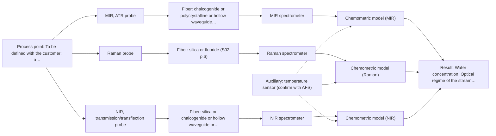

# First technical assessment: Water content in a petroleum stream

## Answer

**Customer request (our summary):** The customer wants to investigate a fiber-based process measurement for water determination in a petroleum stream to detect changes faster.

### Brief answer

Test mid-IR ATR first: water in petroleum has been measured with ATR fiber probes in the supplied example, and ATR suits liquid streams in contact with the crystal. Test Raman on the same samples as a comparison, and NIR transmission only if the stream is optically clear. Open points: the water concentration range and required accuracy, the analyzer distance (mid-IR fiber link length is undocumented), and the stream's optical regime and temperature.

### Proposal

- **Best current option:** O2 (recommended)
- **Basis:** supplied AFS sources
- **What would change it:** If the required analyzer distance exceeds what a mid-IR fiber link can achieve, MIR-ATR drops in favour of NIR or Raman with silica fibers; if the stream is opaque, NIR transmission is excluded.
- **Next step:** Answer the clarification questions (concentration range, distance, optical regime, temperature, response time) and run the multi-method feasibility trial on representative samples with laboratory reference values.

**Secondary evidence (external, not AFS material):** G1: E03 ¶33; G2: no usable external source found; G3: no usable external source found; G4: no usable external source found. See Expert detail.

**Decision status:** Provisional feasibility assessment

### Solution options

| ID | Tier | Methods | Confidence | Cost class, S01 Table 1 (p.6) | Ease of use | Maintenance | Performance fit | Sources |
|---|---|---|---|---|---|---|---|---|
| O1 | Simple | M1 MIR, ATR probe | Medium: open question: Q1, Q2 (starts at Medium) | high cost (row 2) | Simple probe and spectrometer setup | ATR crystal cleaning and fouling checks | Directly targets water in petroleum per precedent | [1: S02 p.13] [2: S01 p.10] [3: S01 p.9] |
| O2 | Recommended | M1 MIR, ATR probe; M2 Raman probe; M3 NIR, transmission/transflection probe | Low: open question: Q1, Q2, Q3 (starts at Medium); sample clarity unknown | high cost (rows 2, 7, 12) | Moderate; several probes to trial | Per-method calibration and probe upkeep | Covers opaque and clear stream cases before committing | [1: S02 p.13] [2: S01 p.10] [3: S01 p.9] [4: S01 p.16] [5: S01 p.11] [6: S01 p.18] [7: S01 p.18] [8: S02 p.7] |

*Confidence rates the basis of the advice (how much is known and cited), not a predicted accuracy or probability of success. It starts at High, or at Medium when a key question on the method or the option is open, and drops one level per weakness listed (floor Low).*

*Cost class is the relative rating in S01 Table 1 (p.6) for the in-line method+technique rows named (the highest one for a multi-method option); it is not a price.*

### Setup sketch

*Recommended option O2; drawn by code from the option, a schematic, not a configuration.*

### Key questions

1. What water concentration range must be measured, and what detection limit and accuracy are required compared with the laboratory method?
2. What is the distance from the measurement point to the analyzer location outside the process area?
3. Is the stream optically clear or opaque/emulsified, and is the water dissolved or as a separate dispersed phase?

## Expert detail

**Customer enquiry**

> We handle a petroleum stream and currently send samples to a laboratory for water determination. We want to investigate a fiber based measurement closer to the process so that changes can be noticed sooner. The analyzer would be outside the process area. Before selecting equipment, we need to know what to clarify and what a first comparison experiment should establish.

**Decision status:** Provisional feasibility assessment. A shortlist can be justified from the supplied material, but the water concentration range, the required analyzer distance and the stream's optical regime are unknown, so the method choice stays provisional until these are clarified.

### Parameters

| ID | Parameter | Kind | Need | Measured by | Why | Sources |
|---|---|---|---|---|---|---|
| P1 | Water concentration | quantitative | required | Spectroscopy: MIR | It is the target variable the in-line method must determine and calibrate against. | [1: S02 p.13] |
| P2 | Optical regime of the stream (clear vs. opaque/scattering) | qualitative | required | Spectroscopy: NIR | It decides whether NIR transmission/transflection is viable or only contact techniques such as ATR or Raman apply. | [7: S01 p.18] |
| P3 | Process temperature at the measurement point | quantitative | optional | Auxiliary sensor: temperature sensor (engineering judgement: confirm availability with AFS) | It should be available because temperature shifts spectra and affects probe material choice; it can be logged with a simple sensor. | *(no verified source: engineering judgement)* |

### Solution option details

- **O1 cost drivers:** MIR spectrometer, ATR probe, mid-IR fiber, calibration samples and reference analyses
- **O2 cost drivers:** Multi-method lab trial, several probes and spectrometers, reference analyses, chemometric development

### Premise check

- **Precedent only:** Fiber-optic spectroscopy can determine water in a petroleum stream. A supplied application example shows water-in-petroleum measured with ATR probes in the laboratory; this is a reason to test, not proof for this customer's stream. [1: S02 p.13]
- **Not covered:** The analyzer can sit outside the process area connected by fibers at the required distance. Long cables (100-300 m) are stated only for low-OH silica fibers; no source states an achievable length for a mid-IR fiber link, so the distance feasibility is open. [8: S02 p.7]

### Requirements

**Stated by the customer**

- Water determination in a petroleum stream
- Measurement closer to the process than the current laboratory route
- Analyzer located outside the process area
- Faster notice of changes than off-site laboratory analysis

**Key unknowns**

- Water concentration range and required detection limit
- Distance from the measurement point to the analyzer outside the process area
- Optical regime of the stream (clear vs. opaque/scattering) and water dispersion state
- Process temperature and pressure at the measurement point
- Required response time and accuracy versus the laboratory method

### Clarification questions (most decision-relevant first)

Q1. What water concentration range must be measured, and what detection limit and accuracy are required compared with the laboratory method? *Why it matters:* The concentration range decides whether NIR, MIR-ATR or Raman has sufficient sensitivity and which calibration effort is realistic. *(affects: method, technique)*
Q2. What is the distance from the measurement point to the analyzer location outside the process area? *Why it matters:* Long cables are documented for silica fibers, but no source states an achievable mid-IR fiber link length, so distance may rule MIR-ATR in or out. *(affects: installation, M1)*
Q3. Is the stream optically clear or opaque/emulsified, and is the water dissolved or as a separate dispersed phase? *Why it matters:* Transmission techniques fail on thick or opaque streams, and dispersed water may behave differently from dissolved water in any spectral method. *(affects: technique, M3)*
Q4. What are the process temperature and pressure at the intended measurement point, and is there fouling or particulate load? *Why it matters:* ATR needs tight sample contact and samples only a surface layer a few micrometres deep, so temperature, pressure and fouling affect probe choice and maintenance. *(affects: installation, M1)*
Q5. How quickly must a change in water content be noticed? *Why it matters:* The required response time influences the acquisition technique and whether a full spectrometer or a reduced multi-wavelength approach is appropriate. *(affects: technique, status)*

### Recommendation

- **M1 · Primary candidate: MIR, ATR probe.** Water in petroleum has been measured with mid-IR ATR probes in the supplied application example, and ATR suits liquid hydrocarbon streams in direct contact with the crystal. The usable range depends on the selected fiber and crystal, and the fiber link length for MIR is an open question. *Conditions:* The stream must allow tight contact with the ATR crystal at the measurement point. [1: S02 p.13] [2: S01 p.10] [3: S01 p.9]
- **M2 · Comparison candidate: Raman probe.** Raman tolerates water-rich and aqueous media better than infrared absorption methods and can be tested on the same samples as a second single method. Its weak signal and possible fluorescence background from petroleum components must be checked on real samples. [4: S01 p.16] [5: S01 p.11]
- **M3 · Conditional candidate: NIR, transmission/transflection probe.** NIR transmission or transflection is the preferred geometry for transparent liquids and uses robust silica fibers for which long cables are documented, but it fails when the stream is too thick or opaque for light to penetrate. *Conditions:* Applies only if the petroleum stream is sufficiently transparent at the measurement point and the water is in a form NIR can see. [6: S01 p.18] [7: S01 p.18] [8: S02 p.7]
- **M4 · Not recommended: fluorescence probe.** Water itself is not a fluorescent species and no fluorescent indicator has been identified for this stream, so fluorescence cannot directly determine water here. [9: S01 p.5]

### Measurement concept

- **Probe and geometry:** Immersion ATR fiber probe (mid-IR, e.g. CIR or PIR fiber with ATR crystal) at a suitable process side-stream or line, with the spectrometer outside the process area; Raman and NIR alternatives use their own fiber probes.
- **Location:** To be defined with the customer: a side-stream or in-line position that is representative of the stream and accessible for probe maintenance.
- **Fiber link:** Silica fibers for NIR/Raman/fluorescence; mid-IR requires CIR or PIR fibers or hollow waveguides, whose achievable link length is not stated in the sources and must be confirmed. [10: S02 p.6] [11: S02 p.6]

### Spectral range

- **MIR:** Nominal mid-IR range 4000-400 cm-1; the usable range depends on the instrument, fiber and probe actually selected. [3: S01 p.9]
- **NIR:** Nominal NIR range 780-2500 nm; the usable range depends on the instrument, fiber and probe actually selected. [12: S01 p.10]
- **Raman:** Raman shift in cm-1 with the laser excitation wavelength stated separately; excitation wavelength not yet selected for this stream. [13: S01 p.11]

### Risks and uncertainty

- The mid-IR fiber link length required to place the analyzer outside the process area is not documented and may not be achievable. *(rules: R-FIB-2)* [14: S02 p.9]
- ATR probes only a surface layer a few micrometres deep, so crystal fouling or a non-representative surface layer could bias the water reading. *(rules: R-MIR-3)* [15: S01 p.13]
- If the water is a dispersed phase rather than dissolved, sample inhomogeneity could make any point measurement unrepresentative. *(rules: R-GEN-5)* [16: S01 p.7]
- Any calibration will be specific to this petroleum matrix and must be re-validated if the stream composition changes. *(rules: R-CAL-1)* [17: REF §5]

### First feasibility experiment

1. **Collect representative petroleum samples spanning the expected water range and stream variation (e.g. different grades, temperatures, dispersion states).** Cover the chemical and physical variation the in-line method must handle. *(no verified source: engineering judgement)*
2. **Measure each sample with the laboratory reference water method used today, on the same samples, close in time to the spectral measurements.** Provide independent reference values for calibration and validation. *(no verified source: engineering judgement)*
3. **Measure all samples with the MIR-ATR probe first, then with the Raman probe, and (if the stream is clear) with an NIR transmission/transflection probe, each as a separate single-method dataset.** Compare single methods before considering any combination. *(no verified source: engineering judgement)*
4. **Build a preliminary calibration or regression model per method and validate on held-out samples or batches not used in the model.** Estimate real prediction error rather than fit quality. *(no verified source: engineering judgement)*
5. **Compare methods against the customer-defined go/no-go criteria (accuracy versus the laboratory method, detection limit, response time) and decide whether an in-line trial with a fiber link of the required length is justified.** Give the customer an explicit basis for the go/no-go decision. *(no verified source: engineering judgement)*

**Reference measurements:** The customer's current laboratory water determination on the same samples.

**Decision basis:** Customer-defined numerical criteria for accuracy, detection limit and response time; these are not yet stated and must be supplied (Q1, Q5).

### Assumptions

- The stream is a liquid petroleum product at conditions that allow probe contact or a side-stream loop.
- The laboratory water method currently used can also serve as the reference for the feasibility study.

### Not covered by the supplied sources

- Achievable mid-IR fiber link length for a remote analyzer location
- Detection limits or accuracy for water in petroleum by any of the candidate methods

### Further notes

- **Chemometrics:** A quantitative water model will need calibration samples spanning the expected concentration and physical variation, an independent reference method, and validation on held-out batches; NIR and Raman calibrations are matrix-specific.
- **Real-time tracking:** The aim of noticing changes sooner than the laboratory route implies continuous or frequent in-line measurement; the required update rate should be set by the customer (Q5) and the acquisition conditions chosen accordingly.
- **Future direction:** If a single method proves insufficient after the single-method trials, a combined probe or data fusion of two methods could be evaluated as a later hypothesis, compared against the best single method.

### Secondary evidence (external, not AFS material)

*Found by a literature search for gaps the supplied AFS sources leave open. Not AFS material and not proof for this case; every quote below was verified verbatim against the fetched text.*

*Live search unavailable (library only: cache miss (europepmc); cache miss (openalex)); curated library only.*

**G1 · auxiliary sensor:** In-line measurement of Process temperature at the measurement point with temperature sensor

- **E03 ¶33** The source notes that an optical fiber system can be utilized to reduce the influence of heat development from the globar. *How it applies:* This suggests that temperature effects related to the source could be mitigated, which may be relevant when evaluating auxiliary temperature sensing or thermal stabilities at the measurement point. *Limits and transfer risks:* The setup uses specific components in a laboratory or specialized rig, so transfer to a different industrial petroleum stream requires verification under actual process thermal loads. *(supports O2)*
  > "In order to reduce the influence of heat development of the globar, an optical fiber system can be used."
  > A Process Analytical Concept for In-Line FTIR Monitoring of Polysiloxane Formation. (2020) · Polymers · doi:10.3390/polym12112473 · https://europepmc.org/article/PMC/PMC7693933 · retrieved 2026-10-17, full text, licence: cc by, via curated library

**G2 · not in the supplied sources:** Achievable mid-IR fiber link length for a remote analyzer location

- No usable external source found.

**G3 · not in the supplied sources:** Detection limits or accuracy for water in petroleum by any of the candidate methods

- No usable external source found.

**G4 · premise not covered:** The analyzer can sit outside the process area connected by fibers at the required distance.

- No usable external source found.

### Evidence (verified quotes)

1. ✓ **S02 p.13** (application precedent): "Application: measurement of water content in petroleum"
2. ✓ **S01 p.10** (general): "ATR fiber probes (Fig.1) enable the analysis of liquids and solid elastic samples"
3. ✓ **S01 p.9** (general): "Vibrational spectroscopy in the mid-IR range (4000-400 cm-1) is one of the most informative methods of chemical analysis."
4. ✓ **S01 p.16** (general): "Raman is particularly well-suited for aqueous environments, as it exhibits low absorbance for water molecules compared to infrared methods."
5. ✓ **S01 p.11** (general): "superposition of luminescence (fluorescence), which has a significantly higher intensity."
6. ✓ **S01 p.18** (general): "Transmission is the preferred method for transparent or semi-transparent liquids, such as skim milk, whey, or permeate."
7. ✓ **S01 p.18** (general): "it fails when the milk becomes too "thick" or fat-rich, as the light cannot penetrate the sample."
8. ✓ **S02 p.7** (general): "Robust 100-300m cables made with Silica fibers of low OH-content (<0.1ppm OH) enable remote industrial process-control"
9. ✓ **S01 p.5** (general): "However, most chemicals do not exhibit this property."
10. ✓ **S02 p.6** (general): "1100 nm Chalcogenide As-S IR Fibers 6500 nm"
11. ✓ **S02 p.6** (general): "3000 nm Polycrystalline Infrared Fibers 17 μm"
12. ✓ **S01 p.10** (general): "NIR spectra (780-2500 nm) contain predominantly overtones and component bands of fundamental vibrations"
13. ✓ **S01 p.11** (general): "The Raman shift is used as the horizontal (spectral) axis in Raman spectroscopy"
14. ✓ **S02 p.9** (general): "HWG-750-2m PIR 600/700 -2m"
15. ✓ **S01 p.13** (general): "typically at a depth of few microns"
16. ✓ **S01 p.7** (general): "Morphological factors, such as sample inhomogeneity (e.g., biological tissue) or process turbulence, must also be considered when selecting a measurement technique."
17. ✓ **REF §5** (general): "physical variation; calibration specific to the matrix."

### Verification

- Citations verified: 22 of 22 (exact or whitespace/hyphen-tolerant match on the cited page, scope checked).
- Hard check failures before deterministic corrections: 0; still open: 0; soft warnings: 0; repair rounds: 1.
- External evidence (cache): 1 quote(s) verified verbatim (exact or whitespace/hyphen-tolerant, at most 400 characters and 2 sentences, against the cited paragraph); 0 item(s) dropped.
- External search: 5 query(ies), 0 hit(s), 3 source(s) (3 from the curated library); ⚠ library only: cache miss (europepmc); cache miss (openalex).
- External step: 2 model call(s), 2.2 s extra (cost in the run JSON).

*Run D06-20261018T075900Z-c8ef · models google/gemini-3.5-flash-lite, google/gemini-3.8-flash, z-ai/glm-5.3-flash*
