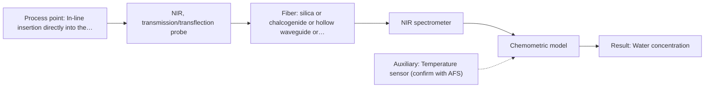

# First technical assessment: Water content in a petroleum stream

## Answer

**Customer request (our summary):** The customer wants to explore a remote, fiber-based optical measurement for water in a petroleum stream to monitor changes faster than laboratory testing.

### Brief answer

To monitor water in your petroleum stream closer to the process, mid-infrared attenuated total reflection (MIR-ATR) spectroscopy is recommended as the primary approach, using a robust immersion probe connected to an analyzer located outside the process area. A feasibility experiment with representative samples and laboratory reference testing should be performed first to establish calibration accuracy and verify resistance to fouling.

### Proposal

- **Best current option:** O2 (recommended)
- **Basis:** supplied AFS sources
- **What would change it:** Confirmation that water concentrations are outside the detection limits of mid-IR ATR or severe optical fouling that precludes crystal contact would shift the recommendation.
- **Next step:** Conduct a multi-method laboratory trial using representative petroleum samples with varying water concentrations to validate spectral sensitivity.

**Secondary evidence (external, not AFS material):** G1: E01 ¶12. See Expert detail.

**Decision status:** Provisional feasibility assessment

### Solution options

| ID | Tier | Methods | Confidence | Cost class, S01 Table 1 (p.6) | Ease of use | Maintenance | Performance fit | Sources |
|---|---|---|---|---|---|---|---|---|
| O1 | Simple | M1 MIR, ATR probe | Low: open question: Q1, Q2 (starts at Medium); precedent only | high cost (row 2) | High via remote ATR probe | Periodic crystal cleaning for fouling | Direct measurement of water via MIR ATR | [1: S02 p.13] |
| O2 | Recommended | M2 NIR, transmission/transflection probe | Low: open question: Q1 (starts at Medium); sample clarity unknown | average cost (row 7) | Automated with temperature compensation | Robust probe design with fouling checks | Alternative near-infrared path configuration for comparison testing | [2: S01 p.18] |

*Confidence rates the basis of the advice (how much is known and cited), not a predicted accuracy or probability of success. It starts at High, or at Medium when a key question on the method or the option is open, and drops one level per weakness listed (floor Low).*

*Cost class is the relative rating in S01 Table 1 (p.6) for the in-line method+technique rows named (the highest one for a multi-method option); it is not a price.*

### Setup sketch

*Recommended option O2; drawn by code from the option, a schematic, not a configuration.*

### Key questions

1. What is the expected water concentration range (e.g., low ppm to high percentage) in the petroleum stream?
2. What is the exact distance between the measurement insertion point in the process and the remote analyzer location outside the process area?
3. What are the temperature, pressure, and optical clarity of the petroleum stream?

## Expert detail

**Customer enquiry**

> We handle a petroleum stream and currently send samples to a laboratory for water determination. We want to investigate a fiber based measurement closer to the process so that changes can be noticed sooner. The analyzer would be outside the process area. Before selecting equipment, we need to know what to clarify and what a first comparison experiment should establish.

**Decision status:** Provisional feasibility assessment. A provisional assessment is possible because mid-infrared attenuated total reflection (MIR-ATR) spectroscopy is a demonstrated method for water determination in petroleum streams, though key operating parameters and stream clarity must be confirmed.

### Parameters

| ID | Parameter | Kind | Need | Measured by | Why | Sources |
|---|---|---|---|---|---|---|
| P1 | Water concentration | quantitative | required | Spectroscopy: MIR | Direct target of the in-line monitoring system to track changes sooner than laboratory samples. | [1: S02 p.13] |
| P2 | Stream temperature | quantitative | optional | Auxiliary sensor: Temperature sensor (engineering judgement: confirm availability with AFS) | Temperature variations can affect background spectral response and should be monitored for calibration stability. | *(no verified source: engineering judgement)* |

### Solution option details

- **O1 cost drivers:** MIR spectrometer and remote fiber cable run
- **O2 cost drivers:** Complete analyzer system with temperature sensor and robust fiber cabling

### Requirements

**Stated by the customer**

- Fiber-based optical measurement closer to the petroleum process
- Water determination to notice changes sooner
- Analyzer located outside the process area

**Key unknowns**

- Water concentration range in the petroleum stream
- Exact temperature, pressure, and flow velocity of the petroleum stream
- Optical clarity, turbidity, and scattering behavior of the petroleum stream
- Exact distance between the insertion point and the remote analyzer location
- Fouling or window coating tendencies of the petroleum stream

### Clarification questions (most decision-relevant first)

Q1. What is the expected water concentration range (e.g., low ppm to high percentage) in the petroleum stream? *Why it matters:* It determines the required sensitivity and path length configuration of the spectroscopic setup. *(affects: method, installation, M1)*
Q2. What is the exact distance between the measurement insertion point in the process and the remote analyzer location outside the process area? *Why it matters:* It dictates fiber cable length requirements and optical attenuation limits. *(affects: installation, M1)*
Q3. What are the temperature, pressure, and optical clarity of the petroleum stream? *Why it matters:* It affects probe material compatibility and signal scattering characteristics. *(affects: technique, installation)*
Q4. Is there any tendency for suspended solids, heavy fractions, or asphalthenes to foul or coat the probe window? *Why it matters:* Window fouling directly impacts the reliability of evanescent wave measurements in ATR setups. *(affects: technique, installation)*

### Recommendation

- **M1 · Primary candidate: MIR, ATR probe.** Mid-infrared ATR spectroscopy is directly applicable for measuring water content in petroleum streams using rugged immersion probes with high-refractive-index crystals, providing clear absorbance features for water. *Conditions:* Applicable if the petroleum stream allows sufficient contact with the ATR crystal and water concentration is within the detection range. [1: S02 p.13]
- **M2 · Comparison candidate: NIR, transmission/transflection probe.** Near-infrared spectroscopy can be evaluated as an alternative if transmission-based or transflection monitoring is preferred across larger optical path lengths, provided scattering is managed. *Conditions:* Applicable if the petroleum stream has sufficient optical transmission and water overtone bands are discernible. [2: S01 p.18]

### Measurement concept

- **Probe and geometry:** Immersion ATR fiber probe with a zirconium dioxide or diamond ATR tip mounted flush in the process stream.
- **Location:** In-line insertion directly into the petroleum process pipe or reactor, with the spectrometer housed outside the hazardous or process area.
- **Fiber link:** Mid-infrared compatible optical fiber link connecting the immersion probe to the remote analyzer. [1: S02 p.13] [3: S01 p.10]

### Spectral range

- **MIR:** The nominal mid-IR vibrational spectroscopy range is 4000-400 cm-1, though the usable range depends on the selected fiber, crystal, and spectrometer configuration. [4: S01 p.9]

### Risks and uncertainty

- Optical fouling or deposition of heavy petroleum fractions on the ATR crystal surface can attenuate the evanescent wave and cause signal drift. *(rules: R-MIR-3)* [5: S01 p.13]
- Fiber transmission losses and coupling efficiency over long distances outside the process area may restrict the maximum separation between the probe and the remote analyzer. *(rules: R-FIB-2, R-FIB-3)* [6: S02 p.10]
- Temperature and pressure fluctuations in the petroleum stream can alter background absorption and refractive index at the crystal interface. *(rules: R-MIR-2)* [3: S01 p.10]

### First feasibility experiment

1. **Sample Collection** Gather representative petroleum samples spanning the expected water concentration range. *(no verified source: engineering judgement)*
2. **Laboratory Reference Measurement** Determine independent reference water values for all sample batches using established laboratory titration or analytical methods. *(no verified source: engineering judgement)*
3. **Spectral Bench Testing** Record mid-IR ATR spectra of the samples using an ATR fiber probe and evaluate absorption band intensity near water signature regions. [1: S02 p.13]
4. **Chemometric Calibration** Build and cross-validate a partial least squares calibration model relating spectral absorbance to reference water concentrations. [7: S01 p.2]
5. **Validation on Held-Out Samples** Test the predictive accuracy of the model on independent test runs against customer-defined error criteria. *(no verified source: engineering judgement)*

**Reference measurements:** Standard laboratory water determination methods performed on spot samples.

**Decision basis:** Proceed to in-line pilot installation if laboratory feasibility trials achieve a prediction error below the customer's specified maximum allowable water determination tolerance.

### Assumptions

- The petroleum stream is compatible with PEEK-shaft and zirconium dioxide or diamond ATR crystal materials.
- Remote fiber cable routing is feasible between the process insertion point and the remote analyzer housing.

### Further notes

- **Chemometrics:** Partial least squares regression models should be trained on spectral data correlated against laboratory reference water measurements to enable continuous quantitative tracking.
- **Real-time tracking:** Continuous in-line spectral acquisition allows real-time monitoring of water fluctuations in the petroleum stream, significantly reducing response time compared to periodic lab sampling.
- **Future direction:** Integration of automated probe cleaning mechanisms or multi-point multiplexing to monitor multiple process lines from a single centralized remote analyzer.

### Secondary evidence (external, not AFS material)

*Found by a literature search for gaps the supplied AFS sources leave open. Not AFS material and not proof for this case; every quote below was verified verbatim against the fetched text.*

*Live search unavailable (library only: cache miss (europepmc); cache miss (openalex)); curated library only.*

**G1 · auxiliary sensor:** In-line measurement of Stream temperature with Temperature sensor

- **E01 ¶12** The text notes that temperature sensitivity of OH bands poses a severe drawback for measuring aqueous solutions in NIR and MIR, requiring tempered sample holders. *How it applies:* This highlights why tracking or controlling stream temperature is critical when evaluating NIR transmission or transflection options, suggesting that temperature compensation or auxiliary sensing should be tested. *Limits and transfer risks:* The source discusses biopharmaceutical downstream processing in general rather than an on-line petroleum stream, so the exact thermal coefficients and sample holder requirements may differ. *(supports O2)*
  > "Additionally, the temperature sensitivity of the OH bands is a severe drawback for measuring aqueous solution in NIR and MIR, which makes tempered sample holders necessary [29]."
  > A critical review of recent trends, and a future perspective of optical spectroscopy as PAT in biopharmaceutical downstream processing. (2020) · Analytical and bioanalytical chemistry · doi:10.1007/s00216-020-02407-z · https://europepmc.org/article/PMC/PMC7072065 · retrieved 2026-10-17, full text, licence: cc by, via curated library

### Evidence (verified quotes)

1. ✓ **S02 p.13** (application precedent): "Application: measurement of water content in petroleum ATR-Probes with ATR-tips from ZrO2 (& Diamond, etc.) sealed in PEEK-shaft and protected by PEEK-tubing can be used in microwave furnaces"
2. ✓ **S01 p.18** (general): "In some cases, a Transflection probe can already be a combined solution working well for low-fat and high-fat containing milk products."
3. ✓ **S01 p.10** (general): "ATR fiber probes (Fig.1) enable the analysis of liquids and solid elastic samples, such as biological tissue, using specialized probes utilizing high-transmission fiber optics in the Mid-IR region."
4. ✓ **S01 p.9** (general): "Vibrational spectroscopy in the mid-IR range (4000-400 cm-1) is one of the most informative methods of chemical analysis."
5. ✓ **S01 p.13** (general): "typically at a depth of few microns"
6. ✓ **S02 p.10** (general): "too low NA>0.1 - which results in very poor coupling efficiency with FTIR-spectrometers, while high NA>0.3 for PIR-fibers provides much better coupling efficiency of PIR-fiber based ATR-probes with FTIR-beams- much better vs Hollow Waveguides"
7. ✓ **S01 p.2** (general): "constructing calibration and classification models, as well as methods for in-depth research data analysis."

### Verification

- Citations verified: 13 of 13 (exact or whitespace/hyphen-tolerant match on the cited page, scope checked).
- Hard check failures before deterministic corrections: 0; still open: 0; soft warnings: 2; repair rounds: 2.
- External evidence (cache): 1 quote(s) verified verbatim (exact or whitespace/hyphen-tolerant, at most 400 characters and 2 sentences, against the cited paragraph); 0 item(s) dropped.
- External search: 2 query(ies), 0 hit(s), 3 source(s) (3 from the curated library); ⚠ library only: cache miss (europepmc); cache miss (openalex).
- External step: 2 model call(s), 1.9 s extra (cost in the run JSON).

*Run D06-20261018T075900Z-cc06 · models google/gemini-3.5-flash-lite*
