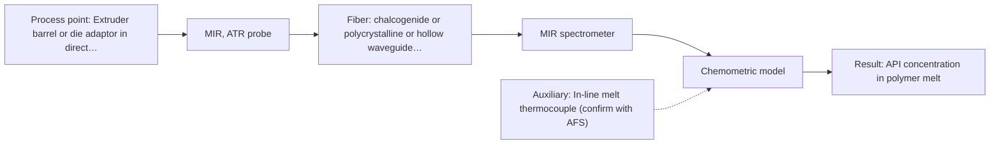

# First technical assessment: API concentration during hot polymer extrusion

## Answer

**Customer request (our summary):** The customer wants to know whether optical spectroscopy can monitor composition changes in-line during hot melt extrusion of an active pharmaceutical ingredient, and requires an evaluation plan and probe selection criteria.

### Brief answer

Mid-infrared spectroscopy using a diamond-cone ATR probe is the primary option to test first, supported by published precedent for monitoring active ingredients in hot polymer extrusion. Near-infrared reflection serves as a viable alternative if the melt exhibits sufficient optical scattering. Initial clarification of chemical formulations, process temperatures, and port dimensions is required before selecting final probe hardware.

### Proposal

- **Best current option:** O2 (recommended)
- **Basis:** supplied AFS sources
- **What would change it:** If the polymer melt is highly scattering and mid-IR fiber length constraints are prohibitive, NIR reflection would be prioritized instead.
- **Next step:** Obtain spectral scans of raw API and carrier polymer formulations off-line and clarify extruder port dimensions and operating temperatures.

**Secondary evidence (external, not AFS material):** G1: no usable external source found; G2: no usable external source found; G3: no usable external source found; G4: no usable external source found. See Expert detail.

**Decision status:** Provisional feasibility assessment

### Solution options

| ID | Tier | Methods | Confidence | Cost class, S01 Table 1 (p.6) | Ease of use | Maintenance | Performance fit | Sources |
|---|---|---|---|---|---|---|---|---|
| O1 | Simple | M2 NIR, diffuse reflection probe | Low: open question: Q1 (starts at Medium); sample clarity unknown; uncited auxiliary sensor | average cost (row 8) | Standard silica optics facilitate straightforward installation | Window inspection and periodic cleaning required | Captures gross overtones if scattering suffices | [1: S02 p.14] [2: S01 p.5] |
| O2 | Recommended | M1 MIR, ATR probe | Low: open question: Q1 (starts at Medium); uncited auxiliary sensor | high cost (row 2) | Direct flush installation in melt stream | ATR crystal cleaning if fouled | Direct fundamental bands yield superior selectivity | [3: S02 p.14] [4: S01 p.5] |

*Confidence rates the basis of the advice (how much is known and cited), not a predicted accuracy or probability of success. It starts at High, or at Medium when a key question on the method or the option is open, and drops one level per weakness listed (floor Low).*

*Cost class is the relative rating in S01 Table 1 (p.6) for the in-line method+technique rows named (the highest one for a multi-method option); it is not a price.*

### Setup sketch

*Recommended option O2; drawn by code from the option, a schematic, not a configuration.*

### Key questions

1. What are the chemical identities, nominal concentrations, and target ranges of the API and polymer carrier?
2. What are the continuous operating temperature and melt pressure at the planned optical port location?
3. What are the physical dimensions and mounting specifications of the port on the extruder barrel or die?

## Expert detail

**Customer enquiry**

> We are developing a hot polymer extrusion process that incorporates an active pharmaceutical ingredient. We want to investigate whether an optical measurement can detect composition changes while the melt is being processed. We have offline assays, but the process interface is hot and may be exposed to material build up. We need an initial comparison plan and the questions required before choosing a probe.

**Decision status:** Provisional feasibility assessment. Precedent demonstrates that in-line MIR-ATR and NIR reflection can monitor active pharmaceutical ingredients in hot polymer extrusion, but specific optical, mechanical, and thermal parameters must be established before selecting final hardware.

### Parameters

| ID | Parameter | Kind | Need | Measured by | Why | Sources |
|---|---|---|---|---|---|---|
| P1 | API concentration in polymer melt | quantitative | required | Spectroscopy: MIR | Verifies that the extrusion process delivers the target pharmaceutical dosage uniformly. | [3: S02 p.14] |
| P2 | Process interface melt temperature | quantitative | required | Auxiliary sensor: In-line melt thermocouple (engineering judgement: confirm availability with AFS) | Monitors thermal conditions to account for temperature-induced band shifts and protect optical probe components. | *(no verified source: engineering judgement)* |
| P3 | Reference API assay | quantitative | required | Reference lab method: Offline assay (e.g., HPLC) | Supplies absolute reference values to calibrate and validate in-line multivariate spectroscopic models. | *(no verified source: engineering judgement)* |

### Solution option details

- **O1 cost drivers:** NIR spectrometer and industrial reflection probe
- **O2 cost drivers:** FTIR mid-IR spectrometer and PIR diamond-cone ATR probe

### Premise check

- **Precedent only:** Optical spectroscopy can detect composition changes of an active pharmaceutical ingredient in a hot polymer melt in-line. Extrusion monitoring of an API in hot polymer has been demonstrated in-line using mid-IR ATR and NIR reflection probes, but applicability to this specific drug-polymer formulation must be verified experimentally. [1: S02 p.14] [3: S02 p.14]

### Requirements

**Stated by the customer**

- Hot polymer extrusion process incorporating an active pharmaceutical ingredient
- In-line detection of composition changes while the melt is being processed
- Offline reference assays are available
- Process interface is hot and subject to potential material build-up
- Initial comparison plan and clarification questions required prior to probe selection

**Key unknowns**

- Chemical identity, spectral signature, and expected concentration range of the API and carrier polymer
- Operating temperature and pressure profile at the extruder interface
- Port dimensions, mechanical clearances, and threading at the extruder barrel or die adaptor
- Optical regime and turbidity of the polymer melt at process temperatures
- Material residence time, rheology, and fouling tendencies on optical surfaces

### Clarification questions (most decision-relevant first)

Q1. What are the chemical identities, nominal concentrations, and target ranges of the API and polymer carrier? *Why it matters:* Determines the distinct vibrational absorption bands and governs whether mid-IR or NIR provides sufficient selectivity and sensitivity. *(affects: method)*
Q2. What are the continuous operating temperature and melt pressure at the planned optical port location? *Why it matters:* Dictates probe body construction, sealing materials, crystal choice, and thermal protection requirements. *(affects: installation)*
Q3. What are the physical dimensions and mounting specifications of the port on the extruder barrel or die? *Why it matters:* Governs probe shaft diameter, insertion depth, and mechanical fit in the extruder stream. *(affects: technique)*
Q4. What is the optical appearance of the melt at operating temperature (e.g., clear liquid, turbid, or filled with scattering particles)? *Why it matters:* Determines whether diffuse reflection or internal reflectance (ATR) is the optimal optical interface. *(affects: technique)*

### Recommendation

- **M1 · Primary candidate: MIR, ATR probe.** Mid-IR spectroscopy provides sharp, informative fundamental vibrational bands for specific molecular identification. Diamond-cone ATR probes have established precedent for tracking API spectra in hot polymer extrusion in-line. *Conditions:* Melt must maintain reproducible, tight contact with the robust crystal face under extrusion conditions. [3: S02 p.14] [4: S01 p.5]
- **M2 · Comparison candidate: NIR, diffuse reflection probe.** Near-infrared reflection probes using silica fibers offer robust industrial deployment with deep penetration and compatibility with standard optics. Precedent demonstrates its comparative utility for extrusion control. *Conditions:* Applicable if the melt exhibits sufficient backscattering or turbidity and calibration models resolve overlapping overtone bands. [1: S02 p.14] [2: S01 p.5]

### Measurement concept

- **Probe and geometry:** An immersion ATR probe featuring a robust crystal tip (such as diamond) flush-mounted into the flow channel, or a diffuse reflection probe depending on optical scattering.
- **Location:** Extruder barrel or die adaptor in direct contact with the flowing polymer melt.
- **Fiber link:** Polycrystalline infrared (PIR) fibers for mid-IR ATR transmission, or silica fiber cables for NIR reflection, routing signal to an analyzer located away from machine vibration. [3: S02 p.14] [1: S02 p.14] [5: S01 p.15]

### Spectral range

- **MIR:** The nominal mid-IR range is 4000 to 400 cm-1 (2.5 to 25 µm), though usable spectral coverage is defined by the specific PIR fiber transmission, ATR crystal material, and spectrometer configuration. [6: S01 p.9] [7: REF §3]
- **NIR:** The nominal near-IR range is 780 to 2500 nm, while usable bandwidth depends on the instrument spectrometer, detector, and fiber optic cable installed. [8: S01 p.10] [7: REF §3]

### Risks and uncertainty

- Fouling or stagnant material deposition on the probe surface can shield the flowing melt and cause measurement drift. *(rules: R-MIR-3)* [9: S01 p.13] [10: REF §5]
- Thermal degradation or intense physical variations in the melt can mimic or mask spectral composition changes. *(rules: R-GEO-6, R-CAL-1)* [11: S01 p.17] [12: REF §5]
- Transmission fibers for mid-IR have finite length limits and coupling constraints that must be verified against the physical plant layout. *(rules: R-FIB-2)* [13: S02 p.7]

### First feasibility experiment

1. **Laboratory spectral screening of pure API, pure polymer, and synthetic mixtures across operating temperature profiles using MIR-ATR and NIR benchtop setups.** Identify unambiguous diagnostic bands for the API and quantify spectral sensitivity against baseline polymer absorption. [14: S01 p.3]
2. **Pilot-scale static or flow-cell testing under controlled temperature and pressure to evaluate probe contact, thermal resilience, and fouling tendencies.** Verify mechanical integrity of the optical seal and assess signal stability in a simulated hot melt. [15: REF §3]
3. **In-line extruder trial executing planned API concentration steps while recording real-time spectra alongside independent offline reference samples.** Collect paired in-line spectra and offline assay values spanning the entire operational formulation range. [15: REF §3]
4. **Calibration model construction using chemometrics followed by validation on independent extrusion batches.** Demonstrate predictive robustness, verify signal recovery after purging, and ensure lack of overfitting. [16: S01 p.5]

**Reference measurements:** Offline analytical laboratory assays (such as HPLC or extraction assays) performed on grab samples taken synchronously with in-line spectral acquisitions.

**Decision basis:** Go/no-go criteria must satisfy customer accuracy and precision thresholds for API concentration across independent validation batches without intolerable signal loss from material build-up.

### Assumptions

- The active pharmaceutical ingredient exhibits distinct infrared or near-infrared vibrational bands that do not completely overlap with the excipient polymer matrix.
- The extrusion machine can accommodate an optical interface port at the barrel, adapter, or die without disturbing critical melt flow dynamics.

### Not covered by the supplied sources

- Specific mechanical thread standards and pressure rating certifications for hot melt extruder ports.
- Achievable industrial link length limits for polycrystalline mid-IR fiber bundles.

### Further notes

- **Chemometrics:** Multivariate regression models (such as PLS) will be necessary to decouple overlapping vibrational features, account for matrix baseline changes, and correlate in-line spectral response to offline reference assays.
- **Real-time tracking:** In-line probe integration enables continuous spectral acquisition in real time, supporting automated feed-forward control or rapid out-of-specification rejection in continuous extrusion.
- **Future direction:** If single-method sensitivity proves insufficient across wide formulation varieties, multi-spectral fusion combining mid-IR ATR and NIR reflection within the extrusion line may be evaluated.

### Secondary evidence (external, not AFS material)

*Found by a literature search for gaps the supplied AFS sources leave open. Not AFS material and not proof for this case; every quote below was verified verbatim against the fetched text.*

*Live search unavailable (library only: cache miss (europepmc); cache miss (openalex)); curated library only.*

**G1 · auxiliary sensor:** In-line measurement of Process interface melt temperature with In-line melt thermocouple

- No usable external source found.

**G2 · not in the supplied sources:** Specific mechanical thread standards and pressure rating certifications for hot melt extruder ports.

- No usable external source found.

**G3 · not in the supplied sources:** Achievable industrial link length limits for polycrystalline mid-IR fiber bundles.

- No usable external source found.

**G4 · parameter without a source:** Measuring Reference API assay: Supplies absolute reference values to calibrate and validate in-line multivariate spectroscopic models.

- No usable external source found.

### Evidence (verified quotes)

1. ✓ **S02 p.14** (application precedent): "NIR-Reflex & MIR-ATR-spectroscopy to control polymer extrusion in-line"
2. ✓ **S01 p.5** (general): "NIR spectroscopy, with its relatively large penetration depth (up to several millimetres) even into dense solid samples due to low absorption and strong scattering, allows the use of ordinary glass for optics, as well as standard lamps as light sources, making it ideal for online applications, including remote measurements via fiber optic probes."
3. ✓ **S02 p.14** (application precedent): "Spectra of API in hot polymer obtained with Diamond cone ATR probe coupled to iC10 FTIR (MTAC)"
4. ✓ **S01 p.5** (general): "Mid-IR band spectra contain well-defined peaks (absorption bands), while NIR, UV, and fluorescence spectra contain broad, highly overlapping signals"
5. ✓ **S01 p.15** (general): "located safely away from the vibration and dust of the manufacturing floor."
6. ✓ **S01 p.9** (general): "Vibrational spectroscopy in the mid-IR range (4000-400 cm-1) is one of the most informative methods of chemical analysis."
7. ✓ **REF §3** (general): "A nominal method range is not the range of a specific instrument, fiber or probe."
8. ✓ **S01 p.10** (general): "NIR spectra (780-2500 nm) contain predominantly overtones and component bands of fundamental vibrations"
9. ✓ **S01 p.13** (general): "typically at a depth of few microns"
10. ✓ **REF §5** (general): "Usable range limited by fiber and crystal; contact, fouling, compatibility."
11. ✓ **S01 p.17** (general): "the method is sensitive to the surface characteristics and fat globule size."
12. ✓ **REF §5** (general): "physical variation; calibration specific to the matrix."
13. ✓ **S02 p.7** (general): "Robust 100-300m cables made with Silica fibers of low OH-content (<0.1ppm OH) enable remote industrial process-control"
14. ✓ **S01 p.3** (general): "samples of incompletely known composition, in order to select the most suitable method or combination of methods."
15. ✓ **REF §3** (general): "Representative samples or process states, independent reference measurements, what is compared, and the basis for the go / no-go decision."
16. ✓ **S01 p.5** (general): "construction, validation, and application of predictive models, specifically calibration or classification models."

### Verification

- Citations verified: 25 of 25 (exact or whitespace/hyphen-tolerant match on the cited page, scope checked).
- Hard check failures before deterministic corrections: 0; still open: 0; soft warnings: 1; repair rounds: 1.
- External evidence (cache): 0 quote(s) verified verbatim (exact or whitespace/hyphen-tolerant, at most 400 characters and 2 sentences, against the cited paragraph); 0 item(s) dropped.
- External search: 5 query(ies), 0 hit(s), 3 source(s) (3 from the curated library); ⚠ library only: cache miss (europepmc); cache miss (openalex).
- External step: 2 model call(s), 5.6 s extra (cost in the run JSON).

*Run D07-20261018T075900Z-0a6e · models google/gemini-3.8-flash*
