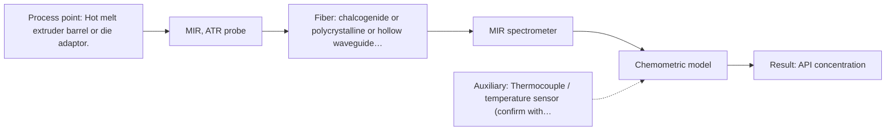

# First technical assessment: API concentration during hot polymer extrusion

## Answer

**Customer request (our summary):** The customer wants to investigate whether optical spectroscopy can detect composition changes of an active pharmaceutical ingredient in a hot polymer extrusion melt.

### Brief answer

For in-line monitoring of API composition in a hot polymer extrusion process, testing Mid-Infrared ATR spectroscopy and Near-Infrared diffuse reflection is recommended first. MIR-ATR provides high chemical specificity using fundamental vibrational bands, while NIR offers robust scattering-based sensing. Key unknowns regarding polymer optical properties, temperature limits, and concentration ranges must be clarified to finalize the probe installation.

### Proposal

- **Best current option:** O2 (recommended)
- **Basis:** supplied AFS sources
- **What would change it:** Results showing poor MIR transmission or severe fouling indicating that NIR reflection is more robust for the specific polymer melt.
- **Next step:** Conduct multi-method laboratory trials comparing MIR-ATR and NIR reflection on representative polymer-API samples.

**Secondary evidence (external, not AFS material):** G1: no usable external source found; G2: E02 ¶34. See Expert detail.

**Decision status:** Provisional feasibility assessment

### Solution options

| ID | Tier | Methods | Confidence | Cost class, S01 Table 1 (p.6) | Ease of use | Maintenance | Performance fit | Sources |
|---|---|---|---|---|---|---|---|---|
| O1 | Simple | M2 NIR, diffuse reflection probe | Low: open question: Q1 (starts at Medium); sample clarity unknown; precedent only | average cost (row 8) | Standard fiber connection | Periodic window inspection | Robust bulk scattering measurement | [1: S02 p.14] |
| O2 | Recommended | M1 MIR, ATR probe | Low: open question: Q1 (starts at Medium); precedent only; uncited auxiliary sensor | high cost (row 2) | Direct ATR probe insertion | Cleaning against polymer build-up | High chemical specificity via fundamental bands | [1: S02 p.14] |

*Confidence rates the basis of the advice (how much is known and cited), not a predicted accuracy or probability of success. It starts at High, or at Medium when a key question on the method or the option is open, and drops one level per weakness listed (floor Low).*

*Cost class is the relative rating in S01 Table 1 (p.6) for the in-line method+technique rows named (the highest one for a multi-method option); it is not a price.*

### Setup sketch

*Recommended option O2; drawn by code from the option, a schematic, not a configuration.*

### Key questions

1. What is the specific polymer type and the active pharmaceutical ingredient (API) concentration range?
2. What are the scattering and absorption optical properties of the polymer melt?
3. What are the exact temperature and pressure limits at the extruder barrel or die adaptor interface?

## Expert detail

**Customer enquiry**

> We are developing a hot polymer extrusion process that incorporates an active pharmaceutical ingredient. We want to investigate whether an optical measurement can detect composition changes while the melt is being processed. We have offline assays, but the process interface is hot and may be exposed to material build up. We need an initial comparison plan and the questions required before choosing a probe.

**Decision status:** Provisional feasibility assessment. The customer enquiry outlines a clear industrial application (hot polymer extrusion with an API) and asks for an initial comparison plan and clarification questions, which are supported by the supplied sources on polymer extrusion monitoring.

### Parameters

| ID | Parameter | Kind | Need | Measured by | Why | Sources |
|---|---|---|---|---|---|---|
| P1 | API concentration | quantitative | required | Spectroscopy: MIR | Main process target determining active pharmaceutical ingredient content in the melt. | *(no verified source: engineering judgement)* |
| P2 | Process temperature | quantitative | required | Auxiliary sensor: Thermocouple / temperature sensor (engineering judgement: confirm availability with AFS) | Ensures probe and fiber materials operate within safe thermal limits during extrusion. | *(no verified source: engineering judgement)* |

### Solution option details

- **O1 cost drivers:** Standard NIR spectrometer and reflection probe
- **O2 cost drivers:** Mid-IR FTIR spectrometer and specialized PIR/CIR fiber probe

### Premise check

- **Supported:** An initial comparison plan can be provided before detailed probe selection parameters are defined. The AFS guided pathway begins with multi-method laboratory trials and comparison to select the optimal technique before finalizing custom solution configurations. [2: S02 p.20]

### Requirements

**Stated by the customer**

- Investigate whether optical measurement can detect composition changes in a hot polymer extrusion melt
- Provide an initial comparison plan
- Identify questions required before choosing a probe

**Key unknowns**

- Specific polymer type and API concentration range
- Optical scattering and absorption properties of the polymer melt
- Thermal and pressure limits at the extruder process interface
- Required measurement accuracy and response time

### Clarification questions (most decision-relevant first)

Q1. What is the specific polymer type and the active pharmaceutical ingredient (API) concentration range? *Why it matters:* Determines the expected absorption coefficients and required analytical sensitivity. *(affects: method, M1, M2)*
Q2. What are the scattering and absorption optical properties of the polymer melt? *Why it matters:* Decides whether transmission, reflection, or ATR optical regimes are suitable for penetration. *(affects: technique)*
Q3. What are the exact temperature and pressure limits at the extruder barrel or die adaptor interface? *Why it matters:* Defines mechanical and thermal sealing constraints for probe and fiber hardware. *(affects: technique, installation)*
Q4. Are offline assay reference measurements available across the expected concentration range for calibration? *Why it matters:* Essential for building and validating quantitative chemometric calibration models. *(affects: status)*

### Recommendation

- **M1 · Primary candidate: MIR, ATR probe.** Mid-IR ATR spectroscopy provides fundamental vibrational bands with high chemical specificity for monitoring API in polymer extrusion environments. *Conditions:* Requires probe tip contact with the melt and management of potential material build-up. [1: S02 p.14]
- **M2 · Comparison candidate: NIR, diffuse reflection probe.** NIR diffuse reflection allows robust remote probing of polymer melts using standard silica fiber optics and offers deeper penetration into scattering media. *Conditions:* Requires chemometric calibration for broad overlapping absorption bands. [1: S02 p.14]

### Measurement concept

- **Probe and geometry:** Mid-IR ATR probe with a diamond or zirconium oxide crystal or NIR diffuse reflection probe mounted flush in the extruder barrel or die adaptor.
- **Location:** Hot melt extruder barrel or die adaptor.
- **Fiber link:** Polycrystalline infrared (PIR) or chalcogenide (CIR) fibers for MIR, or low-OH silica fibers for NIR. [1: S02 p.14]

### Spectral range

- **MIR:** Nominal method range is 4000-400 cm-1 (2.5-25 um); usable range depends on the instrument, fiber and probe actually selected. [3: S01 p.9]
- **NIR:** Nominal method range is 780-2500 nm; usable range depends on the instrument, fiber and probe actually selected. [4: S01 p.10]

### Risks and uncertainty

- Material build-up or polymer fouling on the probe interface can obscure the optical measurement and degrade signal quality. *(rules: R-MIR-3)* [5: S01 p.13]
- High operating temperatures in the extruder may exceed thermal ratings of standard fiber coatings or probe sealing assemblies. *(rules: R-GEN-1)* [6: REF §5]

### First feasibility experiment

1. **Collect representative polymer-API samples covering the expected compositional variation.** Gather representative polymer-API samples covering expected compositional variation. *(no verified source: engineering judgement)*
2. **Obtain independent offline reference measurements for all calibration and test samples.** Obtain independent offline reference measurements for all test samples. *(no verified source: engineering judgement)*
3. **Perform benchtop spectroscopic screening using MIR-ATR and NIR setups.** Test representative samples using benchtop MIR-ATR and NIR reflection setups to compare spectral contrast. *(no verified source: engineering judgement)*
4. **Build and cross-validate initial chemometric regression models relating spectra to concentration.** Build and cross-validate initial chemometric calibration models relating spectra to API concentration. *(no verified source: engineering judgement)*

**Reference measurements:** Customer offline assays.

**Decision basis:** Go/no-go determined by achieving customer-defined prediction accuracy and calibration robustness targets.

### Assumptions

- Representative polymer-API samples can be provided for laboratory screening trials.
- Offline assay data is sufficiently accurate to serve as a calibration reference.
- The polymer melt optical regime allows sufficient light penetration for reflection or ATR measurements.

### Further notes

- **Chemometrics:** Multivariate calibration models (such as PLS) are required to extract quantitative composition changes from vibrational spectra.
- **Real-time tracking:** In-line probe installation enables continuous tracking of composition dynamics during extrusion processing.
- **Future direction:** Integration of automated probe purging mechanisms to prevent material build-up at the hot interface.

### Secondary evidence (external, not AFS material)

*Found by a literature search for gaps the supplied AFS sources leave open. Not AFS material and not proof for this case; every quote below was verified verbatim against the fetched text.*

*Live search unavailable (library only: cache miss (europepmc); cache miss (openalex)); curated library only.*

**G1 · auxiliary sensor:** In-line measurement of Process temperature with Thermocouple / temperature sensor

- No usable external source found.

**G2 · parameter without a source:** Measuring API concentration: Main process target determining active pharmaceutical ingredient content in the melt.

- **E02 ¶34** The combination of ATR-FTIR measurements and principal component analysis can serve as a useful tool for real-time reaction monitoring. *How it applies:* This suggests testing ATR-FTIR coupled with multivariate data analysis to monitor active pharmaceutical ingredient variations in the polymer melt. *Limits and transfer risks:* The cited study monitored polysiloxane formation rather than a hot polymer extrusion melt containing an active pharmaceutical ingredient, so matrix effects and process conditions will differ. *(supports O2)*
  > "The combination of ATR-FTIR measurements and PCA proved to be a valuable tool for real-time reaction monitoring and identifying faulty batches."
  > A Process Analytical Concept for In-Line FTIR Monitoring of Polysiloxane Formation. (2020) · Polymers · doi:10.3390/polym12112473 · https://europepmc.org/article/PMC/PMC7693933 · retrieved 2026-10-17, full text, licence: cc by, via curated library

### Evidence (verified quotes)

1. ✓ **S02 p.14** (application precedent): "NIR-Reflex & MIR-ATR-spectroscopy to control polymer extrusion in-line"
2. ✓ **S02 p.20** (general): "1. Multi-Method Lab Trials AFS tests your process using all key fiber optic spectroscopy methods."
3. ✓ **S01 p.9** (general): "Vibrational spectroscopy in the mid-IR range (4000-400 cm-1) is one of the most informative methods of chemical analysis."
4. ✓ **S01 p.10** (general): "NIR spectra (780-2500 nm) contain predominantly overtones and component bands of fundamental vibrations"
5. ✓ **S01 p.13** (general): "typically at a depth of few microns"
6. ✓ **REF §5** (general): "It is not a product specification: actual spectral coverage, fiber length, component ratings, detection limits and accuracy depend on the configuration and the sample."

### Verification

- Citations verified: 9 of 9 (exact or whitespace/hyphen-tolerant match on the cited page, scope checked).
- Hard check failures before deterministic corrections: 0; still open: 0; soft warnings: 1; repair rounds: 1.
- External evidence (cache): 1 quote(s) verified verbatim (exact or whitespace/hyphen-tolerant, at most 400 characters and 2 sentences, against the cited paragraph); 0 item(s) dropped.
- External search: 4 query(ies), 0 hit(s), 3 source(s) (3 from the curated library); ⚠ library only: cache miss (europepmc); cache miss (openalex).
- External step: 2 model call(s), 2.0 s extra (cost in the run JSON).

*Run D07-20261018T075900Z-0b7f · models google/gemini-3.5-flash-lite*
