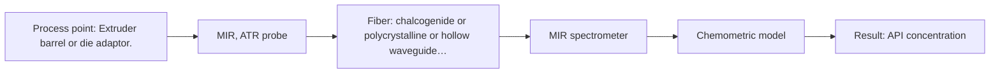

# First technical assessment: API concentration during hot polymer extrusion

## Answer

**Customer request (our summary):** The customer wants to know if an optical measurement can detect composition changes during a hot polymer extrusion process incorporating an active pharmaceutical ingredient, and requests an initial comparison plan.

### Brief answer

To monitor composition changes in hot polymer extrusion, start with multi-method laboratory trials comparing MIR-ATR and NIR reflection probes. MIR-ATR provides high chemical specificity for fingerprinting, while NIR reflection suits robust barrel mounting. Clarify your polymer, API type, concentration range, and optical properties before selecting the final probe hardware.

### Proposal

- **Best current option:** O2 (recommended)
- **Basis:** engineering judgement, with secondary external support E02 ¶4 (not AFS material)
- **What would change it:** Confirmation that NIR diffuse reflection adequately resolves the API without requiring surface ATR contact.
- **Next step:** Conduct multi-method laboratory trials using representative polymer-API samples to evaluate MIR-ATR and NIR reflection.

**Secondary evidence (external, not AFS material):** G1: E02 ¶4; G2: no usable external source found; G3: no usable external source found; G4: no usable external source found. See Expert detail.

**Decision status:** Insufficient information for a method choice

### Solution options

| ID | Tier | Methods | Confidence | Cost class, S01 Table 1 (p.6) | Ease of use | Maintenance | Performance fit | Sources |
|---|---|---|---|---|---|---|---|---|
| O1 | Simple | M2 NIR, diffuse reflection probe | Low: open question: Q1 (starts at Medium); sample clarity unknown; status: insufficient information | average cost (row 8) | High with NIR reflection probe | Periodic cleaning of probe window | Suitable if NIR overtones resolve the API concentration. | [1: S01 p.10] [2: S02 p.14] |
| O2 | Recommended | M1 MIR, ATR probe | Low: open question: Q1 (starts at Medium); status: insufficient information | high cost (row 2) | Moderate due to ATR contact requirements | Crystal cleaning and inspection for fouling | High chemical specificity for polymer and API fingerprinting. | [3: S01 p.9] [4: S02 p.14] |

*Confidence rates the basis of the advice (how much is known and cited), not a predicted accuracy or probability of success. It starts at High, or at Medium when a key question on the method or the option is open, and drops one level per weakness listed (floor Low).*

*Cost class is the relative rating in S01 Table 1 (p.6) for the in-line method+technique rows named (the highest one for a multi-method option); it is not a price.*

### Setup sketch

*Recommended option O2; drawn by code from the option, a schematic, not a configuration.*

### Key questions

1. What are the specific polymer and active pharmaceutical ingredient (API) types, and what is the target API concentration range?
2. What is the optical clarity and scattering behavior of the polymer melt at the extrusion temperature?
3. What are the exact process temperature and pressure limits at the extruder installation point?

## Expert detail

**Customer enquiry**

> We are developing a hot polymer extrusion process that incorporates an active pharmaceutical ingredient. We want to investigate whether an optical measurement can detect composition changes while the melt is being processed. We have offline assays, but the process interface is hot and may be exposed to material build up. We need an initial comparison plan and the questions required before choosing a probe.

**Decision status:** Insufficient information for a method choice. The specific polymer, active pharmaceutical ingredient, and melt optical properties are unknown, so a definitive method choice cannot be established without preliminary laboratory trials and clarification.

### Parameters

| ID | Parameter | Kind | Need | Measured by | Why | Sources |
|---|---|---|---|---|---|---|
| P1 | API concentration | quantitative | required | Spectroscopy: MIR | Tracks composition changes and blend potency in the melt. | *(no verified source: engineering judgement)* |

### Solution option details

- **O1 cost drivers:** Standard NIR spectrometer and reflection probe hardware.
- **O2 cost drivers:** FTIR spectrometer and specialized MIR fiber probe with high-refractive-index crystal.

### Premise check

- **Supported:** An initial comparison plan and probe questions can be provided without knowing the specific polymer, API, concentration range, or optical properties. A general comparison framework and key clarification questions can be outlined based on established polymer extrusion monitoring precedents. [5: S01 p.3]

### Requirements

**Stated by the customer**

- Investigate composition changes during hot polymer extrusion incorporating an active pharmaceutical ingredient
- Initial comparison plan
- Clarification questions before choosing a probe

**Key unknowns**

- Specific polymer and active pharmaceutical ingredient types
- Concentration range of the API
- Optical properties and clarity of the polymer melt
- Exact process temperature and pressure limits
- Required measurement accuracy and response time

### Clarification questions (most decision-relevant first)

Q1. What are the specific polymer and active pharmaceutical ingredient (API) types, and what is the target API concentration range? *Why it matters:* Determines characteristic spectral absorption bands and required detection sensitivity. *(affects: method, technique)*
Q2. What is the optical clarity and scattering behavior of the polymer melt at the extrusion temperature? *Why it matters:* Decides whether transmission, reflection, or ATR is feasible for the melt phase. *(affects: technique)*
Q3. What are the exact process temperature and pressure limits at the extruder installation point? *Why it matters:* Ensures probe and fiber hardware compatibility with extreme thermal and mechanical loads. *(affects: installation)*

### Recommendation

- **M1 · Primary candidate: MIR, ATR probe.** Mid-IR spectroscopy provides high chemical specificity for functional groups and is demonstrated for API-in-polymer extrusion using diamond cone ATR probes. *Conditions:* Requires tight contact with the melt and a crystal material resistant to the process temperature. [3: S01 p.9] [4: S02 p.14]
- **M2 · Comparison candidate: NIR, diffuse reflection probe.** NIR reflection probes can be flush-mounted directly into extruder barrels or die adapters for robust in-line monitoring. *Conditions:* Requires chemometric calibration for the specific polymer-API matrix. [1: S01 p.10] [2: S02 p.14]

### Measurement concept

- **Probe and geometry:** Diamond or PEEK-sealed ATR probe or NIR reflection probe flush-mounted at the extruder barrel or die adaptor.
- **Location:** Extruder barrel or die adaptor.
- **Fiber link:** Chalcogenide (CIR) or polycrystalline infrared (PIR) fibers for MIR, or low-OH silica fibers for NIR. [2: S02 p.14]

### Spectral range

- **MIR:** Nominal 4000-400 cm-1 (2.5-25 µm); usable range depends on the spectrometer, fiber, and ATR crystal configuration. [3: S01 p.9]
- **NIR:** Nominal 780-2500 nm; usable range depends on the instrument, fiber, and reflection probe actually used. [6: S01 p.10]

### Risks and uncertainty

- Material build-up or fouling on the optical interface can obscure the signal or alter the effective pathlength. *(rules: R-MIR-3)* [7: S01 p.13]

### First feasibility experiment

1. **Multi-method laboratory trials** Test representative polymer-API samples across MIR and NIR to identify optimal spectral features. [8: S02 p.20]
2. **Reference assay correlation** Compare spectral variations against independent offline assays to build initial quantitative calibration models. [9: S01 p.3]

**Reference measurements:** Offline assays provided by the customer for reference concentration values.

**Decision basis:** Go/no-go is determined by whether the spectral model achieves the customer's required prediction accuracy against offline assay references.

### Assumptions

- The customer has representative polymer and API batches available for initial testing.
- Offline reference assays can provide accurate composition benchmarks.

### Not covered by the supplied sources

- Specific chemical structures of the customer's proprietary polymer and API.
- Exact extruder operating temperatures and pressures.

### Further notes

- **Chemometrics:** Multivariate calibration (such as PLS regression) is required to correlate broad NIR or detailed MIR spectra with API concentration changes.
- **Real-time tracking:** High-speed spectral acquisition is necessary to track dynamic composition changes in the extrusion melt.
- **Future direction:** Transition from laboratory spectrometer testing to a dedicated optical multisensor system (OMS) or IoT sensor for continuous extrusion monitoring.

### Secondary evidence (external, not AFS material)

*Found by a literature search for gaps the supplied AFS sources leave open. Not AFS material and not proof for this case; every quote below was verified verbatim against the fetched text.*

*Live search unavailable (library only: cache miss (europepmc); cache miss (openalex)); curated library only.*

**G1 · decision status:** insufficient information: The specific polymer, active pharmaceutical ingredient, and melt optical properties are unknown, so a definitive method choice cannot be established without preliminary laboratory trials and clarification.

- **E02 ¶4** Attenuated total reflection probes can enable in-line measurements in demanding reaction environments. *How it applies:* This suggests that probe-based systems might be suitable for challenging extrusion environments, though testing is required to confirm compatibility with the specific polymer and API. *Limits and transfer risks:* The cited context focuses on polysiloxane formation and reactive mixtures rather than hot polymer extrusion with active pharmaceutical ingredients, so transferability to the customer's specific matrix remains uncertain. *(supports O2)*
  > "Attenuated total reflection probes (ATR) allow in-line measurements even in demanding measurement environments and reaction mixtures with highly oxidative and corrosive substances, such as chlorosilanes or strong acids and bases."
  > A Process Analytical Concept for In-Line FTIR Monitoring of Polysiloxane Formation. (2020) · Polymers · doi:10.3390/polym12112473 · https://europepmc.org/article/PMC/PMC7693933 · retrieved 2026-10-17, full text, licence: cc by, via curated library

**G2 · not in the supplied sources:** Specific chemical structures of the customer's proprietary polymer and API.

- No usable external source found.

**G3 · not in the supplied sources:** Exact extruder operating temperatures and pressures.

- No usable external source found.

**G4 · parameter without a source:** Measuring API concentration: Tracks composition changes and blend potency in the melt.

- No usable external source found.

### Evidence (verified quotes)

1. ✓ **S01 p.10** (general): "Near-IR vibrational spectroscopy (NIR) is the most common online analysis method performed using fiber optic probes."
2. ✓ **S02 p.14** (application precedent): "NIR-Reflex & MIR-ATR-spectroscopy to control polymer extrusion in-line"
3. ✓ **S01 p.9** (general): "Vibrational spectroscopy in the mid-IR range (4000-400 cm-1) is one of the most informative methods of chemical analysis."
4. ✓ **S02 p.14** (application precedent): "Spectra of API in hot polymer obtained with Diamond cone ATR probe coupled to iC10 FTIR"
5. ✓ **S01 p.3** (general): "The exploratory nature of scientific research does not always allow for a precise prediction of which existing method will yield the desired result."
6. ✓ **S01 p.10** (general): "NIR spectra (780-2500 nm) contain predominantly overtones and component bands of fundamental vibrations"
7. ✓ **S01 p.13** (general): "typically at a depth of few microns"
8. ✓ **S02 p.20** (general): "1. Multi-Method Lab Trials AFS tests your process using all key fiber optic spectroscopy methods."
9. ✓ **S01 p.3** (general): "The relevant measurement and data analysis methods are provided, including software and illustrative explanations."

### Verification

- Citations verified: 11 of 11 (exact or whitespace/hyphen-tolerant match on the cited page, scope checked).
- Hard check failures before deterministic corrections: 0; still open: 0; soft warnings: 1; repair rounds: 0.
- External evidence (cache): 1 quote(s) verified verbatim (exact or whitespace/hyphen-tolerant, at most 400 characters and 2 sentences, against the cited paragraph); 0 item(s) dropped.
- External search: 3 query(ies), 0 hit(s), 3 source(s) (3 from the curated library); ⚠ library only: cache miss (europepmc); cache miss (openalex).
- External step: 2 model call(s), 2.4 s extra (cost in the run JSON).

*Run D07-20261018T075900Z-19c7 · models google/gemini-3.5-flash-lite*
