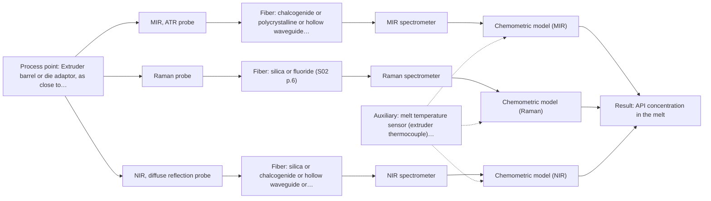

# First technical assessment: API concentration during hot polymer extrusion

## Answer

**Customer request (our summary):** The customer wants to know if optical measurement can detect composition changes in a hot polymer extrusion process incorporating an active pharmaceutical ingredient, and requests an initial comparison plan.

### Brief answer

Test MIR-ATR first: it is the only supplied technique with a published precedent for API in hot polymer extrusion, and ATR suits melts in contact with the crystal. Run Raman as a comparison and NIR reflection only if the melt proves opaque; skip NIR transmission, which fails in thick opaque melts. Open points: polymer/API identity and concentration range, melt temperature and pressure, optical regime, required accuracy and response time, and fouling behaviour at the probe port.

### Proposal

- **Best current option:** O2 (recommended)
- **Basis:** supplied AFS sources
- **What would change it:** If the melt is clear and the API bands are strong in MIR alone, O1 may suffice; if the melt temperature exceeds probe material limits, the installation concept must change before any method is chosen.
- **Next step:** Answer the clarification questions and run a multi-method lab trial on representative hot melt samples with MIR-ATR first, then Raman, against the offline assays.

**Secondary evidence (external, not AFS material):** G1: no usable external source found; G2: no usable external source found; G3: no usable external source found; G4: E02 ¶33. See Expert detail.

**Decision status:** Provisional feasibility assessment

### Solution options

| ID | Tier | Methods | Confidence | Cost class, S01 Table 1 (p.6) | Ease of use | Maintenance | Performance fit | Sources |
|---|---|---|---|---|---|---|---|---|
| O1 | Simple | M1 MIR, ATR probe | Low: open question: Q1 (starts at Medium); uncited auxiliary sensor | high cost (row 2) | Single probe, straightforward bench trial | Crystal cleaning and fouling checks needed | Direct precedent for API in hot polymer melt | [1: S02 p.14] [2: S01 p.10] [3: S01 p.13] |
| O2 | Recommended | M1 MIR, ATR probe; M2 Raman probe; M3 NIR, diffuse reflection probe | Low: open question: Q1 (starts at Medium); sample clarity unknown; uncited auxiliary sensor | high cost (rows 2, 8, 12) | Multi-method lab trial, moderate setup | Per-method calibration and diagnostics | Covers unknown optical regime and complements MIR with Raman | [4: S01 p.3] [1: S02 p.14] [2: S01 p.10] [3: S01 p.13] [5: S01 p.11] [6: S01 p.11] [7: S01 p.17] [8: S02 p.14] |

*Confidence rates the basis of the advice (how much is known and cited), not a predicted accuracy or probability of success. It starts at High, or at Medium when a key question on the method or the option is open, and drops one level per weakness listed (floor Low).*

*Cost class is the relative rating in S01 Table 1 (p.6) for the in-line method+technique rows named (the highest one for a multi-method option); it is not a price.*

### Setup sketch

*Recommended option O2; drawn by code from the option, a schematic, not a configuration.*

### Key questions

1. Which polymer and API are involved, and over what API concentration range should changes be detected?
2. What melt temperature and pressure will the probe tip see, and is a flush or immersion port available?
3. Is the melt optically clear, turbid or opaque at process temperature?

## Expert detail

**Customer enquiry**

> We are developing a hot polymer extrusion process that incorporates an active pharmaceutical ingredient. We want to investigate whether an optical measurement can detect composition changes while the melt is being processed. We have offline assays, but the process interface is hot and may be exposed to material build up. We need an initial comparison plan and the questions required before choosing a probe.

**Decision status:** Provisional feasibility assessment. A shortlist can be justified from the supplied material, but the polymer/API identity, melt temperature and optical regime are unknown, so the technique choice stays provisional.

### Parameters

| ID | Parameter | Kind | Need | Measured by | Why | Sources |
|---|---|---|---|---|---|---|
| P1 | API concentration in the melt | quantitative | required | Spectroscopy: MIR | It is the target variable whose changes the optical method must detect. | [1: S02 p.14] |
| P2 | Polymer matrix and API identity | qualitative | required | Reference lab method: offline assay / lab FTIR identification | The spectral bands, probe material compatibility and calibration matrix depend on the chemistry. | *(no verified source: engineering judgement)* |
| P3 | Melt temperature at the measurement point | quantitative | required | Auxiliary sensor: melt temperature sensor (extruder thermocouple) (engineering judgement: confirm availability with AFS) | It decides whether the probe and fiber can survive in-line and affects the spectra. | *(no verified source: engineering judgement)* |
| P4 | Melt optical regime (clear, turbid or opaque) | qualitative | optional | Reference lab method: visual/optical inspection of hot-pressed samples | It should be available from simple lab inspection and decides whether reflection-style geometries are needed. | *(no verified source: engineering judgement)* |

### Solution option details

- **O1 cost drivers:** One MIR-ATR probe, FTIR spectrometer, lab trial time, offline reference assays
- **O2 cost drivers:** Two to three probe/spectrometer sets, trial time, chemometric model building

### Premise check

- **Precedent only:** Optical measurement can detect composition changes in a hot polymer melt with an API in-line. A supplied process example shows NIR reflection and MIR-ATR spectroscopy used to control polymer extrusion in-line with an API in hot polymer; this is a reason to test, not proof for this customer's process. [8: S02 p.14]
- **Precedent only:** An ATR probe can be used on a hot melt despite the hot, fouling-prone interface. The same example shows a diamond cone ATR probe used on API in hot polymer, but the sources give no temperature rating or fouling performance, so this must be verified for the customer's conditions. [1: S02 p.14]

### Requirements

**Stated by the customer**

- Detect composition changes while the melt is being processed
- Cope with a hot process interface and possible material build-up
- Provide an initial comparison plan and pre-probe questions

**Key unknowns**

- Polymer matrix and API identity, and the API concentration range
- Melt temperature and pressure at the intended measurement point
- Optical regime of the melt (clear, turbid or opaque)
- Required accuracy and response time
- Available port geometry and probe access in the extruder

### Clarification questions (most decision-relevant first)

Q1. Which polymer and API are involved, and over what API concentration range should changes be detected? *Why it matters:* The spectral bands, detection limit and calibration feasibility all depend on the chemistry and the concentration range. *(affects: method, technique)*
Q2. What melt temperature and pressure will the probe tip see, and is a flush or immersion port available? *Why it matters:* It decides whether an ATR or reflection probe can survive in-line and where it can be mounted. *(affects: installation)*
Q3. Is the melt optically clear, turbid or opaque at process temperature? *Why it matters:* Transmission-style geometries fail in opaque melts, while reflection and ATR need them; this decides the technique. *(affects: technique)*
Q4. What accuracy and response time does the composition-change detection need? *Why it matters:* It determines whether a full-spectrum method suffices or a faster reduced-channel approach is needed. *(affects: status)*
Q5. How quickly does material build up on surfaces at the proposed measurement point, and how is the probe cleaned? *Why it matters:* ATR samples only a thin surface layer, so fouling directly corrupts the signal. *(affects: M1, installation)*

### Recommendation

- **M1 · Primary candidate: MIR, ATR probe.** MIR-ATR is the only in-line technique with a direct published precedent for API in hot polymer extrusion, and ATR suits melts in contact with the crystal. Its few-micron sampling depth makes fouling the main risk to test. *Conditions:* Probe materials must be verified against the actual melt temperature and the polymer/API chemistry. [1: S02 p.14] [2: S01 p.10] [3: S01 p.13]
- **M2 · Comparison candidate: Raman probe.** Raman passed screening and complements MIR spectrally, giving a second view of the API and polymer bands in the same trial. Weak signals and possible fluorescence background must be checked on the real melt. [5: S01 p.11] [6: S01 p.11]
- **M3 · Conditional candidate: NIR, diffuse reflection probe.** NIR reflection suits opaque, concentrated streams and has an extrusion precedent alongside MIR-ATR, but its fit depends on the melt's optical regime, which is unknown. *Conditions:* Include it only if the melt proves opaque or highly scattering; reflection signals are sensitive to surface characteristics and scatter correction will be needed. [7: S01 p.17] [8: S02 p.14]
- **M4 · Not recommended: NIR, transmission/transflection probe.** A hot polymer melt is typically too thick or opaque for transmission, which fails when light cannot penetrate the sample; the pathlength constraint also makes it unsuitable here. [9: S01 p.18]

### Measurement concept

- **Probe and geometry:** Immersion or flush-mounted MIR ATR fiber probe (diamond or ZrO2 crystal) at the extruder die or barrel, with a Raman probe tested at the same spot in lab trials
- **Location:** Extruder barrel or die adaptor, as close to the die as the port allows
- **Fiber link:** MIR link requires infrared transmitting fibers such as CIR or PIR fibers because standard silica fibers cannot transmit the mid-IR range; Raman and NIR use silica fibers; achievable MIR link length in production remains an open question as only short laboratory test lengths are documented [10: S02 p.6] [11: S02 p.10]

### Spectral range

- **MIR:** Nominal MIR range is 4000-400 cm-1; the usable range depends on the instrument, fiber and probe actually selected. [12: S01 p.9]
- **Raman:** Raman shift in cm-1 with the laser excitation wavelength (e.g. 785 nm in the pharma example) stated separately; exact coverage depends on the spectrometer and probe. [13: S01 p.15]
- **NIR:** Nominal NIR range 780-2500 nm; the usable range depends on the instrument, fiber and probe actually selected. [14: S01 p.10]

### Risks and uncertainty

- Material build-up on the ATR crystal corrupts the few-micron surface-layer signal and may be the dominant failure mode. *(rules: R-MIR-3)* [3: S01 p.13]
- No source states a temperature rating or achievable MIR fiber length for this installation, so probe survival and link length are unverified. *(rules: R-FIB-2)* [15: S02 p.7]
- Fluorescence background from the polymer or API could swamp the Raman signal and remove M2 as a comparison. *(rules: R-RAM-1)* [6: S01 p.11]
- Any calibration is specific to the polymer/API matrix and must be rebuilt if the formulation changes. *(rules: R-CAL-1)* [16: REF §5]

### First feasibility experiment

1. **Collect representative melt samples across the expected API concentration and polymer variation, including hot-pressed lab extrusions at process temperature.** Cover the chemical and physical variation the in-line model must handle. *(no verified source: engineering judgement)*
2. **Measure each sample with the offline assays as independent reference values for API content.** Provide the reference data the spectral calibration is validated against. *(no verified source: engineering judgement)*
3. **Test MIR-ATR first on the hot melt samples, then Raman on the same samples, each as a single method.** Compare the single methods before any combination, checking Raman for fluorescence background. [17: S02 p.20]
4. **If both single methods show signal, test a fused MIR+Raman model on held-out extrusion runs and check it beats the best single method.** Verify any combination gain is real before adding hardware. [18: S01 p.15]
5. **Validate the chosen method on held-out extrusion runs against the offline assay, with go/no-go criteria (accuracy and response time) set by the customer.** Establish an agreed basis for proceeding to an in-line probe selection. [19: REF §3]

**Reference measurements:** The customer's offline assays on matched samples

**Decision basis:** Customer-defined accuracy and response-time thresholds on held-out runs

### Assumptions

- The melt behaves as a liquid or soft solid in contact with a probe, so ATR contact is physically possible.
- The offline assays can deliver reference values matched to spectral measurements.

### Not covered by the supplied sources

- Temperature and pressure ratings of ATR or Raman probes for hot-melt extrusion service
- Achievable MIR fiber link length for an in-line extruder installation

### Further notes

- **Chemometrics:** A PLS calibration for API concentration will need reference assays across the concentration range and validation on held-out runs; NIR/Raman calibrations are matrix-specific and must be rebuilt if the formulation changes.
- **Real-time tracking:** The goal is in-line, time-resolved tracking of composition during extrusion; acquisition speed and synchronisation matter if two methods are later combined.
- **Future direction:** If the lab trial succeeds, a customized in-line system or reduced-channel spectral sensor for the extruder port can be developed.

### Secondary evidence (external, not AFS material)

*Found by a literature search for gaps the supplied AFS sources leave open. Not AFS material and not proof for this case; every quote below was verified verbatim against the fetched text.*

*Live search unavailable (library only: cache miss (europepmc); cache miss (openalex)); curated library only.*

**G1 · auxiliary sensor:** In-line measurement of Melt temperature at the measurement point with melt temperature sensor (extruder thermocouple)

- No usable external source found.

**G2 · not in the supplied sources:** Temperature and pressure ratings of ATR or Raman probes for hot-melt extrusion service

- No usable external source found.

**G3 · not in the supplied sources:** Achievable MIR fiber link length for an in-line extruder installation

- No usable external source found.

**G4 · parameter without a source:** Measuring Polymer matrix and API identity: The spectral bands, probe material compatibility and calibration matrix depend on the chemistry.

- **E02 ¶33** The publication notes that optical fiber systems can be utilized to mitigate heat influence from the globar. *How it applies:* This finding can be tested during probe design to see if fiber separation helps manage thermal loading from the hot extrusion process. *Limits and transfer risks:* The source discusses polysiloxane formation rather than a polymer melt extrusion with an active pharmaceutical ingredient, so thermal and viscosity conditions differ. *(supports O2)*
  > "In order to reduce the influence of heat development of the globar, an optical fiber system can be used."
  > A Process Analytical Concept for In-Line FTIR Monitoring of Polysiloxane Formation. (2020) · Polymers · doi:10.3390/polym12112473 · https://europepmc.org/article/PMC/PMC7693933 · retrieved 2026-10-17, full text, licence: cc by, via curated library

### Evidence (verified quotes)

1. ✓ **S02 p.14** (application precedent): "Spectra of API in hot polymer obtained with Diamond cone ATR probe coupled to iC10 FTIR (MTAC)"
2. ✓ **S01 p.10** (general): "Probe-based analysis is gaining widespread use in online analysis, such as in-line, in-process (chemical, biotechnological, natural) environments"
3. ✓ **S01 p.13** (general): "typically at a depth of few microns"
4. ✓ **S01 p.3** (general): "samples of incompletely known composition, in order to select the most suitable method or combination of methods."
5. ✓ **S01 p.11** (general): "This property makes mid-IR and Raman spectra complementary, that is, they complement each other."
6. ✓ **S01 p.11** (general): "superposition of luminescence (fluorescence), which has a significantly higher intensity."
7. ✓ **S01 p.17** (general): "NIR Reflection is primarily used for opaque or highly concentrated dairy products, such as yogurt, butter, or whole milk concentrates."
8. ✓ **S02 p.14** (application precedent): "NIR-Reflex & MIR-ATR-spectroscopy to control polymer extrusion in-line"
9. ✓ **S01 p.18** (general): "it fails when the milk becomes too "thick" or fat-rich, as the light cannot penetrate the sample."
10. ✓ **S02 p.6** (general): "3000 nm Polycrystalline Infrared Fibers 17 μm"
11. ✓ **S02 p.10** (general): "1.25 Meter Silver Halide - straight run"
12. ✓ **S01 p.9** (general): "Vibrational spectroscopy in the mid-IR range (4000-400 cm-1) is one of the most informative methods of chemical analysis."
13. ✓ **S01 p.15** (general): "Raman spectrometer and Raman fiber probe for contact measurements with 785 nm excitation wavelength"
14. ✓ **S01 p.10** (general): "NIR spectra (780-2500 nm) contain predominantly overtones and component bands of fundamental vibrations"
15. ✓ **S02 p.7** (general): "Robust 100-300m cables made with Silica fibers of low OH-content (<0.1ppm OH) enable remote industrial process-control"
16. ✓ **REF §5** (general): "Weak signal, fluorescence background; calibration specific to the matrix."
17. ✓ **S02 p.20** (general): "1. Multi-Method Lab Trials AFS tests your process using all key fiber optic spectroscopy methods."
18. ✓ (precedent only) **S01 p.15** (method gain): "By combining Raman and NIR, these models can predict API potency or coating thickness with higher accuracy and robustness than single-method models."
19. ✓ **REF §3** (general): "Representative samples or process states, independent reference measurements, what is compared, and the basis for the go / no-go decision."

### Verification

- Citations verified: 24 of 24 (exact or whitespace/hyphen-tolerant match on the cited page, scope checked).
- Hard check failures before deterministic corrections: 0; still open: 0; soft warnings: 1; repair rounds: 1.
- External evidence (cache): 1 quote(s) verified verbatim (exact or whitespace/hyphen-tolerant, at most 400 characters and 2 sentences, against the cited paragraph); 0 item(s) dropped.
- External search: 4 query(ies), 0 hit(s), 3 source(s) (3 from the curated library); ⚠ library only: cache miss (europepmc); cache miss (openalex).
- External step: 2 model call(s), 2.5 s extra (cost in the run JSON).

*Run D07-20261018T075900Z-34af · models google/gemini-3.5-flash-lite, google/gemini-3.8-flash, z-ai/glm-5.3-flash*
