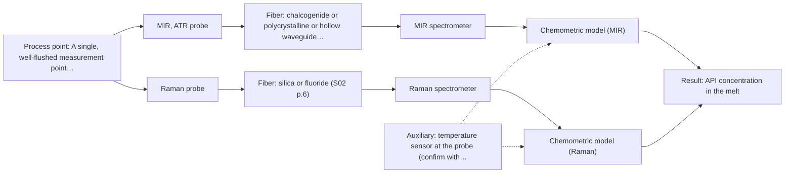

# First technical assessment: API concentration during hot polymer extrusion

## Answer

**Customer request (our summary):** Customer is developing a hot polymer extrusion process incorporating an active pharmaceutical ingredient and wants to investigate optical detection of composition changes in the melt, with an initial comparison plan and pre-probe questions.

### Brief answer

Test mid-infrared ATR first: a shown application reports MIR-ATR spectra of API in hot polymer during extrusion, and ATR suits a melt in contact with a crystal. Raman is the natural second single-method test on the same samples; NIR reflection only if the melt proves strongly scattering. Still open: the API and its concentration range, the melt temperature and access at the port, and how build-up will be managed.

### Proposal

- **Best current option:** O2 (recommended)
- **Basis:** supplied AFS sources
- **What would change it:** If the API bands are buried by the polymer in mid-IR, or polymer fluorescence swamps Raman, the choice moves to the NIR reflection comparison (M3). If the melt temperature, the pressure or the build-up at the port proves unmanageable, the installation concept has to change before any method is fixed.
- **Next step:** Answer the questions on API and range, melt conditions and optical behaviour, and supply representative melt samples with their offline assay values so the first single-method comparison can be run.

**Secondary evidence (external, not AFS material):** G1: E01 ¶19; G2: no usable external source found; G3: E02 ¶8, E02 ¶24; G4: E03 ¶33. See Expert detail.

**Decision status:** Provisional feasibility assessment

### Solution options

| ID | Tier | Methods | Confidence | Cost class, S01 Table 1 (p.6) | Ease of use | Maintenance | Performance fit | Sources |
|---|---|---|---|---|---|---|---|---|
| O1 | Simple | M1 MIR, ATR probe | Low: open question: Q2 (starts at Medium); uncited auxiliary sensor and a parameter is not measurable in-line | high cost (row 2) | one probe, one spectrometer | crystal contact, cleaning, build-up watch | shown precedent for API in hot polymer | [1: S02 p.14] [2: S02 p.14] [3: S01 p.10] [4: S01 p.9] |
| O2 | Recommended | M1 MIR, ATR probe; M2 Raman probe | Low: open question: Q2 (starts at Medium); uncited auxiliary sensor and a parameter is not measurable in-line | high cost (rows 2, 12) | two probes, two spectrometers | two probes to clean and check | complementary vibrational view of the API bands | [5: S01 p.11] [2: S02 p.14] [3: S01 p.10] [4: S01 p.9] [6: S01 p.15] |

*Confidence rates the basis of the advice (how much is known and cited), not a predicted accuracy or probability of success. It starts at High, or at Medium when a key question on the method or the option is open, and drops one level per weakness listed (floor Low).*

*Cost class is the relative rating in S01 Table 1 (p.6) for the in-line method+technique rows named (the highest one for a multi-method option); it is not a price.*

### Setup sketch

*Recommended option O2; drawn by code from the option, a schematic, not a configuration.*

### Key questions

1. Is the melt at the measurement point transparent, strongly scattering or opaque, and does it contain fillers, pigments or other particulates?
2. Which active pharmaceutical ingredient is used, and over what concentration range must a composition change be detected?
3. What are the melt temperature and pressure at the intended measurement point?

## Expert detail

**Customer enquiry**

> We are developing a hot polymer extrusion process that incorporates an active pharmaceutical ingredient. We want to investigate whether an optical measurement can detect composition changes while the melt is being processed. We have offline assays, but the process interface is hot and may be exposed to material build up. We need an initial comparison plan and the questions required before choosing a probe.

**Decision status:** Provisional feasibility assessment. A shortlist can be justified: MIR-ATR suits a melt in contact with a crystal, and a shown application reports MIR-ATR spectra of API in hot polymer during extrusion. What is not covered by any supplied source is whether a probe survives the hot interface and build-up, so the plan rests on the stated assumptions and on the open questions.

### Parameters

| ID | Parameter | Kind | Need | Measured by | Why | Sources |
|---|---|---|---|---|---|---|
| P1 | API concentration in the melt | quantitative | required | Spectroscopy: MIR | The composition change to be detected is the API level, so this is the quantity the calibration has to predict. | [2: S02 p.14] |
| P2 | Melt temperature at the measurement point | quantitative | required | Auxiliary sensor: temperature sensor at the probe (engineering judgement: confirm availability with AFS) | Temperature shifts the spectra and sets what the probe, crystal and fiber must tolerate at the port. | *(no verified source: engineering judgement)* |
| P3 | Polymer grade and additive package | qualitative | required | Reference lab method: material specification and the customer's offline assay | The calibration is specific to the matrix, so a change of grade or additives has to be known and the model re-validated. | [7: REF §5] |
| P4 | Build-up layer on the probe interface | qualitative | required | Not measurable in-line by spectroscopy; alternative: scheduled probe inspection and a repeat spectrum of a reference standard before and after a run | ATR sees only a surface layer a few micrometres deep, so a deposit changes what is measured without any change in the melt. | [8: S01 p.13] |

### Solution option details

- **O1 cost drivers:** one mid-IR spectrometer, one ATR probe, calibration runs
- **O2 cost drivers:** second spectrometer and Raman probe, extra calibration

### Premise check

- **Precedent only:** An optical probe at the process interface can detect composition changes in a hot polymer melt in-line. A conference slide shows MIR-ATR spectra of API in hot polymer obtained during extrusion, which is a reason to test the method here, not proof that it will work for this process. [2: S02 p.14]
- **Not covered:** A probe exposed to a hot interface that may build up material can keep measuring reliably. No supplied source addresses fouling, cleaning or probe ratings for a hot polymer melt; the shallow ATR sampling depth makes the concern real, but the mitigation is not described anywhere in the material. *(no verified source: engineering judgement)*

### Requirements

**Stated by the customer**

- Compare optical methods for detecting composition changes in a hot polymer melt carrying an active pharmaceutical ingredient.
- Provide the questions that must be answered before a probe is chosen.
- The process interface is hot and may be exposed to material build-up.
- Offline assays are available as a reference.

**Key unknowns**

- Identity of the API and the concentration range over which composition change must be seen.
- Optical behaviour of the melt: transparent, strongly scattering or opaque, and presence of fillers or additives.
- Whether the API or the polymer fluoresces, which decides the Raman option.
- Melt temperature and pressure at the intended measurement point.
- Installation point, access and distance from the port to the spectrometer.
- Required accuracy and response time, and the uncertainty of the existing offline assay.

### Clarification questions (most decision-relevant first)

Q1. Is the melt at the measurement point transparent, strongly scattering or opaque, and does it contain fillers, pigments or other particulates? *Why it matters:* The optical behaviour decides whether a reflection or a transmission geometry is meaningful at all, and therefore whether the NIR reflection comparison applies. *(affects: technique)*
Q2. Which active pharmaceutical ingredient is used, and over what concentration range must a composition change be detected? *Why it matters:* The identity and level of the API decide which method has usable bands and whether the target sits below the sensitivity of a method. *(affects: method)*
Q3. What are the melt temperature and pressure at the intended measurement point? *Why it matters:* Both set what the probe, crystal and fiber must tolerate and whether an in-line port is feasible at that location. *(affects: installation)*
Q4. Where is the measurement point, how far is it from the spectrometer, and how often can a probe be accessed for cleaning? *Why it matters:* Access and distance fix the probe geometry and the fiber link, and build-up at the port cannot be managed without access. *(affects: installation)*
Q5. Do the polymer or the API fluoresce under visible or near-infrared laser light? *Why it matters:* A strong fluorescence background can swamp the Raman bands and would decide against the Raman comparison. *(affects: M2)*
Q6. What accuracy and response time must the measurement reach, and how uncertain is the existing offline assay? *Why it matters:* The go/no-go threshold and the usable reference both come from these numbers, and without them no method can be judged adequate. *(affects: status)*

### Recommendation

- **M1 · Primary candidate: MIR, ATR probe.** ATR fiber probes handle liquids and soft solids in contact with the crystal, and a shown application reports MIR-ATR spectra of API in hot polymer during extrusion. Mid-IR gives well-defined absorption bands, which is the most direct route to an API fingerprint inside a polymer matrix. *Conditions:* Applies if the melt wets the ATR crystal and the API has a mid-IR band that is not buried by the polymer matrix. [2: S02 p.14] [3: S01 p.10] [4: S01 p.9]
- **M2 · Comparison candidate: Raman probe.** Mid-IR and Raman spectra are complementary, and Raman reports the molecular backbone and symmetrical non-polar groups, so it is the natural second single-method test on the same samples. Running it as its own method, not fused, shows whether it adds anything the mid-IR spectrum misses. *Conditions:* Worth keeping only if fluorescence from the polymer or the API does not swamp the Raman bands on real melt samples. [5: S01 p.11] [6: S01 p.15]
- **M3 · Conditional candidate: NIR, diffuse reflection probe.** A shown extrusion application pairs NIR reflection with MIR-ATR for in-line control, so NIR reflection is the expected alternative to check. It is only sensible if the melt scatters strongly, since reflection is less representative for clear liquids. *Conditions:* Only if the melt is opaque or strongly scattering and a reflection probe can be mounted at the port, which is decided by the answer on optical behaviour. [1: S02 p.14] [9: S01 p.18]

### Measurement concept

- **Probe and geometry:** First choice is an ATR fiber probe in contact with the melt, mounted at a port in the extruder or die adaptor; Raman would use a separate contact probe on the same port or a neighbouring one, NIR reflection a non-contact probe if the melt is strongly scattering.
- **Location:** A single, well-flushed measurement point where the melt is homogeneous, not in a dead zone where build-up would collect.
- **Fiber link:** The fiber family follows the method: mid-IR needs chalcogenide or polycrystalline infrared fibers, Raman needs silica fibers free of polymer-jacket fluorescence; the achievable link length for a mid-IR probe at a production extruder is not stated in the supplied material. [10: S02 p.7]

### Spectral range

- **MIR:** Nominal mid-IR range 4000-400 cm-1; the usable range depends on the fiber, crystal and spectrometer actually selected. [11: S01 p.9]
- **Raman:** Raman is reported as Raman shift in cm-1, with the laser excitation wavelength stated separately; neither value is fixed for this case yet. [12: S01 p.11]

### Risks and uncertainty

- Build-up on the ATR crystal can make the measurement unrepresentative, because ATR samples only a surface layer a few micrometres deep. *(rules: R-MIR-3)* [8: S01 p.13]
- The API bands may be hidden by the polymer matrix in mid-IR, or by polymer fluorescence in Raman, once real melt samples are measured. *(rules: R-RAM-1, R-CAL-1)* *(no verified source: engineering judgement)*
- The melt temperature and pressure at the probe may exceed what a probe and fiber can tolerate, and no supplied source gives ratings for a hot melt. *(rules: R-FIB-2)* *(no verified source: engineering judgement)*
- If the required accuracy is tighter than the method can reach, or the API level is a trace component, no option in this shortlist meets the target. *(rules: R-NIR-4)* *(no verified source: engineering judgement)*

### First feasibility experiment

1. **Collect melt samples or process states that span the expected API range, the polymer grades and the melt temperatures, including start-up and any known off-spec material.** Cover the chemical and physical variation the method must survive. [13: REF §3]
2. **Record MIR-ATR spectra of each sample at process-representative temperature, then Raman spectra on the same material, keeping each method as its own single-method data set.** Single methods first, so each can be judged on its own before any combination is considered. *(no verified source: engineering judgement)*
3. **Obtain an independent reference value for every sample from the customer's existing offline assay, measured on the same material.** Give the calibration an independent reference and define what is compared. [14: REF §3]
4. **Build and validate one calibration per method on held-out runs or batches, and repeat a reference-standard check before and after a run to see whether build-up shifts the signal.** Separate real composition change from drift caused by the interface. *(no verified source: engineering judgement)*
5. **Fix the go/no-go threshold from the customer's required accuracy and response time before the trials, and drop any method that does not reach it.** Make the decision on the customer's numbers, not on the spectra looking plausible. *(no verified source: engineering judgement)*

**Reference measurements:** The customer's existing offline assay, run on the same material as the spectra.

**Decision basis:** Go if one method reaches the customer's required accuracy and response time on held-out runs; no-go otherwise.

### Assumptions

- The melt is hot enough to flow but remains in contact with an ATR crystal without degrading it.
- The API has at least one absorption band that is not fully overlapped by the polymer matrix.
- The existing offline assay is accurate enough to serve as the calibration reference.

### Not covered by the supplied sources

- Probe and fiber temperature and pressure ratings for a hot polymer melt.
- How build-up at the process interface should be prevented, cleaned or detected.
- An achievable fiber link length for a mid-infrared probe on a production extruder.

### Further notes

- **Chemometrics:** A quantitative answer needs one calibration per method, built on the customer's offline assay values. Calibration is specific to the matrix, so the model has to be re-validated when the polymer grade, the additives or the API range changes.
- **Real-time tracking:** The aim is continuous tracking of the melt while it is processed. Acquisition rate and averaging must match the required response time, which is not yet known.
- **Future direction:** Once one method meets the targets, a compact analyser dedicated to that single measurement point would be the later step, rather than a full multi-method system.

### Secondary evidence (external, not AFS material)

*Found by a literature search for gaps the supplied AFS sources leave open. Not AFS material and not proof for this case; every quote below was verified verbatim against the fetched text.*

*Live search unavailable (library only: cache miss (europepmc); cache miss (openalex)); curated library only.*

**G1 · auxiliary sensor:** In-line measurement of Melt temperature at the measurement point with temperature sensor at the probe

- **E01 ¶19** The source reports that nitric acid and hydrochloric acid concentrations, ionic strength and temperature were varied to obtain a robust model. *How it applies:* This suggests temperature should be treated as a variable in the measurement model; for the enquiry, it supports checking whether a temperature sensor at the probe is needed to capture local melt temperature. *Limits and transfer risks:* The work concerns reactive liquid-liquid extraction, not hot polymer melt, and does not describe a probe-mounted temperature sensor. *(supports O2)*
  > "The concentrations of nitric acid and hydrochloric acid as well as the ionic strength and temperature were varied to obtain a robust model."
  > Process Analytical Technology-Integrated FT-IR and Raman Spectroscopies for Efficient Reactive Liquid-Liquid Extraction Processing in Lithium Recycling. (2025) · ACS omega · doi:10.1021/acsomega.5c05705 · https://europepmc.org/article/PMC/PMC12573149 · retrieved 2026-10-17, full text, licence: cc by, via curated library

**G2 · not in the supplied sources:** Probe and fiber temperature and pressure ratings for a hot polymer melt.

- No usable external source found.

**G3 · not in the supplied sources:** How build-up at the process interface should be prevented, cleaned or detected.

- **E02 ¶8** The source notes that sample probe fouling was among the implementation limitations recognized for FTIR or FT-Raman. *How it applies:* This supports treating probe fouling as a known implementation risk and considering cleaning or fouling detection in the probe design. *Limits and transfer risks:* The context is biopharmaceutical Raman/FTIR history, not a hot polymer extrusion interface, so the fouling mechanism and cleaning needs may differ.
  > "It was typical to see in those early reports that Raman was tested only after the implementation limitations of FTIR or FT-Raman, including sample probe fouling, high laser power, or incompatibility with aqueous systems, were recognized."
  > The role of Raman spectroscopy in biopharmaceuticals from development to manufacturing. (2022) · Analytical and bioanalytical chemistry · doi:10.1007/s00216-021-03727-4 · https://europepmc.org/article/PMC/PMC8724084 · retrieved 2026-10-17, full text, licence: cc by, via curated library
- **E02 ¶24** The source says fiber optic probes using a backscattered geometry with the focus slightly away from the optical window gave consistent and robust results across scales. *How it applies:* This could inform probe geometry choices aimed at reducing window fouling or build-up effects, and suggests testing such a geometry at the process interface. *Limits and transfer risks:* The cited results are not from hot polymer melt and do not establish build-up prevention, cleaning or detection performance.
  > "Thus, fiber optic probes with a backscattered optical fiber geometry with a focus slightly away from the optical window have been shown to yield consistent and robust results across scales [45, 46]."
  > The role of Raman spectroscopy in biopharmaceuticals from development to manufacturing. (2022) · Analytical and bioanalytical chemistry · doi:10.1007/s00216-021-03727-4 · https://europepmc.org/article/PMC/PMC8724084 · retrieved 2026-10-17, full text, licence: cc by, via curated library

**G4 · not in the supplied sources:** An achievable fiber link length for a mid-infrared probe on a production extruder.

- **E03 ¶33** The source states that an optical fiber system can be used to reduce the influence of heat development from the globar. *How it applies:* This supports considering fiber coupling to separate the spectrometer heat source from the probe, but it does not give an achievable link length for a production extruder. *Limits and transfer risks:* The statement comes from an in-line FTIR study of polysiloxane formation and does not report fiber length, mid-infrared transmission limits or extruder-scale installation. *(supports O1)*
  > "In order to reduce the influence of heat development of the globar, an optical fiber system can be used."
  > A Process Analytical Concept for In-Line FTIR Monitoring of Polysiloxane Formation. (2020) · Polymers · doi:10.3390/polym12112473 · https://europepmc.org/article/PMC/PMC7693933 · retrieved 2026-10-17, full text, licence: cc by, via curated library

### Evidence (verified quotes)

1. ✓ **S02 p.14** (application precedent): "NIR-Reflex & MIR-ATR-spectroscopy to control polymer extrusion in-line"
2. ✓ **S02 p.14** (application precedent): "Spectra of API in hot polymer obtained with Diamond cone ATR probe coupled to iC10 FTIR (MTAC)"
3. ✓ **S01 p.10** (general): "ATR fiber probes (Fig.1) enable the analysis of liquids and solid elastic samples"
4. ✓ **S01 p.9** (general): "Vibrational spectroscopy in the mid-IR range (4000-400 cm-1) is one of the most informative methods of chemical analysis."
5. ✓ **S01 p.11** (general): "This property makes mid-IR and Raman spectra complementary, that is, they complement each other."
6. ✓ **S01 p.15** (general): "Raman provides information on the molecular backbone and symmetrical non-polar groups."
7. ✓ **REF §5** (general): "physical variation; calibration specific to the matrix."
8. ✓ **S01 p.13** (general): "typically at a depth of few microns"
9. ✓ **S01 p.18** (general): "reflection can work well in highly scattering environments but can be less representative for clear liquids."
10. ✓ **S02 p.7** (general): "Free of Polymer jacket fluorescence for Raman and Fluo- Spectroscopy"
11. ✓ **S01 p.9** (general): "Vibrational spectroscopy in the mid-IR range (4000-400 cm-1)"
12. ✓ **S01 p.11** (general): "The Raman shift is used as the horizontal (spectral) axis in Raman spectroscopy"
13. ✓ **REF §3** (general): "Representative samples or process states"
14. ✓ **REF §3** (general): "independent reference measurements, what is compared, and the basis for the go / no-go decision."

### Verification

- Citations verified: 20 of 20 (exact or whitespace/hyphen-tolerant match on the cited page, scope checked).
- Hard check failures before deterministic corrections: 0; still open: 0; soft warnings: 0; repair rounds: 1.
- External evidence (cache): 4 quote(s) verified verbatim (exact or whitespace/hyphen-tolerant, at most 400 characters and 2 sentences, against the cited paragraph); 0 item(s) dropped.
- External search: 6 query(ies), 0 hit(s), 3 source(s) (3 from the curated library); ⚠ library only: cache miss (europepmc); cache miss (openalex).
- External step: 2 model call(s), 22.7 s extra (cost in the run JSON).

*Run D07-20261018T075900Z-db05 · models deepseek/deepseek-v4.1-flash-1017*
