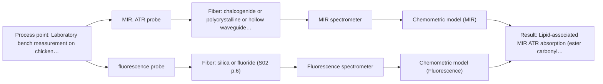
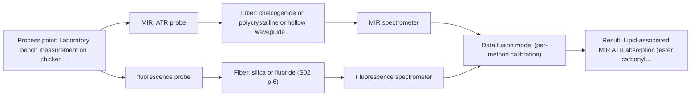

# First technical assessment: Local measurements of heterogeneous model tissues

## Answer

**Customer request (our summary):** Laboratory classification study comparing MIR ATR and fluorescence information from heterogeneous model biological tissues (chicken muscle, fat, liver), with a requested first comparison experiment and statement of what its results would demonstrate.

### Brief answer

Start with MIR ATR on representative chicken breast/muscle, fat and liver samples, then run fluorescence separately as a comparison. This tests whether each method alone separates the three tissue types; the chicken-tissue precedent is a reason to test, not proof for your interface. Class labels, the fluorescence source and same-spot requirements remain open.

### Proposal

- **Best current option:** O2 (recommended)
- **Basis:** supplied AFS sources
- **What would change it:** If same-spot measurement is mandatory or if fluorescence has no usable endogenous signal, the choice would move to the combined-probe option or drop fluorescence; if MIR alone meets the pre-agreed threshold, the fluorescence comparison becomes optional.
- **Next step:** Agree the class labels, reference method and numerical go/no-go thresholds, then run the separate MIR ATR and fluorescence comparison on representative chicken samples.

**Secondary evidence (external, not AFS material):** G1: E02 ¶31, E02 ¶82; G2: E01 ¶8; G3: no usable external source found; G4: E02 ¶33. See Expert detail.

**Decision status:** Provisional feasibility assessment

### Solution options

| ID | Tier | Methods | Confidence | Cost class, S01 Table 1 (p.6) | Ease of use | Maintenance | Performance fit | Sources |
|---|---|---|---|---|---|---|---|---|
| O1 | Simple | M1 MIR, ATR probe | High | high cost (row 2) | single probe, simple workflow | ATR crystal cleaning and contact control | tests MIR-only class separation | [1: S01 p.5] [2: S04 p.4] [3: S01 p.9] [4: REF §3] [5: S04 p.4] |
| O2 | Recommended | M1 MIR, ATR probe; M2 fluorescence probe | Low: open question: Q2 (starts at Medium); fit for soft solid to be tested, sample clarity unknown, fluorescent target unknown | high cost (rows 2, 19) | two probes, sequential runs | two instruments and two calibration sets | directly compares the two named methods | [1: S01 p.5] [2: S04 p.4] [3: S01 p.9] [4: REF §3] [5: S04 p.4] [6: S04 p.4] [7: S01 p.5] [8: S04 p.4] |
| O3 | Extended (multi-method) | M3 MIR, ATR probe + Fluorescence (combination) | Low: open question: Q3 (starts at Medium); fit for soft solid to be tested, sample clarity unknown, fluorescent target unknown; multi-method, fusion benefit not yet shown | high cost (rows 2, 19) | combined probe, one alignment | combined probe cleaning and alignment checks | same-spot fusion may separate all classes | [9: S01 p.8] [10: S04 p.4] [11: S04 p.4] [12: S01 p.8] [13: S01 p.8] |

*Confidence rates the basis of the advice (how much is known and cited), not a predicted accuracy or probability of success. It starts at High, or at Medium when a key question on the method or the option is open, and drops one level per weakness listed (floor Low).*

*Cost class is the relative rating in S01 Table 1 (p.6) for the in-line method+technique rows named (the highest one for a multi-method option); it is not a price.*

### Setup sketch

*Recommended option O2; drawn by code from the option, a schematic, not a configuration.*

### Key questions

1. For each tissue type (muscle, fat, liver), what optical regime applies at the intended probe spot—clear, turbid, opaque or strongly absorbing—and does the sample present a stable surface for contact measurement?
2. Is the intended fluorescence signal endogenous tissue autofluorescence, or will a fluorescent indicator be added? If endogenous, which tissue components are expected to fluoresce?
3. Is same-spot or registered MIR ATR and fluorescence measurement required for the classification question, or is sequential measurement on nominally identical locations acceptable?

## Expert detail

**Customer enquiry**

> Our research group is evaluating a spectral measurement interface using model biological tissues such as chicken muscle, fat and liver. We want to compare MIR ATR and fluorescence information, because the material is heterogeneous and sequential measurements may not sample the same location. This is a laboratory classification study. We need a first comparison experiment and a clear statement of what its results would demonstrate.

**Decision status:** Provisional feasibility assessment. A provisional shortlist is justified by the published chicken-tissue comparison, but it remains a precedent for the customer's interface rather than proof of performance. The assessment therefore starts with MIR ATR as the single method and keeps same-spot fusion as a later hypothesis.

### Parameters

| ID | Parameter | Kind | Need | Measured by | Why | Sources |
|---|---|---|---|---|---|---|
| P1 | Reference tissue class (breast/muscle, fat, liver) | qualitative | required | Reference lab method: gross dissection with histological confirmation | The classification result cannot be scored without an independent label for each sample. | *(no verified source: engineering judgement)* |
| P2 | Lipid-associated MIR ATR absorption (ester carbonyl band near 1740 cm-1) | quantitative | required | Spectroscopy: MIR | This is the MIR feature that discriminated fat from the other chicken tissues in the example. | [14: S04 p.3] |
| P3 | Porphyrin-associated fluorescence (selective peak at 613 nm) | qualitative | required | Spectroscopy: Fluorescence | This is the fluorescence feature that distinguished liver tissue in the example. | [15: S04 p.3] |

### Solution option details

- **O1 cost drivers:** one spectrometer, one ATR probe, sample preparation and reference labels
- **O2 cost drivers:** two spectrometers, two probes, two calibration sets, reference labels
- **O3 cost drivers:** combined probe, two spectrometers, synchronisation and fusion modelling
- **O3 combining methods:** Low-level fusion of MIR ATR and fluorescence spectra from the same probe spot is the hypothesis. The two channels must be synchronised to a common time step, and each block needs its own calibration. The fused model must beat the best single method on held-out samples, otherwise the extra instrument is not justified.

*Extended (multi-method) option O3; drawn by code from the option, a schematic, not a configuration.*

### Premise check

- **Supported:** Chicken muscle, fat and liver are suitable model tissues for evaluating the spectral measurement interface. The chicken-tissue study used breast, fat and liver as a model system for evaluating spectroscopic methods and equipment. [16: S04 p.3]
- **Precedent only:** MIR ATR and fluorescence information can be meaningfully compared for this heterogeneous material. A published chicken-tissue study compared IR and fluorescence data and found that fused data separated tissue classes that neither method separated alone; this is a reason to test, not proof for the customer's interface. [10: S04 p.4] [11: S04 p.4]
- **Supported:** Heterogeneity and possible location mismatch between sequential measurements are the key reason to compare MIR ATR and fluorescence. The combined-probe study identifies same-point simultaneous measurement as the main challenge for local multispectral analysis and states that alternating measurements cannot guarantee coincidence. [17: S04 p.2]

### Requirements

**Stated by the customer**

- "evaluating a spectral measurement interface"
- "model biological tissues such as chicken muscle, fat and liver"
- "compare MIR ATR and fluorescence information"
- "This is a laboratory classification study"
- *Further statements: see the customer enquiry above.*

**Key unknowns**

- Target tissue classes and independent reference labels
- Endogenous fluorescence versus an added fluorescent indicator
- Need for same-spot or registered MIR and fluorescence measurement
- Measurement interface, probe geometry and fiber coupling
- Sample preparation, hydration, temperature and storage
- Numerical classification performance and validation criteria

### Clarification questions (most decision-relevant first)

Q1. For each tissue type (muscle, fat, liver), what optical regime applies at the intended probe spot—clear, turbid, opaque or strongly absorbing—and does the sample present a stable surface for contact measurement? *Why it matters:* The fluorescence probe's usefulness depends on whether each tissue is transparent, scattering or opaque at the intended measurement spot. *(affects: technique)*
Q2. Is the intended fluorescence signal endogenous tissue autofluorescence, or will a fluorescent indicator be added? If endogenous, which tissue components are expected to fluoresce? *Why it matters:* Fluorescence only reports species that fluoresce, so this decides whether the fluorescence comparison is interpretable. *(affects: M2)*
Q3. Is same-spot or registered MIR ATR and fluorescence measurement required for the classification question, or is sequential measurement on nominally identical locations acceptable? *Why it matters:* This decides whether the combined-probe option is needed or whether separate single-method runs suffice. *(affects: M3)*
Q4. What measurement interface and fiber coupling are intended: separate laboratory probes, a combined same-spot probe, or a fiber-coupled system, and what probe/sampling area is available? *Why it matters:* The interface and fiber determine the usable spectral range and whether the same small area can be measured by both methods. *(affects: installation)*
Q5. What independent reference labels, sample preparation and storage conditions, and numerical classification criteria (for example accuracy, sensitivity and specificity on held-out animals or batches) should define the first comparison experiment? *Why it matters:* These determine whether the comparison is representative and what result would count as a clear demonstration. *(affects: status)*

### Recommendation

- **M1 · Primary candidate: MIR, ATR probe.** MIR ATR is suited to soft-solid contact measurement and gives well-defined absorption bands; in the chicken-tissue example, IR was better for discriminating fat, with a nominal 4000-400 cm-1 range and a usable range set by the fiber, crystal and probe. It is the first single method to test because it does not require an identified fluorophore. *Conditions:* Requires tight contact between the ATR crystal and a flat, soft-solid sample, with controlled cleaning and contact pressure. [1: S01 p.5] [2: S04 p.4] [3: S01 p.9] [4: REF §3] [5: S04 p.4]
- **M2 · Comparison candidate: fluorescence probe.** Fluorescence is the second named method and can add information on fluorescent tissue components; in the chicken-tissue example, fluorescence was well suited for recognising liver. It only applies if the sample contains at least one fluorescent component or a justified indicator. *Conditions:* Identify an endogenous fluorophore or justify an added indicator before including fluorescence. [6: S04 p.4] [7: S01 p.5] [8: S04 p.4]
- **M3 · Conditional candidate: MIR, ATR probe + Fluorescence (combination).** A combined MIR ATR and fluorescence probe can collect both signals from the same small area, addressing the location-mismatch concern; in the chicken-tissue example, fused IR and fluorescence data separated three classes that neither method separated alone. This is a later hypothesis, not the first test. *Conditions:* Applies only after the single-method runs, if same-spot measurement is required or if neither single method meets the classification target. [9: S01 p.8] [10: S04 p.4] [11: S04 p.4] [12: S01 p.8] [13: S01 p.8]

### Measurement concept

- **Probe and geometry:** MIR ATR contact probe for soft-solid tissue; fluorescence probe or combined same-spot MIR ATR/fluorescence probe if same-location measurement is required.
- **Location:** Laboratory bench measurement on chicken breast/muscle, fat and liver samples.
- **Fiber link:** Fiber coupling is not specified in the enquiry; the usable range depends on the fiber, probe and spectrometer actually selected. *(no verified source: engineering judgement)*

### Spectral range

- **MIR:** Nominal mid-IR range 4000-400 cm-1; usable range depends on the fiber, ATR crystal and probe selected. [3: S01 p.9] [4: REF §3]
- **Fluorescence:** No fixed nominal range can be stated without the fluorescent species and excitation wavelength; it depends on the fluorophore present. [7: S01 p.5]

### Risks and uncertainty

- The chicken-tissue study used a specific combined probe and a small model set, so its class separation is a precedent, not evidence that the customer's interface will separate new samples. *(rules: R-EVI-2)* *(no verified source: engineering judgement)*
- If the tissues have no useful endogenous fluorescence and no justified indicator is added, the fluorescence comparison cannot be interpreted. *(rules: R-FLU-1)* *(no verified source: engineering judgement)*
- MIR ATR samples only a thin surface layer, so surface fat, protein or contact variability may dominate and not represent the bulk tissue. *(rules: R-MIR-3)* *(no verified source: engineering judgement)*
- Sequential MIR and fluorescence runs may still measure different spots; if same-spot registration is essential, the combined-probe option becomes necessary but adds alignment and synchronisation work. *(rules: R-CMB-2)* *(no verified source: engineering judgement)*

### First feasibility experiment

1. **Define the three tissue classes and an independent reference label, then collect chicken breast/muscle, fat and liver from several animals or batches. Prepare samples large enough to cover tissue heterogeneity and record hydration, temperature and storage.** Representative samples across the expected chemical and physical variation. [18: S04 p.3] [19: S04 p.3] [20: S01 p.7]
2. **Acquire MIR ATR spectra on all samples with repeated probe placements and cleaning between samples; record contact pressure, background and instrument settings.** Single-method MIR ATR comparison. *(no verified source: engineering judgement)*
3. **Acquire fluorescence spectra on the same sample set, first without any indicator, and check whether an endogenous signal is present; if not, test a justified fluorescent indicator or drop fluorescence.** Single-method fluorescence comparison and fluorophore check. [8: S04 p.4]
4. **Build separate classification models for MIR ATR and fluorescence, validate on held-out animals or batches, and compare accuracy, sensitivity and specificity with the customer's pre-agreed numerical go/no-go thresholds.** Independent reference measurements and a customer-defined go/no-go basis. [21: REF §3]
5. **Only if neither single method meets the target, test a combined same-spot MIR ATR and fluorescence probe, synchronise the channels, and require the fused model to beat the best single method on held-out samples.** Combination after single methods, with same-spot and synchronisation checks. [9: S01 p.8] [13: S01 p.8] [11: S04 p.4]

**Reference measurements:** Independent tissue class labels by gross dissection with histological confirmation where possible; the customer must supply the numerical acceptance criteria.

**Decision basis:** Go/no-go is based on held-out classification performance against customer-defined numerical thresholds; a fused model is only justified if it beats the best single method.

### Assumptions

- The chicken breast/muscle, fat and liver samples are soft-solid and can make tight contact with an ATR crystal.
- At least one tissue type has an endogenous fluorescent component, or a justified fluorescent indicator can be used.
- The study is laboratory classification only; process or clinical use is outside the supplied evidence.

### Not covered by the supplied sources

- The supplied material does not evaluate the customer's specific spectral measurement interface or its probe geometry; only a published chicken-tissue combined-probe example is available.
- No supplied source sets a sample size or numerical acceptance threshold for this laboratory classification study.

### Further notes

- **Chemometrics:** PCA and PLS-DA are plausible classification tools, but the chicken-tissue example is exploratory and uses a small model set; any customer model needs independent reference labels and held-out validation.

### Secondary evidence (external, not AFS material)

*Found by a literature search for gaps the supplied AFS sources leave open. Not AFS material and not proof for this case; every quote below was verified verbatim against the fetched text.*

*Live search unavailable (library only: cache miss (europepmc); cache miss (openalex)); curated library only.*

**G1 · multi-method:** Combining several spectroscopy methods (data fusion) (Low-level fusion of MIR ATR and fluorescence spectra from the same probe spot is the hypothesis. The two channels must be synchronised to a common time step, and each block needs its own calibration. The fused model must beat the best single method on held-out samples, otherwise the extra instrument is not justified.)

- **E02 ¶31** Low-level data fusion is described as the simplest way to combine inputs by placing variables from different sources into one matrix. *How it applies:* This could inform a first comparison experiment that concatenates the MIR and fluorescence spectral blocks and compares the fused model with single-method models. *Limits and transfer risks:* The source is a review of process analytical data fusion, not a tissue classification study; it does not address synchronisation to a common time step or per-block calibration. *(supports O3)*
  > "Low-level data fusion (LLDF) is considered the simplest method to achieve a combination of inputs. In this case, the data is rearranged into a new data matrix, where the variables coming from different sources are placed one after the other."
  > Challenges and Opportunities of Implementing Data Fusion in Process Analytical Technology-A Review. (2022) · Molecules (Basel, Switzerland) · doi:10.3390/molecules27154846 · https://europepmc.org/article/PMC/PMC9369811 · retrieved 2026-10-17, full text, licence: cc by, via curated library
- **E02 ¶82** The review states that before fusing multiple sources, the contribution of each dataset and its complementarity should be evaluated. *How it applies:* This could shape the experiment by including single-block models and complementarity checks before deciding whether the fused model is justified. *Limits and transfer risks:* This is a general review; it does not provide a tissue-specific acceptance rule or show that fusion will beat the best single method. *(supports O3)*
  > "Before fusing data from multiple sources, it is essential to evaluate the contribution of each dataset to the model and its complementarity."
  > Challenges and Opportunities of Implementing Data Fusion in Process Analytical Technology-A Review. (2022) · Molecules (Basel, Switzerland) · doi:10.3390/molecules27154846 · https://europepmc.org/article/PMC/PMC9369811 · retrieved 2026-10-17, full text, licence: cc by, via curated library

**G2 · not in the supplied sources:** The supplied material does not evaluate the customer's specific spectral measurement interface or its probe geometry; only a published chicken-tissue combined-probe example is available.

- **E01 ¶8** A continuous process with a fixed probe location is described as operating in a steady-state window that simplifies model design and validation. *How it applies:* This could prompt checking whether the customer's probe is fixed and the process is steady-state; if not, the simplified calibration and validation assumptions may not transfer. *Limits and transfer risks:* The source concerns lithium recycling process monitoring, not tissue classification or the customer's probe geometry.
  > "In contrast, a continuous process at a fixed probe location is intended to operate in a steady-state window, which simplifies the model design: calibrations can be narrower and centered on the operational envelope, validation can rely on independent steady-state runs, and online monitoring focuses on drift and out-of-specification detection rather than resolving the rapidly changing composition."
  > Process Analytical Technology-Integrated FT-IR and Raman Spectroscopies for Efficient Reactive Liquid-Liquid Extraction Processing in Lithium Recycling. (2025) · ACS omega · doi:10.1021/acsomega.5c05705 · https://europepmc.org/article/PMC/PMC12573149 · retrieved 2026-10-17, full text, licence: cc by, via curated library

**G3 · not in the supplied sources:** No supplied source sets a sample size or numerical acceptance threshold for this laboratory classification study.

- No usable external source found.

**G4 · parameter without a source:** Measuring Reference tissue class (breast/muscle, fat, liver): The classification result cannot be scored without an independent label for each sample.

- **E02 ¶33** High-level data fusion is described as first fitting supervised models to each data matrix. *How it applies:* This could inform planning for independent reference labels, since supervised classification models need labels to fit and score each tissue class. *Limits and transfer risks:* The source is a review of data fusion, not a tissue study; it does not define how labels should be obtained or how many samples are needed. *(supports O2)*
  > "The high-level data fusion (HLDF) (also called "decision-level" fusion) works on a decision level. This means that the first step is to fit some supervised models to each data matrix."
  > Challenges and Opportunities of Implementing Data Fusion in Process Analytical Technology-A Review. (2022) · Molecules (Basel, Switzerland) · doi:10.3390/molecules27154846 · https://europepmc.org/article/PMC/PMC9369811 · retrieved 2026-10-17, full text, licence: cc by, via curated library

### Evidence (verified quotes)

1. ✓ **S01 p.5** (general): "Mid-IR band spectra contain well-defined peaks (absorption bands), while NIR, UV, and fluorescence spectra contain broad, highly overlapping signals"
2. ✓ **S04 p.4** (application precedent): "IR spectroscopy works better for the discrimination of fat"
3. ✓ **S01 p.9** (general): "Vibrational spectroscopy in the mid-IR range (4000-400 cm-1) is one of the most informative methods of chemical analysis."
4. ✓ **REF §3** (general): "A nominal method range is not the range of a specific instrument, fiber or probe."
5. ✓ **S04 p.4** (general): "suitability of analyzed samples for ATR measurements, which is true for liquid or soft solid samples and their components, allowing a tight contact with the probe head."
6. ✓ **S04 p.4** (application precedent): "fluorescence is well suited for the recognition of liver tissue"
7. ✓ **S01 p.5** (general): "However, most chemicals do not exhibit this property."
8. ✓ **S04 p.4** (general): "it is limited to the samples containing at least one fluorescent component"
9. ✓ **S01 p.8** (general): "It is crucial that the spectral information obtained by different methods-Mid-IR, NIR, Raman, and fluorescence spectra-is collected from the same small, even pinpoint, area of the sample."
10. ✓ **S04 p.4** (application precedent): "none of the individual techniques was sufficient to completely separate the three sample classes"
11. ✓ **S04 p.4** (application precedent): "At the same time, the PCA model built on the concatenated IR and fluorescence data revealed three distinct groups of samples corresponding to tissue types"
12. ✓ **S01 p.8** (general): "two or more probes, belonging to different methods, can be used for measurements, but the data from each method must be obtained simultaneously."
13. ✓ **S01 p.8** (general): "Ultimately, the measurement data must be normalized to a common time step."
14. ✓ **S04 p.3** (application precedent): "stretching vibration band of the ester carbonyl C=O at about 1740 cm-1"
15. ✓ **S04 p.3** (application precedent): "The most selective peak at 613 nm, which can be assigned to porphyrins, has sufficient specificity to distinguish the liver from other measured samples."
16. ✓ **S04 p.3** (application precedent): "Commercially produced poultry combines the availability of fresh samples and the variability of tissue types, making it an attractive model system for evaluating spectroscopic methods and equipment."
17. ✓ **S04 p.2** (general): "Such alternating multispectral measurements cannot guarantee complete coincidence of the spots analyzed by both methods and, moreover, cannot be used in the clinical surgery practice."
18. ✓ **S04 p.3** (application precedent): "three samples of each tissue type were prepared"
19. ✓ **S04 p.3** (application precedent): "Each sample was represented by five distributed points."
20. ✓ **S01 p.7** (general): "Morphological factors, such as sample inhomogeneity (e.g., biological tissue) or process turbulence, must also be considered when selecting a measurement technique."
21. ✓ **REF §3** (general): "Representative samples or process states, independent reference measurements, what is compared, and the basis for the go / no-go decision."

### Verification

- Citations verified: 30 of 30 (exact or whitespace/hyphen-tolerant match on the cited page, scope checked).
- Hard check failures before deterministic corrections: 0; still open: 0; soft warnings: 0; repair rounds: 1.
- External evidence (cache): 4 quote(s) verified verbatim (exact or whitespace/hyphen-tolerant, at most 400 characters and 2 sentences, against the cited paragraph); 0 item(s) dropped.
- External search: 6 query(ies), 0 hit(s), 3 source(s) (3 from the curated library); ⚠ library only: cache miss (europepmc); cache miss (openalex).
- External step: 2 model call(s), 27.8 s extra (cost in the run JSON).

*Run D08-20261018T075900Z-1e01 · models deepseek/deepseek-v4.1-flash-1017*
