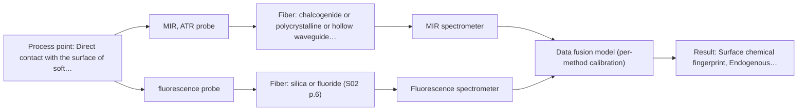

# First technical assessment: Local measurements of heterogeneous model tissues

## Answer

**Customer request (our summary):** A research group wants to compare MIR ATR and fluorescence information for classifying heterogeneous model biological tissues (chicken muscle, fat, and liver) and requests a first comparison experiment with expected results.

### Brief answer

To classify heterogeneous biological tissues, we recommend evaluating a combined MIR-ATR and fluorescence approach using a specialized multispectral probe that samples the exact same point. Single-method trials should be performed first, followed by low-level data fusion and Principal Component Analysis to verify if combined spectra improve tissue differentiation over individual methods.

### Proposal

- **Best current option:** O2 (recommended)
- **Basis:** supplied AFS sources
- **What would change it:** If single-method MIR ATR achieves complete tissue class separation without needing fluorescence data.
- **Next step:** Execute the comparative laboratory trial using chicken tissue samples and a combined MIR-ATR/fluorescence probe.

**Decision status:** Provisional feasibility assessment

### Solution options

| ID | Tier | Methods | Confidence | Cost class, S01 Table 1 (p.6) | Ease of use | Maintenance | Performance fit | Sources |
|---|---|---|---|---|---|---|---|---|
| O1 | Simple | M1 MIR, ATR probe | Medium: open question: Q1 (starts at Medium) | high cost (row 2) | Simple single-method ATR setup. | Routine crystal cleaning. | Captures surface chemical fingerprints but lacks complementary fluorescence markers. | [1: S04 p.4] [2: S01 p.10] |
| O2 | Recommended | M1 MIR, ATR probe; M2 fluorescence probe + MIR (combination) | Low: open question: Q1, Q2 (starts at Medium); fit for soft solid to be tested, fluorescent target unknown; multi-method, fusion benefit not yet shown | high cost (rows 2, 19) | Requires dual spectrometer setup and combined probe. | Maintenance of combined fiber optic probe and dual instruments. | Optimal fit for heterogeneous tissue classification by fusing simultaneous MIR and fluorescence data. | [3: S04 p.4] [2: S01 p.10] [4: S04 p.1] |

*Confidence rates the basis of the advice (how much is known and cited), not a predicted accuracy or probability of success. It starts at High, or at Medium when a key question on the method or the option is open, and drops one level per weakness listed (floor Low).*

*Cost class is the relative rating in S01 Table 1 (p.6) for the in-line method+technique rows named (the highest one for a multi-method option); it is not a price.*

### Setup sketch

*Recommended option O2; drawn by code from the option, a schematic, not a configuration.*

### Key questions

1. What specific sample preparation and point-sampling density will be used across the chicken tissue replicates?
2. What specific excitation wavelengths and emission filters are selected for the fluorescence channel?
3. What numerical classification accuracy or error rate constitutes a successful go/no-go outcome for the feasibility study?

## Expert detail

**Customer enquiry**

> Our research group is evaluating a spectral measurement interface using model biological tissues such as chicken muscle, fat and liver. We want to compare MIR ATR and fluorescence information, because the material is heterogeneous and sequential measurements may not sample the same location. This is a laboratory classification study. We need a first comparison experiment and a clear statement of what its results would demonstrate.

**Decision status:** Provisional feasibility assessment. The supplied sources detail a proven laboratory approach using a combined MIR-ATR and fluorescence fiber probe to classify heterogeneous biological tissues via data fusion, fully supporting a provisional assessment for this study.

### Parameters

| ID | Parameter | Kind | Need | Measured by | Why | Sources |
|---|---|---|---|---|---|---|
| P1 | Surface chemical fingerprint | qualitative | required | Spectroscopy: MIR | To identify functional groups such as lipid ester carbonyls and protein amides characteristic of specific tissue types. | [5: S04 p.3] |
| P2 | Endogenous fluorophore response | qualitative | required | Spectroscopy: Fluorescence | To provide complementary biochemical emission features (such as porphyrin bands) for robust tissue classification. | [6: S04 p.3] |

### Solution option details

- **O1 cost drivers:** Single spectrometer and MIR ATR probe.
- **O2 cost drivers:** Combined multispectral probe and two spectrometers.
- **O2 combining methods:** Combines MIR-ATR and fluorescence data collected from the same spot using a combined probe. Spectra are normalized, concatenated into an augmented matrix, and evaluated via PCA to demonstrate improved class separation over single methods.

### Premise check

- **Supported:** Evaluating a spectral measurement interface using model biological tissues such as chicken muscle, fat and liver. The supplied text explicitly describes testing model biological tissues including chicken breast, fat, and liver. [7: S04 p.3]
- **Supported:** Compare MIR ATR and fluorescence information because material is heterogeneous and sequential measurements may not sample the same location. The sources confirm that simultaneous collection from the same spot using a combined probe solves the spatial mismatch of sequential measurements in heterogeneous tissue. [8: S04 p.2]

### Requirements

**Stated by the customer**

- Compare MIR ATR and fluorescence information
- Address material heterogeneity and spatial sampling
- Perform a laboratory classification study on chicken muscle, fat, and liver
- Provide a first comparison experiment and state what results demonstrate

**Key unknowns**

- Specific fiber bundle configuration and coupling efficiency for simultaneous delivery
- Required multivariate classification accuracy and validation method

### Clarification questions (most decision-relevant first)

Q1. What specific sample preparation and point-sampling density will be used across the chicken tissue replicates? *Why it matters:* Determines the spatial representativeness and statistical robustness of the classification model. *(affects: method, technique, M1, M2)*
Q2. What specific excitation wavelengths and emission filters are selected for the fluorescence channel? *Why it matters:* Affects the sensitivity to endogenous fluorophores such as FAD and porphyrins in the tissue samples. *(affects: technique, M2)*
Q3. What numerical classification accuracy or error rate constitutes a successful go/no-go outcome for the feasibility study? *Why it matters:* Defines the objective decision basis for evaluating whether combined data outperforms single methods. *(affects: status)*

### Recommendation

- **M1 · Primary candidate: MIR, ATR probe.** MIR ATR captures the surface chemical fingerprint of soft tissue, specifically highlighting lipid ester carbonyl bands and protein amide vibrations. [2: S01 p.10]
- **M2 · Comparison candidate: fluorescence probe + MIR (combination).** Fluorescence provides complementary subsurface biochemical information (such as porphyrin or FAD emissions) that aids tissue differentiation when combined with MIR. *Conditions:* Applied as a combined multi-method probe to ensure identical sampling spots on heterogeneous tissue. [4: S04 p.1] Later hypothesis, after single-method tests.

### Measurement concept

- **Probe and geometry:** Combined multispectral fiber probe featuring a truncated cone (frustum) ZrO2 ATR crystal at the tip for MIR analysis and orthogonal silica fibers for fluorescence detection.
- **Location:** Direct contact with the surface of soft tissue samples (chicken breast, fat, and liver).
- **Fiber link:** Chalcogenide infrared (CIR) fibers for MIR and silica fibers for fluorescence. [9: S04 p.2]

### Spectral range

- **MIR:** Nominal range 4000-400 cm-1; the usable range depends on the instrument, fiber and probe actually selected. [10: S01 p.9]
- **Fluorescence:** Emission spectra observed upon irradiation in UV and visible regions, shifted to longer wavelengths than excitation source; usable range depends on configuration. [11: S01 p.12]

### Risks and uncertainty

- Surface fouling or imperfect contact on the ATR crystal tip can distort MIR absorbance spectra of soft biological tissues. *(rules: R-MIR-3)* [12: S01 p.13]
- Inadequate sample replication or spatial heterogeneity across tissue cuts can lead to overlapping clusters in multivariate analysis. *(rules: R-CMB-2)* [13: S01 p.8]

### First feasibility experiment

1. **Prepare representative tissue samples of chicken muscle, fat, and liver** Prepare representative samples of chicken muscle, fat, and liver reflecting physical and biological heterogeneity. [14: S04 p.3]
2. **Acquire independent MIR ATR and fluorescence spectra from identical points** Acquire independent MIR ATR and fluorescence spectra from identical measurement points using the combined multispectral probe. [14: S04 p.3]
3. **Normalize and concatenate spectra into a single augmented data matrix** Apply standard normal variate (SNV) normalization and concatenate MIR and fluorescence spectra into a single augmented data matrix. [3: S04 p.4]
4. **Perform Principal Component Analysis to classify tissue types** Perform Principal Component Analysis (PCA) to evaluate whether combined multispectral data successfully separates the three tissue classes. [3: S04 p.4]

**Reference measurements:** Anatomical and histological classification of chicken muscle, fat, and liver sample types.

**Decision basis:** Clear separation of tissue classes (muscle, fat, and liver) in the PCA score plot using fused MIR ATR and fluorescence data compared to single methods.

### Assumptions

- Chicken muscle, fat, and liver adequately model heterogeneous biological tissue scattering and chemistry for this laboratory classification study.

### Further notes

- **Chemometrics:** Spectra are preprocessed with Standard Normal Variate (SNV), rescaled, and concatenated into a joint matrix for Principal Component Analysis (PCA).
- **Future direction:** Extension of the combined probe design for in vivo surgical diagnostics or endoscopic deployment.

### Evidence (verified quotes)

1. ✓ **S04 p.4** (general): "PCA models for individual data blocks confirmed the above conclusions based on the spectral interpretation that IR spectroscopy works better for the discrimination of fat"
2. ✓ **S01 p.10** (general): "ATR fiber probes (Fig.1) enable the analysis of liquids and solid elastic samples, such as biological tissue, using specialized probes utilizing high-transmission fiber optics in the Mid-IR region."
3. ✓ **S04 p.4** (application precedent): "At the same time, the PCA model built on the concatenated IR and fluorescence data revealed three distinct groups of samples corresponding to tissue types"
4. ✓ **S04 p.1** (application precedent): "A multispectral fiber optic probe has been developed that enables simultaneous analysis of various liquid and solid samples using attenuated total reflection mid-infrared spectroscopy and fluorimetry."
5. ✓ **S04 p.3** (general): "The discriminative power of mid-IR spectroscopy (Figure 2a and Figure S-4) toward rich in lipids fat samples is related to the stretching vibration band of the ester carbonyl C=O at about 1740 cm-1, which is characteristic of saturated triglycerides."
6. ✓ **S04 p.3** (general): "The most selective peak at 613 nm, which can be assigned to porphyrins, has sufficient specificity to distinguish the liver from other measured samples."
7. ✓ **S04 p.3** (application precedent): "The developed multispectral probe was tested in the practical analysis of biological tissue samples using different organs and parts of the chicken: breast, fat, and liver."
8. ✓ **S04 p.2** (general): "The main challenge of such local multispectral analysis is related to the necessity to perform different spectroscopic measurements at the same point simultaneously."
9. ✓ **S04 p.2** (general): "The proposed solution (Figure 1) is based on a precise determination of the optical configuration of the ATR crystal head, which, in this case, plays the role of a common measurement interface for both methods."
10. ✓ **S01 p.9** (general): "Vibrational spectroscopy in the mid-IR range (4000-400 cm-1) is one of the most informative methods of chemical analysis."
11. ✓ **S01 p.12** (general): "Fluorimetry is based on measuring the broad emission signal observed upon irradiation of certain samples in the UV and visible regions. The fluorescence peak is shifted to longer wavelengths compared to the excitation radiation"
12. ✓ **S01 p.13** (general): "The MIR-ATR component captures the "chemical fingerprint" of the tissue's surface layer, typically at a depth of few microns"
13. ✓ **S01 p.8** (general): "It is crucial that the spectral information obtained by different methods-Mid-IR, NIR, Raman, and fluorescence spectra-is collected from the same small, even pinpoint, area of the sample."
14. ✓ **S04 p.3** (application precedent): "To provide the necessary statistical representativeness of the data, three samples of each tissue type were prepared. The samples were large enough to reflect the possible heterogeneity of the tissue."

### Verification

- Citations verified: 17 of 17 (exact or whitespace/hyphen-tolerant match on the cited page, scope checked).
- Hard check failures before deterministic corrections: 0; still open: 0; soft warnings: 0; repair rounds: 2.
- External evidence: no gap found, so no search.

*Run D08-20261018T075900Z-307d · models google/gemini-3.5-flash-lite*
