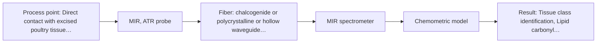
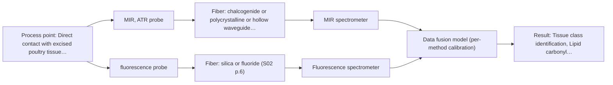

# First technical assessment: Local measurements of heterogeneous model tissues

## Answer

**Customer request (our summary):** The customer wants to design an initial laboratory comparison experiment and define what its results would demonstrate when using a spectral measurement interface combining MIR ATR and fluorescence to classify model biological tissues.

### Brief answer

Mid-IR ATR should be tested first as the primary baseline method because it directly resolves lipid and protein vibrational bands in soft tissue. Fluorescence provides complementary sensitivity for liver fluorophores but has a much larger penetration depth than ATR. A combined interface should be tested next using low-level data fusion to verify whether it resolves class overlap that single methods cannot separate.

### Proposal

- **Best current option:** O2 (recommended)
- **Basis:** supplied AFS sources
- **What would change it:** Demonstrating that mid-IR ATR alone distinguishes muscle from liver without fluorescence, or that contact variability precludes reproducible ATR spectra, would change the recommended option.
- **Next step:** Run single-modality baseline measurements on replicate chicken muscle, fat, and liver samples before conducting co-located dual-probe measurements.

**Secondary evidence (external, not AFS material):** G1: E02 ¶16, E03 ¶82; G2: no usable external source found; G3: no usable external source found. See Expert detail.

**Decision status:** Premise not supported by the sources

### Solution options

| ID | Tier | Methods | Confidence | Cost class, S01 Table 1 (p.6) | Ease of use | Maintenance | Performance fit | Sources |
|---|---|---|---|---|---|---|---|---|
| O1 | Simple | M2 fluorescence probe | Low: open question: Q1 (starts at Medium); fit for soft solid to be tested, sample clarity unknown, fluorescent target unknown; a customer premise is contradicted, status: premise not supported | low cost (row 19) | Standard silica probe and spectrometer setup | Routine optical window cleaning required | Identifies liver but confuses other tissues | [1: S04 p.4] [2: S04 p.3] [3: S01 p.12] |
| O2 | Recommended | M1 MIR, ATR probe | Low: open question: Q1, Q2 (starts at Medium); a customer premise is contradicted, status: premise not supported | high cost (row 2) | Single FTIR with contact ATR probe | Crystal inspection and contact surface cleaning | Robust fat identification via lipid bands | [4: S04 p.4] [5: S04 p.3] [6: S01 p.10] |
| O3 | Extended (multi-method) | M1 MIR, ATR probe; M2 fluorescence probe; M3 MIR, ATR probe + Fluorescence (combination) | Low: open question: Q1, Q2 (starts at Medium); fit for soft solid to be tested, sample clarity unknown, fluorescent target unknown; a customer premise is contradicted, status: premise not supported; multi-method, fusion benefit not yet shown | high cost (rows 2, 19) | Dual spectrometer synchronization and fused calibration | Dual channel alignment and crystal maintenance | Complete separation of all tissue classes | [7: S04 p.4] [8: S01 p.8] [5: S04 p.3] [6: S01 p.10] [2: S04 p.3] [3: S01 p.12] [9: S04 p.4] [10: S01 p.8] |

*Confidence rates the basis of the advice (how much is known and cited), not a predicted accuracy or probability of success. It starts at High, or at Medium when a key question on the method or the option is open, and drops one level per weakness listed (floor Low).*

*Cost class is the relative rating in S01 Table 1 (p.6) for the in-line method+technique rows named (the highest one for a multi-method option); it is not a price.*

### Setup sketch

*Recommended option O2; drawn by code from the option, a schematic, not a configuration.*

### Key questions

1. Which excitation laser wavelength and emission detection range do you plan to use for the fluorescence measurements?
2. What specific probe interface or ATR crystal geometry (e.g., truncated cone ZrO2 crystal) are you considering to house both fiber channels?
3. Will tissue samples be measured fresh or following freeze-thaw cycles, and how will probe-to-sample contact pressure be standardized?

## Expert detail

**Customer enquiry**

> Our research group is evaluating a spectral measurement interface using model biological tissues such as chicken muscle, fat and liver. We want to compare MIR ATR and fluorescence information, because the material is heterogeneous and sequential measurements may not sample the same location. This is a laboratory classification study. We need a first comparison experiment and a clear statement of what its results would demonstrate.

**Decision status:** Premise not supported by the sources. A central premise that mid-IR ATR and fluorescence interrogate identical sample volumes across heterogeneous tissue is contradicted by the sources, as ATR measures only surface layers (microns) while fluorescence penetrates deeper (millimeters). A provisional comparison experiment can nevertheless evaluate their complementary information.

### Parameters

| ID | Parameter | Kind | Need | Measured by | Why | Sources |
|---|---|---|---|---|---|---|
| P1 | Tissue class identification | qualitative | required | Spectroscopy: MIR | The primary analytical objective is distinguishing between muscle, fat, and liver tissue types. | [11: S04 p.3] |
| P2 | Lipid carbonyl absorbance | quantitative | required | Spectroscopy: MIR | Quantifies ester carbonyl stretching at ~1740 cm-1 to selectively identify lipid-rich fat tissue. | [12: S04 p.3] |
| P3 | Porphyrin emission intensity | quantitative | required | Spectroscopy: Fluorescence | Provides a distinctive fluorescence peak at ~613 nm to selectively identify liver tissue. | [2: S04 p.3] |

### Solution option details

- **O1 cost drivers:** Standard UV-Vis spectrometer, laser, and silica fiber probe
- **O2 cost drivers:** FTIR spectrometer, CIR fiber cables, and crystal ATR probe
- **O3 cost drivers:** Two spectrometers, laser, combined crystal probe, CIR and silica fibers
- **O3 combining methods:** Spectra from the same sample spot are normalized and fused into a single block-scaled matrix. Each instrument requires independent baseline calibration and diagnostics. The fused model must statistically outperform individual mid-IR and fluorescence models on independent test sets.

*Extended (multi-method) option O3; drawn by code from the option, a schematic, not a configuration.*

### Premise check

- **Supported:** Sequential measurements with separate probes fail to reliably sample the same location in heterogeneous tissue, justifying a combined interface. Published research confirms that alternating measurements with separate probes cannot guarantee complete spatial coincidence on heterogeneous tissues. [13: S01 p.8] [14: S04 p.2]
- **Contradicted:** MIR ATR and fluorescence interrogate identical sample volumes across the heterogeneous tissue. ATR captures only the surface layer at a depth of a few micrometers, whereas fluorescence excitation light penetrates deeper into the tissue. [15: S01 p.13]

### Requirements

**Stated by the customer**

- Model biological tissues evaluated: chicken muscle, fat, and liver.
- Compare spectral information from mid-IR ATR and fluorescence.
- Account for sample heterogeneity where sequential measurements may sample different spots.
- Conduct a laboratory classification study.
- Formulate an initial comparison experiment and identify what the results demonstrate.

**Key unknowns**

- Target fluorophores and specific excitation/emission wavelengths selected for the fluorescence channel.
- Design and geometry of the measurement interface (e.g., ATR crystal material, contact tip diameter, fiber bundle routing).
- Tissue sample preparation method (fresh vs. frozen/thawed, moisture retention, surface smoothness).
- Spectral preprocessing and classification criteria (e.g., PCA clustering separation, supervised PLS-DA accuracy target).

### Clarification questions (most decision-relevant first)

Q1. Which excitation laser wavelength and emission detection range do you plan to use for the fluorescence measurements? *Why it matters:* Fluorescence detection requires defining the excitation source and emission window tailored to native tissue fluorophores such as FAD or porphyrins. *(affects: method, technique)*
Q2. What specific probe interface or ATR crystal geometry (e.g., truncated cone ZrO2 crystal) are you considering to house both fiber channels? *Why it matters:* The optical crystal head design determines whether mid-IR internal reflections and fluorescence delivery/collection can co-locate at the sample contact interface. *(affects: installation, M1, M3)*
Q3. Will tissue samples be measured fresh or following freeze-thaw cycles, and how will probe-to-sample contact pressure be standardized? *Why it matters:* Tissue hydration and varying physical contact pressure introduce strong baseline shifts and reproducibility variations in ATR spectra. *(affects: technique, status)*
Q4. What quantitative benchmark or statistical threshold (e.g., percentage classification accuracy or PCA class separation) defines feasibility success? *Why it matters:* A clear numerical criterion is necessary to determine whether fusing modalities offers a statistically meaningful benefit over the single best method. *(affects: status)*

### Recommendation

- **M1 · Primary candidate: MIR, ATR probe.** Mid-IR ATR directly captures fundamental vibrational bands such as lipid carbonyl and protein amides in soft biological tissues. It serves as the primary benchmark technique for chemical tissue profiling. [5: S04 p.3] [6: S01 p.10]
- **M2 · Comparison candidate: fluorescence probe.** Fluorescence targets specific endogenous fluorophores such as porphyrins and flavins, offering selective differentiation for tissue types like liver. It is tested in parallel to evaluate its standalone classification ability. *Conditions:* Applies when endogenous fluorophores can be excited and resolved from laser scatter. [2: S04 p.3] [3: S01 p.12]
- **M3 · Conditional candidate: MIR, ATR probe + Fluorescence (combination).** Combining mid-IR ATR and fluorescence in a single probe head tests whether fusing vibrational surface fingerprints with subsurface emission resolves all tissue classes. This hypothesis is tested only after evaluating both individual modalities. *Conditions:* Applies if neither single technique completely separates all three tissue classes. [9: S04 p.4] [10: S01 p.8] Later hypothesis, after single-method tests.

### Measurement concept

- **Probe and geometry:** An immersion or contact ATR probe head using a truncated cone zirconium dioxide crystal, integrating mid-IR CIR fibers with UV-Vis silica excitation/collection fibers.
- **Location:** Direct contact with excised poultry tissue specimens mounted on an analytical laboratory stage.
- **Fiber link:** Chalcogenide infrared (CIR) fibers for mid-IR transmission coupled with standard silica fibers for UV-Vis excitation and fluorescence collection. [16: S04 p.2] [17: S02 p.6]

### Spectral range

- **MIR:** Nominal range 4000-400 cm-1; usable spectral coverage is governed by the transmission limits of CIR fibers and the ATR crystal element. [18: S01 p.9] [19: REF §3]
- **Fluorescence:** Fluorescence emission range depends on the excitation wavelength and specific fluorophores, with tissue bands observed between 520 and 530 nm and at 613 nm; the usable range is determined by the selected spectrometer, optical filters, and probe. [20: S04 p.3] [2: S04 p.3]

### Risks and uncertainty

- Incomplete or inconsistent optical contact between the ATR crystal tip and soft tissue distorts mid-IR absorbance bands. *(rules: R-MIR-2, R-MIR-3)* [21: S04 p.4]
- Significant penetration depth disparity between ATR and fluorescence means modalities interrogate different tissue depths. *(rules: R-MIR-3, R-GEN-5)* [15: S01 p.13]
- Fluorescence emission may be dominated by laser scatter or lack sufficient intensity in tissues lacking strong endogenous fluorophores. *(rules: R-FLU-1, R-FLU-2)* [22: S01 p.5]
- Direct unweighted concatenation of spectral matrices can cause one modality to dominate multivariate classification. *(rules: R-CMB-3)* [23: S01 p.9]

### First feasibility experiment

1. **Collect representative replicate specimens of poultry breast muscle, adipose fat, and liver tissue.** Capture natural intra-tissue compositional and physical variability across multiple biological samples. [24: S04 p.3]
2. **Measure each sample point independently using standalone mid-IR ATR and record spectral reproducibility.** Establish single-modality baseline performance for identifying lipid C=O and protein amide bands. [25: S04 p.3]
3. **Measure fluorescence emission spectra at the identical sample spots using the designated excitation laser.** Establish single-modality baseline performance for identifying tissue autofluorescence features such as porphyrins. [2: S04 p.3]
4. **Perform low-level data fusion with normalization and construct unsupervised PCA and supervised PLS-DA models.** Test the hypothesis that fused spectra achieve complete separation of all three classes where single methods show overlap. [26: S04 p.4]
5. **Validate classification models using cross-validation and independent sample holdouts.** Verify model robustness against overfitting on heterogeneous biological matrices. [27: REF §3]

**Reference measurements:** Known anatomical tissue origins (chicken breast, abdominal fat, liver) verified by visual and histopathological inspection.

**Decision basis:** Go/no-go is determined by whether the combined interface resolves class overlap present in individual modalities without degrading single-channel signal quality.

### Assumptions

- Tissue samples can be held firmly against the ATR crystal tip to maintain consistent evanescent wave coupling.
- Tissue autofluorescence under the selected excitation is sufficiently strong to register above detector noise without exogenous labels.
- The test environment is a controlled laboratory bench setting.

### Not covered by the supplied sources

- Instrument model numbers and software licenses used in the customer's specific laboratory.
- Mechanical mounting stage specifications for controlling sample contact pressure.

### Further notes

- **Chemometrics:** A low-level data fusion workflow concatenates normalized mid-IR absorbance and fluorescence emission vectors. Unsupervised PCA visualizes natural clustering, followed by cross-validated PLS-DA to verify class discrimination.
- **Future direction:** Simplifying the combined measurement into a discrete-channel multi-sensor system utilizing targeted mid-IR and LED/photodiode wavelengths once key spectral biomarkers are established.

### Secondary evidence (external, not AFS material)

*Found by a literature search for gaps the supplied AFS sources leave open. Not AFS material and not proof for this case; every quote below was verified verbatim against the fetched text.*

*Live search unavailable (library only: cache miss (europepmc); cache miss (openalex)); curated library only.*

**G1 · multi-method:** Combining several spectroscopy methods (data fusion) (Spectra from the same sample spot are normalized and fused into a single block-scaled matrix. Each instrument requires independent baseline calibration and diagnostics. The fused model must statistically outperform individual mid-IR and fluorescence models on independent test sets.)

- **E02 ¶16** Although block scaling is commonly suggested when combining data, in certain cases it can degrade outcomes compared with alternative preprocessing approaches. *How it applies:* When planning laboratory data fusion from the two instruments, one should compare block scaling against other preprocessing routines rather than assuming it is optimal. *Limits and transfer risks:* The cited review focuses on dairy applications, so behavior may differ on model biological tissue matrices and ATR or fluorescence signals. *(supports O3)*
  > "While block scaling is often recommended for data fusion, sometimes it can have a worse effect on results than other pre-processing methods (17)."
  > Spectroscopic technologies and data fusion: Applications for the dairy industry. (2022) · Frontiers in nutrition · doi:10.3389/fnut.2022.1074688 · https://europepmc.org/article/PMC/PMC9875022 · retrieved 2026-10-17, full text, licence: cc by, via curated library
- **E03 ¶82** Prior to combining datasets from multiple measurement sources, assessing each dataset's individual contribution and complementarity is crucial. *How it applies:* The experimental plan should evaluate separate single-method performance to verify genuine complementarity before committing to a fused model. *Limits and transfer risks:* This review paper discusses general PAT applications, and observed benefits or lack of complementarity depend heavily on the specific analytical targets and tissue samples. *(supports O3)*
  > "Before fusing data from multiple sources, it is essential to evaluate the contribution of each dataset to the model and its complementarity."
  > Challenges and Opportunities of Implementing Data Fusion in Process Analytical Technology-A Review. (2022) · Molecules (Basel, Switzerland) · doi:10.3390/molecules27154846 · https://europepmc.org/article/PMC/PMC9369811 · retrieved 2026-10-17, full text, licence: cc by, via curated library

**G2 · not in the supplied sources:** Instrument model numbers and software licenses used in the customer's specific laboratory.

- No usable external source found.

**G3 · not in the supplied sources:** Mechanical mounting stage specifications for controlling sample contact pressure.

- No usable external source found.

### Evidence (verified quotes)

1. ✓ **S04 p.4** (application precedent): "whereas fluorescence is well suited for the recognition of liver tissue (Figure 3b). However, none of the individual techniques was sufficient to completely separate the three sample classes"
2. ✓ **S04 p.3** (application precedent): "The most selective peak at 613 nm, which can be assigned to porphyrins, has sufficient specificity to distinguish the liver from other measured samples."
3. ✓ **S01 p.12** (general): "Fluorimetry is based on measuring the broad emission signal observed upon irradiation of certain samples in the UV and visible regions."
4. ✓ **S04 p.4** (application precedent): "IR spectroscopy works better for the discrimination of fat (Figure 3a)"
5. ✓ **S04 p.3** (application precedent): "The discriminative power of mid-IR spectroscopy (Figure 2a and Figure S-4) toward rich in lipids fat samples is related to the stretching vibration band of the ester carbonyl C=O at about 1740 cm-1, which is characteristic of saturated triglycerides."
6. ✓ **S01 p.10** (general): "ATR fiber probes (Fig.1) enable the analysis of liquids and solid elastic samples, such as biological tissue, using specialized probes utilizing high-transmission fiber optics in the Mid-IR region."
7. ✓ **S04 p.4** (application precedent): "At the same time, the PCA model built on the concatenated IR and fluorescence data revealed three distinct groups of samples corresponding to tissue types (Figure 3c)."
8. ✓ **S01 p.8** (general): "If the variables have different units of measurement, the data should be normalized in some way, for example, using an autoscaling algorithm."
9. ✓ **S04 p.4** (application precedent): "none of the individual techniques was sufficient to completely separate the three sample classes on the PCA score plots (PCs one to five were investigated). At the same time, the PCA model built on the concatenated IR and fluorescence data revealed three distinct groups of samples corresponding to tissue types"
10. ✓ (precedent only) **S01 p.8** (method gain): "The use of a combined probe facilitates measurements and allows for the analysis of a smaller sample volume."
11. ✓ **S04 p.3** (application precedent): "Multispectral Classification of Biological Tissue. The developed multispectral probe was tested in the practical analysis of biological tissue samples using different organs and parts of the chicken: breast, fat, and liver."
12. ✓ **S04 p.3** (application precedent): "stretching vibration band of the ester carbonyl C=O at about 1740 cm-1, which is characteristic of saturated triglycerides."
13. ✓ **S01 p.8** (general): "collected from the same small, even pinpoint, area of the sample. This is difficult to achieve by using two probes alternately for measurements."
14. ✓ **S04 p.2** (general): "Such alternating multispectral measurements cannot guarantee complete coincidence of the spots analyzed by both methods and, moreover, cannot be used in the clinical surgery practice."
15. ✓ **S01 p.13** (general): "The MIR-ATR component captures the "chemical fingerprint" of the tissue's surface layer, typically at a depth of few microns, providing information on molecular composition and biochemical changes. Concurrently, the fluorescence or near-infrared (NIR) signals penetrate deeper into the sample, offering morphological insights and subsurface chemical data."
16. ✓ **S04 p.2** (application precedent): "ZrO2 crystal was chosen due to its high (close to the diamond) refractive index, high transparency in the working spectral regions of both chalcogenide infrared (CIR) and UV silica fibers, as well as small intrinsic fluorescence."
17. ✓ **S02 p.6** (general): "1100 nm Chalcogenide As-S IR Fibers 6500 nm"
18. ✓ **S01 p.9** (general): "Vibrational spectroscopy in the mid-IR range (4000-400 cm-1) is one of the most informative methods of chemical analysis."
19. ✓ **REF §3** (general): "A nominal method range is not the range of a specific instrument, fiber or probe."
20. ✓ **S04 p.3** (application precedent): "The observed broad band with the maximum between 520 and 530 nm is formed by the emission of intracellular fluorophores with the dominating contribution of flavin adenine dinucleotide (FAD)"
21. ✓ **S04 p.4** (general): "suitability of analyzed samples for ATR measurements, which is true for liquid or soft solid samples and their components, allowing a tight contact with the probe head."
22. ✓ **S01 p.5** (general): "However, most chemicals do not exhibit this property."
23. ✓ **S01 p.9** (general): "Furthermore, methods containing a larger number of variables have a greater impact on the model."
24. ✓ **S04 p.3** (application precedent): "To provide the necessary statistical representativeness of the data, three samples of each tissue type were prepared. The samples were large enough to reflect the possible heterogeneity of the tissue."
25. ✓ **S04 p.3** (application precedent): "The discriminative power of mid-IR spectroscopy (Figure 2a and Figure S-4) toward rich in lipids fat samples is related to the stretching vibration band of the ester carbonyl C=O at about 1740 cm-1"
26. ✓ **S04 p.4** (application precedent): "At the same time, the PCA model built on the concatenated IR and fluorescence data revealed three distinct groups of samples corresponding to tissue types"
27. ✓ **REF §3** (general): "Representative samples or process states, independent reference measurements, what is compared, and the basis for the go / no-go decision."

### Verification

- Citations verified: 31 of 31 (exact or whitespace/hyphen-tolerant match on the cited page, scope checked).
- Hard check failures before deterministic corrections: 0; still open: 0; soft warnings: 2; repair rounds: 1.
- External evidence (cache): 2 quote(s) verified verbatim (exact or whitespace/hyphen-tolerant, at most 400 characters and 2 sentences, against the cited paragraph); 0 item(s) dropped.
- External search: 4 query(ies), 0 hit(s), 3 source(s) (3 from the curated library); ⚠ library only: cache miss (europepmc); cache miss (openalex).
- External step: 2 model call(s), 8.0 s extra (cost in the run JSON).

*Run D08-20261018T075900Z-73d5 · models google/gemini-3.8-flash*
