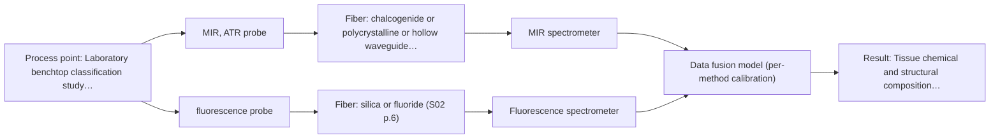

# First technical assessment: Local measurements of heterogeneous model tissues

## Answer

**Customer request (our summary):** The customer wants to compare MIR ATR and fluorescence information using model biological tissues for a laboratory classification study and requests a first comparison experiment design.

### Brief answer

To evaluate tissue classification on heterogeneous biological samples, compare single-method MIR ATR and fluorescence against a combined multi-method approach using co-registered probes. Testing should follow a structured feasibility plan comparing individual and fused multivariate classification models. Clarification on exact performance metrics and probe geometry will finalize the configuration.

### Proposal

- **Best current option:** O2 (recommended)
- **Basis:** supplied AFS sources
- **What would change it:** If single-method MIR ATR classification proves fully sufficient for all tissue classes without requiring fluorescence data, the extended fusion approach can be simplified.
- **Next step:** Perform comparative laboratory trials on model chicken tissues using a co-registered multispectral probe to evaluate single versus fused classification performance.

**Decision status:** Provisional feasibility assessment

### Solution options

| ID | Tier | Methods | Confidence | Cost class, S01 Table 1 (p.6) | Ease of use | Maintenance | Performance fit | Sources |
|---|---|---|---|---|---|---|---|---|
| O1 | Simple | M1 MIR, ATR probe | Low: open question: Q1, Q2, Q3 (starts at Medium); precedent only | high cost (row 2) | Standard single-probe ATR setup | Routine crystal cleaning | Captures surface chemical fingerprints but misses deeper fluorophore markers. | [1: S04 p.4] [2: S04 p.3] |
| O2 | Recommended | M1 MIR, ATR probe; M2 fluorescence probe + MIR (combination) | Low: open question: Q1, Q2, Q3 (starts at Medium); fit for soft solid to be tested, sample clarity unknown, fluorescent target unknown; precedent only; multi-method, fusion benefit not yet shown | high cost (rows 2, 19) | Multispectral probe requiring aligned acquisition | Dual instrument calibration and probe maintenance | Provides complementary chemical and fluorescence data from the exact same sampling point, resolving heterogeneity. | [3: S04 p.4] [2: S04 p.3] [4: S04 p.3] |

*Confidence rates the basis of the advice (how much is known and cited), not a predicted accuracy or probability of success. It starts at High, or at Medium when a key question on the method or the option is open, and drops one level per weakness listed (floor Low).*

*Cost class is the relative rating in S01 Table 1 (p.6) for the in-line method+technique rows named (the highest one for a multi-method option); it is not a price.*

### Setup sketch

*Recommended option O2; drawn by code from the option, a schematic, not a configuration.*

### Key questions

1. What specific classification performance metrics (such as accuracy, sensitivity, or confusion matrix thresholds) are required for the study?
2. Will the experiment use a combined multi-method probe for simultaneous co-registered sampling or separate sequential probes?
3. What specific excitation wavelength and spectral collection range are planned for the fluorescence channel?

## Expert detail

**Customer enquiry**

> Our research group is evaluating a spectral measurement interface using model biological tissues such as chicken muscle, fat and liver. We want to compare MIR ATR and fluorescence information, because the material is heterogeneous and sequential measurements may not sample the same location. This is a laboratory classification study. We need a first comparison experiment and a clear statement of what its results would demonstrate.

**Decision status:** Provisional feasibility assessment. The customer's laboratory study on biological tissue classification using MIR ATR and fluorescence is directly supported by published precedents and multi-method probe designs in the sources, allowing a provisional assessment and experimental plan.

### Parameters

| ID | Parameter | Kind | Need | Measured by | Why | Sources |
|---|---|---|---|---|---|---|
| P1 | Tissue chemical and structural composition | qualitative | required | Spectroscopy: MIR | Identifies class differences between muscle, fat, and liver tissues. | [2: S04 p.3] |
| P2 | Intracellular fluorophore emission | qualitative | required | Spectroscopy: Fluorescence | Provides complementary biochemical markers (e.g., FAD, porphyrins) for tissue differentiation. | [4: S04 p.3] |

### Solution option details

- **O1 cost drivers:** Single spectrometer and ATR probe hardware.
- **O2 cost drivers:** Multispectral probe head and dual spectrometer setup.
- **O2 combining methods:** Requires low-level data fusion of synchronized MIR and fluorescence spectra into an augmented matrix with block scaling to ensure equal weighting, validated against independent test sets.

### Premise check

- **Supported:** Sequential measurements with separate probes fail to ensure the same sample location due to tissue heterogeneity, requiring simultaneous multi-method sampling. Sources confirm that simultaneous collection from the same pinpoint area is necessary for heterogeneous samples because alternating probes cannot guarantee spatial coincidence. [5: S01 p.8] [6: S04 p.2]

### Requirements

**Stated by the customer**

- The evaluation uses model biological tissues including chicken muscle, fat, and liver.
- The study compares MIR ATR and fluorescence information.
- The material is heterogeneous and sequential measurements may not sample the same location.
- This is a laboratory classification study.
- The customer needs a first comparison experiment and a statement of what results would demonstrate.

**Key unknowns**

- Specific instrument configurations and wavelength ranges for MIR ATR and fluorescence
- Exact classification performance metrics and criteria
- Sampling interface geometry and core-co-registration details to address spatial heterogeneity

### Clarification questions (most decision-relevant first)

Q1. What specific classification performance metrics (such as accuracy, sensitivity, or confusion matrix thresholds) are required for the study? *Why it matters:* Determines the quantitative go/no-go criteria for evaluating single-method versus fused model performance. *(affects: status, M1, M2)*
Q2. Will the experiment use a combined multi-method probe for simultaneous co-registered sampling or separate sequential probes? *Why it matters:* Directly impacts whether spatial heterogeneity artifacts can be eliminated as hypothesized by the customer. *(affects: technique, installation, O1, O2)*
Q3. What specific excitation wavelength and spectral collection range are planned for the fluorescence channel? *Why it matters:* Defines the hardware setup and ensures appropriate matching with intrinsic tissue fluorophores. *(affects: technique, method)*

### Recommendation

- **M1 · Primary candidate: MIR, ATR probe.** Provides surface chemical fingerprinting, particularly capturing ester carbonyl C=O stretching bands in lipids and amide bands in proteins for tissue differentiation. [2: S04 p.3]
- **M2 · Comparison candidate: fluorescence probe + MIR (combination).** Provides high sensitivity detection of intrinsic fluorophores such as FAD and porphyrins to complement vibrational spectroscopy. *Conditions:* Tested in tandem with MIR ATR using a co-registered multi-method probe. [4: S04 p.3] Later hypothesis, after single-method tests.

### Measurement concept

- **Probe and geometry:** Combined multispectral ATR crystal probe integrating mid-infrared chalcogenide fibers for ATR and silica fibers for orthogonal fluorescence excitation and collection at a common contact spot.
- **Location:** Laboratory benchtop classification study using model biological tissues.
- **Fiber link:** Chalcogenide (CIR) fibers for MIR and UV-Vis silica fibers for fluorescence, connected to respective spectrometers. [7: S04 p.2]

### Spectral range

- **MIR:** The nominal mid-IR range is 4000-400 cm-1 (2.5-25 µm); the usable range depends on the specific instrument, fiber and crystal selected. [8: S01 p.9]
- **Fluorescence:** Fluorescence measurement range depends on the excitation source and emission of the specific fluorophores in the sample. [9: S01 p.12]

### Risks and uncertainty

- Surface fouling or inadequate contact on soft biological tissues can distort MIR ATR spectra. *(rules: R-MIR-3)* [10: S01 p.10]
- Spatial misalignment between independent probes can lead to classification errors on heterogeneous samples. *(rules: R-CMB-2)* [5: S01 p.8]

### First feasibility experiment

1. **Prepare representative sample sets of model biological tissues (chicken muscle, fat, and liver) capturing expected physical and biochemical variation.** Ensure samples reflect the heterogeneity and target classes of the study. *(no verified source: engineering judgement)*
2. **Acquire baseline single-method spectra using MIR ATR and fluorescence separately across distributed points on each tissue sample.** Establish individual method classification performance and baseline limitations. *(no verified source: engineering judgement)*
3. **Acquire simultaneous multi-method spectra using a co-registered multispectral probe sampling the exact same spot.** Test whether simultaneous co-localization resolves spatial heterogeneity issues. *(no verified source: engineering judgement)*
4. **Build and validate multivariate classification models (such as PCA or PLS-DA) using data fusion on independent held-out sample splits.** Evaluate whether the fused model improves class separation over single methods. *(no verified source: engineering judgement)*

**Reference measurements:** Standard histological classification (WHO criteria / tissue type confirmation) for the model tissue samples.

**Decision basis:** A go/no-go basis is established if the fused multispectral model achieves statistically significant improvement in classification accuracy over single-method models without overfitting.

### Assumptions

- Model tissues (chicken muscle, fat, and liver) adequately represent structural and biochemical heterogeneity for the classification study.
- Reference tissue typing is accurate and consistently applied.
- The optical regime of the tissue samples is turbid and highly scattering, which is typical for biological soft solids and allows superficial ATR mid-IR sampling alongside diffuse fluorescence emission.

### Further notes

- **Chemometrics:** Multivariate analysis using PCA and PLS-DA on concatenated and autoscaled spectral blocks enables unsupervised and supervised classification of tissue types.
- **Future direction:** Extension of the multispectral probe design to in vivo diagnostic settings or incorporation of additional spectral ranges.

### Evidence (verified quotes)

1. ✓ **S04 p.4** (general): "IR spectroscopy works better for the discrimination of fat"
2. ✓ **S04 p.3** (general): "toward rich in lipids fat samples is related to the stretching vibration band of the ester carbonyl C=O at about 1740 cm-1"
3. ✓ **S04 p.4** (general): "At the same time, the PCA model built on the concatenated IR and fluorescence data revealed three distinct groups of samples corresponding to tissue types"
4. ✓ **S04 p.3** (general): "The observed broad band with the maximum between 520 and 530 nm is formed by the emission of intracellular fluorophores with the dominating contribution of flavin adenine dinucleotide (FAD)"
5. ✓ **S01 p.8** (general): "It is crucial that the spectral information obtained by different methods-Mid-IR, NIR, Raman, and fluorescence spectra-is collected from the same small, even pinpoint, area of the sample. This is difficult to achieve by using two probes alternately for measurements."
6. ✓ **S04 p.2** (general): "Such alternating multispectral measurements cannot guarantee complete coincidence of the spots analyzed by both methods and, moreover, cannot be used in the clinical surgery practice."
7. ✓ **S04 p.2** (general): "The proposed solution (Figure 1) is based on a precise determination of the optical configuration of the ATR crystal head, which, in this case, plays the role of a common measurement interface for both methods."
8. ✓ **S01 p.9** (general): "Vibrational spectroscopy in the mid-IR range (4000-400 cm-1) is one of the most informative methods of chemical analysis."
9. ✓ **S01 p.12** (general): "Fluorimetry is based on measuring the broad emission signal observed upon irradiation of certain samples in the UV and visible regions."
10. ✓ **S01 p.10** (general): "ATR fiber probes (Fig.1) enable the analysis of liquids and solid elastic samples, such as biological tissue"

### Verification

- Citations verified: 13 of 13 (exact or whitespace/hyphen-tolerant match on the cited page, scope checked).
- Hard check failures before deterministic corrections: 0; still open: 0; soft warnings: 0; repair rounds: 1.
- External evidence: no gap found, so no search.

*Run D08-20261018T075900Z-ab74 · models google/gemini-3.5-flash-lite, google/gemini-3.8-flash*
