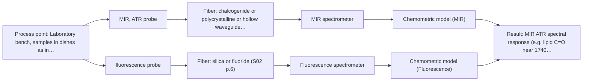
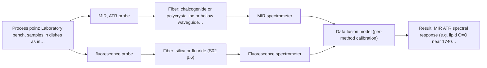

# First technical assessment: Local measurements of heterogeneous model tissues

## Answer

**Customer request (our summary):** The customer wants to compare MIR ATR and fluorescence methods using model biological tissues (chicken muscle, fat, and liver) for a laboratory classification study.

### Brief answer

Test MIR ATR first on labelled chicken muscle, fat and liver samples, then fluorescence alone at the same documented points; this directly answers your comparison question. If neither single method fully separates the classes, repeat key points with a combined ATR-fluorescence probe, which published work shows can separate these three tissues when single methods cannot. Open points: your class labels and reference method, the fluorescence excitation wavelength, and whether same-spot simultaneity is required.

### Proposal

- **Best current option:** O2 (recommended)
- **Basis:** supplied AFS sources
- **What would change it:** If the tissues do not fluoresce at the available excitation wavelength, the fluorescence channel (M2, M3) loses value and O1 becomes the focus. If same-spot simultaneous measurement is a hard requirement, the combined probe (O3) moves to the front.
- **Next step:** Run the single-method MIR ATR and fluorescence measurements on labelled chicken tissue samples with documented positions, then decide on the combined-probe test.

**Secondary evidence (external, not AFS material):** G1: E01 ¶31; G2: no usable external source found; G3: no usable external source found; G4: no usable external source found. See Expert detail.

**Decision status:** Provisional feasibility assessment

### Solution options

| ID | Tier | Methods | Confidence | Cost class, S01 Table 1 (p.6) | Ease of use | Maintenance | Performance fit | Sources |
|---|---|---|---|---|---|---|---|---|
| O1 | Simple | M1 MIR, ATR probe | Medium: open question: Q1, Q2 (starts at Medium) | high cost (row 2) | Single probe, straightforward contact measurement | Crystal cleaning and contact checks | Fits the MIR-first question but covers only one method | [1: S01 p.10] [2: S04 p.3] |
| O2 | Recommended | M1 MIR, ATR probe; M2 fluorescence probe | Low: open question: Q1, Q2 (starts at Medium); fit for soft solid to be tested, sample clarity unknown, fluorescent target unknown | high cost (rows 2, 19) | Two probes used sequentially on same points | Two instruments, separate calibrations | Directly answers the requested MIR-vs-fluorescence comparison | [1: S01 p.10] [2: S04 p.3] [3: S04 p.3] [4: S01 p.5] |
| O3 | Extended (multi-method) | M3 MIR, ATR probe + Fluorescence (combination) | Low: open question: Q1, Q2, Q3 (starts at Medium); fit for soft solid to be tested, sample clarity unknown, fluorescent target unknown; precedent only; multi-method, fusion benefit not yet shown | high cost (rows 2, 19) | Combined probe simplifies same-spot work | Two spectrometers, one probe head | Fits heterogeneous tissue where same-spot data is essential | [5: S04 p.3] [6: S04 p.1] [7: S04 p.4] |

*Confidence rates the basis of the advice (how much is known and cited), not a predicted accuracy or probability of success. It starts at High, or at Medium when a key question on the method or the option is open, and drops one level per weakness listed (floor Low).*

*Cost class is the relative rating in S01 Table 1 (p.6) for the in-line method+technique rows named (the highest one for a multi-method option); it is not a price.*

### Setup sketch

*Recommended option O2; drawn by code from the option, a schematic, not a configuration.*

### Key questions

1. What are the tissue classes to discriminate, and what independent reference (e.g. anatomical origin or histology) will serve as ground truth?
2. What is the optical regime (e.g. scattering, turbidity) of your tissue samples, and which fluorescence excitation wavelength is available?
3. Do you require truly simultaneous same-spot measurement, or is a sequential comparison on the same samples sufficient for this laboratory study?

## Expert detail

**Customer enquiry**

> Our research group is evaluating a spectral measurement interface using model biological tissues such as chicken muscle, fat and liver. We want to compare MIR ATR and fluorescence information, because the material is heterogeneous and sequential measurements may not sample the same location. This is a laboratory classification study. We need a first comparison experiment and a clear statement of what its results would demonstrate.

**Decision status:** Provisional feasibility assessment. A laboratory comparison of MIR ATR and fluorescence on chicken tissues is directly supported by a published precedent using the same tissues and a combined probe, so a method shortlist and a first experiment can be justified; clinical or in-vivo use is not supported by the supplied material.

### Parameters

| ID | Parameter | Kind | Need | Measured by | Why | Sources |
|---|---|---|---|---|---|---|
| P1 | Tissue class label | qualitative | required | Reference lab method: anatomical origin or histological classification | It is the classification target and the ground truth against which spectral discrimination is judged. | *(no verified source: engineering judgement)* |
| P2 | MIR ATR spectral response (e.g. lipid C=O near 1740 cm-1, protein amide bands) | quantitative | required | Spectroscopy: MIR | It is the MIR information content that the classification model and the comparison with fluorescence rest on. | [8: S04 p.3] |
| P3 | Fluorescence emission response (e.g. 613 nm porphyrin band) | quantitative | required | Spectroscopy: Fluorescence | It is the fluorescence information content needed to judge what the second method contributes. | [3: S04 p.3] |

### Solution option details

- **O1 cost drivers:** One FTIR spectrometer with ATR fiber probe, chemometric software, sample set
- **O2 cost drivers:** FTIR-ATR plus fluorescence spectrometer and probes, documented positions, chemometric analysis
- **O3 cost drivers:** Combined ATR-fluorescence probe, two spectrometers, data-fusion software
- **O3 combining methods:** Low-level fusion: synchronized MIR ATR and fluorescence spectra from the same probe spot are concatenated into one matrix, with block scaling so neither method dominates. Both channels must sample the same small area and be normalized to a common time step. The fused model must beat the best single method on held-out samples, otherwise the extra channel is dropped.

*Extended (multi-method) option O3; drawn by code from the option, a schematic, not a configuration.*

### Premise check

- **Supported:** Sequential measurements with separate probes may not sample the same location in heterogeneous tissue. The sources state that multispectral information must come from the same small area and that alternating two probes cannot guarantee this. [9: S01 p.8] [10: S01 p.8]
- **Precedent only:** Chicken muscle, fat and liver contain fluorescent components that fluorescence spectroscopy can measure. A published study measured exactly these three chicken tissue types with a combined ATR-fluorescence probe and found tissue-specific fluorescence (e.g. a 613 nm porphyrin band in liver); this is a reason to test, not a guarantee for the customer's samples. [11: S04 p.4] [3: S04 p.3]
- **Precedent only:** Combining MIR ATR and fluorescence can classify these tissue types better than either method alone. In the published chicken-tissue study, neither single technique fully separated the three classes while the fused data did; this supports testing the combination, but the gain must be confirmed on the customer's own samples. [12: S04 p.4] [7: S04 p.4]

### Requirements

**Stated by the customer**

- "model biological tissues such as chicken muscle, fat and liver"
- "the material is heterogeneous"
- "sequential measurements may not sample the same location"
- "compare MIR ATR and fluorescence information"
- *Further statements: see the customer enquiry above.*

**Key unknowns**

- Tissue class labels and the independent reference (e.g. histology or anatomical origin) used as ground truth
- Optical regime and scattering characteristics of the tissue samples
- Available fluorescence excitation wavelength and whether the tissues' fluorophores match it
- Whether same-spot simultaneous measurement is required, or sequential single-probe measurements are acceptable for this study
- Number of tissue samples and measurement points per class available for calibration and validation

### Clarification questions (most decision-relevant first)

Q1. What are the tissue classes to discriminate, and what independent reference (e.g. anatomical origin or histology) will serve as ground truth? *Why it matters:* The class labels and reference define the classification model and the go/no-go criteria for the comparison. *(affects: method, status)*
Q2. What is the optical regime (e.g. scattering, turbidity) of your tissue samples, and which fluorescence excitation wavelength is available? *Why it matters:* The optical regime and excitation wavelength determine whether fluorescence emission can be effectively excited and collected. *(affects: technique, method, M2)*
Q3. Do you require truly simultaneous same-spot measurement, or is a sequential comparison on the same samples sufficient for this laboratory study? *Why it matters:* A sequential study can use two separate probes; a same-spot requirement points to the combined ATR-fluorescence probe. *(affects: installation, M3)*
Q4. How many tissue samples and measurement points per class are available? *Why it matters:* The number of independent samples limits the chemometric model complexity and the validation that the results can support. *(affects: status)*

### Recommendation

- **M1 · Primary candidate: MIR, ATR probe.** MIR ATR is the method the customer named first, suits soft solids in contact with the crystal, and gave well-defined lipid and protein bands in the published chicken-tissue study. It is the strongest single method to test first. *Conditions:* Samples must allow tight contact with the ATR crystal; the crystal samples only a surface layer of a few micrometres. [1: S01 p.10] [2: S04 p.3]
- **M2 · Comparison candidate: fluorescence probe.** Fluorescence is the second method the customer named and showed tissue-specific contrast (e.g. liver porphyrins at 613 nm) in the same published study. Testing it alone establishes what it contributes before any fusion. *Conditions:* The tissues must contain fluorophores matching the available excitation wavelength; fluorescence has high sensitivity but low selectivity. [3: S04 p.3] [4: S01 p.5]
- **M3 · Conditional candidate: MIR, ATR probe + Fluorescence (combination).** A combined ATR-fluorescence probe measures both methods at the same point simultaneously, which addresses the customer's stated concern about sequential measurements on heterogeneous tissue. In the published chicken study only the fused data fully separated the three tissue classes. *Conditions:* Test this only after the single-method runs, and only if the tissues fluoresce at the available excitation and the single methods do not already separate the classes. [6: S04 p.1] [7: S04 p.4]

### Measurement concept

- **Probe and geometry:** MIR ATR fiber probe with the crystal tip in contact with the tissue surface; fluorescence fiber probe (or, later, a combined ATR+fluorescence probe) at the same measurement point.
- **Location:** Laboratory bench, samples in dishes as in the published chicken-tissue study.
- **Fiber link:** MIR ATR needs mid-IR-transmitting fibers (CIR or PIR); silica fibers carry the fluorescence channel. Actual cable lengths depend on the selected configuration and are not stated in the sources. [13: S02 p.6] [14: S04 p.2]

### Spectral range

- **MIR:** Nominal mid-IR range 4000-400 cm-1; the usable range depends on the selected instrument, fiber and probe. [15: S01 p.9]
- **Fluorescence:** Emission range depends on the fluorophores present and the excitation wavelength chosen; no fixed nominal range applies. [16: S01 p.12]

### Risks and uncertainty

- The ATR crystal samples only a surface layer of a few micrometres, so on heterogeneous tissue the MIR signal may represent a different volume than the fluorescence signal. *(rules: R-MIR-3)* [17: S01 p.13]
- If the tissues' fluorophores do not match the available excitation wavelength, the fluorescence channel may add little information. *(rules: R-FLU-1)* *(no verified source: engineering judgement)*
- The published chicken-tissue result is a laboratory precedent; the same class separation is not guaranteed on the customer's samples. *(rules: R-EVI-2)* [18: REF §3]
- With few samples per class, classification models risk overfitting unless validated on held-out samples or positions. *(no verified source: engineering judgement)*

### First feasibility experiment

1. **Collect representative samples of each tissue class (muscle, fat, liver) covering the expected biological variation, with several distributed measurement points per sample as in the published study.** Represent the chemical and morphological variation the classifier must handle. [19: S04 p.3]
2. **Record the independent reference label for every sample and point (anatomical origin or histology) before any spectral measurement.** Provide ground truth for classification. *(no verified source: engineering judgement)*
3. **Measure each point first with the MIR ATR probe alone, then with the fluorescence probe alone, keeping the measurement positions documented.** Establish each single method's discriminative power before any combination. *(no verified source: engineering judgement)*
4. **Build per-method PCA/PLS-DA models, then, only if the single methods do not fully separate the classes, repeat key measurements with the combined ATR-fluorescence probe and fuse the synchronized data.** Test whether the combination beats the best single method. [20: S04 p.4]
5. **Validate all models on held-out samples or held-out measurement positions, and agree go/no-go criteria (e.g. classification accuracy targets) with the customer in advance.** Give an honest basis for deciding whether the method, or the combination, is worth pursuing. [21: REF §3]

**Reference measurements:** Independent tissue class labels (anatomical origin or histology) for every sample and measurement point.

**Decision basis:** Agreed classification accuracy (sensitivity/specificity or correct-class rate) on held-out samples, defined with the customer before the experiment; the sources do not state a numeric target.

### Assumptions

- The study remains ex vivo laboratory work on model tissues; no clinical or in-vivo use is claimed or supported.
- The optical regime of the tissue samples is assumed to be turbid or scattering soft solid, suitable for ATR contact and fluorescence probe measurement.
- The customer can provide tissue class labels as independent reference.

### Not covered by the supplied sources

- Achievable cable length for the MIR ATR link in the customer's setup (only short laboratory MIR fiber samples are shown).
- Specific excitation wavelength and fluorescence spectrometer configuration available to the customer.

### Further notes

- **Chemometrics:** Start with unsupervised PCA per method and on fused data, as in the published chicken-tissue study, then move to supervised PLS-DA with validation on held-out samples or positions; with few samples, keep model complexity low and use permutation tests to check for overfitting.
- **Future direction:** If the laboratory classification succeeds, the same combined-probe concept has published precedents in tumor-margin and tissue-classification studies, which could motivate a later application study.

### Secondary evidence (external, not AFS material)

*Found by a literature search for gaps the supplied AFS sources leave open. Not AFS material and not proof for this case; every quote below was verified verbatim against the fetched text.*

*Live search unavailable (library only: cache miss (europepmc); cache miss (openalex)); curated library only.*

**G1 · multi-method:** Combining several spectroscopy methods (data fusion) (Low-level fusion: synchronized MIR ATR and fluorescence spectra from the same probe spot are concatenated into one matrix, with block scaling so neither method dominates. Both channels must sample the same small area and be normalized to a common time step. The fused model must beat the best single method on held-out samples, otherwise the extra channel is dropped.)

- **E01 ¶31** Low-level data fusion rearranges data into a new matrix by placing variables from different sources one after the other. *How it applies:* This approach could be tested to combine MIR ATR and fluorescence spectra, though instrument complementarity must be carefully evaluated first. *Limits and transfer risks:* The cited review discusses general PAT applications rather than the specific biological tissues and optical configurations of this study. *(supports O3)*
  > "Low-level data fusion (LLDF) is considered the simplest method to achieve a combination of inputs. In this case, the data is rearranged into a new data matrix, where the variables coming from different sources are placed one after the other."
  > Challenges and Opportunities of Implementing Data Fusion in Process Analytical Technology-A Review. (2022) · Molecules (Basel, Switzerland) · doi:10.3390/molecules27154846 · https://europepmc.org/article/PMC/PMC9369811 · retrieved 2026-10-17, full text, licence: cc by, via curated library

**G2 · not in the supplied sources:** Achievable cable length for the MIR ATR link in the customer's setup (only short laboratory MIR fiber samples are shown).

- No usable external source found.

**G3 · not in the supplied sources:** Specific excitation wavelength and fluorescence spectrometer configuration available to the customer.

- No usable external source found.

**G4 · parameter without a source:** Measuring Tissue class label: It is the classification target and the ground truth against which spectral discrimination is judged.

- No usable external source found.

### Evidence (verified quotes)

1. ✓ **S01 p.10** (general): "ATR fiber probes (Fig.1) enable the analysis of liquids and solid elastic samples"
2. ✓ **S04 p.3** (application precedent): "The discriminative power of mid-IR spectroscopy (Figure 2a and Figure S-4) toward rich in lipids fat samples is related to the stretching vibration band of the ester carbonyl C=O at about 1740 cm-1"
3. ✓ **S04 p.3** (application precedent): "The most selective peak at 613 nm, which can be assigned to porphyrins, has sufficient specificity to distinguish the liver from other measured samples."
4. ✓ **S01 p.5** (general): "However, most chemicals do not exhibit this property."
5. ✓ **S04 p.3** (application precedent): "the IR and fluorescence spectra rescaled to have intensities between 0 and 1 were fused into a single matrix X (45 × 823) with the augmented spectral axis"
6. ✓ **S04 p.1** (application precedent): "A multispectral fiber optic probe has been developed that enables simultaneous analysis of various liquid and solid samples using attenuated total reflection mid-infrared spectroscopy and fluorimetry."
7. ✓ (precedent only) **S04 p.4** (method gain): "the PCA model built on the concatenated IR and fluorescence data revealed three distinct groups of samples corresponding to tissue types"
8. ✓ **S04 p.3** (application precedent): "the stretching vibration band of the ester carbonyl C=O at about 1740 cm-1"
9. ✓ **S01 p.8** (general): "It is crucial that the spectral information obtained by different methods-Mid-IR, NIR, Raman, and fluorescence spectra-is collected from the same small, even pinpoint, area of the sample."
10. ✓ **S01 p.8** (general): "This is difficult to achieve by using two probes alternately for measurements."
11. ✓ **S04 p.4** (general): "it is limited to the samples containing at least one fluorescent component"
12. ✓ **S04 p.4** (application precedent): "none of the individual techniques was sufficient to completely separate the three sample classes on the PCA score plots"
13. ✓ **S02 p.6** (general): "1100 nm Chalcogenide As-S IR Fibers 6500 nm"
14. ✓ **S04 p.2** (general): "ZrO2 crystal was chosen due to its high (close to the diamond) refractive index, high transparency in the working spectral regions of both chalcogenide infrared (CIR) and UV silica fibers"
15. ✓ **S01 p.9** (general): "Vibrational spectroscopy in the mid-IR range (4000-400 cm-1) is one of the most informative methods of chemical analysis."
16. ✓ **S01 p.12** (general): "The fluorescence peak is shifted to longer wavelengths compared to the excitation radiation of the source (laser or LED)."
17. ✓ **S01 p.13** (general): "typically at a depth of few microns"
18. ✓ **REF §3** (general): "a published application is a reason to test a method, not proof that it will work for a new customer."
19. ✓ **S04 p.3** (application precedent): "Each sample was represented by five distributed points."
20. ✓ **S04 p.4** (application precedent): "The data preprocessing and analysis in this study were deliberately minimized to facilitate understanding of how complementary spectral information contributes into the joint multivariate model."
21. ✓ **REF §3** (general): "Representative samples or process states, independent reference measurements, what is compared, and the basis for the go / no-go decision."

### Verification

- Citations verified: 24 of 24 (exact or whitespace/hyphen-tolerant match on the cited page, scope checked).
- Hard check failures before deterministic corrections: 0; still open: 0; soft warnings: 1; repair rounds: 1.
- External evidence (cache): 1 quote(s) verified verbatim (exact or whitespace/hyphen-tolerant, at most 400 characters and 2 sentences, against the cited paragraph); 0 item(s) dropped.
- External search: 2 query(ies), 0 hit(s), 3 source(s) (3 from the curated library); ⚠ library only: cache miss (europepmc); cache miss (openalex).
- External step: 2 model call(s), 2.1 s extra (cost in the run JSON).

*Run D08-20261018T075900Z-f5f7 · models google/gemini-3.5-flash-lite, google/gemini-3.8-flash, z-ai/glm-5.3-flash*
