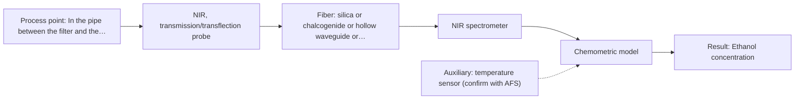
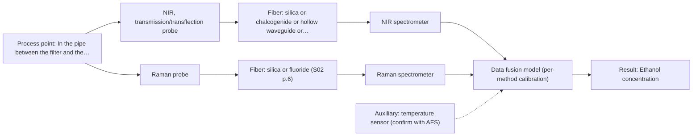

# First technical assessment

## Answer

**Customer request (our summary):** The customer wants to know which spectroscopic method and probe to test first for in-line monitoring of ethanol concentration in a clear aqueous fermentation broth flowing through a pipe.

### Brief answer

Test NIR transmission/transflection first: it is the preferred geometry for clear aqueous liquids and ethanol has strong NIR overtone bands, but it needs a controlled pathlength and a PLS calibration against your GC. Test a Raman probe in parallel as a comparison, since Raman tolerates water well. We still need your concentration range and accuracy target, process temperature, pipe mounting options, CIP requirements and the levels of sugars and other co-products.

### Proposal

- **Best current option:** O2 (recommended)
- **Basis:** supplied AFS sources
- **What would change it:** If the ethanol range demands sensitivity NIR cannot deliver, or the pipe only allows an immersion geometry with poor optical contact, Raman (O1) or MIR-ATR (M3) would move up; a demonstrated fusion gain would justify O3.
- **Next step:** Answer the concentration range, temperature and mounting questions, then run the multi-method lab trial on representative filtered broth samples with GC reference values.

**Secondary evidence (external, not AFS material):** G1: E01 ¶12; G2: E05 ¶15; G3: no usable external source found; G4: no usable external source found. See Expert detail.

**Decision status:** Provisional feasibility assessment

### Solution options

| ID | Tier | Methods | Confidence | Cost class, S01 Table 1 (p.6) | Ease of use | Maintenance | Performance fit | Sources |
|---|---|---|---|---|---|---|---|---|
| O1 | Simple | M2 Raman probe | Medium: open question: Q2 (starts at Medium) | high cost (row 12) | Simple probe, no flow cell needed | Low; occasional window cleaning | Fits aqueous clarity; selectivity must be verified | [1: S01 p.16] [2: S01 p.11] |
| O2 | Recommended | M1 NIR, transmission/transflection probe | Low: open question: Q1, Q2, Q3 (starts at Medium); uncited auxiliary sensor | average cost (row 7) | Standard NIR probe practice, straightforward | Window cleaning and periodic calibration checks | Preferred geometry for clear liquids with controlled pathlength | [3: S01 p.18] [4: S01 p.5] [5: S01 p.10] [6: S01 p.18] |
| O3 | Extended (multi-method) | M4 NIR, transmission/transflection probe + Raman (combination) | Low: open question: Q2 (starts at Medium); uncited auxiliary sensor; multi-method, fusion benefit not yet shown | high cost (rows 7, 12) | Two instruments to run and align | Each block needs its own calibration and diagnostics | Fits only if single methods miss part of the variance | [7: S01 p.15] [8: S01 p.8] [9: S01 p.9] [10: S01 p.15] [11: S01 p.8] |

*Confidence rates the basis of the advice (how much is known and cited), not a predicted accuracy or probability of success. It starts at High, or at Medium when a key question on the method or the option is open, and drops one level per weakness listed (floor Low).*

*Cost class is the relative rating in S01 Table 1 (p.6) for the in-line method+technique rows named (the highest one for a multi-method option); it is not a price.*

### Setup sketch

*Recommended option O2; drawn by code from the option, a schematic, not a configuration.*

### Key questions

1. What ethanol concentration range do you expect, and what accuracy do you need in-line?
2. What is the process temperature and how much does it vary?
3. How can the probe be mounted on the pipe: is a flow-through transmission cell possible, or only a probe inserted into the line, and what are the pipe dimensions?

## Expert detail

**Customer enquiry**

> We produce ethanol by fermentation. After filtration the broth is a clear, slightly yellow aqueous liquid that flows through a stainless steel pipe to a holding tank. We would like to follow the ethanol concentration in-line in that pipe instead of taking manual samples. Today we take samples a few times per shift and measure them by gas chromatography in our lab, so GC would be our reference method. Which spectroscopic method and probe would you suggest we test first, and what do you need to know from us?

**Decision status:** Provisional feasibility assessment. A clear aqueous liquid in a pipe is a good fit for NIR transmission/transflection, and GC is a suitable reference, but the concentration range, temperature and installation constraints are still open, so the recommendation is a shortlist to test rather than a final configuration.

### Parameters

| ID | Parameter | Kind | Need | Measured by | Why | Sources |
|---|---|---|---|---|---|---|
| P1 | Ethanol concentration | quantitative | required | Spectroscopy: NIR | It is the target variable the in-line model must predict. | *(no verified source: engineering judgement)* |
| P2 | Process temperature | quantitative | required | Auxiliary sensor: temperature sensor (engineering judgement: confirm availability with AFS) | Temperature variation shifts spectra and must be measured to be compensated or included in the calibration. | *(no verified source: engineering judgement)* |
| P3 | Co-fermentation components (residual sugars, glycerol, organic acids) | quantitative | optional | Reference lab method: GC (existing lab method) | They overlap ethanol bands in NIR and should be available (from GC or the fermentation records) to build a selective calibration. | *(no verified source: engineering judgement)* |

### Solution option details

- **O1 cost drivers:** Raman spectrometer and laser, probe, trial calibration effort
- **O2 cost drivers:** NIR spectrometer, transmission/transflection probe or flow cell, GC reference sampling, calibration development
- **O3 cost drivers:** Second spectrometer, synchronisation software, fused model development and validation
- **O3 combining methods:** Low-level fusion: synchronized NIR and Raman spectra merged into one augmented matrix, as in the published feed-frame example. Both probes must sample the same material at the same pipe location, with data normalised to a common time step. Each method keeps its own calibration, and the fused model must beat the best single method on held-out runs or it is dropped.

*Extended (multi-method) option O3; drawn by code from the option, a schematic, not a configuration.*

### Premise check

- **Supported:** A transmission/transflection geometry suits the clear liquid stream. The dairy example states transmission is preferred for transparent or semi-transparent liquids. [3: S01 p.18]
- **Precedent only:** In-line fiber-optic spectroscopy can replace periodic manual sampling for process follow-up. Published process applications such as tablet press feed-frame monitoring show that in-line probes track dynamic changes without interrupting production flow, serving as precedent rather than proof for this stream. [12: S01 p.15]

### Requirements

**Stated by the customer**

- Follow ethanol concentration in-line in the pipe after filtration
- Replace manual sampling a few times per shift
- GC as the reference method

**Key unknowns**

- Ethanol concentration range and required accuracy
- Process temperature and its variation
- Pipe access: flow-through cell vs immersion probe, and allowed pathlength
- Cleaning/sterilisation (CIP/SIP) and hygienic requirements
- Other components (residual sugars, glycerol, by-products) and how much they vary

### Clarification questions (most decision-relevant first)

Q1. What ethanol concentration range do you expect, and what accuracy do you need in-line? *Why it matters:* It sets the required pathlength and decides whether NIR sensitivity is sufficient. *(affects: technique, M1)*
Q2. What is the process temperature and how much does it vary? *Why it matters:* Temperature shifts affect NIR spectra and must be covered by the calibration or compensated. *(affects: method)*
Q3. How can the probe be mounted on the pipe: is a flow-through transmission cell possible, or only a probe inserted into the line, and what are the pipe dimensions? *Why it matters:* It determines the feasible measurement geometry and optical pathlength. *(affects: installation, M1)*
Q4. Are there CIP/SIP or hygienic requirements for the probe and window materials? *Why it matters:* Cleaning constraints restrict probe and window materials and the installation design. *(affects: installation)*
Q5. Which other components (residual sugars, glycerol, organic acids) are present and how do their concentrations vary over a run? *Why it matters:* Overlapping NIR bands mean these interferents must be included in the calibration model. *(affects: M1, M2)*

### Recommendation

- **M1 · Primary candidate: NIR, transmission/transflection probe.** The stream is a clear aqueous liquid, exactly the case where NIR transmission/transflection is the preferred geometry, and NIR suits remote fiber-probe online use. Ethanol has strong NIR overtone bands, but a chemometric calibration against GC is required. *Conditions:* Pathlength must be controlled (typically 1-10 mm in the analogous dairy case) and the calibration must cover temperature and co-fermentation components. [3: S01 p.18] [4: S01 p.5] [5: S01 p.10] [6: S01 p.18]
- **M2 · Comparison candidate: Raman probe.** Raman tolerates water well and gives sharper bands than NIR, so it is worth testing in parallel on the same samples as a simpler-to-interpret alternative. Its weak signal and possible fluorescence background from the broth must be checked on real samples. [1: S01 p.16] [2: S01 p.11]
- **M3 · Conditional candidate: MIR, ATR probe.** MIR-ATR gives well-resolved ethanol bands and is a proven in-line probe principle for liquids, but it samples only a surface layer of a few micrometres and needs tight contact, so fouling and representativeness are risks in a flowing pipe. *Conditions:* Test only if the NIR trial shows insufficient selectivity or accuracy, and if crystal fouling in the pipe can be managed. [13: S01 p.9] [14: S01 p.10] [15: S01 p.13]
- **M4 · Comparison candidate: NIR, transmission/transflection probe + Raman (combination).** If the single methods each capture part of the variance (e.g. ethanol plus interfering sugars), a fused NIR+Raman model is a later hypothesis, analogous to the published feed-frame blend potency case. It must beat the best single method to be kept. *Conditions:* Only after the single-method trials, and only if one method alone does not meet the accuracy target. [10: S01 p.15] [11: S01 p.8]
- **M5 · Not recommended: NIR, diffuse reflection probe.** Diffuse reflection is listed for powders and scattering media, not for a clear liquid, and reflection is less representative for clear liquids. A reader might expect it because reflection probes are common in-line, but it does not fit this stream. [16: S01 p.18]

### Measurement concept

- **Probe and geometry:** NIR transmission or transflection flow cell or probe in the stainless steel pipe after filtration, with a controlled optical pathlength; Raman probe tested in parallel as a comparison
- **Location:** In the pipe between the filter and the holding tank
- **Fiber link:** Vis-NIR silica fibers for NIR and Raman; the achievable link length depends on the selected fiber and is an open question for long runs [17: S01 p.18] [18: S02 p.7]

### Spectral range

- **NIR:** Nominal NIR range 780-2500 nm; the usable range depends on the spectrometer, fiber and probe actually selected. [19: S01 p.10]
- **Raman:** Raman shift in cm-1 with a stated laser excitation wavelength (e.g. 785 nm in the published pharma example); excitation choice affects fluorescence background. [20: S01 p.11] [21: S01 p.15]

### Risks and uncertainty

- Overlapping NIR bands from sugars, glycerol and other fermentation components could bias the ethanol calibration if they are not represented in the calibration set. *(rules: R-NIR-2, R-CAL-1)* [5: S01 p.10]
- Temperature variation in the pipe can shift NIR spectra and degrade the model if not covered by calibration or compensation. *(no verified source: engineering judgement)*
- Window fouling or bubble formation in the flow cell could corrupt transmission signals and require cleaning or mechanical safeguards. *(rules: R-MIR-3)* *(no verified source: engineering judgement)*
- If the slightly yellow broth or its components fluoresce strongly, the Raman comparison could be hampered by fluorescence background. *(rules: R-RAM-1)* [2: S01 p.11]

### First feasibility experiment

1. **Collect representative filtered broth samples across the expected variation in ethanol concentration, temperature and co-fermentation components over several runs.** Cover the calibration space the in-line model must handle. *(no verified source: engineering judgement)*
2. **Measure each sample with GC as the independent reference, using the customer's existing lab method.** Provide the response values for calibration and validation. *(no verified source: engineering judgement)*
3. **Record NIR transmission/transflection spectra at a controlled pathlength on the same samples, and Raman probe spectra in parallel as the comparison method.** Test the primary single method first and the comparison on identical samples. *(no verified source: engineering judgement)*
4. **Build a PLS calibration for ethanol on the NIR data (and Raman data separately), validate on held-out runs or batches, and only then test a fused NIR+Raman model against the best single method.** Single methods first; a combination must prove a gain before adding hardware. [7: S01 p.15]
5. **Define the go/no-go basis with the customer: the in-line prediction error on held-out runs must meet the accuracy they specify against GC before an in-line installation is designed.** Make the decision criterion explicit and customer-owned. [22: REF §3]

**Reference measurements:** Gas chromatography in the customer's laboratory, as stated in the enquiry.

**Decision basis:** Prediction accuracy on held-out runs/batches against GC, with the numerical criterion supplied by the customer (Q1).

### Assumptions

- The filtered broth remains optically clear and of similar composition across runs
- A probe or flow cell can be mounted in or on the pipe with reasonable access

### Not covered by the supplied sources

- Ethanol-specific detection limits or accuracy figures for NIR or Raman in fermentation broth
- Achievable MIR fiber link length for an in-line installation

### Further notes

- **Chemometrics:** A PLS regression against GC values is the expected model; the calibration set must span the ethanol range, temperature variation and the interfering components (P3), and validation should use held-out runs or batches rather than random splits of repeated measurements.
- **Real-time tracking:** Once calibrated, the in-line probe gives continuous ethanol tracking in the pipe, replacing the few-per-shift manual samples; diode-array type NIR analyzers allow fast full-spectrum acquisition for fast processes.
- **Future direction:** If the trial succeeds, a compact LED- or filter-based NIR sensor tuned to the informative ethanol wavelengths could later replace the full spectrometer for routine monitoring.

### Secondary evidence (external, not AFS material)

*Found by a literature search for gaps the supplied AFS sources leave open. Not AFS material and not proof for this case; every quote below was verified verbatim against the fetched text.*

**G1 · auxiliary sensor:** In-line measurement of Process temperature with temperature sensor

- **E01 ¶12** The source notes that the temperature sensitivity of the OH bands is a severe drawback for measuring aqueous solution in NIR and MIR, which makes tempered sample holders necessary. *How it applies:* This highlights the need to closely monitor or control process temperature during NIR testing to account for OH band shifts in aqueous solutions. *Limits and transfer risks:* The cited study addresses general aqueous solutions rather than an in-line flowing fermentation broth specifically. *(supports O2)*
  > "Additionally, the temperature sensitivity of the OH bands is a severe drawback for measuring aqueous solution in NIR and MIR, which makes tempered sample holders necessary [29]."
  > A critical review of recent trends, and a future perspective of optical spectroscopy as PAT in biopharmaceutical downstream processing. (2020) · Analytical and bioanalytical chemistry · doi:10.1007/s00216-020-02407-z · https://europepmc.org/article/PMC/PMC7072065 · retrieved 2026-10-17, full text, licence: cc by, via curated library

**G2 · multi-method:** Combining several spectroscopy methods (data fusion) (Low-level fusion: synchronized NIR and Raman spectra merged into one augmented matrix, as in the published feed-frame example. Both probes must sample the same material at the same pipe location, with data normalised to a common time step. Each method keeps its own calibration, and the fused model must beat the best single method on held-out runs or it is dropped.)

- **E05 ¶15** Data-level fusion involves the direct concatenation of minimally processed data from multiple modalities at the input layer to construct a unified input representation. *How it applies:* This supports testing low-level data fusion by merging synchronized spectral inputs into a single augmented matrix for multivariate modeling. *Limits and transfer risks:* Raw data often contain redundant or noisy signals that can degrade recognition accuracy if not properly addressed, and results from other food matrices may not transfer directly. *(supports O3)*
  > "Data-level fusion is defined as the integration of raw or minimally processed data from multiple modalities at the input layer to construct a unified input representation."
  > Food Intelligent Quality and Safety Analysis: From Data-Driven to Data-Mechanism Hybrid-Driven Paradigm. (2026) · Foods (Basel, Switzerland) · doi:10.3390/foods15173155 · https://europepmc.org/article/PMC/PMC13565232 · retrieved 2026-10-18, full text, licence: cc by, via europepmc

**G3 · not in the supplied sources:** Ethanol-specific detection limits or accuracy figures for NIR or Raman in fermentation broth

- No usable external source found.

**G4 · not in the supplied sources:** Achievable MIR fiber link length for an in-line installation

- No usable external source found.

### Evidence (verified quotes)

1. ✓ **S01 p.16** (general): "Raman is particularly well-suited for aqueous environments, as it exhibits low absorbance for water molecules compared to infrared methods."
2. ✓ **S01 p.11** (general): "superposition of luminescence (fluorescence), which has a significantly higher intensity."
3. ✓ **S01 p.18** (general): "Transmission is the preferred method for transparent or semi-transparent liquids, such as skim milk, whey, or permeate."
4. ✓ **S01 p.5** (general): "making it ideal for online applications, including remote measurements via fiber optic probes."
5. ✓ **S01 p.10** (general): "The broad absorption bands observed in this region overlap, suggesting the use of chemometrics for quantitative and qualitative analysis of spectral data."
6. ✓ **S01 p.18** (general): "the precise control of the optical pathlength (usually 1 - 10 mm); if the pathlength is too wide, the signal is lost to absorption; if too narrow, the sample represents a negligible volume."
7. ✓ **S01 p.15** (application precedent): "Data processing for pharmaceutical tasks relies on "low-level data fusion," where the synchronized NIR and Raman spectra are merged into a single augmented matrix."
8. ✓ **S01 p.8** (general): "collected from the same small, even pinpoint, area of the sample."
9. ✓ **S01 p.9** (general): "One of the challenges of multispectral analysis is the need to simultaneously connect at least two independently operating measuring instruments."
10. ✓ (precedent only) **S01 p.15** (method gain): "By combining Raman and NIR, these models can predict API potency or coating thickness with higher accuracy and robustness than single-method models."
11. ✓ **S01 p.8** (general): "Ultimately, the measurement data must be normalized to a common time step."
12. ✓ **S01 p.15** (application precedent): "As the powder blend passes the probe tip, the system captures spectra at high speeds without interrupting the production flow."
13. ✓ **S01 p.9** (general): "Vibrational spectroscopy in the mid-IR range (4000-400 cm-1) is one of the most informative methods of chemical analysis."
14. ✓ **S01 p.10** (general): "ATR fiber probes (Fig.1) enable the analysis of liquids and solid elastic samples"
15. ✓ **S01 p.13** (general): "typically at a depth of few microns"
16. ✓ **S01 p.18** (general): "reflection can work well in highly scattering environments but can be less representative for clear liquids."
17. ✓ **S01 p.18** (general): "The setup typically consists of a transmission / transflection probe, where light passes entirely through a defined layer of the sample to a detector on the opposite side."
18. ✓ **S02 p.7** (general): "Robust 100-300m cables made with Silica fibers of low OH-content (<0.1ppm OH) enable remote industrial process-control"
19. ✓ **S01 p.10** (general): "NIR spectra (780-2500 nm) contain predominantly overtones and component bands of fundamental vibrations"
20. ✓ **S01 p.11** (general): "The Raman shift is used as the horizontal (spectral) axis in Raman spectroscopy"
21. ✓ **S01 p.15** (general): "Raman spectrometer and Raman fiber probe for contact measurements with 785 nm excitation wavelength"
22. ✓ **REF §3** (general): "Representative samples or process states, independent reference measurements, what is compared, and the basis for the go / no-go decision."

### Verification

- Citations verified: 29 of 29 (exact or whitespace/hyphen-tolerant match on the cited page, scope checked).
- Hard check failures before deterministic corrections: 0; still open: 0; soft warnings: 2; repair rounds: 1.
- Corrected deterministically after verification (1):
  - ⚠ clarification_questions[1].affects: affects normalised to ['method']; dropped ['P2'] (not method, technique, installation, status, an M id or an O id)
- External evidence (live): 2 quote(s) verified verbatim (exact or whitespace/hyphen-tolerant, at most 400 characters and 2 sentences, against the cited paragraph); 0 item(s) dropped.
- External search: 4 query(ies), 20 hit(s), 5 source(s) (3 from the curated library).
- External step: 2 model call(s), 5.5 s extra (cost in the run JSON).

*Run adhoc-20261018T103823Z-e0e0 · models google/gemini-3.5-flash-lite, google/gemini-3.8-flash, z-ai/glm-5.3-flash*
