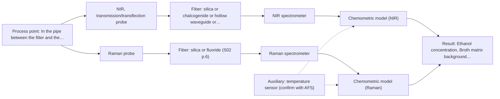
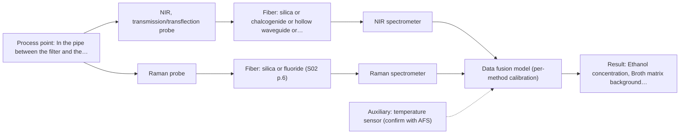

# First technical assessment

## Answer

**Customer request (our summary):** The customer wants to know which spectroscopic method and probe to test first for in-line monitoring of ethanol concentration in a filtered fermentation broth pipe.

### Brief answer

Test NIR transmission or transflection first: your clear, aqueous broth is exactly the sample type this geometry suits, and ethanol has strong NIR bands. Record bench spectra of grab samples across several batches with GC reference values and logged temperature between 28 and 36 °C, then validate on a held-out batch. Raman is a useful aqueous-tolerant comparison. Still open: your ethanol range, accuracy target, pipe access and cleaning requirements.

### Proposal

- **Best current option:** O2 (recommended)
- **Basis:** supplied AFS sources
- **What would change it:** If the ethanol range or required accuracy turns out to demand higher selectivity than NIR transmission delivers, MIR-ATR (M3) becomes the fallback; if NIR alone meets the target comfortably, the Raman comparison can be dropped and O1 suffices.
- **Next step:** Run the bench feasibility trial: NIR transmission spectra of grab samples across several batches with GC reference values and logged temperature, then validate on a held-out batch against your accuracy target.

**Secondary evidence (external, not AFS material):** G1: E02 ¶12; G2: E04 ¶15; G3: no usable external source found; G4: no usable external source found. See Expert detail.

**Decision status:** Provisional feasibility assessment

### Solution options

| ID | Tier | Methods | Confidence | Cost class, S01 Table 1 (p.6) | Ease of use | Maintenance | Performance fit | Sources |
|---|---|---|---|---|---|---|---|---|
| O1 | Simple | M1 NIR, transmission/transflection probe | Low: open question: Q1, Q3 (starts at Medium); uncited auxiliary sensor | average cost (row 7) | Standard NIR probe, straightforward bench trial | Low; occasional window cleaning | Directly targets ethanol in a clear liquid stream | [1: S01 p.18] [2: S01 p.18] [3: S01 p.5] |
| O2 | Recommended | M1 NIR, transmission/transflection probe; M2 Raman probe | Low: open question: Q1, Q3 (starts at Medium); uncited auxiliary sensor | high cost (rows 7, 12) | NIR routine; Raman needs background checks | Moderate; two probes to keep clean | Tests the best-fit NIR route with an aqueous-tolerant comparison before committing | [4: S01 p.16] [1: S01 p.18] [2: S01 p.18] [3: S01 p.5] [5: S01 p.11] |
| O3 | Extended (multi-method) | M4 NIR, transmission/transflection probe + Raman (combination) | Low: open question: Q1 (starts at Medium); precedent only; uncited auxiliary sensor; multi-method, fusion benefit not yet shown | high cost (rows 7, 12) | More complex; two instruments to run | Higher; each block needs its own calibration and diagnostics | Fusion may add robustness if single methods fall short | [6: S01 p.15] [7: S01 p.8] [8: S01 p.7] [9: S01 p.8] |

*Confidence rates the basis of the advice (how much is known and cited), not a predicted accuracy or probability of success. It starts at High, or at Medium when a key question on the method or the option is open, and drops one level per weakness listed (floor Low).*

*Cost class is the relative rating in S01 Table 1 (p.6) for the in-line method+technique rows named (the highest one for a multi-method option); it is not a price.*

### Setup sketch

*Recommended option O2; drawn by code from the option, a schematic, not a configuration.*

### Key questions

1. What ethanol concentration range must the in-line measurement cover, and what accuracy do you need compared to GC?
2. What are the pipe diameter, pressure and available access points, and can a flow-through cell or an insertion probe be mounted?
3. How is the pipe cleaned (CIP/SIP), and how much fouling or deposit formation do you see at the proposed measurement point?

## Expert detail

**Customer enquiry**

> We produce ethanol by fermentation. After filtration the broth is a clear, slightly yellow aqueous liquid that flows through a stainless steel pipe to a holding tank. We would like to follow the ethanol concentration in-line in that pipe instead of taking manual samples. Today we take samples a few times per shift and measure them by gas chromatography in our lab, so GC would be our reference method. Which spectroscopic method and probe would you suggest we test first, and what do you need to know from us?

Additional facts from the customer (answers and added details):
- What is the process temperature and how much does it vary? Answer: About 32 °C; it varies between 28 and 36 °C during a batch.

**Decision status:** Provisional feasibility assessment. A clear, aqueous fermentation broth in a pipe is a good fit for NIR transmission or transflection measurement, and ethanol is a known NIR analyte, so a method shortlist can be justified; the concentration range, accuracy target and pipe access still need to be confirmed.

### Parameters

| ID | Parameter | Kind | Need | Measured by | Why | Sources |
|---|---|---|---|---|---|---|
| P1 | Ethanol concentration | quantitative | required | Spectroscopy: NIR | It is the target variable the in-line model must predict. | *(no verified source: engineering judgement)* |
| P2 | Sample temperature | quantitative | required | Auxiliary sensor: temperature sensor (engineering judgement: confirm availability with AFS) | The swing between 28 and 36 °C affects NIR spectra and must be included in or compensated by the calibration. | *(no verified source: engineering judgement)* |
| P3 | Ethanol reference value by GC | quantitative | required | Reference lab method: gas chromatography | Independent laboratory GC values are needed to calibrate and validate the spectral model. | *(no verified source: engineering judgement)* |
| P4 | Broth matrix background (residual sugars, color, other metabolites) | qualitative | optional | Spectroscopy: NIR | Matrix variation between batches should be known to build a calibration set that covers it; it should be available from process records. | *(no verified source: engineering judgement)* |

### Solution option details

- **O1 cost drivers:** One NIR spectrometer, transmission/transflection probe, silica fiber link, calibration samples and GC reference work
- **O2 cost drivers:** NIR and Raman spectrometers, two probes, fiber links, broader calibration set and GC reference work
- **O3 cost drivers:** Two spectrometers and probes, synchronisation software, fused-model development and validation
- **O3 combining methods:** Low-level fusion: synchronized NIR and Raman spectra merged into one augmented matrix for a PLS model, as in the published feed-frame example. Both probes must sample the same material at the same time, with data normalized to a common time step and block scaling so neither method dominates. The fused model must beat the best single method on held-out batches, otherwise the extra instrument should be dropped.

*Extended (multi-method) option O3; drawn by code from the option, a schematic, not a configuration.*

### Premise check

- **Supported:** A clear aqueous liquid is suitably measured by NIR transmission or transflection. The dairy example in the sources states transmission is preferred for transparent or semi-transparent liquids, with a controlled pathlength. [1: S01 p.18]
- **Precedent only:** In-line fiber-optic monitoring of ethanol-like analytes in a process pipe is feasible. The sources show NIR fiber-probe monitoring of liquid process streams in dairy PAT; this is a reason to test, not proof for this customer's broth. [10: S01 p.17] [11: S01 p.18]

### Requirements

**Stated by the customer**

- Follow ethanol concentration in-line in the pipe after filtration, replacing grab samples measured by laboratory GC.
- Reference method: laboratory gas chromatography.
- Process temperature about 32 °C, varying between 28 and 36 °C during a batch.

**Key unknowns**

- Ethanol concentration range to be covered
- Required accuracy and update rate for process control
- Pipe geometry and available optical access (flow cell vs insertion probe)
- Cleaning requirements (CIP) and fouling risk at the measurement point
- Whether the broth matrix varies between batches (residual sugars, color)

### Clarification questions (most decision-relevant first)

Q1. What ethanol concentration range must the in-line measurement cover, and what accuracy do you need compared to GC? *Why it matters:* The range and accuracy decide whether NIR transmission can meet the target and how the calibration must be built. *(affects: method, M1)*
Q2. What are the pipe diameter, pressure and available access points, and can a flow-through cell or an insertion probe be mounted? *Why it matters:* The installation geometry determines the probe type and the achievable pathlength. *(affects: installation)*
Q3. How is the pipe cleaned (CIP/SIP), and how much fouling or deposit formation do you see at the proposed measurement point? *Why it matters:* Fouling on optical surfaces degrades any in-line measurement and drives probe and maintenance choices. *(affects: installation, M1)*
Q4. How much do the broth matrix components (residual sugars, color, other metabolites) vary between batches? *Why it matters:* NIR calibrations are matrix-specific, so batch-to-batch variation determines how broad the calibration set must be. *(affects: M1, M2)*
Q5. How quickly do you need a new ethanol result (update rate), and is the value used for control or only for monitoring? *Why it matters:* Update rate and use case influence the choice between full-spectrum NIR and simpler sensor approaches. *(affects: method, status)*

### Recommendation

- **M1 · Primary candidate: NIR, transmission/transflection probe.** The broth is a clear aqueous liquid, exactly the case where NIR transmission or transflection is preferred, and NIR suits remote fiber-probe measurement in pipes. A chemometric calibration against GC is the natural first test. *Conditions:* Pathlength must be controlled (typically 1-10 mm for aqueous streams) and temperature variation between 28 and 36 °C must be included in the calibration or compensated. [1: S01 p.18] [2: S01 p.18] [3: S01 p.5]
- **M2 · Comparison candidate: Raman probe.** Raman tolerates water well and gives a direct molecular fingerprint of ethanol, making it a useful second single method to compare against NIR on the same samples. Its weak signal and possible fluorescence background must be checked on the real broth. [4: S01 p.16] [5: S01 p.11]
- **M3 · Conditional candidate: MIR, ATR probe.** MIR-ATR fiber probes are used for in-line liquid analysis and give well-resolved ethanol bands, but ATR samples only a few micrometres of surface layer and needs tight contact, so it is worth testing mainly if NIR selectivity against the broth matrix proves insufficient. *Conditions:* Test only if the NIR calibration cannot separate ethanol from the matrix, and after checking fouling and fiber-link length, since no source states an achievable MIR fiber length for this installation. [12: S01 p.10] [13: S01 p.13]
- **M4 · Comparison candidate: NIR, transmission/transflection probe + Raman (combination).** If the single methods each capture part of the ethanol and matrix information, a fused NIR + Raman model may predict better than either alone; this is a published pattern for liquid process streams but remains a hypothesis here. *Conditions:* Only after the single-method tests, and only if the fused model demonstrably beats the best single method on held-out batches. [8: S01 p.7] [9: S01 p.8]
- **M5 · Not recommended: NIR, diffuse reflection probe.** Diffuse reflection is listed for powders and scattering media, not for a clear liquid, and reflection is less representative for clear liquids. It would also be more sensitive to surface effects than to bulk ethanol concentration. [14: S01 p.18]

### Measurement concept

- **Probe and geometry:** NIR transmission or transflection flow cell or insertion probe in the stainless steel pipe after filtration, with a controlled optical pathlength; Raman comparison via a Raman fiber probe at the same sampling point.
- **Location:** In the pipe between the filter and the holding tank, at a point with representative, well-mixed flow.
- **Fiber link:** Vis-NIR silica fibers cover the NIR range; metal-coated low-OH silica cables avoid polymer-jacket fluorescence and support long remote links, but the actual usable range and length depend on the selected configuration. [15: S02 p.6] [16: S02 p.7] [17: S02 p.7]

### Spectral range

- **NIR:** Nominal NIR method range 780-2500 nm; the usable range depends on the spectrometer, fiber and probe actually selected. [18: S01 p.10]
- **Raman:** Raman is reported as Raman shift in cm-1 with the laser excitation wavelength stated separately (e.g. 785 nm in the source example); the exact range depends on the chosen laser and spectrometer. [19: S01 p.11] [20: S01 p.15]

### Risks and uncertainty

- The temperature swing between 28 and 36 °C shifts NIR band positions and intensities, so temperature must be measured and included in the calibration or compensated. *(no verified source: engineering judgement)*
- NIR calibrations are matrix-specific, so changes in residual sugars, color or other metabolites between batches can degrade the ethanol model until the calibration set covers that variation. *(rules: R-CAL-1)* [21: REF §5]
- Fouling or deposits on the optical surfaces in the pipe would bias both transmission and ATR readings and must be checked at the real measurement point. *(rules: R-MIR-3)* [22: REF §5]
- If the pipe section is not well mixed or the probe samples only part of the flow, the reading may not represent the bulk ethanol concentration. *(rules: R-GEN-5)* [23: S01 p.7]

### First feasibility experiment

1. **Collect grab samples across several batches covering the full ethanol range and the expected matrix variation (sugars, color, temperature between 28 and 36 °C).** Representative calibration and test material. *(no verified source: engineering judgement)*
2. **Measure each sample by your laboratory GC as the independent reference for ethanol concentration.** Reference values for calibration and validation. *(no verified source: engineering judgement)*
3. **Record NIR transmission/transflection spectra on the bench with a controlled pathlength, logging sample temperature; optionally record Raman spectra of the same samples as the comparison method.** Single-method data first, per the plan. *(no verified source: engineering judgement)*
4. **Build a PLS calibration for ethanol and validate it on held-out samples or a later batch not used in calibration.** Estimate real prediction accuracy against GC. *(no verified source: engineering judgement)*
5. **Go/no-go: the customer defines the required accuracy versus GC; proceed to an in-line probe trial only if the held-out validation meets that target across the temperature range.** Decision basis before hardware investment. *(no verified source: engineering judgement)*

**Reference measurements:** Laboratory gas chromatography on every calibration and validation sample.

**Decision basis:** Held-out prediction error versus GC must meet the customer's stated accuracy target over the full concentration range and between 28 and 36 °C.

### Assumptions

- The filtered broth remains optically clear and of similar composition to the grab samples used for calibration.
- A representative sampling point with well-mixed flow exists in the pipe.
- The GC method quantifies ethanol with accuracy adequate as a reference.

### Not covered by the supplied sources

- Achievable in-line accuracy for ethanol in a fermented broth with the offered equipment
- Suitable pathlength for this specific broth at the stated ethanol range
- Cleaning and fouling behaviour of the probes in this particular pipe

### Further notes

- **Chemometrics:** A PLS regression model against GC reference values is the expected route for NIR ethanol quantification; the calibration set must span the ethanol range, the temperature variation between 28 and 36 °C and the expected batch-to-batch matrix variation, and validation should use held-out batches.
- **Real-time tracking:** Once calibrated, the in-line probe can track ethanol continuously during the batch, replacing grab sampling; diode-array NIR analyzers allow instantaneous full-spectrum acquisition, which suits fast process monitoring.
- **Future direction:** If the trial succeeds, a compact LED- or filter-based NIR sensor tuned to the informative ethanol wavelengths could be a lower-cost follow-up for routine operation.

### Secondary evidence (external, not AFS material)

*Found by a literature search for gaps the supplied AFS sources leave open. Not AFS material and not proof for this case; every quote below was verified verbatim against the fetched text.*

**G1 · auxiliary sensor:** In-line measurement of Sample temperature with temperature sensor

- **E02 ¶12** The temperature sensitivity of the OH bands is a severe drawback for measuring aqueous solutions in NIR, which makes tempered sample holders necessary. *How it applies:* Temperature variations should be carefully monitored or controlled when measuring aqueous fermentation broths using NIR to avoid spectral shifts caused by water OH band sensitivity. *Limits and transfer risks:* The cited text discusses biopharmaceutical downstream processing samples in general laboratory or tempered holders rather than a stainless-steel in-line fermentation pipe. *(supports O2)*
  > "Additionally, the temperature sensitivity of the OH bands is a severe drawback for measuring aqueous solution in NIR and MIR, which makes tempered sample holders necessary [29]."
  > A critical review of recent trends, and a future perspective of optical spectroscopy as PAT in biopharmaceutical downstream processing. (2020) · Analytical and bioanalytical chemistry · doi:10.1007/s00216-020-02407-z · https://europepmc.org/article/PMC/PMC7072065 · retrieved 2026-10-17, full text, licence: cc by, via curated library

**G2 · multi-method:** Combining several spectroscopy methods (data fusion) (Low-level fusion: synchronized NIR and Raman spectra merged into one augmented matrix for a PLS model, as in the published feed-frame example. Both probes must sample the same material at the same time, with data normalized to a common time step and block scaling so neither method dominates. The fused model must beat the best single method on held-out batches, otherwise the extra instrument should be dropped.)

- **E04 ¶15** Data-level fusion involves the direct concatenation of multimodal data followed by intelligent learning algorithms, though raw data can contain redundant or noisy signals that might degrade accuracy if not addressed. *How it applies:* When testing low-level data fusion of NIR and Raman spectra, preprocessing should be evaluated to remove noise and redundancies before concatenating the matrices into a unified model input. *Limits and transfer risks:* This source discusses multimodal fusion for food safety analyses rather than continuous pipe monitoring of ethanol in fermentation broths. *(supports O3)*
  > "Data-level fusion is defined as the integration of raw or minimally processed data from multiple modalities at the input layer to construct a unified input representation. In the context of multimodal data fusion, this approach typically involves the direct concatenation of multimodal data, followed by the application of intelligent learning algorithms for downstream computational tasks."
  > Food Intelligent Quality and Safety Analysis: From Data-Driven to Data-Mechanism Hybrid-Driven Paradigm. (2026) · Foods (Basel, Switzerland) · doi:10.3390/foods15173155 · https://europepmc.org/article/PMC/PMC13565232 · retrieved 2026-10-18, full text, licence: cc by, via europepmc

**G3 · not in the supplied sources:** Achievable in-line accuracy for ethanol in a fermented broth with the offered equipment

- No usable external source found.

**G4 · not in the supplied sources:** Suitable pathlength for this specific broth at the stated ethanol range

- No usable external source found.

### Evidence (verified quotes)

1. ✓ **S01 p.18** (general): "Transmission is the preferred method for transparent or semi-transparent liquids, such as skim milk, whey, or permeate."
2. ✓ **S01 p.18** (general): "the precise control of the optical pathlength (usually 1 - 10 mm); if the pathlength is too wide, the signal is lost to absorption; if too narrow, the sample represents a negligible volume."
3. ✓ **S01 p.5** (general): "making it ideal for online applications, including remote measurements via fiber optic probes."
4. ✓ **S01 p.16** (general): "Raman is particularly well-suited for aqueous environments, as it exhibits low absorbance for water molecules compared to infrared methods."
5. ✓ **S01 p.11** (general): "superposition of luminescence (fluorescence), which has a significantly higher intensity."
6. ✓ (precedent only) **S01 p.15** (method gain): "Data processing for pharmaceutical tasks relies on "low-level data fusion," where the synchronized NIR and Raman spectra are merged into a single augmented matrix."
7. ✓ (precedent only) **S01 p.8** (method gain): "Ultimately, the measurement data must be normalized to a common time step."
8. ✓ (precedent only) **S01 p.7** (method gain): "The analysis of such systems may require a combination of two or even more spectral methods."
9. ✓ (precedent only) **S01 p.8** (method gain): "the data from each method must be obtained simultaneously."
10. ✓ **S01 p.17** (application precedent): "The use of Near-Infrared (NIR) spectroscopy for the inline monitoring of milk is a cornerstone of modern dairy "Process Analytical Technology" (PAT)."
11. ✓ **S01 p.18** (application precedent): "NIR Transmission is the preferred method for transparent or semi-transparent liquids"
12. ✓ **S01 p.10** (general): "ATR fiber probes (Fig.1) enable the analysis of liquids and solid elastic samples"
13. ✓ **S01 p.13** (general): "typically at a depth of few microns"
14. ✓ **S01 p.18** (general): "reflection can work well in highly scattering environments but can be less representative for clear liquids."
15. ✓ **S02 p.6** (general): "350 nm Standard VIS-NIR Silica Fibers Al/Cu-coated VIS-NIR Silica Fibers 2400 nm"
16. ✓ **S02 p.7** (general): "Robust 100-300m cables made with Silica fibers of low OH-content (<0.1ppm OH) enable remote industrial process-control"
17. ✓ **S02 p.7** (general): "Free of Polymer jacket fluorescence for Raman and Fluo- Spectroscopy"
18. ✓ **S01 p.10** (general): "NIR spectra (780-2500 nm) contain predominantly overtones and component bands of fundamental vibrations"
19. ✓ **S01 p.11** (general): "The Raman shift is used as the horizontal (spectral) axis in Raman spectroscopy"
20. ✓ **S01 p.15** (application precedent): "785 nm excitation wavelength"
21. ✓ **REF §5** (general): "physical variation; calibration specific to the matrix."
22. ✓ **REF §5** (general): "Usable range limited by fiber and crystal; contact, fouling, compatibility."
23. ✓ **S01 p.7** (general): "Morphological factors, such as sample inhomogeneity (e.g., biological tissue) or process turbulence, must also be considered when selecting a measurement technique."

### Verification

- Citations verified: 26 of 26 (exact or whitespace/hyphen-tolerant match on the cited page, scope checked).
- Hard check failures before deterministic corrections: 0; still open: 0; soft warnings: 5; repair rounds: 1.
- External evidence (live): 2 quote(s) verified verbatim (exact or whitespace/hyphen-tolerant, at most 400 characters and 2 sentences, against the cited paragraph); 0 item(s) dropped.
- External search: 4 query(ies), 20 hit(s), 5 source(s) (3 from the curated library).
- External step: 2 model call(s), 10.4 s extra (cost in the run JSON).

*Run adhoc-20261018T104143Z-1683 · models google/gemini-3.5-flash-lite, google/gemini-3.8-flash, z-ai/glm-5.3-flash*
